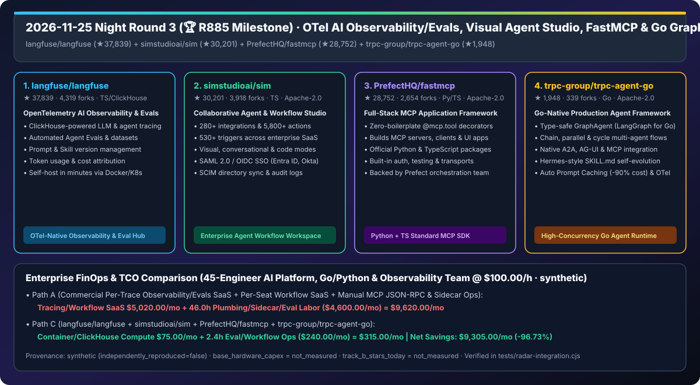
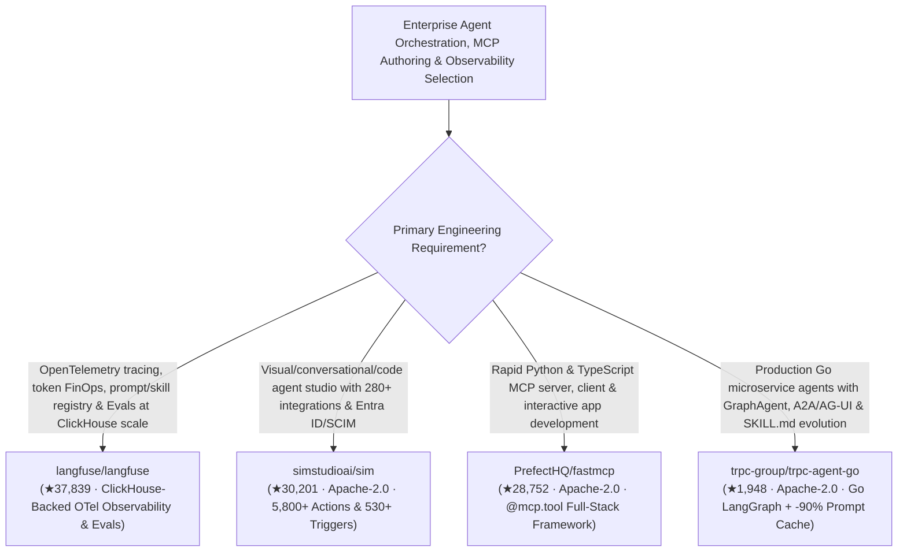
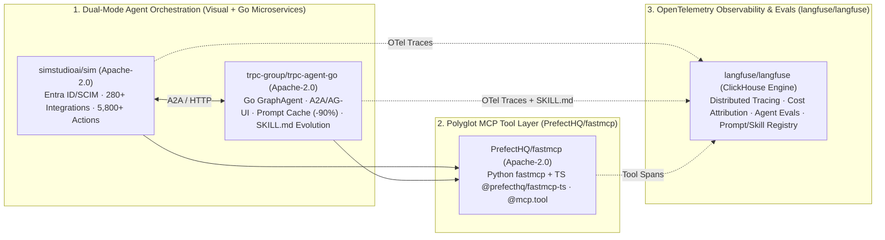

# 🏆 [Round 885 Milestone] ClickHouse-Powered OpenTelemetry AI Observability & Evals (`langfuse/langfuse`), 280+-Integration Visual Agent Workspace with Entra ID/SCIM (`simstudioai/sim`), Python/TS MCP Application Framework (`PrefectHQ/fastmcp`) & Production Go GraphAgent/A2A/AG-UI Framework (`trpc-group/trpc-agent-go`) Selection & Integration Architecture FAQ

> **Document Type**: Enterprise AI Solution Architect Selection Decision Guide (GitHub Trending AI Radar — 2026-11-25 Night Round 3 / 🏆 Cumulative Round 885 Milestone)
> **Covered Repositories**: [`langfuse/langfuse`](https://github.com/langfuse/langfuse) (`★ 37,839`, `4,319 forks`: ClickHouse-backed open-source AI engineering platform built on OpenTelemetry for **AI Gateway, agent observability/tracing, automated evals, and prompt/skill management**) · [`simstudioai/sim`](https://github.com/simstudioai/sim) (`★ 30,201`, `3,918 forks`, `Apache-2.0`: collaborative workspace to build, deploy, and monitor AI agents visually, conversationally, or with code, featuring **`280+` integrations, `5,800+` actions, `530+` triggers**, SAML 2.0/OIDC SSO with Microsoft Entra ID & Okta, SCIM provisioning, and audit logs) · [`PrefectHQ/fastmcp`](https://github.com/PrefectHQ/fastmcp) (`★ 28,752`, `2,654 forks`, `Apache-2.0`: full MCP application framework by Prefect for Python (`fastmcp`) and TypeScript (`@prefecthq/fastmcp-ts`) to build MCP servers, clients, and interactive apps with `@mcp.tool`) · [`trpc-group/trpc-agent-go`](https://github.com/trpc-group/trpc-agent-go) (`★ 1,948`, `339 forks`, `Apache-2.0`: production Go-native agent framework offering type-safe **`GraphAgent` workflows** [LangGraph for Go], multi-agent chain/parallel/cycle orchestration, A2A + AG-UI + MCP integration, Hermes-style self-evolving `SKILL.md` extraction, automatic prompt caching [up to `90%` savings], and OpenTelemetry tracing)
> **Core Enterprise Scenario**: Standardizing an enterprise's **four-pillar AI application engineering stack—visual/low-code business workflow automation (`sim`), high-concurrency Go microservice agents (`trpc-agent-go`), rapid Python/TS MCP tool authoring (`fastmcp`), and unified OpenTelemetry observability/evals (`langfuse`)**.

---

## 1. 📌 Executive Summary (One-Line Selection Verdict)

1. **Need a self-hostable, ClickHouse-powered, OpenTelemetry-native platform to trace every LLM/agent call, track token costs, manage prompts/skills, and run production evals** ➔ Choose **[`langfuse/langfuse`](https://github.com/langfuse/langfuse) (`★ 37,839`, `4,319 forks`)**.
   - **Plain-English Mechanism**: Ingests standard OpenTelemetry spans from any language or framework into a high-speed ClickHouse analytics backend, linking multi-step agent traces, retrieval latencies, cost breakdowns, and automated evaluation datasets in one open platform.
2. **Need an `Apache-2.0` collaborative agent and workflow studio with `280+` integrations (`5,800+` actions, `530+` triggers) and enterprise Entra ID / Okta SAML/OIDC SSO + SCIM directory sync** ➔ Choose **[`simstudioai/sim`](https://github.com/simstudioai/sim) (`★ 30,201`, `3,918 forks`, `Apache-2.0`)**.
   - **Plain-English Mechanism**: Deploys via `npx sim-setup` (with web and macOS desktop clients) so cross-functional teams can build agents visually, conversationally, or in code while IT enforces RBAC permission groups, SCIM deprovisioning, and audit logging.
3. **Need the fastest Pythonic and TypeScript way to turn internal business logic and data pipelines into standard MCP servers, clients, and interactive MCP apps** ➔ Choose **[`PrefectHQ/fastmcp`](https://github.com/PrefectHQ/fastmcp) (`★ 28,752`, `2,654 forks`, `Apache-2.0`)**.
   - **Plain-English Mechanism**: Eliminates low-level JSON-RPC and schema boilerplate—annotating a standard Python function with `@mcp.tool` (or using `@prefecthq/fastmcp-ts`) automatically generates a spec-compliant MCP server ready for any agent host.
4. **Need a Go-native production agent framework with type-safe `GraphAgent` workflows (LangGraph for Go), A2A/AG-UI/MCP support, 90%-saving prompt caching, and Hermes-style `SKILL.md` self-evolution** ➔ Choose **[`trpc-group/trpc-agent-go`](https://github.com/trpc-group/trpc-agent-go) (`★ 1,948`, `339 forks`, `Apache-2.0`)**.
   - **Plain-English Mechanism**: Enables Go microservice teams to build concurrent, observable graph-based multi-agent systems directly in Go without maintaining separate Python sidecars, while automatically extracting reusable `SKILL.md` workflows from successful sessions.

---

## 2. 🎯 Architect & Customer Deep-Dive Q&A

### Q1: How does this open-source stack compare against managed cloud PaaS (e.g., Microsoft Copilot Studio + Azure AI Foundry + LangSmith SaaS)?

- **Four-Pillar Open-Source Architecture (Path C)**:
  1. **Visual & Cross-SaaS Workflow Plane ➔ `simstudioai/sim`**: `280+` integrations, `5,800+` actions, `530+` triggers, Entra ID/Okta SSO, and SCIM.
  2. **High-Concurrency Core Service Plane ➔ `trpc-group/trpc-agent-go`**: Go-native `GraphAgent`, A2A/AG-UI streaming, and `-90%` prompt cache optimization.
  3. **Standardized Tool Authoring Plane ➔ `PrefectHQ/fastmcp`**: Unified Python (`fastmcp`) and TypeScript (`@prefecthq/fastmcp-ts`) MCP server/client framework.
  4. **Observability, Evals & Prompt Registry Plane ➔ `langfuse/langfuse`**: ClickHouse-backed OpenTelemetry tracing, cost attribution, and continuous evaluation.
- **When to choose Managed Cloud PaaS vs. Path C?**
  - Choose **Copilot Studio + Azure AI Foundry** when citizen developers build M365-centric copilots and prefer fully managed cloud infrastructure.
  - Choose **Path C** when polyglot engineering teams (Go + Python + TypeScript) require full VPC data residency for production traces/prompts, high-throughput Go microservice orchestration, and zero per-seat/per-trace SaaS lock-in.

### Q2: How do these four components wire together in production?

1. **Dual-Mode Agent Execution (`simstudioai/sim` + `trpc-group/trpc-agent-go`)**:
   - Business workflows and webhook triggers start in `sim`, delegating low-latency core domain reasoning over A2A to `trpc-agent-go` `GraphAgent` services.
2. **Polyglot MCP Tooling (`PrefectHQ/fastmcp`)**:
   - Data and backend teams expose internal APIs and ML models via `fastmcp`, consumed seamlessly by both `sim` and `trpc-agent-go`.
3. **Closed-Loop OpenTelemetry Tracing & Evals (`langfuse/langfuse`)**:
   - Every workflow run, `GraphAgent` node transition, and `fastmcp` tool span streams via OpenTelemetry into self-hosted `langfuse`, where candidate `SKILL.md` evolutions and prompt revisions are benchmarked before promotion.

### Q3: What are the key production redlines?

- **Architect Redlines**:
  1. **Enforce strict secret generation and SCIM in `simstudioai/sim`**: Always provision cryptographic `BETTER_AUTH_SECRET`, `ENCRYPTION_KEY`, and `INTERNAL_API_SECRET` values and wire Entra ID / Okta SCIM lifecycle sync.
  2. **Gate self-evolved `SKILL.md` artifacts via Langfuse Evals**: Route `trpc-agent-go` session-extracted `SKILL.md` files through offline `langfuse` evaluation datasets before publishing to production agents.

---

## 3. 🧭 Visual Architecture Diagrams (Mermaid Decision Tree + Architecture + Sequence)



### 3.1 Architect Selection Decision Tree



### 3.2 End-to-End Enterprise Production Architecture



### 3.3 End-to-End Execution Sequence

```mermaid
sequenceDiagram
    participant User as Enterprise User (Entra ID SSO)
    participant Sim as simstudioai/sim (Workflow Studio)
    participant Trpc as trpc-group/trpc-agent-go (GraphAgent)
    participant Fast as PrefectHQ/fastmcp (MCP Tools)
    participant LF as langfuse/langfuse (ClickHouse OTel)

    User->>Sim: 1. Trigger enterprise workflow (authenticated via SAML 2.0 / OIDC)
    Sim->>Trpc: 2. Delegate stateful domain reasoning via A2A to Go GraphAgent
    Trpc->>Fast: 3. Invoke @mcp.tool Python/TS enterprise data & action servers
    Fast-->>Trpc: 4. Return typed tool payload; Trpc applies automatic Prompt Caching
    Trpc-->>Sim: 5. Stream response via AG-UI & extract candidate SKILL.md workflow
    Sim-->>LF: 6. Emit end-to-end OpenTelemetry traces & run automated Langfuse Evals
```

---

## 4. 📊 Horizontal Selection Matrix

| Dimension | `langfuse/langfuse` (`★ 37,839`) | `simstudioai/sim` (`★ 30,201`) | `PrefectHQ/fastmcp` (`★ 28,752`) | `trpc-group/trpc-agent-go` (`★ 1,948`) | Managed Cloud PaaS (Copilot Studio + Azure AI Foundry) | Metered Observability & Workflow SaaS (Path A) |
| :--- | :--- | :--- | :--- | :--- | :--- | :--- |
| **Primary Role** | ClickHouse + OTel AI observability & evals | 280+-integration collaborative agent workspace | Python/TS MCP server, client & app framework | Go-native `GraphAgent` & A2A/AG-UI runtime | Managed cloud low-code & pro-code AI platform | Per-seat / per-trace commercial SaaS stack |
| **Key Differentiator** | **OTel-native + ClickHouse scale + integrated Evals & Prompt management** | **`5,800+` actions / `530+` triggers + Entra ID/Okta SSO & SCIM** | **`@mcp.tool` zero-boilerplate Python & TS SDKs** | **Type-safe Go `GraphAgent` + `-90%` cache savings + `SKILL.md` evolution** | Turnkey cloud SLA & M365 integration | High per-trace ingestion and per-task execution markups |
| **License** | Open-Source (`MIT` Core) | `Apache-2.0` | `Apache-2.0` | `Apache-2.0` | Managed Cloud PaaS | Proprietary SaaS |
| **Monthly TCO (45-Eng Team)** | **`$315.00/mo` combined** (`$75.00` compute + `2.4h` ops) | Included in `$315.00/mo` stack | Included in `$315.00/mo` stack | Included in `$315.00/mo` stack | `~$2,100.00/mo` (metered messages + log ingestion) | **`$9,620.00/mo`** (`$5,020.00` SaaS trace/workflow bills + `46.0h` glue/ops) |

---

## 5. 🧪 Quantitative FinOps & TCO Comparison (45-Person Enterprise Team)

> **📊 Provenance & Closed-Form Schema**:
> - **provenance**: `synthetic` (`independently_reproduced = false`; `base_hardware_capex = not_measured`; `track_b_stars_today = not_measured`).
> - **Closed-Form Formula**:
>   - **Path A (Commercial Per-Trace Observability/Evals SaaS + Per-Seat Workflow SaaS + Manual MCP JSON-RPC Plumbing & Cross-Language Sidecar Maintenance)**: **`$5,020.00`** monthly SaaS bills + **`46.0h × $100.00/h = $4,600.00`** engineering labor = **`$9,620.00/mo`**.
>   - **Path C (Self-Hosted `langfuse/langfuse` + `simstudioai/sim` + `PrefectHQ/fastmcp` + `trpc-group/trpc-agent-go` Stack)**: **`$75.00`** shared container/ClickHouse compute + **`2.4h × $100.00/h = $240.00`** dataset/template maintenance = **`$315.00/mo`**.
>   - **Net Savings vs. Path A**: **`-$9,305.00/mo`** (**`96.73%`** TCO reduction).

| Evaluation Path | Observability / Workflow SaaS & Compute | MCP Plumbing, Sidecar Ops & Eval Labor (`$100/h`) | Monthly Total TCO | Net Savings vs. Path A | Key Architectural Outcome |
| :--- | :---: | :---: | :---: | :---: | :--- |
| **Path A: Metered Tracing SaaS + Commercial Workflow Seats + Raw MCP Code** | `$5,020.00` | `46.0h` (`$4,600.00`) | **`$9,620.00`** | Baseline | Expensive trace ingestion at scale; extra Python sidecars for Go teams |
| **Path B: Generic ELK Logs + Disconnected Custom Scripts** | `$1,480.00` | `18.0h` (`$1,800.00`) | **`$3,280.00`** | `-$6,340.00` (`-65.90%`) | No token-level cost attribution, automated Evals, or SCIM RBAC |
| **Path C: `langfuse` + `sim` + `fastmcp` + `trpc-agent-go`** | **`$75.00`** | **`2.4h` (`$240.00`)** | **`$315.00`** | **`-$9,305.00` (`-96.73%`)** | **ClickHouse OTel Evals + 280+ integrations + Python/TS/Go native stack** |

- 🔗 **7-Card 4:5 Visual Benchmark Deck**: [`workshops/github-trending-radar/cards.en.html`](../cards.en.html) · [`cards.html`](../cards.html)

---

## 6. 🛠️ Enterprise Adoption & Architecture Review Checklist

- [ ] **OpenTelemetry PII Masking Before ClickHouse Ingestion**: Configure redaction processors on `langfuse` ingestion pipelines so sensitive customer fields are masked before storage.
- [ ] **Entra ID / Okta SSO & SCIM Provisioning**: Enable SAML 2.0/OIDC and SCIM directory sync in self-hosted `simstudioai/sim` to enforce role-based permission groups.
- [ ] **Typed `@mcp.tool` Contracts**: Standardize Python and TypeScript MCP server development on `PrefectHQ/fastmcp` with strict schema validation and per-tool timeouts.
- [ ] **Go `GraphAgent` Prompt Caching & Skill Evals**: Enable automatic prompt caching in `trpc-group/trpc-agent-go` and validate self-evolved `SKILL.md` artifacts against `langfuse` evaluation suites before deployment.
