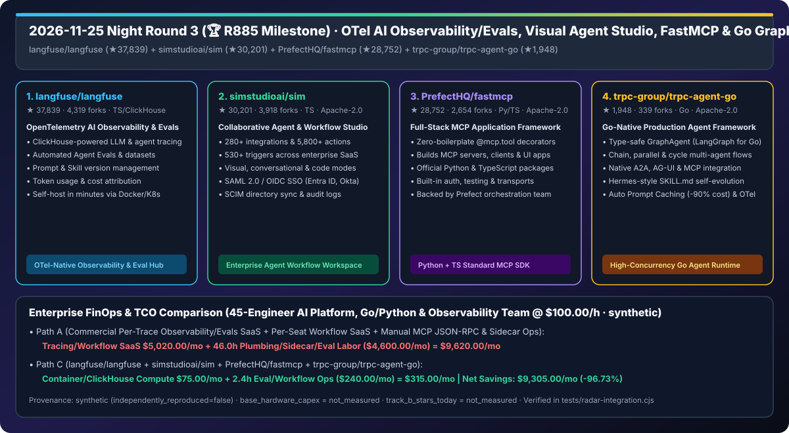
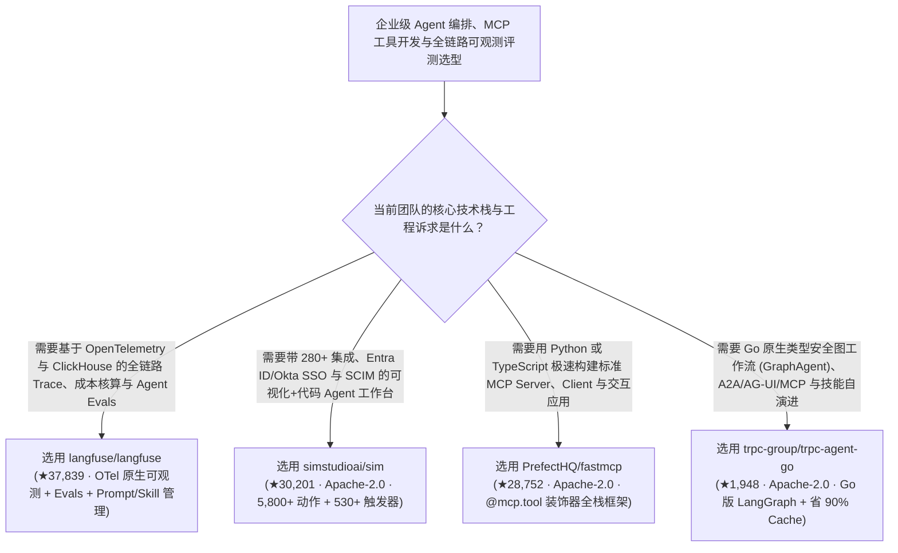
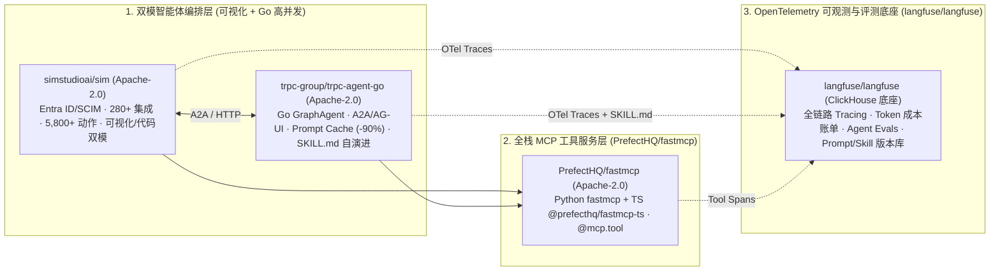
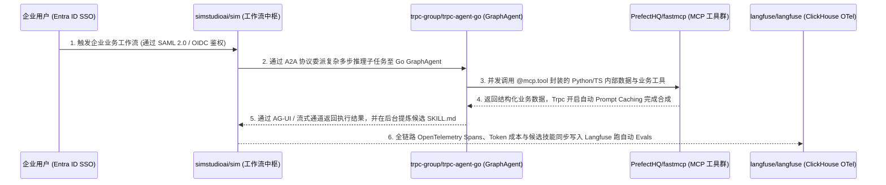

# 🏆【第 885 轮里程碑】ClickHouse 驱动的 OpenTelemetry AI 可观测与评测平台（`langfuse/langfuse`）、280+ 集成与 Entra ID/SCIM 企业级可视化 Agent 工作台（`simstudioai/sim`）、Python/TS 全栈 MCP 应用开发框架（`PrefectHQ/fastmcp`）与 Go 生产级图工作流及 A2A/AG-UI 智能体框架（`trpc-group/trpc-agent-go`）选型与集成架构 FAQ

> **文档类型**：企业 AI 解决方案架构师（AI Solution Architect）选型决策指南（GitHub Trending AI 雷达 2026-11-25 Night Round 3 / 🏆 累计第 885 轮里程碑）
> **覆盖项目**：[`langfuse/langfuse`](https://github.com/langfuse/langfuse)（`★ 37,839`、`4,319 forks`：由 ClickHouse 强力驱动的开源 AI 工程平台，基于 OpenTelemetry 统一承载企业级 **AI 可观测性（Tracing）、智能体评测（Agent Evals）、AI 网关及 Prompt/Skill 版本管理**，支持云托管与分钟级私有化部署）· [`simstudioai/sim`](https://github.com/simstudioai/sim)（`★ 30,201`、`3,918 forks`、`Apache-2.0`：被 10 万+ 开发者使用的企业级 AI 智能体与工作流协同平台，支持可视化画布、对话式与代码三种构建方式，内置 **`280+` 集成、`5,800+` 动作与 `530+` 触发器**，原生具备 Microsoft Entra ID / Okta SAML 2.0/OIDC 单点登录、SCIM 目录同步与权限组审计）· [`PrefectHQ/fastmcp`](https://github.com/PrefectHQ/fastmcp)（`★ 28,752`、`2,654 forks`、`Apache-2.0`：由数据编排大厂 Prefect 打造的 Python (`fastmcp`) 与 TypeScript (`@prefecthq/fastmcp-ts`) 全栈 MCP 应用框架，一行 `@mcp.tool` 装饰器即可将业务函数发布为标准 MCP Server、Client 与交互式应用）· [`trpc-group/trpc-agent-go`](https://github.com/trpc-group/trpc-agent-go)（`★ 1,948`、`339 forks`、`Apache-2.0`：面向高并发微服务架构的 Go 原生生产级智能体框架，提供对标 LangGraph 的类型安全 **`GraphAgent` 图工作流**、串行/并行/循环多智能体协同、A2A + AG-UI + MCP 全协议支持、Hermes 风格会话自演进 `SKILL.md` 提炼、自动 Prompt Caching（省 `90%` 缓存成本）及 OpenTelemetry 链路追踪）
> **核心场景**：当企业架构师规划全公司统一的 **“Agent 应用研发、可视化编排、MCP 工具开发与全链路可观测评测”** 四层技术标准时，常面临**“业务部门希望像搭积木一样连接 280+ 办公系统并对接企业 Entra ID/SCIM、Python 算法团队需要最快把内部模型能力包装成标准 MCP、高并发核心交易后端（Go 技术栈）苦于没有类似 Python LangGraph 的成熟图编排框架、以及线上 Agent 出了幻觉或延迟飙升却没有统一的 OpenTelemetry Trace 与自动化评测闭环”**四大选型难题。本文给出端到端参考架构及与 Azure AI Foundry / Copilot Studio / LangSmith 的横向对比。

---

## 一、📌 核心结论速览（选型一句话结论）

1. **需要一套可完全私有化部署、底层基于高性能 ClickHouse 与 OpenTelemetry 标准，统一管住全公司所有 LLM/Agent 调用链路追踪、成本核算、Prompt/Skill 版本与生产数据回流评测的工程底座** ➔ 选 **[`langfuse/langfuse`](https://github.com/langfuse/langfuse)（`★ 37,839`，`4,319 forks`）**。
   - **通俗原理**：只要在应用里接入标准 OpenTelemetry 或 `@langfuse/core` / `langfuse` SDK，每一次大模型生成、向量检索、MCP 工具调用的耗时、Token 账单与输入输出都会实时写入 ClickHouse 列式引擎；既能在线回放定位多跳 Agent 的哪一步出错，又能把线上真实坏例一键转为测试集跑自动化 Evals。
2. **需要为业务开发团队与跨部门创新小组提供一套带 `280+` 预置集成（`5,800+` 动作 / `530+` 触发器）、支持 Entra ID / Okta SSO 与 SCIM 自动账号同步的可视化/代码双模工作流平台** ➔ 选 **[`simstudioai/sim`](https://github.com/simstudioai/sim)（`★ 30,201`，`3,918 forks`，`Apache-2.0`）**。
   - **通俗原理**：一条 `npx sim-setup` 命令即可在企业内网拉起完整工作台（也支持 macOS 桌面客户端直连自托管实例）。业务专家可以用可视化画布拖拽或对话式搭建连接 Slack、Salesforce、HubSpot、Notion 与知识库的自动化工作流，而平台团队可通过 SAML 2.0/OIDC、SCIM 部门同步与细粒度审计日志守住企业安全边界。
3. **需要让 Python 数据科学团队与 TypeScript 全栈团队用最少样板代码开发、测试并交付生产级 MCP Server、MCP Client 与交互式 MCP 应用** ➔ 选 **[`PrefectHQ/fastmcp`](https://github.com/PrefectHQ/fastmcp)（`★ 28,752`，`2,654 forks`，`Apache-2.0`）**。
   - **通俗原理**：手写底层 MCP JSON-RPC 协议、Schema 序列化与生命周期管理既繁琐又容易出错。`FastMCP` 就像 MCP 界的 FastAPI：给普通 Python 函数加上 `@mcp.tool` 和类型注解，几行代码就能生成带类型校验、依赖注入、认证中间件与交互式视图的标准 MCP 服务，且同时提供 Python 与 TypeScript 官方包。
4. **企业核心后端采用 Go 语言微服务架构，需要一套原生支持类型安全图工作流（Go 版 LangGraph）、A2A 跨智能体通信、AG-UI 前端流式交互、MCP 工具调用与会话自进化提取 `SKILL.md` 的生产级框架** ➔ 选 **[`trpc-group/trpc-agent-go`](https://github.com/trpc-group/trpc-agent-go)（`★ 1,948`，`339 forks`，`Apache-2.0`）**。
   - **通俗原理**：无需为了写复杂 Agent 被迫在 Go 微服务集群旁额外部署一套难维护的 Python Sidecar。`trpc-agent-go` 原生提供支持多条件路由的 **`GraphAgent`**、支持串行/并行/循环的多 Agent 协作、开箱即用的 A2A/AG-UI/MCP 协议栈、省下 `90%` 重复上下文成本的自动 Prompt Caching，还能在会话结束后像 Hermes 一样自动复盘提炼可复用的 `SKILL.md` 技能文件。

---

## 二、🎯 客户与架构师灵魂拷问 Q&A（深度架构拆解）

### Q1：在企业构建“AI 应用工厂”时，这四个开源项目 vs 云厂商全托管 PaaS（如 Microsoft Copilot Studio + Azure AI Foundry Tracing/Evals + LangSmith）怎么选？

- **四层协同参考架构（开源自托管 Path C）**：
  1. **业务敏捷编排与连接面 ➔ `simstudioai/sim`**：面向跨部门业务流程自动化，复用 `280+` 集成与 Entra ID/SCIM 权限体系。
  2. **高并发核心微服务智能体面 ➔ `trpc-group/trpc-agent-go`**：面向低延迟、高并发核心业务后端，用 Go 原生 `GraphAgent` 与 A2A/AG-UI 承载复杂有状态编排。
  3. **标准化 MCP 工具研发面 ➔ `PrefectHQ/fastmcp`**：统一 Python 与 TypeScript 团队封装内部数据与算法工具的开发规范。
  4. **全链路可观测、Prompt/Skill 治理与评测面 ➔ `langfuse/langfuse`**：基于 OpenTelemetry 与 ClickHouse 统一采集 `sim`、`trpc-agent-go` 与 `fastmcp` 的全链路 Trace 与评测得分。
- **何时选云厂商托管方案（Azure AI Foundry + Copilot Studio + Application Insights） vs 自建本轮开源四件套（Path C）？**
  - 若企业完全运行在 Azure 公有云上，且团队以低代码 Power Platform 公民开发者为主，直接采用 **Microsoft Copilot Studio + Azure AI Foundry (内置 OpenTelemetry 追踪与云端安全评测)** 最快。
  - 若企业拥有**大规模 Go / Python / TypeScript 工程团队**、每月 Trace 日志量达数千万条（商业 SaaS 按 Trace 条数或席位计费极高）、或者合规要求 Prompt、生产对话与评测数据 100% 留存在企业自有 VPC 内，采用本轮开源四件套（Path C）可节省 **96%+** 的可观测与工作流平台软件许可支出。

### Q2：如何将这四个项目端到端串联进企业生产架构？

1. **双轨智能体编排层（`simstudioai/sim` + `trpc-group/trpc-agent-go`）**：
   - 办公协同、CRM/工单流转等场景由 `simstudioai/sim` 通过 `530+` 触发器驱动；高并发核心交易、实时风控与 AG-UI 流式交互场景由 `trpc-group/trpc-agent-go` 的 `GraphAgent` 承载，两者通过标准 A2A 协议与 HTTP/gRPC 互通。
2. **统一 MCP 工具服务层（`PrefectHQ/fastmcp`）**：
   - 算法与数据团队使用 `fastmcp`（Python）与 `@prefecthq/fastmcp-ts`（TypeScript）将内部特征库、报表查询与业务操作封装为标准 MCP Server，供 `sim` 与 `trpc-agent-go` 统一调用。
3. **统一可观测、Prompt/Skill 仓库与评测底座（`langfuse/langfuse`）**：
   - `sim`、`trpc-agent-go` 与 `fastmcp` 统一输出 OpenTelemetry Trace 至自托管 `langfuse`（ClickHouse 引擎）；同时 `trpc-agent-go` 自演进提炼出的优质 `SKILL.md` 与 Prompt 模板纳入 `langfuse` 版本控制，触发自动化回归评测（Evals）。

### Q3：这套架构在企业落地时有哪些关键注意事项？

- **架构师落地红线**：
  1. **`simstudioai/sim` 生产密钥强校验**：自托管部署 `sim` 时，必须按官方安全规范生成高强度 `BETTER_AUTH_SECRET`、`ENCRYPTION_KEY`、`INTERNAL_API_SECRET` 与 `CRON_SECRET`，并启用 SAML 2.0 / OIDC 与 SCIM 自动离职销户同步。
  2. **`trpc-agent-go` 自演进技能的人工/评测门禁**：开启 `trpc-agent-go` 的会话复盘自演进（Self-Evolution）生成 `SKILL.md` 时，必须经过 `langfuse` 离线评测集校验与安全审核后才能发布至生产技能库，严禁未经验证直接热加载。

---

## 三、🧭 直观可视化图解（Mermaid 决策树 + 集成架构 + 时序图）

### 3.1 架构师选型决策树

### 3.2 企业端到端生产集成参考架构图

### 3.3 端到端工作流触发、Go 图编排、FastMCP 工具调用与 Langfuse 评测闭环时序图

---

## 四、📊 同类开源与商业云服务横向选型决策矩阵

| 对比维度 | `langfuse/langfuse` (`★ 37,839`) | `simstudioai/sim` (`★ 30,201`) | `PrefectHQ/fastmcp` (`★ 28,752`) | `trpc-group/trpc-agent-go` (`★ 1,948`) | 云厂商托管 PaaS（Copilot Studio + Azure AI Foundry） | 商业按量计费 Observability + 闭源自动化 SaaS (Path A) |
| :--- | :--- | :--- | :--- | :--- | :--- | :--- |
| **核心架构定位** | ClickHouse + OTel 开源 AI 可观测与评测平台 | 280+ 集成企业级可视化/代码 Agent 工作台 | Python + TS 标准 MCP 应用开发框架 | Go 原生生产级 `GraphAgent` 与 A2A/AG-UI 框架 | 全托管低代码智能体与云原生开发套件 | 按 Trace 条数与工作流步数高价计费的商业 SaaS |
| **差异化杀手锏** | **OpenTelemetry 原生 + ClickHouse 亿级 Trace 秒查 + Evals** | **`5,800+` 动作 / `530+` 触发器 + Entra ID/Okta SSO & SCIM** | **`@mcp.tool` 极简声明式构建 Server/Client/App** | **Go 版类型安全 LangGraph + 技能自演进 + `-90%` 缓存优化** | 免运维 SLA、深度绑定 M365 生态 | 高并发下 Trace 存储与自动化执行账单呈指数级膨胀 |
| **开源协议** | Open-Source (`MIT` Core) | `Apache-2.0` | `Apache-2.0` | `Apache-2.0` | 商业云服务 | 闭源商业 SaaS |
| **月度 TCO（45 人团队）** | **四件套合建仅 `$315.00/月`**（`$75.00` 容器/ClickHouse 算力 + `2.4h` 维护） | 同左（`Apache-2.0` 零席位税自托管） | 同左（消除手写协议样板代码） | 同左（Go 高并发单实例极低内存开销） | 约 `$2,100.00/月`（按消息包与日志摄取量计费） | **`$9,620.00/月`**（`$5,020.00` 商业 Trace/Evals 与工作流席位 + `46.0h` 胶水开发与排障） |

---

## 五、🧪 应用落地定量收益/TCO 对比与 7-Card 报告

> **📊 数据来源与闭式核算声明（Provenance & Closed-Form Schema）**：
> - **provenance**: `synthetic`（基于 45 人企业 AI 工程、Go/Python 后端与平台可观测团队月度工作负载模型：`independently_reproduced = false`；硬件采购基线 `base_hardware_capex = not_measured`；Track B 单日增量 `track_b_stars_today = not_measured`）。
> - **核算公式**：
>   - **Path A（采购按席位/按量计费的商业 LLM Tracing/Evals SaaS + 商业工作流自动化 SaaS 席位 + 工程师手写底层 MCP JSON-RPC 样板与维护跨语言 Python Sidecar）**：月度商业可观测与工作流 SaaS 账单 **`$5,020.00`** + 协议手写、跨语言排障与人工回归评测工时 **`46.0h × $100.00/h = $4,600.00`** = **`$9,620.00/月`**。
>   - **Path C（自建 `langfuse/langfuse` + `simstudioai/sim` + `PrefectHQ/fastmcp` + `trpc-group/trpc-agent-go` 全栈生产底座）**：共享容器与 ClickHouse 存储分摊 **`$75.00`** + 评测集与工作流模板日常维护人工 **`2.4h × $100.00/h = $240.00`** = **`$315.00/月`**。
>   - **净节省（Net Savings vs Path A）**：**`-$9,305.00/月`**（成本降低 **`96.73%`**）。

| 评估方案 | 可观测 / 工作流 SaaS 订阅与算力成本 | MCP 开发、跨语言维护与评测人工（`$100/h`） | 月度总 TCO | 相对 Path A 净节省 | 核心架构交付收益 |
| :--- | :---: | :---: | :---: | :---: | :--- |
| **Path A：商业 Tracing/Evals SaaS + 商业自动化席位 + 手写 MCP 协议** | `$5,020.00` | `46.0h` (`$4,600.00`) | **`$9,620.00`** | Baseline | 海量 Trace 按条计费高昂；Go 团队被迫额外维护 Python 编排层 |
| **Path B：通用日志 ELK 拼凑 + 手写单点脚本无统一工作台** | `$1,480.00` | `18.0h` (`$1,800.00`) | **`$3,280.00`** | `-$6,340.00` (`-65.90%`) | 缺乏 Token 级成本归因与自动化 Evals；无 SSO/SCIM 权限治理 |
| **Path C：`langfuse` + `sim` + `fastmcp` + `trpc-agent-go`** | **`$75.00`** | **`2.4h` (`$240.00`)** | **`$315.00`** | **`-$9,305.00` (`-96.73%`)** | **OTel+ClickHouse 评测闭环 + 280+ 集成工作台 + Go/Py/TS 全栈原生** |

- 🔗 **关联 7-Card 4:5 视觉评测报告**：[`workshops/github-trending-radar/cards.html`](../cards.html) · [`cards.en.html`](../cards.en.html)

---

## 六、🛠️ 企业引入与架构评审 Checklist

- [ ] **OpenTelemetry 全链路追踪与敏感字段脱敏**：在 `langfuse` 摄取端开启 PII 掩码规则，确保 `sim`、`trpc-agent-go` 与 `fastmcp` 上报的 Span 在落盘 ClickHouse 前完成客户手机号、身份证与密钥脱敏。
- [ ] **企业级 SSO 与 SCIM 自动权限回收**：自托管 `simstudioai/sim` 时，强制对接企业 Microsoft Entra ID 或 Okta 的 SAML 2.0/OIDC 与 SCIM 接口，确保员工转岗或离职时自动撤销工作流与连接器访问权限。
- [ ] **MCP 工具强类型契约与超时保护**：使用 `PrefectHQ/fastmcp` 封装内部服务时，为所有 `@mcp.tool` 参数声明完整 Pydantic/TypeScript 类型注解与显式超时阈值。
- [ ] **Go `GraphAgent` 缓存与自演进技能门禁**：在 `trpc-group/trpc-agent-go` 中开启自动 Prompt Caching（节省高达 90% 重复上下文成本），并将自演进生成的 `SKILL.md` 纳入 `langfuse` Evals 回归门禁。
