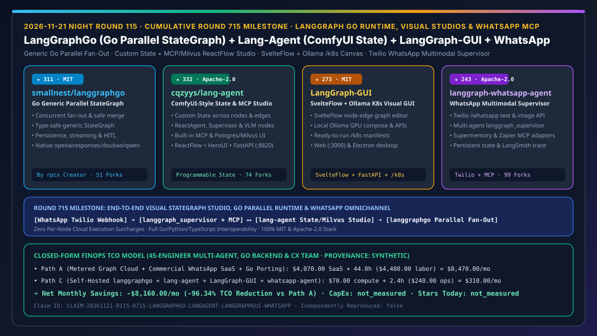
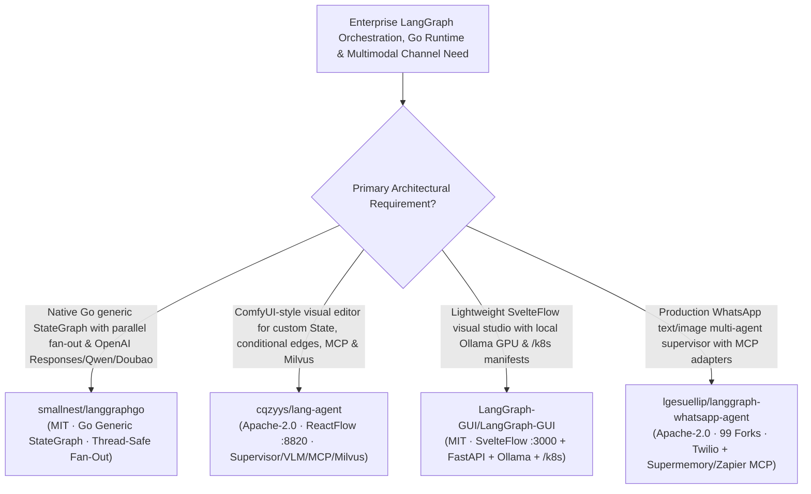
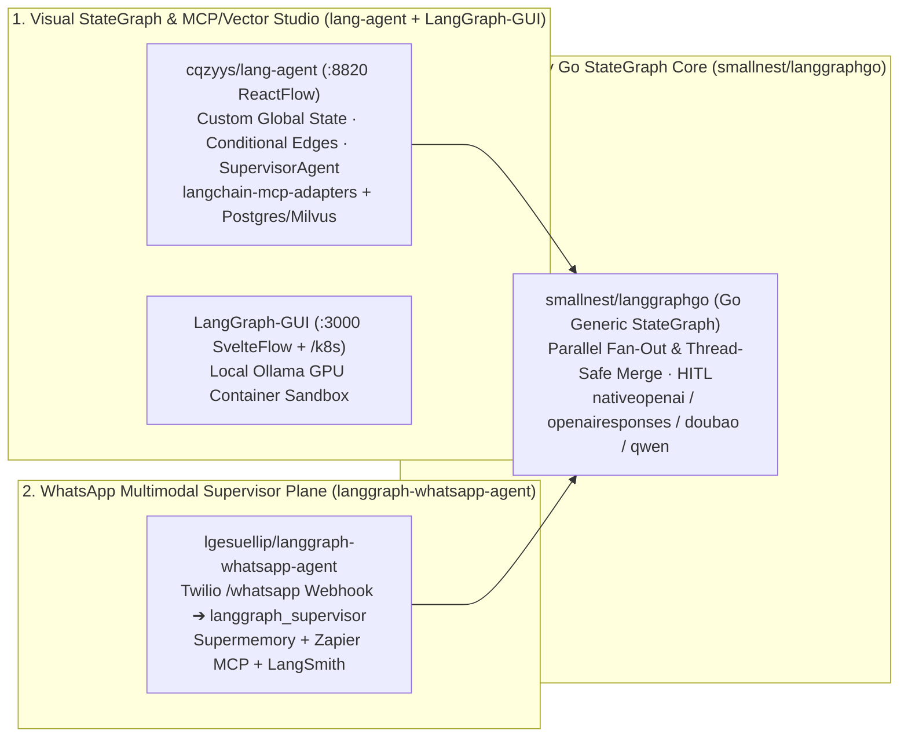
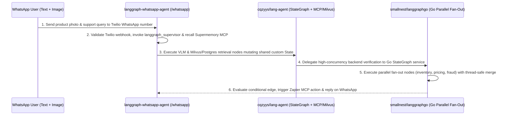

# [Round 715 Milestone] Go Generic Parallel StateGraph (`smallnest/langgraphgo`), ComfyUI-Style State & MCP/Milvus Studio (`cqzyys/lang-agent`), SvelteFlow + Ollama K8s Canvas (`LangGraph-GUI/LangGraph-GUI`) & WhatsApp Multimodal Supervisor Agent (`lgesuellip/langgraph-whatsapp-agent`) Selection & Architecture FAQ

> **Document Type**: Enterprise AI Solution Architect Selection & Integration Guide (GitHub Trending AI Radar — 2026-11-21 Night Round 115 / Cumulative Round 715 Milestone)
> **Covered Repositories**: [`smallnest/langgraphgo`](https://github.com/smallnest/langgraphgo) (`★ 311`, `51 forks`, `MIT` — Go generic `StateGraph` runtime with parallel fan-out, thread-safe state merging, HITL & native `openairesponses`/`doubao`/`qwen` providers by `rpcx` creator smallnest) · [`cqzyys/lang-agent`](https://github.com/cqzyys/lang-agent) (`★ 332`, `74 forks`, `Apache-2.0` — ComfyUI-style ReactFlow + FastAPI LangGraph configuration platform with custom global `State` variables, conditional edges, `ReactAgent`/`SupervisorAgent`/VLM nodes, MCP & Postgres/Milvus vector stores) · [`LangGraph-GUI/LangGraph-GUI`](https://github.com/LangGraph-GUI/LangGraph-GUI) (`★ 273`, `24 forks`, `MIT` — SvelteFlow + FastAPI visual node-edge editor with local Ollama GPU containers & `/k8s` manifests) · [`lgesuellip/langgraph-whatsapp-agent`](https://github.com/lgesuellip/langgraph-whatsapp-agent) (`★ 243`, `99 forks`, `Apache-2.0` — production WhatsApp multimodal supervisor agent template combining Twilio webhooks, `langgraph_supervisor` & `langchain-mcp-adapters`)
> **Core Scenario**: At our **Cumulative Round 715 Milestone**, we address the four most common enterprise LangGraph adoption challenges: **running type-safe parallel StateGraphs natively in Go microservices without Python overhead (`langgraphgo`)**, **exposing custom LangGraph `State` variables, conditional edges, MCP adapters, and Milvus/Postgres retrieval in a ComfyUI-style visual platform (`lang-agent`)**, **operating a Kubernetes/Ollama visual sandbox (`LangGraph-GUI`)**, and **connecting multimodal Supervisor + MCP graphs to WhatsApp customer channels (`langgraph-whatsapp-agent`)**.

---

## 1. 📌 Executive Summary (One-Line Selection Verdict)

1. **Need Python LangGraph feature parity in native Go—including generic type-safe `StateGraph`, parallel node fan-out with thread-safe state merging, persistence, HITL, and zero-dependency `openairesponses`/`doubao`/`qwen` providers** ➔ Choose **[`smallnest/langgraphgo`](https://github.com/smallnest/langgraphgo) (`★ 311`, `51 forks`, `MIT`)**.
   - **Plain-English Mechanism**: Maintained by `smallnest` (creator of `rpcx`, `go get github.com/smallnest/langgraphgo`), `lango` brings stateful cyclic graph orchestration to Go with concurrent fan-out execution, `RunnableConfig` metadata propagation, generic state structs, and native LLM providers (`nativeopenai`, `openairesponses`, `doubao`, `qwen`).
2. **Need a visual LangGraph platform (`ReactFlow + FastAPI`, `:8820`) designed like ComfyUI rather than rigid linear pipelines—supporting custom global `State` variables across nodes and conditional edges, `ReactAgent`/`SupervisorAgent`/VLM nodes, MCP servers, and Postgres/Milvus vector DBs** ➔ Choose **[`cqzyys/lang-agent`](https://github.com/cqzyys/lang-agent) (`★ 332`, `74 forks`, `Apache-2.0`)**.
   - **Plain-English Mechanism**: Unlike Dify or Coze where a node only reads the immediate predecessor's output, `lang-agent` lets architects define custom **LangGraph `State` variables** read and mutated by any node (`LLM`, `VLM`, `ReactAgent`, `SupervisorAgent`, `Vector Retrieval`) or conditional edge, with built-in UI tabs for **MCP configuration (`langchain-mcp-adapters`)** and **PostgreSQL / Milvus** vector stores.
3. **Need a lightweight SvelteFlow + FastAPI visual node-edge editor packaged with local `Ollama` GPU containers (`nv-docker`), Electron desktop support, and ready-to-apply `/k8s` Kubernetes manifests** ➔ Choose **[`LangGraph-GUI/LangGraph-GUI`](https://github.com/LangGraph-GUI/LangGraph-GUI) (`★ 273`, `24 forks`, `MIT`)**.
   - **Plain-English Mechanism**: Launches on `http://localhost:3000` via Docker Compose or Kubernetes (`/k8s`), pairing a responsive SvelteFlow graph editor with local Ollama or cloud API execution.
4. **Need a battle-tested (`99 forks`) production template for deploying multimodal (text + image) WhatsApp customer agents powered by `langgraph_supervisor`, Twilio webhooks, and MCP servers (`Supermemory`, `Zapier`)** ➔ Choose **[`lgesuellip/langgraph-whatsapp-agent`](https://github.com/lgesuellip/langgraph-whatsapp-agent) (`★ 243`, `99 forks`, `Apache-2.0`)**.
   - **Plain-English Mechanism**: Wires Twilio's WhatsApp API (`/whatsapp` webhook with request validation) into a multi-agent `langgraph_supervisor` topology equipped with `langchain-mcp-adapters` (connecting to `Supermemory` and `Zapier`'s thousands of SaaS actions), multimodal vision understanding, persistent conversation state, and LangSmith tracing.

---

## 2. 🎯 Architect & Customer Deep-Dive Q&A

### Q1: Why do linear workflow builders (Dify/Coze) and Python-only runtimes hit a wall on complex cyclic multi-agent state machines and high-concurrency Go backends?

- **Three Architectural Bottlenecks & LangGraph Ecosystem Solutions**:
  1. **Linear DAGs vs Stateful Cyclic Graphs (`cqzyys/lang-agent`)**: Cyclic reflection and multi-agent supervisor loops require mutating shared state fields across iterations and branching on conditional edges. `lang-agent` exposes LangGraph's native `State`, conditional edges, `SupervisorAgent`, VLM, MCP, and Postgres/Milvus directly in a ComfyUI-inspired ReactFlow canvas.
  2. **High-Concurrency Fan-Out in Go Microservices (`smallnest/langgraphgo`)**: Porting Python LangGraph prototypes into high-QPS Go backends usually forces teams to rewrite orchestration logic from scratch. `langgraphgo` provides generic `StateGraph` and thread-safe parallel fan-out natively in Go with built-in `openairesponses`, `doubao`, and `qwen` clients.
  3. **Production WhatsApp Multimodal & MCP Wiring (`lgesuellip/langgraph-whatsapp-agent`)**: `langgraph-whatsapp-agent` packages Twilio multimedia webhook validation, `langgraph_supervisor` routing, and `langchain-mcp-adapters` (`Supermemory` + `Zapier`) into a ready-to-fork blueprint.
- **When to Choose Managed Cloud Services (Path B)**:
  - If your team is 100% Python-based and prefers paying per-node execution and uptime fees for managed hosting, **LangGraph Platform (Cloud) + Twilio Studio** provides a managed cloud path.

### Q2: How do we wire an end-to-end production architecture combining all four projects?

1. **Visual StateGraph Authoring & MCP/Vector Binding (`cqzyys/lang-agent` + `LangGraph-GUI`)**:
   - Design stateful graphs with custom `State` schemas, conditional edges, VLM/Supervisor nodes, MCP tools, and Postgres/Milvus collections in `lang-agent` (`:8820`), while running offline local-LLM experiments in `LangGraph-GUI` (`:3000` on `/k8s` + `Ollama`).
2. **Omnichannel WhatsApp Multimodal Ingress (`lgesuellip/langgraph-whatsapp-agent`)**:
   - Receive customer text and images via `/whatsapp` Twilio webhooks, validate requests, and route turns through `langgraph_supervisor` with `Supermemory` and `Zapier` MCP tools.
3. **High-Throughput Go StateGraph Execution Core (`smallnest/langgraphgo`)**:
   - Execute latency-critical backend subgraphs and parallel fan-out checks in Go microservices using `smallnest/langgraphgo` (`StateGraph` + thread-safe merge + native `openairesponses`/`qwen`/`doubao`).

### Q3: What are the boundaries and trade-offs of this stack?

- **Key Strengths**:
  - **Zero Per-Node Execution Surcharges**: Self-hosting under **`MIT` & `Apache-2.0`** eliminates metered per-node cloud orchestration bills on multi-step cyclic graphs.
  - **Bridges Python, TypeScript (ReactFlow/SvelteFlow), and Go**.
- **When NOT to Use**:
  - Simple single-turn Q&A bots without conditional loops, shared state mutations, or multi-agent supervision do not need full StateGraph orchestration.

---

## 3. 🧭 Visual Architecture & Decision Diagrams

### 3.1 Solution Architect Selection Decision Tree

### 3.2 End-to-End Enterprise Reference Architecture

### 3.3 WhatsApp Multimodal Ingress, Supervisor Routing, State Mutation & Go Parallel Fan-Out Sequence

---

## 4. 📊 Peer Open-Source vs Commercial Cloud Selection Matrix

| Dimension | `smallnest/langgraphgo` (`★ 311`) | `cqzyys/lang-agent` (`★ 332`) | `LangGraph-GUI/LangGraph-GUI` (`★ 273`) | `lgesuellip/langgraph-whatsapp-agent` (`★ 243`) | Metered Graph Cloud + Commercial WhatsApp SaaS (Path A) | Cloud Low-Code Bot + Cloud Comms (Path B) |
| :--- | :--- | :--- | :--- | :--- | :--- | :--- |
| **Core Role** | Go generic parallel `StateGraph` runtime | ComfyUI-style `State` + MCP + Milvus platform | SvelteFlow + Ollama `/k8s` visual graph editor | Twilio WhatsApp multimodal Supervisor + MCP template | Hosted per-node graph cloud + commercial WhatsApp bot SaaS | Copilot Studio + Azure Communication Services |
| **Architectural Edge** | **Native Go fan-out + `openairesponses`/`doubao`/`qwen`** | **Custom `State` across nodes/edges + VLM/MCP/Milvus** | **Bundled Ollama GPU compose + `/k8s` manifests** | **99-fork blueprint with Twilio vision + Supermemory/Zapier MCP** | Per-node execution fees compound rapidly on cyclic graphs | Rigid dialogue trees lack cyclic `State` & Go fan-out |
| **License** | `MIT` | `Apache-2.0` | `MIT` | `Apache-2.0` | Proprietary SaaS | Proprietary Cloud PaaS |
| **Monthly TCO (45-Eng Team)** | **`$310.00/mo` combined** (`$70.00` compute + `2.4h` ops) | Included in `$310.00/mo` stack | Included in `$310.00/mo` stack | Included in `$310.00/mo` stack | **`$8,470.00/mo`** (`$4,070.00` node/SaaS fees + `44.0h` labor) | `~$2,690.00/mo` (session packs + cloud functions) |

---

## 5. 🧪 Quantitative ROI / FinOps TCO Model & 7-Card Report

> **📊 Provenance & Closed-Form Audit Declaration**:
> - **Provenance**: `synthetic` (45-engineer enterprise multi-agent orchestration, Go backend & omnichannel customer experience workload model; `independently_reproduced = false`; `base_hardware_capex = not_measured`; `track_b_stars_today = not_measured`).
> - **Closed-Form Equations**:
>   - **Path A (Commercial Metered Per-Node StateGraph Cloud + Commercial Multimodal WhatsApp Bot SaaS + Manual Python-to-Go Orchestration Porting & Custom Visual UI Maintenance)**: Monthly metered SaaS spend **`$4,070.00`** + Go porting & channel integration labor **`44.0h × $100.00/h = $4,400.00`** = **`$8,470.00/mo`**.
>   - **Path C (Self-Hosted `smallnest/langgraphgo` + `cqzyys/lang-agent` + `LangGraph-GUI/LangGraph-GUI` + `lgesuellip/langgraph-whatsapp-agent`)**: Shared container & vector DB compute **`$70.00`** + graph template & webhook maintenance **`2.4h × $100.00/h = $240.00`** = **`$310.00/mo`**.
>   - **Net Savings vs Path A**: **`-$8,160.00/mo`** (**`96.34%`** cost reduction).

| Architecture Option | API / SaaS / Compute | Engineering & Ops Labor (`$100/h`) | Total Monthly TCO | Net Savings vs Path A | Key Architectural Outcome |
| :--- | :---: | :---: | :---: | :---: | :--- |
| **Path A: Metered Graph Cloud + Commercial WhatsApp SaaS** | `$4,070.00` | `44.0h` (`$4,400.00`) | **`$8,470.00`** | Baseline | Cyclic loops multiply per-node cloud bills; costly Go rewrites |
| **Path B: Cloud Low-Code Bot + Cloud Comms PaaS** | `$1,490.00` | `12.0h` (`$1,200.00`) | **`$2,690.00`** | `-$5,780.00` (`-68.24%`) | Lacks ComfyUI-style custom `State` & Go parallel fan-out |
| **Path C: `langgraphgo` + `lang-agent` + `GUI` + `whatsapp`** | **`$70.00`** | **`2.4h` (`$240.00`)** | **`$310.00`** | **`-$8,160.00` (`-96.34%`)** | **Go parallel StateGraph + visual State/MCP studio + WhatsApp vision** |

- 🔗 **7-Card 4:5 Visual Report**: [`workshops/github-trending-radar/cards.en.html`](../cards.en.html) · [`cards.html`](../cards.html)

---

## 6. 🛠️ Enterprise Adoption & Architecture Review Checklist

- [ ] **1. Build High-Concurrency Go Subgraphs with `smallnest/langgraphgo`**: Define generic `StateGraph` structs, enable parallel node fan-out with thread-safe state merging, and wire native `openairesponses`, `doubao`, or `qwen` providers.
- [ ] **2. Author Custom-State & MCP Graphs in `cqzyys/lang-agent` (`:8820`)**: Bind custom `State` variables across `ReactAgent`, `SupervisorAgent`, and `VLM` nodes, conditional edges, `langchain-mcp-adapters`, and PostgreSQL/Milvus vector stores.
- [ ] **3. Provision K8s Local-LLM Sandboxes with `LangGraph-GUI/LangGraph-GUI`**: Deploy the SvelteFlow + FastAPI + Ollama stack via Docker Compose or `/k8s` manifests for zero-API-cost prototyping.
- [ ] **4. Launch Omnichannel WhatsApp Agents with `lgesuellip/langgraph-whatsapp-agent`**: Configure `/whatsapp` Twilio webhook validation, `langgraph_supervisor` routing, and `Supermemory` + `Zapier` MCP integrations.
