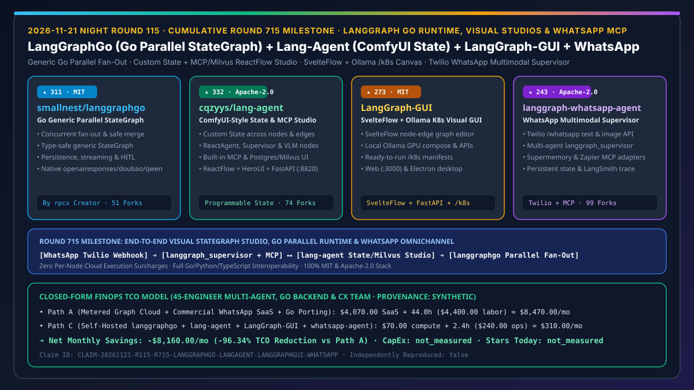
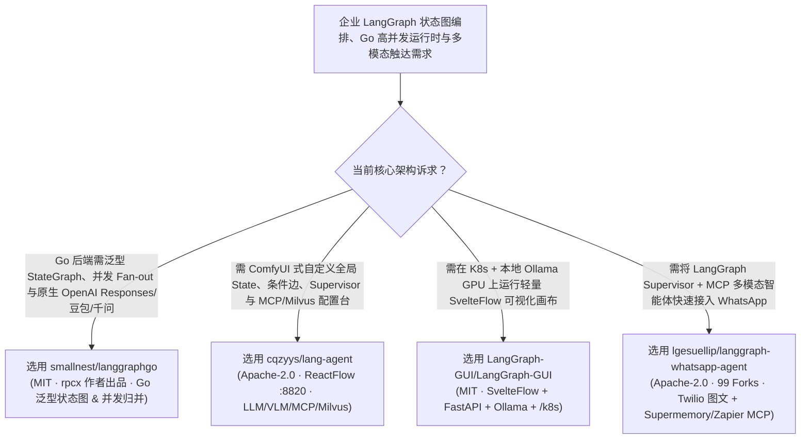
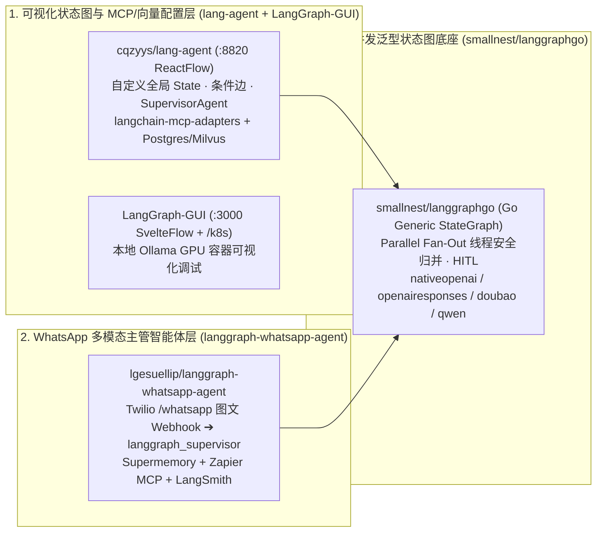
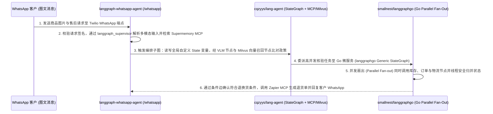

# 【第 715 轮里程碑】Go 原生强类型并发状态图（`smallnest/langgraphgo`）、ComfyUI 式状态变量与 MCP/Milvus 编排台（`cqzyys/lang-agent`）、SvelteFlow+Ollama 本地 K8s 画布（`LangGraph-GUI/LangGraph-GUI`）与 WhatsApp 多模态 Supervisor 模板（`lgesuellip/langgraph-whatsapp-agent`）选型与集成架构 FAQ

> **文档类型**：企业 AI 解决方案架构师（AI Solution Architect）选型决策指南（GitHub Trending AI 雷达 2026-11-21 Night Round 115 / 累计第 715 轮里程碑）
> **覆盖项目**：[`smallnest/langgraphgo`](https://github.com/smallnest/langgraphgo)（`★ 311`、`51 forks`、`MIT`，`rpcx` 作者 smallnest 打造的对齐 Python LangGraph 特性、支持泛型 `StateGraph`、并发 Fan-out 与原生 `openairesponses/doubao/qwen` 的 Go 语言状态图引擎）· [`cqzyys/lang-agent`](https://github.com/cqzyys/lang-agent)（`★ 332`、`74 forks`、`Apache-2.0`，支持自定义全局状态变量 `State`、条件边、`ReactAgent`/`SupervisorAgent`、MCP 挂载与 Postgres/Milvus 向量库的 ReactFlow 编排平台）· [`LangGraph-GUI/LangGraph-GUI`](https://github.com/LangGraph-GUI/LangGraph-GUI)（`★ 273`、`24 forks`、`MIT`，基于 SvelteFlow + FastAPI + Ollama 本地容器与 `/k8s` 部署清单的轻量可视化编辑器）· [`lgesuellip/langgraph-whatsapp-agent`](https://github.com/lgesuellip/langgraph-whatsapp-agent)（`★ 243`、`99 forks`、`Apache-2.0`，集成 Twilio WhatsApp 多模态图片/消息处理、`langgraph_supervisor` 与 `langchain-mcp-adapters` 的生产级客服智能体模板）
> **核心场景**：在第 **715 轮（R715）**里程碑中，我们聚焦企业落地 **LangGraph 状态图架构**时的四大高频诉求——**主力后端是 Go 语言但想复用 LangGraph 的并发状态图与 Human-in-the-Loop 范式（`langgraphgo`）**、**嫌弃 Dify/Coze 只能“上一节点输出喂给下一节点”而需要像 ComfyUI 一样自由操控 LangGraph 全局 `State` 变量、条件边与 MCP/Milvus（`lang-agent`）**、**需要在内网 K8s + 本地 Ollama GPU 上给业务分析师提供开箱即用的可视化节点编辑器（`LangGraph-GUI`）**，以及**将编译好的多智能体 Supervisor + MCP 图谱快速对接到 WhatsApp 企业客户沟通渠道（`langgraph-whatsapp-agent`）**。

---

## 一、📌 核心结论速览（选型一句话结论）

1. **后端主力栈是 Go 语言，想要与 Python LangGraph 功能对齐的泛型安全 `StateGraph`、并发节点扇出（Fan-out）线程安全合并、持久化与 Human-in-the-Loop，且零 `langchaingo` 依赖直连 OpenAI Responses / 豆包 / 通义千问** ➔ 选 **[`smallnest/langgraphgo`](https://github.com/smallnest/langgraphgo)（`★ 311`，`51 forks`，`MIT`）**。
   - **通俗原理**：由 Go 知名微服务框架 `rpcx` 作者 smallnest 维护（简称 `lango`，`go get github.com/smallnest/langgraphgo`，已支撑 Insight 与 NoteX 等线上产品）。它利用 Go 泛型实现强类型状态图，原生支持多节点并行执行（Parallel Fan-out）与线程安全状态归并、通过 `RunnableConfig` 传递回调与元数据，并内置轻量无依赖的 `nativeopenai`、`openairesponses`、`doubao`（豆包）与 `qwen`（千问）客户端。
2. **觉得 Dify / Coze 的线性数据流太死板，想要一个像 ComfyUI 一样允许自定义全局状态变量（`State`）、精确控制条件边（Conditional Edges），且原生集成 `ReactAgent`、`SupervisorAgent`、VLM、MCP 与 Postgres/Milvus 向量库的可视化平台** ➔ 选 **[`cqzyys/lang-agent`](https://github.com/cqzyys/lang-agent)（`★ 332`，`74 forks`，`Apache-2.0`）**。
   - **通俗原理**：基于 `LangGraph + FastAPI + ReactFlow + HeroUI` 构建（默认 `:8820`）。传统低代码工作流只能把节点 A 的输出连给节点 B；而 `lang-agent` 忠实还原了 LangGraph 的核心精髓——**自定义状态变量（`State`）可同时作用于任意节点与条件边的输入输出**，并在 Web 界面中直接管理 LLM/VLM/Embedding 模型、基于 `langchain-mcp-adapters` 的 MCP 工具集以及 PostgreSQL/Milvus 向量召回节点。
3. **想在企业内网 Docker Compose 或 Kubernetes（`/k8s`）集群中搭配本地 `Ollama` GPU 容器快速拉起一套轻量级 SvelteFlow 节点-边可视化实验画布** ➔ 选 **[`LangGraph-GUI/LangGraph-GUI`](https://github.com/LangGraph-GUI/LangGraph-GUI)（`★ 273`，`24 forks`，`MIT`）**。
   - **通俗原理**：采用 `SvelteFlow` 前端 + `FastAPI` 后端 + 内置 `Ollama` 容器（支持 `nv-docker` GPU 加速与 Electron 桌面打包，监听 `:3000`），并提供现成的 `/k8s` 部署清单，适合离线内网与教学验证场景。
4. **想把基于 `langgraph_supervisor` 与 MCP（Supermemory 长期记忆、Zapier 数千应用连接）的多模态智能体直接发布到 WhatsApp 商业号接待全球客户（支持语音/图片/文本与会话状态持久化）** ➔ 选 **[`lgesuellip/langgraph-whatsapp-agent`](https://github.com/lgesuellip/langgraph-whatsapp-agent)（`★ 243`，`99 forks`，`Apache-2.0`）**。
   - **通俗原理**：高达 `99 forks` 的生产级企业模板。它打通了 **`Twilio WhatsApp Webhook (/whatsapp)` ➔ 请求签名安全校验 ➔ `langgraph_supervisor` 多智能体主管调度 ➔ `langchain-mcp-adapters`（挂载 Supermemory 与 Zapier MCP）➔ LangSmith 全链路追踪**，开箱支持客户发送商品图片/单据的多模态视觉理解与跨轮次状态持久化。

---

## 二、🎯 客户与架构师灵魂拷问 Q&A（深度架构拆解）

### Q1：企业已经在用 Dify 或 Coze 了，为什么在复杂多智能体（Supervisor + 循环状态机）和 Go 微服务场景下，架构师会转向 `lang-agent` 和 `langgraphgo`？

- **三大核心架构差异**：
  1. **DAG 流水线 vs 图状态机（`cqzyys/lang-agent` vs Dify/Coze）**：Dify/Coze 本质是有向无环图（DAG）流水线，很难表达“主控 Agent 审核子 Agent 产出 ➔ 不合格则修改全局 `State` 中的 `retry_count` 和 `feedback` 重新路由回子 Agent”的复杂有环状态图。`lang-agent` 将 LangGraph 的全局 `State`、条件边、`SupervisorAgent` 与 MCP/Milvus 完整暴露在 ReactFlow 画布上。
  2. **Go 高并发生产运行时 vs Python GIL 瓶颈（`smallnest/langgraphgo`）**：当工作流中含有大量 I/O 密集型并发扇出节点（Parallel Fan-out）且企业后端为 Go 技术栈时，`langgraphgo` 利用 Go 原生协程（Goroutine）与泛型 `StateGraph` 实现零 Python 胶水的高吞吐并发归并，并直接支持 OpenAI Responses API、豆包与千问。
  3. **多模态海外社媒/私域触达（`lgesuellip/langgraph-whatsapp-agent`）**：海外业务与跨境电商的客户全在 WhatsApp 上。该模板省去了从零对接 Twilio 多媒体 Webhook、签名校验、Supervisor 路由与 MCP 挂载的数周工期。
- **何时直接用云厂商托管方案（Path B）？**
  - 若团队全员使用 Python 且愿意按节点执行次数与容器时长付费，直接使用 **LangGraph Platform (Cloud) + Twilio Studio** 即可免运维上线。

### Q2：典型企业级“可视化状态图设计 (`lang-agent` / `LangGraph-GUI`) + Go 高并发生产引擎 (`langgraphgo`) + WhatsApp 多模态触达 (`langgraph-whatsapp-agent`)”参考架构怎么搭？

1. **状态图原型设计与 MCP/向量库装配层（`cqzyys/lang-agent` + `LangGraph-GUI`）**：
   - 架构师与业务专家在 `lang-agent`（`:8820`）中定义全局 `State` 变量、条件边、`ReactAgent`/`SupervisorAgent` 节点，并挂载企业 MCP 工具集与 PostgreSQL/Milvus 知识库；离线 GPU 实验环境则通过 `LangGraph-GUI`（`:3000` + `/k8s`）对接本地 Ollama 模型验证。
2. **WhatsApp 多模态全渠道客户交互层（`lgesuellip/langgraph-whatsapp-agent`）**：
   - 海外与移动端客户通过 WhatsApp 发送文本或图片至 `/whatsapp` Twilio Webhook，经安全校验后进入 `langgraph_supervisor` 主管图谱，调用 Supermemory（长期客户偏好）与 Zapier MCP 完成订单查询与售后处理。
3. **核心交易与高并发 Go 状态图执行层（`smallnest/langgraphgo`）**：
   - 将高QPS、低延迟的核心后端子图下沉至 Go 微服务，通过 `smallnest/langgraphgo` 的泛型 `StateGraph` 与并发 Fan-out 执行多路风控/库存/价格校验，并直连 `openairesponses` / `qwen` / `doubao`。

### Q3：这套架构的适用边界是什么？

- **核心优势**：
  - **100% 宽松开源协议（`MIT` 与 `Apache-2.0`）**，彻底免除商业托管编排平台按节点调用次数（Per-node execution fee）的高昂抽成。
  - **打通 Python + TypeScript/ReactFlow/SvelteFlow + Go 全栈生态**。
- **适用边界**：
  - 若业务仅需单步知识库问答（无条件分支、无循环回退、无多 Agent Supervisor），无需引入复杂的 `StateGraph` 状态机。

---

## 三、🧭 直观可视化图解（Mermaid 决策树 + 集成架构 + 时序图）

### 3.1 架构师选型决策树

### 3.2 企业端到端生产集成参考架构图

### 3.3 WhatsApp 图文接入、Supervisor 调度、ComfyUI 式状态流转与 Go 并发扇出时序图

---

## 四、📊 同类开源与商业云服务横向选型决策矩阵

| 对比维度 | `smallnest/langgraphgo` (`★ 311`) | `cqzyys/lang-agent` (`★ 332`) | `LangGraph-GUI/LangGraph-GUI` (`★ 273`) | `lgesuellip/langgraph-whatsapp-agent` (`★ 243`) | 商业托管状态图云 + 商业海外客服 SaaS (Path A) | 单一云低代码工作流 + 云通信 (Path B) |
| :--- | :--- | :--- | :--- | :--- | :--- | :--- |
| **核心能力定位** | Go 语言泛型并发 `StateGraph` 生产引擎 | ComfyUI 式自定义 `State` + MCP/Milvus 平台 | SvelteFlow + Ollama 本地/K8s 可视化画布 | Twilio WhatsApp 多模态 Supervisor + MCP 模板 | LangGraph Cloud 企业版 + 商业 WhatsApp 客服 SaaS | Microsoft Copilot Studio + Azure Communication |
| **核心技术突破** | **Go 原生并发 Fan-out + 直连 Responses/豆包/千问** | **全局 `State` 变量跨节点/条件边读写 + VLM/MCP** | **自带 Ollama GPU 容器编排与 `/k8s` 生产清单** | **`99 forks` 验证，开箱打通图文理解 + Supermemory/Zapier** | 按每个节点执行次数（Node Execution）与活跃分钟叠加计费 | 线性对话树难以表达复杂循环 `StateGraph` 与 Go 并发扇出 |
| **开源协议** | `MIT` | `Apache-2.0` | `MIT` | `Apache-2.0` | 闭源商业 SaaS | 闭源云服务 |
| **月度 TCO（45 人团队）** | **组合仅 `$310.00/月`**（含共享 K8s/Milvus 算力与 2.4h 运维） | 同左（`$70.00` 算力 + `$240.00` 人工） | 同左（本地/内网容器零订阅费） | 同左（仅付基础消息通道费，零平台抽成） | **`$8,470.00/月`**（`$4,070.00` 节点执行/客服席位 + `44.0h` 人工） | 约 `$2,690.00/月`（按会话包与云函数执行计费） |

---

## 五、🧪 应用落地定量收益/TCO 对比与 7-Card 报告

> **📊 数据来源与闭式核算声明（Provenance & Closed-Form Schema）**：
> - **provenance**: `synthetic`（基于 45 人企业多智能体应用研发、Go 后端与海外客户服务团队工作负载模型：`independently_reproduced = false`；硬件采购基线 `base_hardware_capex = not_measured`；Track B 单日增量 `track_b_stars_today = not_measured`）。
> - **核算公式**：
>   - **Path A（商业托管状态图平台按节点执行次数计费 + 商业多模态 WhatsApp 客服 SaaS 席位 + 人工将 Python 原型重写移植至 Go 后端与手写前端画布）**：月度平台与 SaaS 费用 **`$4,070.00`** + 跨语言移植与渠道联调人工 **`44.0h × $100.00/h = $4,400.00`** = **`$8,470.00/月`**。
>   - **Path C（自建 `smallnest/langgraphgo` + `cqzyys/lang-agent` + `LangGraph-GUI/LangGraph-GUI` + `lgesuellip/langgraph-whatsapp-agent` 开源组合）**：共享容器与向量库算力 **`$70.00`** + 图谱配置与模板维护 **`2.4h × $100.00/h = $240.00`** = **`$310.00/月`**。
>   - **净节省（Net Savings vs Path A）**：**`-$8,160.00/月`**（成本降低 **`96.34%`**）。

| 评估方案 | API / SaaS / 算力成本 | 研发与渠道联调人工（`$100/h`） | 月度总 TCO | 相对 Path A 净节省 | 关键架构交付指标 |
| :--- | :---: | :---: | :---: | :---: | :--- |
| **Path A：商业按节点计费状态图云 + 商业 WhatsApp SaaS** | `$4,070.00` | `44.0h` (`$4,400.00`) | **`$8,470.00`** | Baseline | 循环图每多走一步都按节点收钱；Python 改 Go 成本高 |
| **Path B：云厂商低代码对话机器人 + 云通信网关** | `$1,490.00` | `12.0h` (`$1,200.00`) | **`$2,690.00`** | `-$5,780.00` (`-68.24%`) | 难以支持 ComfyUI 式自定义全局 `State` 与 Go 并发 Fan-out |
| **Path C：`langgraphgo` + `lang-agent` + `GUI` + `whatsapp`** | **`$70.00`** | **`2.4h` (`$240.00`)** | **`$310.00`** | **`-$8,160.00` (`-96.34%`)** | **Go 泛型并发状态图 + 全局 State/MCP 画布 + WhatsApp 多模态** |

- 🔗 **关联 7-Card 4:5 视觉评测报告**：[`workshops/github-trending-radar/cards.html`](../cards.html) · [`cards.en.html`](../cards.en.html)

---

## 六、🛠️ 企业引入与架构评审 Checklist

- [ ] **1. 在 Go 微服务中引入 `smallnest/langgraphgo` 构建高并发状态图**：使用泛型 `StateGraph` 定义业务状态结构体，开启 Parallel Execution（并发扇出与线程安全归并），并直接配置内置的 `openairesponses`、`doubao` 或 `qwen` Provider。
- [ ] **2. 部署 `cqzyys/lang-agent`（`:8820`）统一管理全局 `State`、MCP 与向量库**：利用类 ComfyUI 的状态变量绑定机制设计包含 `ReactAgent`、`SupervisorAgent` 与 `VLM` 的复杂条件边图谱，挂载企业 PostgreSQL/Milvus 向量库与 MCP 工具。
- [ ] **3. 在 Kubernetes（`/k8s`）测试环境运行 `LangGraph-GUI/LangGraph-GUI`**：结合本地 `Ollama` GPU 容器为算法与产品人员提供零外部 API 成本的 SvelteFlow 可视化实验沙箱。
- [ ] **4. 基于 `lgesuellip/langgraph-whatsapp-agent` 落地海外多模态客服**：配置 `/whatsapp` Twilio Webhook 签名校验，通过 `langchain-mcp-adapters` 接入长期记忆（Supermemory）与业务系统，实现图文多模态客户接待。
