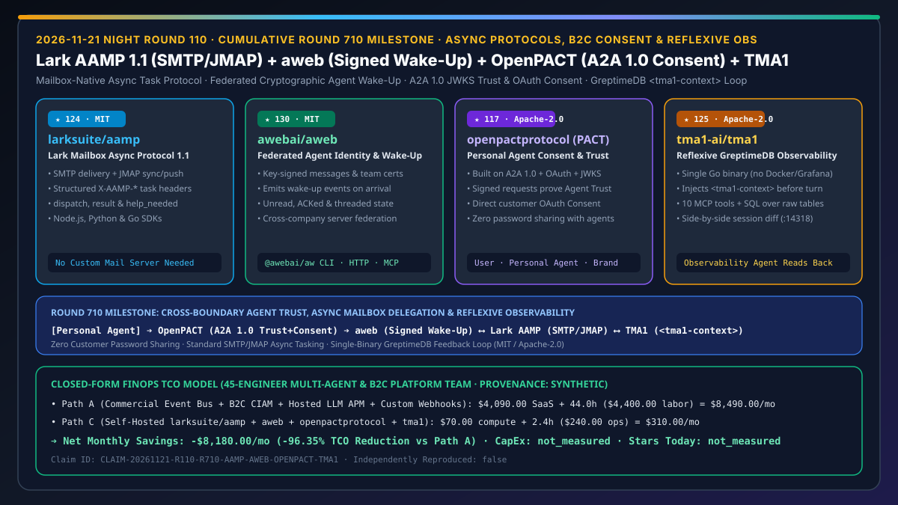
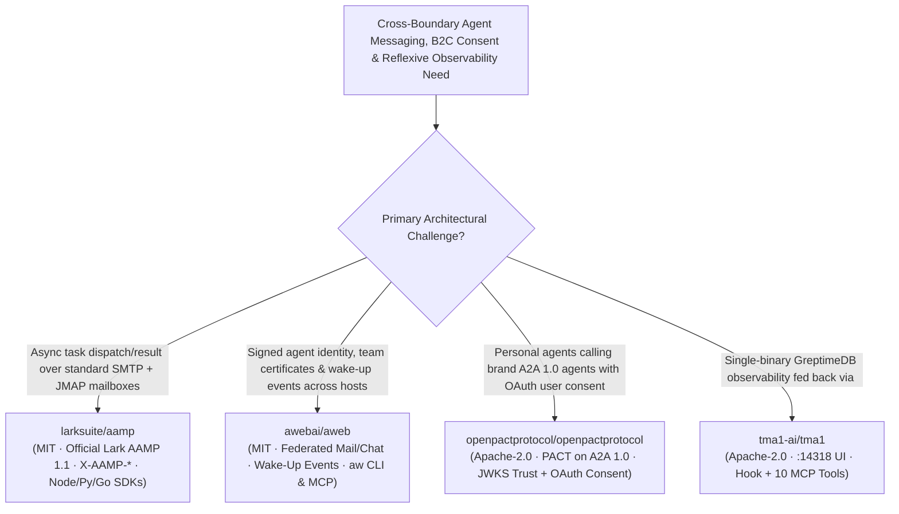
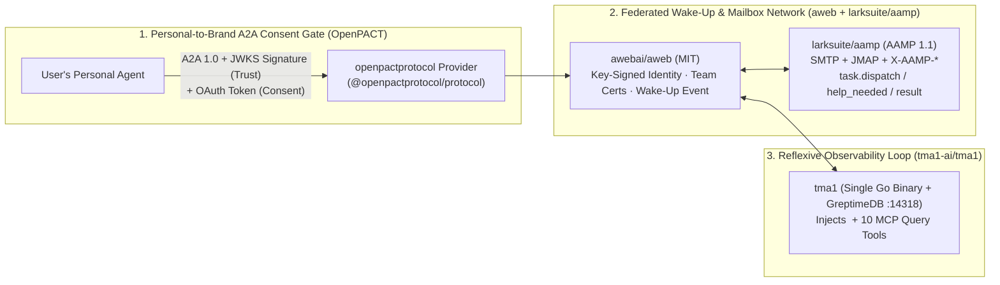
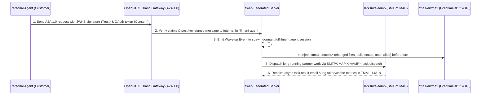

# [Round 710 Milestone] Lark Mailbox-Native Async Agent Protocol (`larksuite/aamp`), Federated Signed Identity & Wake-Up Network (`awebai/aweb`), A2A 1.0 Personal Agent Consent & Trust (`openpactprotocol/openpactprotocol`) & GreptimeDB Reflexive Observability (`tma1-ai/tma1`) Selection & Architecture FAQ

> **Document Type**: Enterprise AI Solution Architect Selection & Integration Guide (GitHub Trending AI Radar — 2026-11-21 Night Round 110 / Cumulative Round 710 Milestone)
> **Covered Repositories**: [`larksuite/aamp`](https://github.com/larksuite/aamp) (`★ 124`, `18 forks`, `MIT` — official Lark/Feishu `AAMP 1.1` Agent Asynchronous Messaging Protocol over `SMTP + JMAP + X-AAMP-*` headers with Node.js, Python & Go SDKs) · [`awebai/aweb`](https://github.com/awebai/aweb) (`★ 130`, `13 forks`, `MIT` — federated agent communication network with cryptographic key identities, team certificates, durable mail/chat & session wake-up events) · [`openpactprotocol/openpactprotocol`](https://github.com/openpactprotocol/openpactprotocol) (`★ 117`, `11 forks`, `Apache-2.0` — Personal Agent Consent & Trust `PACT` protocol built on A2A 1.0, OAuth & JWKS) · [`tma1-ai/tma1`](https://github.com/tma1-ai/tma1) (`★ 125`, `16 forks`, `Apache-2.0` — GreptimeDB-powered single-binary local observability monolith feeding `<tma1-context>` and 10 MCP tools back into the agent's next turn)
> **Core Scenario**: At our **Cumulative Round 710 Milestone**, we examine how enterprise architects solve **asynchronous cross-boundary task delegation over standard email (`larksuite/aamp`)**, **cryptographically verified agent identity and automatic session wake-up across machines and organizations (`awebai/aweb`)**, **verifiable customer consent and agent trust when personal agents call enterprise brand agents over A2A 1.0 (`openpactprotocol`)**, and **reflexive observability that feeds build/anomaly telemetry back into the agent's own loop (`tma1-ai/tma1`)**.

---

## 1. 📌 Executive Summary (One-Line Selection Verdict)

1. **Need an open protocol and multi-language SDKs (`Node.js`, `Python`, `Go`) for asynchronous task collaboration between agents over ordinary `SMTP + JMAP` mailbox infrastructure without running a custom mail server** ➔ Choose **[`larksuite/aamp`](https://github.com/larksuite/aamp) (`★ 124`, `18 forks`, `MIT`)**.
   - **Plain-English Mechanism**: Open-sourced by **Lark/Feishu (`larksuite`)**, **AAMP 1.1 (Agent Asynchronous Messaging Protocol)** turns standard email addresses into an asynchronous agent task network. It combines **`SMTP`** for durable delivery, **`JMAP`** for mailbox sync/push/attachments, and structured **`X-AAMP-*` headers** defining a machine-readable task lifecycle (`task.dispatch`, `task.result`, `task.help_needed`) governed by sender allowlist policies.
2. **Need federated agent communication with cryptographic key-signed identities, team membership certificates, durable unread/ACKed state, and wake-up events across sessions, machines, and organizations** ➔ Choose **[`awebai/aweb`](https://github.com/awebai/aweb) (`★ 130`, `13 forks`, `MIT`)**.
   - **Plain-English Mechanism**: Shared files and Git branches cannot wake a sleeping agent, prove who wrote an approval ACK, or cross company boundaries. `aweb` (`aweb` Python server + `@awebai/aw` CLI + HTTP API + MCP tools) gives each agent a persistent cryptographic key identity and certificate-backed team membership, tracks unread/acknowledged/threaded delivery state, federates across independent servers, and emits a **wake-up event** that spawns a session with the waiting message in front of it.
3. **Need an open standard built on `A2A 1.0` and `OAuth` so customers' personal agents can interact with your enterprise brand agents under explicit, verifiable permissions without sharing user passwords** ➔ Choose **[`openpactprotocol/openpactprotocol`](https://github.com/openpactprotocol/openpactprotocol) (`★ 117`, `11 forks`, `Apache-2.0`)**.
   - **Plain-English Mechanism**: **PACT (Personal Agent Consent & Trust)** defines four actors (`User`, `Personal agent`, `Brand`, `Provider`) on top of **A2A 1.0 (`a2a-protocol.org`)**. Personal agents prove identity via JWKS-signed requests (**Trust**, `@openpactprotocol/client`), while customers authenticate directly with the Brand and grant scoped OAuth tokens (**Consent**, `@openpactprotocol/protocol` Zod schemas & JWT claims)—so personal agents never touch customer credentials.
4. **Need single-binary local observability (`GreptimeDB`, `:14318`) that not only renders a human dashboard, but also injects `<tma1-context>` and 10 MCP tools back into the agent's next turn** ➔ Choose **[`tma1-ai/tma1`](https://github.com/tma1-ai/tma1) (`★ 125`, `16 forks`, `Apache-2.0`)**.
   - **Plain-English Mechanism**: Ships as one Go binary embedding **GreptimeDB** (no Docker, no Grafana, no cloud account; `TMA1_ADAPTER=claude-code|codex|all`). Before every turn, TMA1 feeds the agent a **`<tma1-context>` block** summarizing what it did this session, which files changed under it, whether the build is broken, and any detected anomalies, backed by **10 on-demand MCP query tools** and a side-by-side session comparison UI at `http://localhost:14318`.

---

## 2. 🎯 Architect & Customer Deep-Dive Q&A

### Q1: Why are synchronous HTTP webhooks and passive dashboards insufficient for cross-organization agent workflows and B2C personal-agent commerce?

- **Four Architectural Gaps & Protocol-Level Solutions**:
  1. **Firewall-Friendly Asynchronous Tasking (`larksuite/aamp`)**: Synchronous HTTP calls time out on multi-hour research/coding tasks, and enterprise firewalls block inbound webhooks from external partners. `AAMP 1.1` layers `task.dispatch`, `task.help_needed`, and `task.result` over ubiquitous `SMTP + JMAP` mailboxes via `X-AAMP-*` headers.
  2. **Dormant Agent Wake-Up & Cryptographic Authority (`awebai/aweb`)**: Polling loops burn compute when idle, and plain-text messages in shared files can be forged. `aweb` signs every message with the sender agent's key, verifies team membership via certificates, and wakes dormant agents on message arrival.
  3. **Zero-Credential-Sharing B2C Delegation (`openpactprotocol`)**: Enterprises cannot let third-party personal agents scrape web portals using customer passwords. `PACT` extends A2A 1.0 with JWKS agent authentication (**Trust**) and direct customer OAuth authorization (**Consent**).
  4. **Reflexive Self-Correcting Observability (`tma1-ai/tma1`)**: Traditional observability only helps humans after a session fails. `tma1` routes GreptimeDB telemetry back into the active agent's next turn via `<tma1-context>` hooks and 10 MCP tools.
- **When to Choose Managed Cloud Services (Path B)**:
  - If all agents operate inside a single cloud tenant (e.g., Azure Service Bus + Microsoft Entra Agent ID + Azure Monitor) with no external consumer agents or cross-company email federation, native cloud primitives suffice.

### Q2: How do we wire an end-to-end enterprise architecture combining all four projects?

1. **B2C / Partner Trust & Consent Edge (`openpactprotocol/openpactprotocol`)**:
   - Deploy a PACT Provider gateway in front of customer-facing Brand A2A agents using `@openpactprotocol/protocol` to verify incoming personal-agent JWKS signatures (**Trust**) and customer OAuth JWT scopes (**Consent**).
2. **Federated Wake-Up & Signed Internal Coordination Mesh (`awebai/aweb`)**:
   - Connect internal specialist agents via `aweb` (`@awebai/aw` CLI & MCP tools) so coordinator instructions and review ACKs are cryptographically signed and automatically wake sleeping worker agents across hosts.
3. **Long-Horizon Mailbox Task Network (`larksuite/aamp`)**:
   - Dispatch cross-organization or multi-hour asynchronous tasks over standard `SMTP + JMAP` mailboxes using `larksuite/aamp` (`X-AAMP-*` headers for `task.dispatch`, `task.help_needed`, and `task.result` with sender policy enforcement).
4. **Reflexive Turn-by-Turn Observability Loop (`tma1-ai/tma1`)**:
   - Run the `tma1` single binary (`:14318`) on each agent workstation/runner so every turn receives `<tma1-context>` (changed files, build health, anomalies) and engineers can compare session cache share and token usage side by side.

### Q3: What are the boundaries and trade-offs of this stack?

- **Key Strengths**:
  - **100% Permissive Open Source (`MIT` & `Apache-2.0`)**: Open specifications (`AAMP 1.1`, `PACT` on `A2A 1.0`) with conformance test suites.
  - **Zero Heavy Infrastructure Dependencies**: `AAMP` runs on existing email servers; `TMA1` embeds GreptimeDB in a single binary with zero Docker overhead.
- **Operational Scope**:
  - `AAMP` over `SMTP/JMAP` is designed for asynchronous tasks (seconds to hours), not sub-10ms RPC calls.

---

## 3. 🧭 Visual Architecture & Decision Diagrams

### 3.1 Solution Architect Selection Decision Tree

### 3.2 End-to-End Enterprise Reference Architecture

### 3.3 PACT Consent Verification, aweb Wake-Up, AAMP Mailbox Dispatch & TMA1 Reflexive Loop Sequence

---

## 4. 📊 Peer Open-Source vs Commercial Cloud Selection Matrix

| Dimension | `larksuite/aamp` (`★ 124`) | `awebai/aweb` (`★ 130`) | `openpactprotocol/openpactprotocol` (`★ 117`) | `tma1-ai/tma1` (`★ 125`) | Commercial Event Bus + CIAM + APM SaaS (Path A) | Single-Cloud Bus + Entra ID (Path B) |
| :--- | :--- | :--- | :--- | :--- | :--- | :--- |
| **Core Role** | Official Lark `AAMP 1.1` mailbox-native async protocol | Federated key-signed agent comms & wake-up runtime | `PACT` on A2A 1.0 for personal-to-brand consent & trust | GreptimeDB reflexive observability feeding `<tma1-context>` | Proprietary enterprise bus + B2C CIAM + hosted LLM APM | Azure Service Bus + Entra Agent ID + Monitor |
| **Architectural Edge** | **Uses ordinary `SMTP + JMAP` + `X-AAMP-*` headers** | **Cryptographic identity + certificates + wake-up events** | **JWKS agent trust + direct customer OAuth consent** | **Single binary (no Docker) + agent reads back its own traces** | Expensive cross-org webhook/VPN setup; passive-only APM | Locked to single cloud; no JMAP email or B2C PACT standard |
| **License** | `MIT` | `MIT` | `Apache-2.0` | `Apache-2.0` | Proprietary SaaS | Proprietary Cloud PaaS |
| **Monthly TCO (45-Eng Team)** | **`$310.00/mo` combined** (`$70.00` compute + `2.4h` ops) | Included in `$310.00/mo` stack | Included in `$310.00/mo` stack | Included in `$310.00/mo` stack | **`$8,490.00/mo`** (`$4,090.00` SaaS + `44.0h` integration labor) | `~$2,740.00/mo` (broker units + MAU + log ingestion) |

---

## 5. 🧪 Quantitative ROI / FinOps TCO Model & 7-Card Report

> **📊 Provenance & Closed-Form Audit Declaration**:
> - **Provenance**: `synthetic` (45-engineer enterprise multi-agent platform, B2C ecosystems & DevEx workload model; `independently_reproduced = false`; `base_hardware_capex = not_measured`; `track_b_stars_today = not_measured`).
> - **Closed-Form Equations**:
>   - **Path A (Commercial Cross-Org Messaging Broker + Commercial B2C CIAM Seats + Hosted LLM APM SaaS + Custom Polling Daemons & Partner Webhook Engineering)**: Monthly SaaS subscriptions **`$4,090.00`** + cross-boundary integration & debugging labor **`44.0h × $100.00/h = $4,400.00`** = **`$8,490.00/mo`**.
>   - **Path C (Self-Hosted `larksuite/aamp` + `awebai/aweb` + `openpactprotocol/openpactprotocol` + `tma1-ai/tma1`)**: Shared mailbox/federation compute **`$70.00`** + sender policy & protocol maintenance **`2.4h × $100.00/h = $240.00`** = **`$310.00/mo`**.
>   - **Net Savings vs Path A**: **`-$8,180.00/mo`** (**`96.35%`** cost reduction).

| Architecture Option | API / SaaS / Compute | Engineering & Ops Labor (`$100/h`) | Total Monthly TCO | Net Savings vs Path A | Key Architectural Outcome |
| :--- | :---: | :---: | :---: | :---: | :--- |
| **Path A: Commercial Message Bus + CIAM + Hosted APM** | `$4,090.00` | `44.0h` (`$4,400.00`) | **`$8,490.00`** | Baseline | Slow partner onboarding; passive APM never steers the active agent |
| **Path B: Single-Cloud Queue + Cloud Native Identity** | `$1,540.00` | `12.0h` (`$1,200.00`) | **`$2,740.00`** | `-$5,750.00` (`-67.73%`) | Intra-cloud only; lacks SMTP/JMAP `AAMP` & B2C `PACT` consent |
| **Path C: `aamp` + `aweb` + `openpact` + `tma1`** | **`$70.00`** | **`2.4h` (`$240.00`)** | **`$310.00`** | **`-$8,180.00` (`-96.35%`)** | **SMTP/JMAP async tasks + signed wake-ups + A2A PACT + `<tma1-context>`** |

- 🔗 **7-Card 4:5 Visual Report**: [`workshops/github-trending-radar/cards.en.html`](../cards.en.html) · [`cards.html`](../cards.html)

---

## 6. 🛠️ Enterprise Adoption & Architecture Review Checklist

- [ ] **1. Connect Long-Horizon Agents to `larksuite/aamp` (`AAMP 1.1`)**: Use the Node.js, Python, or Go SDKs over standard `SMTP + JMAP` mailboxes with `X-AAMP-*` headers (`task.dispatch`, `task.help_needed`, `task.result`) and strict sender policies.
- [ ] **2. Replace Polling Loops with `awebai/aweb` Signed Wake-Up Events**: Provision cryptographic agent identities and team certificates in `aweb` so incoming mail/chat messages wake dormant agent sessions on demand across hosts and federated organizations.
- [ ] **3. Enforce B2C Agent Trust & Customer Consent with `openpactprotocol`**: Validate external personal agents on A2A 1.0 endpoints using `@openpactprotocol/protocol` Zod schemas, JWKS request signatures (**Trust**), and customer-granted OAuth JWT claims (**Consent**).
- [ ] **4. Enable Reflexive `<tma1-context>` Feedback with `tma1-ai/tma1`**: Install the single-binary GreptimeDB service (`TMA1_ADAPTER=all` on `:14318`) so agents receive pre-turn build/anomaly context and engineers can audit side-by-side session diffs via SQL and 10 MCP tools.
