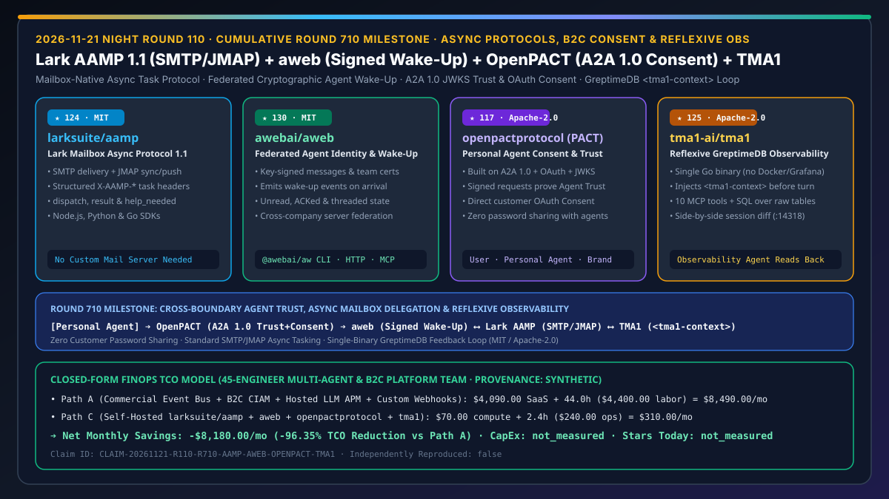
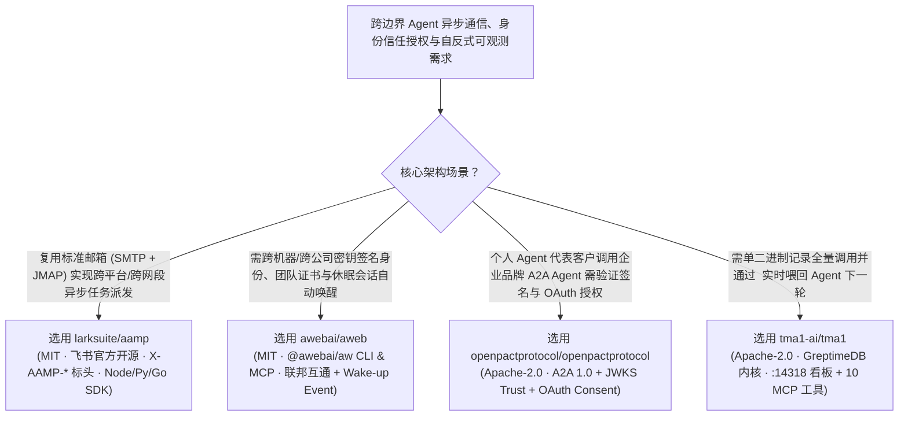
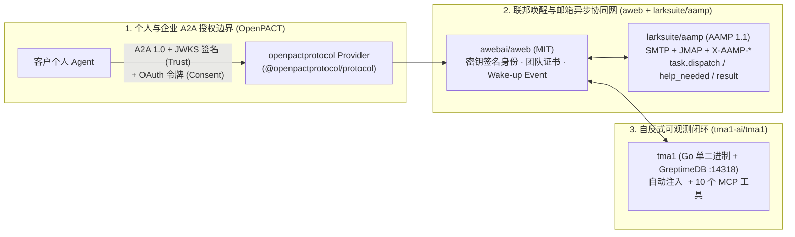
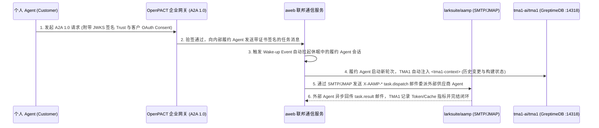

# 【第 710 轮里程碑】飞书官方邮箱原生异步协同协议（`larksuite/aamp`）、跨组织签名身份与唤醒通信网（`awebai/aweb`）、A2A 1.0 个人与企业授权信任协议（`openpactprotocol/openpactprotocol`）与 GreptimeDB 自反式可观测单二进制（`tma1-ai/tma1`）选型与集成架构 FAQ

> **文档类型**：企业 AI 解决方案架构师（AI Solution Architect）选型决策指南（GitHub Trending AI 雷达 2026-11-21 Night Round 110 / 累计第 710 轮里程碑）
> **覆盖项目**：[`larksuite/aamp`](https://github.com/larksuite/aamp)（`★ 124`、`18 forks`、`MIT`，飞书/Lark 官方开源的基于 `SMTP + JMAP + X-AAMP-*` 标头的邮箱原生 Agent 异步消息协议与 Node/Python/Go 三栈 SDK）· [`awebai/aweb`](https://github.com/awebai/aweb)（`★ 130`、`13 forks`、`MIT`，为跨机器、跨运行时与跨公司 Agent 提供密钥签名身份、团队证书、持久化邮件/聊天与自动唤醒事件的联邦通信底座）· [`openpactprotocol/openpactprotocol`](https://github.com/openpactprotocol/openpactprotocol)（`★ 117`、`11 forks`、`Apache-2.0`，基于 A2A 1.0 与 OAuth/JWKS 的个人 Agent 与企业品牌 Agent 双向可验证授权信任协议 `PACT`）· [`tma1-ai/tma1`](https://github.com/tma1-ai/tma1)（`★ 125`、`16 forks`、`Apache-2.0`，基于 GreptimeDB、无需 Docker 即可通过 `<tma1-context>` 钩子与 10 个 MCP 工具把异常与构建状态实时喂回 Agent 下一轮的 Go 单二进制可观测引擎）
> **核心场景**：在第 **710 轮（R710）**里程碑中，我们聚焦下一代分布式多智能体架构的四大跨边界难题——**如何利用企业现成标准邮箱（SMTP/JMAP）完成跨平台长耗时异步派单（`larksuite/aamp`）**、**如何让已经休眠或位于另一家公司的 Agent 收到带密码学签名身份的消息并自动被唤醒（`awebai/aweb`）**、**如何让用户的个人 Agent 在不索要用户账号密码的前提下代表用户调用银行/航司/电商的企业 A2A Agent（`openpactprotocol`）**，以及**如何让可观测性数据不再只给人类看，而是通过 `<tma1-context>` 实时反馈给 Agent 自己纠正死循环与编译失败（`tma1-ai/tma1`）**？

---

## 一、📌 核心结论速览（选型一句话结论）

1. **想直接复用企业现成的标准邮件基础设施（无需改写邮件服务器），让不同平台或不同部门的 Agent（如 Claude、Codex、OpenClaw）通过邮箱地址异步收发长耗时任务** ➔ 选 **[`larksuite/aamp`](https://github.com/larksuite/aamp)（`★ 124`，`MIT`）**。
   - **通俗原理**：由**飞书（Larksuite）**官方开源的 **AAMP 1.1（Agent Asynchronous Messaging Protocol）**，自带 Node.js、Python、Go 三套对齐的 SDK 与一致性测试集（Conformance Fixtures）。它不发明私有消息队列，而是直接组合 **`SMTP`（可靠投递）+ `JMAP`（邮箱同步、推送与附件拉取）+ 结构化 `X-AAMP-*` 邮件标头**，定义了 `task.dispatch`（派发任务）、`task.result`（返回结果）与 `task.help_needed`（请求人工/上游澄清）标准状态机及发件人白名单策略（Sender Policy）。
2. **想让分布在不同机器、不同运行时甚至不同公司的独立 Agent 拥有不可伪造的密钥签名身份与团队证书，并在收到消息时自动触发“会话唤醒（Wake-up Event）”** ➔ 选 **[`awebai/aweb`](https://github.com/awebai/aweb)（`★ 130`，`MIT`）**。
   - **通俗原理**：靠共享文件或 Git 分支传话有四大缺陷：不会唤醒已退出的接收方、不知道是谁写的、没有未读/已确认（ACK）状态、跨不出单机边界。`aweb`（提供 Python 服务端、npm `@awebai/aw` CLI、HTTP API 与 MCP 工具）为每个 Agent 分配持久化加密私钥签名身份与团队证书，支持跨组织联邦互通（Federation），并在消息到达时抛出 **Wake-up Event** 自动拉起目标 Agent 会话。
3. **当外部客户的“个人 AI 助手”通过 A2A 1.0 协议来调用你企业的“品牌客服/交易 Agent”时，想在不让个人助手接触客户密码的前提下，同时验证调用方 Agent 身份（Trust）与客户的明确授权范围（Consent）** ➔ 选 **[`openpactprotocol/openpactprotocol`](https://github.com/openpactprotocol/openpactprotocol)（`★ 117`，`Apache-2.0`）**。
   - **通俗原理**：**PACT（Personal Agent Consent & Trust）** 建立在 **A2A 1.0（`a2a-protocol.org`）与 OAuth / JWKS** 之上，清晰划分 **`User`（个人用户）、`Personal agent`（个人智能体）、`Brand`（企业品牌）与 `Provider`（企业智能体托管方）** 四方角色：个人智能体通过 JWKS 私钥签名请求自证身份（**Trust**，`@openpactprotocol/client`），客户则直接在品牌官网登录并签发细粒度 OAuth 权限（**Consent**，`@openpactprotocol/protocol` Zod Schema 与 JWT Claims），彻底杜绝个人 Agent 索要用户明文密码的安全隐患。
4. **希望可观测性工具不仅能给人类提供本地 `:14318` SQL/成本/会话对比看板，还能在每次对话前通过 `<tma1-context>` 钩子与 10 个 MCP 工具把“刚才改了哪些文件、构建是否报错、是否触发异常”直接喂回给 Agent 自己纠错** ➔ 选 **[`tma1-ai/tma1`](https://github.com/tma1-ai/tma1)（`★ 125`，`Apache-2.0`）**。
   - **通俗原理**：内置 **GreptimeDB** 的单二进制本地可观测性引擎（无需 Docker，无需 Grafana，一行命令 `TMA1_ADAPTER=claude-code|codex|all` 安装）。它首创了**“Agent 自己读得懂的可观测性（Observability your agent reads back）”**：在每一轮对话开始前自动注入 `<tma1-context>` 块并暴露 10 个按需查询的 MCP 工具，让 Agent 瞬间看清当前会话历史、文件变更、编译状态与异常告警；同时为工程师在 `http://localhost:14318` 提供双会话并排对比（Token、Cache 命中率、工具失败数、Compaction 次数）与原生 SQL 查询。

---

## 二、🎯 客户与架构师灵魂拷问 Q&A（深度架构拆解）

### Q1：我们已经有 HTTP/REST 和同步 A2A 调用了，为什么在企业跨部门、跨公司与 B2C 场景下必须引入 `AAMP`、`aweb` 和 `PACT`？

- **三大跨边界架构痛点与协议解方**：
  1. **长周期跨网段异步协同 ➔ `larksuite/aamp`**：跨企业防火墙或跨云环境往往禁止入站 Webhook 回调，且复杂研发/调研任务耗时数小时，HTTP 同步连接必断。借道企业既有的 `SMTP + JMAP` 邮件基础设施配合 `X-AAMP-*` 标头，任何拥有邮箱地址的 Agent 都能跨网段异步接单（`task.dispatch`）与交卷（`task.result`）。
  2. **休眠 Agent 自动唤醒与密码学身份认证 ➔ `awebai/aweb`**：常驻轮询脚本极其浪费算力，且普通文本消息无法证明“这条同意合并 PR 的指令确实来自架构师 Agent 而非被注入的子进程”。`aweb` 用密钥签名 + 团队证书锁定身份，并用事件流按需唤醒目标会话。
  3. **B2C 个人 Agent 代客操作的法律与安全合规 ➔ `openpactprotocol` (PACT)**：银行或电商绝不能允许第三方个人 Agent 拿着用户的账号密码来调接口。`PACT` 在 A2A 1.0 之上结合 JWKS 请求签名（验证哪个个人 Agent 在调）与 OAuth 令牌（验证客户授权了什么权限），实现零密码泄露的合规代客操作。
- **何时直接用云厂商托管方案（Path B）？**
  - 若所有 Agent 均运行在单一云厂商内部同租户环境（如 Azure AI Foundry + Azure Service Bus + Microsoft Entra Agent ID），直接使用云内托管队列与 Entra ID 即可。

### Q2：典型企业级“B2C 授权接入 (`PACT`) + 联邦唤醒与签名通信 (`aweb`) + 邮箱异步任务网 (`AAMP`) + 自反式闭环观测 (`TMA1`)”架构怎么搭？

1. **外部客户个人 Agent 授权准入层（`openpactprotocol/openpactprotocol`）**：
   - 企业品牌（Brand）门户部署 PACT Provider（基于 `@openpactprotocol/protocol` 校验 Agent Card、JWKS 签名与 OAuth Consent JWT Claims），验证外部个人 Agent 的合法委托权限。
2. **内部多智能体联邦唤醒与签名协作层（`awebai/aweb`）**：
   - 企业内部各职能 Agent 通过 `aweb`（`aw` CLI / MCP 工具）通信，每条审批 ACK 与协调指令均附带 Agent 私钥签名与团队证书，并在任务到达时通过 Wake-up Event 精准拉起休眠中的专职 Agent。
3. **跨组织/长周期邮箱原生异步任务层（`larksuite/aamp`）**：
   - 对于需要跨合作伙伴企业或耗时数小时的后台任务，通过 `larksuite/aamp`（Node/Python/Go SDK）经 `SMTP + JMAP` 发送带 `X-AAMP-*` 标头的 `task.dispatch` 邮件，中间缺少信息时自动发送 `task.help_needed`，完成后回传 `task.result`。
4. **单机/工作区 GreptimeDB 自反式可观测层（`tma1-ai/tma1`）**：
   - 在每个编码与执行 Agent 宿主上运行 `tma1` 单二进制服务（`:14318`），自动记录每次 LLM 与工具调用，并在下一轮对话前注入 `<tma1-context>` 辅助 Agent 自主感知构建破损与异常循环。

### Q3：这套协议与工具栈的适用边界是什么？

- **核心优势**：
  - **100% 宽松开源协议（`MIT` 与 `Apache-2.0`）**：协议规范与参考实现完全开放，无专有云锁定。
  - **零额外中间件负担**：`AAMP` 复用标准 SMTP/JMAP 邮箱，`TMA1` 将 GreptimeDB 打包为免 Docker 的单一 Go 二进制。
- **适用边界**：
  - 毫秒级高频实时交易或同进程函数调用无需走 `SMTP/JMAP` 邮件协议（`AAMP` 专为分钟至小时级跨边界异步任务设计）。

---

## 三、🧭 直观可视化图解（Mermaid 决策树 + 集成架构 + 时序图）

### 3.1 架构师选型决策树

### 3.2 企业端到端生产集成参考架构图

### 3.3 PACT 授权验签、aweb 唤醒、AAMP 邮箱异步流转与 TMA1 自反纠错时序图

---

## 四、📊 同类开源与商业云服务横向选型决策矩阵

| 对比维度 | `larksuite/aamp` (`★ 124`) | `awebai/aweb` (`★ 130`) | `openpactprotocol/openpactprotocol` (`★ 117`) | `tma1-ai/tma1` (`★ 125`) | 商业跨云消息总线 + 商业 IAM + 商业 APM (Path A) | 单一云托管总线 + Entra ID (Path B) |
| :--- | :--- | :--- | :--- | :--- | :--- | :--- |
| **核心能力定位** | 飞书官方邮箱原生（SMTP/JMAP）异步任务协议 | 跨机/跨组织密钥签名身份、持久化通信与唤醒网 | 基于 A2A 1.0 + OAuth 的个人与企业双向信任协议 | GreptimeDB 驱动、向 Agent 回注 `<tma1-context>` 的可观测引擎 | 商业企业服务总线 + 商业 B2C CIAM + 商业 LLM APM | Azure Service Bus + Entra Agent ID + Monitor |
| **核心架构创新** | **无需自建队列，直接用普通邮箱与 `X-AAMP-*` 标头协同** | **私钥签名身份 + 团队证书 + 收到消息自动唤醒会话** | **JWKS 验证调用方 Agent + OAuth 验证客户授权（零密码共享）** | **单二进制免 Docker + Agent 通过钩子/10 MCP 自读监控纠错** | 跨企业开专线/Webhook 审批极慢；传统 APM 无法喂回给 Agent | 仅限同云租户内部，不支持标准邮箱 JMAP 与跨组织联邦 |
| **开源协议** | `MIT` | `MIT` | `Apache-2.0` | `Apache-2.0` | 闭源商业 SaaS | 闭源云服务 |
| **月度 TCO（45 人团队）** | **组合仅 `$310.00/月`**（复用现有邮箱与共享算力 + 2.4h 运维） | 同左（`$70.00` 算力 + `$240.00` 人工） | 同左（开源协议栈零抽成） | 同左（本地单二进制零云端账单） | **`$8,490.00/月`**（`$4,090.00` 订阅 + `44.0h` 跨组织对接人工） | 约 `$2,740.00/月`（按消息量、MAU 与日志存储计费） |

---

## 五、🧪 应用落地定量收益/TCO 对比与 7-Card 报告

> **📊 数据来源与闭式核算声明（Provenance & Closed-Form Schema）**：
> - **provenance**: `synthetic`（基于 45 人跨组织智能体协同、B2C 开放平台与研发团队工作负载模型：`independently_reproduced = false`；硬件采购基线 `base_hardware_capex = not_measured`；Track B 单日增量 `track_b_stars_today = not_measured`）。
> - **核算公式**：
>   - **Path A（商业跨组织企业消息总线 + 商业 B2C CIAM/OAuth 高级模块 + 商业托管 LLM 可观测 SaaS + 人工维护常驻轮询守护进程与跨公司 Webhook 联调）**：月度 SaaS 订阅费 **`$4,090.00`** + 跨网段联调与排障人工 **`44.0h × $100.00/h = $4,400.00`** = **`$8,490.00/月`**。
>   - **Path C（自建 `larksuite/aamp` + `awebai/aweb` + `openpactprotocol/openpactprotocol` + `tma1-ai/tma1` 开源组合）**：共享轻量服务与邮箱基础设施 **`$70.00`** + 协议配置与发件人策略维护 **`2.4h × $100.00/h = $240.00`** = **`$310.00/月`**。
>   - **净节省（Net Savings vs Path A）**：**`-$8,180.00/月`**（成本降低 **`96.35%`**）。

| 评估方案 | API / SaaS / 算力成本 | 工程与联调运维人工（`$100/h`） | 月度总 TCO | 相对 Path A 净节省 | 关键架构交付指标 |
| :--- | :---: | :---: | :---: | :---: | :--- |
| **Path A：商业消息总线 + 商业 CIAM + 商业 APM SaaS** | `$4,090.00` | `44.0h` (`$4,400.00`) | **`$8,490.00`** | Baseline | 跨公司开通私有 API 极慢；监控数据无法实时反哺 Agent |
| **Path B：单一云托管消息队列 + 云原生身份认证** | `$1,540.00` | `12.0h` (`$1,200.00`) | **`$2,740.00`** | `-$5,750.00` (`-67.73%`) | 局限于单一云内，缺乏邮箱原生 `AAMP` 与 `PACT` 开放协议 |
| **Path C：`aamp` + `aweb` + `openpact` + `tma1`** | **`$70.00`** | **`2.4h` (`$240.00`)** | **`$310.00`** | **`-$8,180.00` (`-96.35%`)** | **SMTP/JMAP 异步派单 + 签名唤醒 + A2A 1.0 PACT 授权 + `<tma1-context>`** |

- 🔗 **关联 7-Card 4:5 视觉评测报告**：[`workshops/github-trending-radar/cards.html`](../cards.html) · [`cards.en.html`](../cards.en.html)

---

## 六、🛠️ 企业引入与架构评审 Checklist

- [ ] **1. 启用 `larksuite/aamp` 构建邮箱原生异步任务网**：使用 Node.js / Python / Go SDK 为长耗时 Agent 绑定标准 `SMTP + JMAP` 邮箱，配置严格的 Sender Policy 白名单，并通过 `X-AAMP-*` 标头标准化 `task.dispatch`、`task.help_needed` 与 `task.result` 闭环。
- [ ] **2. 部署 `awebai/aweb` 实现跨机器签名身份与按需唤醒**：为每个核心 Agent 签发持久化私钥与团队证书，用 `aweb` 的 Wake-up Event 替代低效的死循环轮询脚本，并在跨部门/跨组织节点间开启联邦（Federation）认证。
- [ ] **3. 在对外品牌 A2A 接口落地 `openpactprotocol/openpactprotocol` (PACT)**：集成 `@openpactprotocol/protocol` 与 `@openpactprotocol/client`，强制校验外部个人 Agent 的 JWKS 请求签名（Trust）与客户在品牌侧直签的 OAuth JWT 权限声明（Consent）。
- [ ] **4. 安装 `tma1-ai/tma1` 开启自反式 `<tma1-context>` 闭环**：在 Claude Code / Codex 宿主环境通过 `TMA1_ADAPTER=all` 启动单二进制服务（`:14318`），让 Agent 在每轮开始前自动读取文件改动、构建失败与异常提示，并通过双会话对比面板持续优化缓存命中率。
