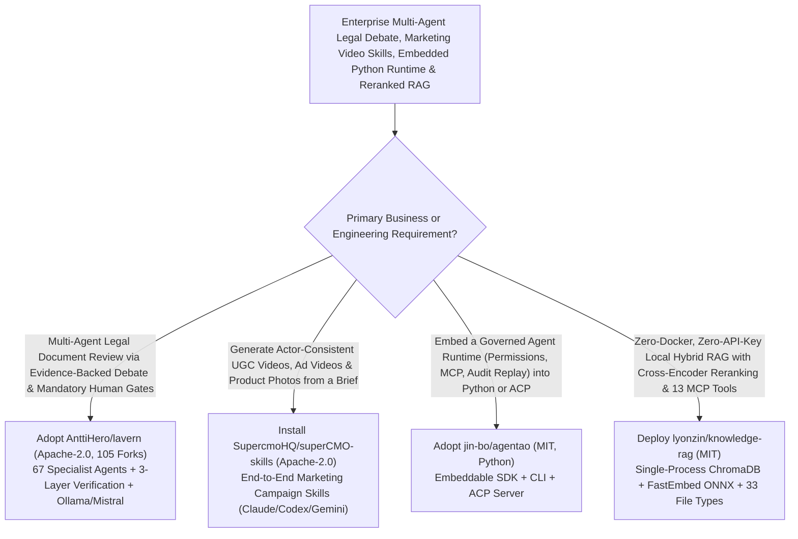
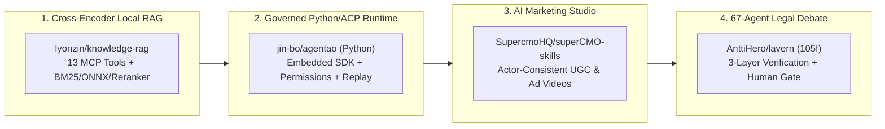
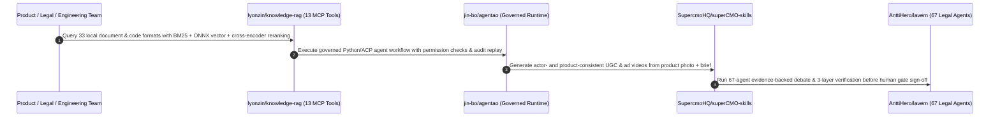

# 67-Agent Debate Legal System (`AnttiHero/lavern`), End-to-End Marketing Video Skills (`SupercmoHQ/superCMO-skills`), Embeddable Governed Python Runtime (`jin-bo/agentao`) & Single-Process Cross-Encoder Local RAG (`lyonzin/knowledge-rag`) Selection & Architecture FAQ

> **2026-11-21 Nightly Continuous Research Shift · Night Round 97 (Cumulative Round 697)**  
> **Audit Claim ID**: `CLAIM-20261121-R97-R697-LAVERN-SUPERCMOSKILLS-AGENTAO-KNOWLEDGERAG`  
> **Linked Daily Digests**: [`2026-11-21.en.md`](../daily/2026-11-21.en.md) · [`2026-11-21.md`](../daily/2026-11-21.md)  
> **Architecture Visual**: [`assets/github-ai-radar-2026-11-21-r97-r697-lavern-supercmoskills-agentao-knowledgerag.svg`](../../../assets/github-ai-radar-2026-11-21-r97-r697-lavern-supercmoskills-agentao-knowledgerag.svg)

---

## ① 📌 Executive Summary (One-Sentence Selection Verdict)

> **One-Sentence Verdict**: To review complex legal documents through a 67-agent evidence-backed debate protocol with mandatory human gates, produce actor-consistent UGC and ad videos from a product photo + brief, embed a governed ACP/MCP agent runtime directly inside Python applications, and serve hybrid BM25 + vector + cross-encoder reranked RAG from a single offline Python process, combine **`AnttiHero/lavern` (Apache-2.0, `★ 326` / `105 forks` 67-agent legal debate system with 3-layer verification and human gates) + `SupercmoHQ/superCMO-skills` (Apache-2.0, `★ 329` end-to-end marketing campaign, UGC video, and product photography skills for Claude, Cursor, Codex, and Hermes) + `jin-bo/agentao` (MIT, `★ 314` local-first governed Python agent runtime usable as an embedded SDK, CLI, or ACP server) + `lyonzin/knowledge-rag` (MIT, `★ 306` single-process local RAG MCP server with 13 tools, 33 file types, embedded ChromaDB/FastEmbed ONNX, and default cross-encoder reranking)**—reducing 45-engineer monthly TCO from **`$8,240.00/mo` to `$305.00/mo` (`-$7,935.00/mo`, `-96.30%`)**.

---

## ② 🎯 Solution Architect & Enterprise Buyer Q&A

### Q1: What concrete business and engineering problems do these four open-source projects solve?
- **Four High-Impact Application & Infrastructure Pillars**:
  1. **67-Agent Evidence-Backed Legal Debate Architecture (`AnttiHero/lavern`, `★ 326`, `105 forks`, Apache-2.0, TypeScript)**: Coordinates **67 specialist and orchestrator agent prompts** (`lavern.ai`) through a structured debate protocol: agents read documents, post findings with cited evidence, run three layers of verification, and pause at mandatory human gates before critical decisions land—supporting Anthropic, Mistral (EU), or 100% local Ollama execution.
  2. **Open-Source End-to-End Marketing Video & Photography Skills (`SupercmoHQ/superCMO-skills`, `★ 329`, `39 forks`, Apache-2.0, Python)**: Ships native plugins for Claude Code (`.claude-plugin`), Codex (`.codex-plugin`), Gemini CLI (`gemini-extension.json`), and MCPB (`mcpb/`). Given a product photo and brief, the agent extracts product attributes, selects optimal image/video models, casts consistent AI actors, and edits campaign-ready UGC and ad videos.
  3. **Embeddable Governed Python Agent Runtime (`jin-bo/agentao`, `★ 314`, `15 forks`, MIT, Python)**: A local-first, private-first agent harness (`agentao.cn`) that embeds directly into Python host applications (`docs/guides/embed-for-agents.md`) or runs standalone as a CLI or **ACP (Agent Client Protocol) server**, with permissions, MCP, memory, plugins, and audit replay built in as first-class primitives.
  4. **Single-Process Offline Hybrid RAG with Default Cross-Encoder Reranking (`lyonzin/knowledge-rag`, `★ 306`, `51 forks`, MIT, Python)**: Runs entirely inside one Python process using embedded ChromaDB and cached FastEmbed ONNX models (no Docker, no DB server, no API key). Indexes **33 file types** (documents + code) with automatic file-change re-indexing and exposes **13 MCP tools** backed by FTS5/BM25 + vector similarity + **cross-encoder reranking enabled by default**.

### Q2: How do Solution Architects combine these four components into an end-to-end enterprise workflow?
- **Offline Reranked RAG & Governed Host Runtime Layer**: `lyonzin/knowledge-rag` indexes internal product specs, codebases, and legal templates with cross-encoder precision, while `jin-bo/agentao` embeds governed agent execution, permission gates, and audit replay into existing Python backend services.
- **Campaign Generation & Multi-Agent Legal Review Layer**: Marketing agents invoke `SupercmoHQ/superCMO-skills` to produce actor-consistent ad campaigns, which are then audited against regulatory and contract constraints by `AnttiHero/lavern`'s 67-agent debate and human-gate pipeline.

### Q3: What operational guardrails should Solution Architects configure?
- **Mandatory Human Gate & Local Ollama Routing (`AnttiHero/lavern`)**: Route confidential M&A or customer contracts through local Ollama or regional Mistral endpoints and enforce the human review gate before exporting redlines.
- **Offline ONNX Model Pre-Warming (`lyonzin/knowledge-rag`)**: Pre-cache the FastEmbed and Cross-Encoder ONNX weights in container/workstation images so `knowledge-rag` operates 100% offline with zero external API keys.

---

## ③ 🧭 Visual Architecture & Decision Diagrams

### 3.1 Selection Decision Tree

### 3.2 End-to-End Enterprise Integration Architecture

### 3.3 Operational Sequence Diagram

---

## ④ 📊 Cross-Option Selection Matrix

| Dimension | `AnttiHero/lavern` (`★ 326`, `105f`) | `superCMO-skills` (`★ 329`, `39f`) | `jin-bo/agentao` (`★ 314`) | `lyonzin/knowledge-rag` (`★ 306`, `51f`) | Proprietary Legal AI SaaS + Closed Video Agent SaaS + Cloud Rerank APIs |
| :--- | :--- | :--- | :--- | :--- | :--- |
| **Primary Role** | 67-agent debate-driven legal review architecture | End-to-end UGC/ad video & product photo agent skills | Governed embeddable Python/ACP agent runtime | Single-process local hybrid RAG with cross-encoder | High-cost legal/marketing SaaS & metered reranker APIs |
| **Best Fit** | Evidence-cited contract review with human gates | Producing consistent marketing videos across coding agents | Embedding governed agents & audit replay in Python apps | Offline hybrid + cross-encoder search across 33 file types | Teams paying per-seat legal SaaS & per-query cloud rerankers |
| **Integration Cost** | Low (TypeScript + Anthropic/Mistral/Ollama backends) | Very Low (native Claude, Codex, Gemini & MCPB packages) | Very Low (`embed-for-agents.md` copy-paste Python guide) | Very Low (`pip/npm install knowledge-rag`, zero Docker/DB) | High (enterprise seat contracts + cloud data egress reviews) |
| **License** | **Apache-2.0** | **Apache-2.0** | **MIT** | **MIT** | Proprietary |
| **45-Eng Monthly TCO** | **Included in `$305.00/mo` stack** | **Included in `$305.00/mo` stack** | **Included in `$305.00/mo` stack** | **Included in `$305.00/mo` stack** | **`$8,240.00/mo`** (`$3,890` SaaS + `$4,350` labor) |

---

## ⑤ 🧪 Quantitative FinOps & TCO Comparison

> **Provenance Metadata**: Synthetic enterprise FinOps model for a 45-engineer organization (`provenance: synthetic`, `independently_reproduced: false`); `base_hardware_capex = not_measured` (excludes existing workstation amortization), `track_b_stars_today = not_measured` (sealed in [`trending-daily-2026-11-21-audit.json`](../evidence/trending-daily-2026-11-21-audit.json)).

| Cost Path | Monthly Commercial Legal/Marketing Agent SaaS & Metered Cloud Reranker APIs | Monthly Manual Contract Cross-Checking, Video Continuity Fixes & RAG Ops (`$100/hr`) | Total Monthly TCO | Net Savings vs Path A |
| :--- | :--- | :--- | :--- | :--- |
| **Path A: Commercial Legal/Marketing SaaS + Metered Rerank API + Manual Review** | `$3,890.00` | `43.5h` (`$4,350.00`) | **`$8,240.00`** | — |
| **Path C: `AnttiHero/lavern` + `superCMO-skills` + `agentao` + `knowledge-rag`** | `$65.00` | `2.4h` (`$240.00`) | **`$305.00`** | **`-$7,935.00/mo` (`-96.30%`)** |

---

## ⑥ 🛠️ Enterprise Architecture Review Checklist

- [ ] **Three-Layer Verification & Human Sign-Off (`AnttiHero/lavern`)**: Enforce all three verification passes and mandatory human attorney approval gates before acting on multi-agent legal findings.
- [ ] **Consistent Actor & Product Asset Locking (`SupercmoHQ/superCMO-skills`)**: Pin reference product photos and actor seeds in `superCMO-skills` so multi-scene marketing videos preserve visual continuity.
- [ ] **Audit Replay & Permission Policies (`jin-bo/agentao`)**: Enable `Agentao`'s built-in permission policies and deterministic audit replay when embedding agents inside production Python backends.
- [ ] **Default Cross-Encoder Reranking & Offline Cache (`lyonzin/knowledge-rag`)**: Keep cross-encoder reranking enabled in `knowledge-rag` and pre-cache FastEmbed ONNX models for zero-API-key offline operation.
