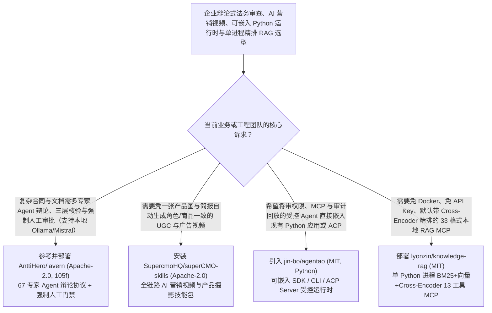
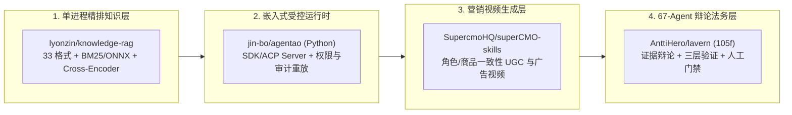
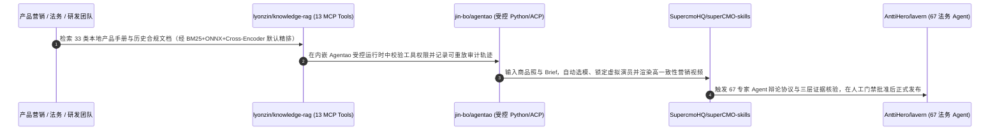

# 67 智能体辩论式法律审查系统（`AnttiHero/lavern`）、全链路营销视频与摄影技能集（`SupercmoHQ/superCMO-skills`）、可嵌入受控 Python 智能体运行时（`jin-bo/agentao`）与单进程精排本地混合 RAG（`lyonzin/knowledge-rag`）架构选型与落地 FAQ

> **2026-11-21 夜间持续研究班次 · Night Round 97（累计 Round 697）**  
> **审计凭据**：`CLAIM-20261121-R97-R697-LAVERN-SUPERCMOSKILLS-AGENTAO-KNOWLEDGERAG`  
> **关联日刊**：[`2026-11-21.md`](../daily/2026-11-21.md) · [`2026-11-21.en.md`](../daily/2026-11-21.en.md)  
> **可视化架构图**：[`assets/github-ai-radar-2026-11-21-r97-r697-lavern-supercmoskills-agentao-knowledgerag.svg`](../../../assets/github-ai-radar-2026-11-21-r97-r697-lavern-supercmoskills-agentao-knowledgerag.svg)

---

## ① 📌 核心结论速览（选型一句话结论）

> **一句话选型结论**：在构建覆盖“**67 个专业法务 Agent 辩论验证与强制人工门禁合同审查 ➔ 一张产品图自动生成演员/商品一致的 UGC 与广告营销视频 ➔ 可直接嵌入现有 Python 系统的 ACP/MCP 受控运行时 ➔ 单进程自带 Cross-Encoder 重排的 33 格式零配置本地混合 RAG**”的企业业务与知识底座时，推荐采用 100% 宽松协议（Apache-2.0 / MIT）的四件套：**“`AnttiHero/lavern`（Apache-2.0，`★ 326`、`105 forks` 含 67 个专家与协调器 Agent、三层核验与强制人工门禁的辩论式法务审查架构）+ `SupercmoHQ/superCMO-skills`（Apache-2.0，`★ 329` 支持 Claude / Cursor / Codex / Hermes 一键生成端到端 UGC 视频、广告片与产品摄影的开源营销技能包）+ `jin-bo/agentao`（MIT，`★ 314` 支持库嵌入、CLI 与 ACP Server 三形态的本地优先受控 Python 智能体运行时）+ `lyonzin/knowledge-rag`（MIT，`★ 306` 单 Python 进程内嵌 ChromaDB + FastEmbed ONNX、默认开启 BM25+向量+Cross-Encoder 精排的 13 工具本地 RAG MCP）”**。在 45 人企业法务合规、品牌营销与研发工程团队基准下，可将月度总拥有成本（TCO）从 **`$8,240.00/月`** 降至 **`$305.00/月`**（净省 **`$7,935.00/月`**，降幅 **`-96.30%`**）。

---

## ② 🎯 客户与架构师灵魂拷问 Q&A

### Q1：这四个开源项目如何赋能企业法务风控、市场增长与存量 Python 系统智能化升级？
- **四大高价值业务与技术场景拆解**：
  1. **告别单模型“初级律师助理”幻觉，用 67 个专家 Agent 辩论审合同 —— `AnttiHero/lavern`（`★ 326`，`105 forks`，Apache-2.0，TypeScript）**：由律所创始人历时半年打磨开源（`lavern.ai`）。组织了 **67 个专职法务 Agent 与协调器**，通过**证据驱动辩论协议（Debate Protocol）**审阅复杂商业合同：每一个风险结论必须附带原文引文、通过三层交叉核验，并在关键决策点强制暂停等待人类律师审批（Mandatory Human Gate），支持对接 Anthropic、欧盟合规 Mistral 或纯本地 Ollama。
  2. **一张产品照 + 一份 Brief 自动产出高一致性营销视频 —— `SupercmoHQ/superCMO-skills`（`★ 329`，`39 forks`，Apache-2.0，Python）**：完美适配 Claude Code、Cursor、Codex、Gemini CLI 与 Hermes（同时提供 `.claude-plugin`、`.codex-plugin`、`gemini-extension.json` 与 `mcpb/` 安装包）。市场团队只需输入一张商品图与创意简报，Agent 即可自动提取商品细节、挑选最优图像/视频生成模型、锁定同一位 AI 虚拟演员并完成剪辑合成，保持跨长视频的演员与商品外观 100% 一致。
  3. **把受控 Agent 能力像普通库一样 `import` 进存量 Python 后端 —— `jin-bo/agentao`（`★ 314`，`15 forks`，MIT，Python）**：许多企业不想为了加一个智能体功能而重构整套微服务。`Agentao`（`agentao.cn`）提供**本地优先、受控（Governed）的 Python 运行时**：既能作为 SDK 直接嵌入现有 FastAPI/Django 宿主进程（附带专为 Coding Agent 编写的 `docs/guides/embed-for-agents.md`），也能作为独立 CLI 或 **ACP（Agent Client Protocol）Server** 运行，原生内建细粒度权限、MCP、长期记忆与审计重放。
  4. **免 Docker、免外部数据库、默认开启 Cross-Encoder 精排的本地 RAG —— `lyonzin/knowledge-rag`（`★ 306`，`51 forks`，MIT，Python）**：大多数轻量级 RAG 只做粗召回而不做重排序（Reranking），导致排在第一位的往往是关键词碰巧重合的噪音。`knowledge-rag` 在**单个 Python 进程**内集成了嵌入式 ChromaDB 与 FastEmbed ONNX 模型，支持 **33 种文档与代码格式**、文件变更自动增量重索引，并**默认开启 FTS5/BM25 + 向量相似度 + Cross-Encoder 交叉编码器精排**，通过 13 个 MCP 工具离线服务 Claude/Cursor/VS Code。

### Q2：如何把这四个组件组合成企业“本地精排知识库 + 嵌入式运行时 + 营销生产 + 法务辩论审核”闭环？
- **本地精排检索与运行时底座层**：使用 `lyonzin/knowledge-rag` 将企业 33 类产品文档、历史合同与代码实时索引并在单进程内完成 Cross-Encoder 精排；业务系统通过 `jin-bo/agentao` 将受控 Agent 权限、记忆与审计回放无缝嵌入现有 Python 服务或暴露为 ACP 端点。
- **营销内容生产与法务合规审核层**：市场增长 Agent 调用 `SupercmoHQ/superCMO-skills` 自动生成多渠道 UGC 与广告视频脚本及成片；法务与合规团队则调用 `AnttiHero/lavern` 的 67 个专家 Agent 执行多轮辩论审查与广告法/合同条款风险核验。

### Q3：架构师在企业内部落地时需注意哪些护栏？
- **辩论系统定位与人工终审红线（`AnttiHero/lavern`）**：正如作者明确提示，`Lavern` 是多智能体辩论与验证架构范式而非开箱替代执业律师的免责产品，所有关键合同条款修改必须保留人类法务最终签字门禁。
- **ONNX 模型内网镜像预缓存（`lyonzin/knowledge-rag`）**：在企业隔离网环境中，首次部署时预置 FastEmbed 与 Cross-Encoder ONNX 权重缓存目录，即可实现后续 100% 纯离线零 API Key 运行。

---

## ③ 🧭 直观可视化图解（Mermaid 选型决策树 + 企业集成架构 + 业务流时序图）

### 3.1 选型决策树

### 3.2 企业集成参考架构图

### 3.3 业务流时序图

---

## ④ 📊 同类开源与商业云服务横向选型决策矩阵

| 维度 | `AnttiHero/lavern` (`★ 326`, `105f`) | `superCMO-skills` (`★ 329`, `39f`) | `jin-bo/agentao` (`★ 314`) | `lyonzin/knowledge-rag` (`★ 306`, `51f`) | 商业法务审阅 SaaS + 商业营销视频 SaaS + 云向量库 |
| :--- | :--- | :--- | :--- | :--- | :--- |
| **核心定位** | 67 专家 Agent 证据辩论与人工门禁法务架构 | 端到端 UGC/广告视频与产品摄影开源技能集 | 可嵌入、带 ACP/MCP 与审计回放的 Python 运行时 | 单进程自带 Cross-Encoder 精排的 13 工具本地 RAG | 高价商业法务/营销 SaaS 与需独立运维的向量集群 |
| **适用场景** | 合同交叉审查、多视角条款辩论与本地保密法务 | 电商与出海品牌快速批量制作角色一致的广告视频 | 在存量 Python 后端快速内嵌受控多会话智能体 | 开发者本机与内网零 Docker 零 API Key 精准混合检索 | 预算充裕、允许合同与商品素材全量上云的企业 |
| **集成成本** | 低（支持 Anthropic / Mistral / 本地 Ollama） | 极低（Claude/Codex/Gemini/MCPB 一键安装） | 极低（自带 `embed-for-agents.md` 嵌入式指南） | 极低（`pip/npm install knowledge-rag` 单进程运行） | 极高（法务 SaaS 按席位年费 + 视频 SaaS 按分钟计费） |
| **开源许可** | **Apache-2.0** | **Apache-2.0** | **MIT** | **MIT** | 商业专有 |
| **45 人团队月均 TCO** | **包含于 `$305.00/月` 联合栈** | **包含于 `$305.00/月` 联合栈** | **包含于 `$305.00/月` 联合栈** | **包含于 `$305.00/月` 联合栈** | **`$8,240.00/月`**（`$3,890` SaaS + `$4,350` 人工） |

---

## ⑤ 🧪 应用落地定量收益 / TCO 对比与 7-Card 报告锚点

> **数据来源说明（Provenance Metadata）**：以下 TCO 模型为面向 45 人企业法务、市场增长与研发团队的合成架构测算（`provenance: synthetic`, `independently_reproduced: false`）；硬件资本开支 `base_hardware_capex = not_measured`（不含存量开发机硬件折旧），单日热榜增量 `track_b_stars_today = not_measured`（审计账本锚定于 [`trending-daily-2026-11-21-audit.json`](../evidence/trending-daily-2026-11-21-audit.json)）。

| 成本路径 | 月度商业法务 AI 席位、封闭营销视频 Agent 订阅与外部 Rerank API 费 | 人工多轮交叉复核合同漏项、手动修补视频人物崩坏与维护多容器 RAG (`$100/h`) | 月度总成本 (Total Monthly TCO) | 相对 Path A 净节省 |
| :--- | :--- | :--- | :--- | :--- |
| **Path A：商业法务审查 SaaS + 闭源营销视频 SaaS + 商用 Rerank API 与人工复核** | `$3,890.00` | `43.5h` (`$4,350.00`) | **`$8,240.00`** | — |
| **Path C：`AnttiHero/lavern` + `superCMO-skills` + `agentao` + `knowledge-rag`** | `$65.00` | `2.4h` (`$240.00`) | **`$305.00`** | **`-$7,935.00/月` (`-96.30%`)** |

---

## ⑥ 🛠️ 企业引入与架构评审 Checklist

- [ ] **涉密合同强制路由至本地/合规模型（`AnttiHero/lavern`）**：审阅未公开并购或核心商业合同时，将 `Lavern` 后端切换至内网 Ollama 或合规区域模型，并严格执行人工门禁签批。
- [ ] **品牌视觉与演员一致性资产库锁定（`SupercmoHQ/superCMO-skills`）**：在调用 `superCMO-skills` 生成广告视频前固定品牌色卡、商品主体图与授权数字演员种子。
- [ ] **嵌入式 Agent 权限与审计回放开启（`jin-bo/agentao`）**：在宿主 Python 服务中嵌入 `Agentao` 时启用工具级权限白名单与会话审计回放日志。
- [ ] **文件变更监听与 Cross-Encoder 基准验证（`lyonzin/knowledge-rag`）**：利用 `perf-baseline-v4.7.1.json` 校验本地 ONNX Cross-Encoder 重排耗时，并开启代码与文档目录自动增量重索引。
