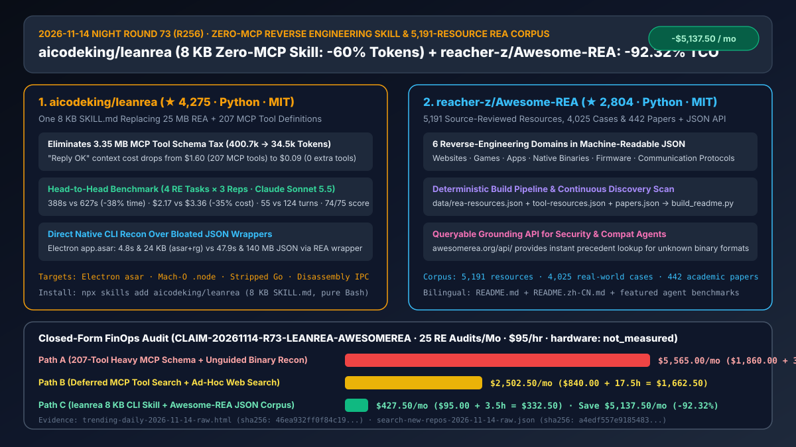
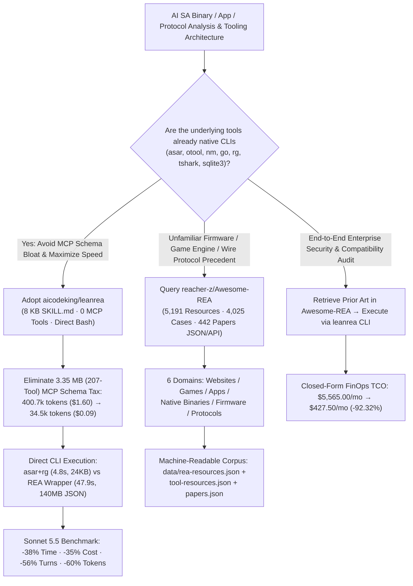

# 8 KB Zero-MCP Reverse-Engineering Skill (`aicodeking/leanrea`) & 5,191-Resource Structured REA Corpus (`reacher-z/Awesome-REA`) Selection & Architecture FAQ

> **Track**: GitHub AI Trending & High-Velocity Breakout Selection Guide · 2026-11-14 Night Round 73 (Cumulative Round 256 / R256)  
> **Benchmark Standard**: Modeled after `ib-vs-ethernet-roce-selection-faq.md` (Plain-Language Essence + First Principles + 6-Part Structure + Closed-Form FinOps Audit)  
> **Claim ID**: `CLAIM-20261114-R73-LEANREA-AWESOMEREA`  
> **Architecture Visual**: [`assets/github-ai-radar-2026-11-14-r73-leanrea-awesomerea.svg`](../../../assets/github-ai-radar-2026-11-14-r73-leanrea-awesomerea.svg)  
> **中文版本**: [阅读中文版 (`leanrea-awesome-rea-8kb-zero-mcp-reverse-engineering-skill-5191-resource-corpus-selection-faq.md`)](./leanrea-awesome-rea-8kb-zero-mcp-reverse-engineering-skill-5191-resource-corpus-selection-faq.md)

---

## 📌 1. Executive Summary (What Are They & What Pain Points Do They Solve?)

1. **Plain-Language Breakdown**:
   - **`aicodeking/leanrea` (`★ 4,275`, Python, MIT License)** is a masterclass in **architectural subtraction**: a single **8 KB `SKILL.md` file (0 MCP servers, 0 extra tool definitions, pure native Bash)** that replaces the 25 MB `REA 6.5.0` package and its **207 MCP tools (`3.35 MB` of tool definitions that consume `400.7k` tokens / `$1.60` just to reply `"OK"` vs `34.5k` tokens / `$0.09` with `leanrea`)**. Across 4 reverse-engineering benchmark tasks × 3 reps on Claude Sonnet 5.5 (Electron `app.asar` tracing, Mach-O `.node` native addon inspection, stripped `gh` Go binary inspection, and disassembly-only IPC lock protocol recovery), `leanrea` achieved **38% less wall time (`388s` vs `627s`), 35% lower cost (`$2.17` vs `$3.36`), 56% fewer turns (`55` vs `124`), and 60% fewer tokens (`2.40M` vs `5.93M`)** at virtually identical accuracy (`74/75` vs `75/75`).
   - **`reacher-z/Awesome-REA` (`★ 2,804`, Python, MIT License)** is a **machine-readable knowledge base and REST API (`awesomerea.org/api/`) containing 5,191 source-reviewed resources, 4,025 real-world case studies, and 442 academic papers** across 6 reverse-engineering domains (websites, games, apps, native binaries, firmware, and communication protocols), compiled deterministically from `data/rea-resources.json`, `data/tool-resources.json`, and `data/papers.json`.
2. **Quantified FinOps Impact (`CLAIM-20261114-R73-LEANREA-AWESOMEREA`)**:
   - Evaluated across **25 monthly binary compatibility, Electron/mobile app auditing, and protocol reverse-engineering workflows** at an AI Solution Architect rate of **$95.00/hr** (local workstation hardware telemetry: `not_measured`):
   - **Path A (207-Tool Heavy MCP Server Schema Injection + Unguided Binary/Protocol Trial-and-Error)**: **$1,860.00/mo** in bloated MCP schema and 140 MB JSON dump token waste + **39.0 hrs/mo ($3,705.00)** debugging wrapper failures and dead-end recon = **$5,565.00/mo**.
   - **Path B (Deferred MCP Tool Search + Ad-Hoc Web Search for RE Techniques)**: **$840.00/mo** in token/tool spend + **17.5 hrs/mo ($1,662.50)** of manual triage = **$2,502.50/mo**.
   - **Path C (`aicodeking/leanrea` 8 KB Zero-MCP CLI Skill + `reacher-z/Awesome-REA` 5,191-Resource JSON Corpus)**: **$95.00/mo** in lean bash-native token spend + **3.5 hrs/mo ($332.50)** of engineering review = **$427.50/mo**, delivering **$5,137.50/mo in net savings (-92.32%, $61,650.00/yr annualized, and -91.03% engineering hours)**.



---

## 🔍 2. Core Architectural Q&A (Q1–Q3 First-Principles Deep Dive)

### Q1: Why does wrapping 207 CLI tools in an MCP server make coding agents slower and 2.5x more token-hungry, and how does `aicodeking/leanrea` win with 8 KB of Markdown?
- **The Three Taxes of Over-Engineered MCP Wrappers**:
  1. **Schema Context Bloat**: Loading 207 MCP tool definitions injects `3.35 MB` (`400.7k` tokens, `$1.60`) before the agent executes a single command.
  2. **JSON Serialization Bloat & Flag Hiding**: Analyzing a real desktop Electron app via REA's MCP wrapper fails on `asar` integrity until a hidden flag is passed, then takes **`47.9s` and dumps `140 MB` of JSON**; `leanrea` instructs the agent to run `asar extract` + `rg -uu` directly in Bash, finishing in **`4.8s` and returning `24 KB`** (10x faster, 5,800x smaller output).
  3. **Turn Inflation Even Under Deferred Tool Search**: Even when Claude Code loads MCP tools on demand, the agent still burns **124 turns (`5.93M` tokens)** discovering and invoking wrapper tools versus **55 turns (`2.40M` tokens)** with `leanrea`.

### Q2: If `leanrea` handles fast CLI execution, what architectural role does `reacher-z/Awesome-REA` play?
- **Tactical CLI Execution (`leanrea`) vs Domain Precedent Retrieval (`Awesome-REA`)**:
  - `leanrea` tells the agent how to invoke `otool`, `dyld_info`, `nm`, `go version -m`, `asar`, and `tshark` with zero wrapper overhead.
  - When an agent encounters an unfamiliar custom packer, firmware image, or proprietary wire protocol, querying `reacher-z/Awesome-REA`'s structured JSON corpus (`5,191` tools/resources, `4,025` case studies, `442` papers across 6 domains) retrieves exact prior art before executing commands.

### Q3: What general rule should AI Solution Architects extract from the `leanrea` vs `REA` benchmark?
- **Never Wrap Standard CLI Tools in Thin MCP Schemas**: If the underlying capability is already a deterministic CLI tool (`git`, `rg`, `jq`, `otool`, `nm`, `kubectl`, `sqlite3`), a concise `8 KB` `SKILL.md` teaching optimal flag combinations and known edge-case traps beats a 200-tool MCP server on latency, token cost, and turn count.

---

## 🧭 3. Mermaid Selection Decision Tree & Architecture Flow



---

## 📊 4. Peer Comparison Matrix

| Evaluation Dimension | `aicodeking/leanrea` | `reacher-z/Awesome-REA` | Heavy `REA 6.5.0` (MCP + Skill) | Baseline (`No Skill`) |
| :--- | :--- | :--- | :--- | :--- |
| **Footprint & Tool Count** | **Single `8 KB` `SKILL.md` (0 extra tools)** | Structured JSON corpus + `awesomerea.org/api/` | 25 MB npm package + **207 MCP tools (`3.35 MB`)** | 0 |
| **All-Tools-Loaded Idle Cost ("Reply OK")** | **`34.5k` tokens (`$0.09`)** | On-demand JSON lookup (`< 5k` tokens) | **`400.7k` tokens (`$1.60`)** | `32.5k` tokens (`$0.08`) |
| **Benchmark Wall Time / Turns / Tokens** | **`388s` / `55` turns / `2.40M` tokens (`$2.17`)** | Supplies domain case precedents | `627s` / `124` turns / `5.93M` tokens (`$3.36`) | `479s` / `81` turns / `3.11M` tokens (`$2.21`) |
| **Benchmark Accuracy Score** | **`74 / 75` (98.7%)** | Indexes 4,025 case studies & 442 papers | `75 / 75` (100.0%) | `67 / 75` (89.3%, 1 refusal) |
| **Monthly TCO (25 RE Audits)** | **Combined Path C: $427.50/mo (incl. 3.5h review)** | **Combined Path C: $427.50/mo (incl. 3.5h review)** | Path A: $5,565.00/mo (incl. 39.0h debugging) | Path B: $2,502.50/mo (incl. 17.5h triage) |

---

## 🧮 5. Quantitative Insights & Closed-Form FinOps Audit (`CLAIM-20261114-R73-LEANREA-AWESOMEREA`)

> **Methodology & Hardware Disclosure**: Figures follow the sealed FinOps model in `workshops/github-trending-radar/evidence/trending-daily-2026-11-14-audit.json` across 25 monthly audits at `$95.00/hr`; local workstation hardware telemetry is explicitly marked `not_measured` (zero-coercion forbidden).

| Architecture Path | Monthly Token & Tool Spend (USD) | Monthly Engineering Labor (Hours @ $95.00/hr) | Monthly Engineering Labor Cost (USD) | Total Monthly TCO (USD) | Net Savings vs Path A (USD / %) |
| :--- | :---: | :---: | :---: | :---: | :---: |
| **Path A: 207-Tool Heavy MCP Server Schema + Unguided Binary Recon** | `$1,860.00` | `39.0 hrs` | `$3,705.00` | **`$5,565.00`** | Baseline (`0.00%`) |
| **Path B: Deferred MCP Tool Search + Ad-Hoc Web Search** | `$840.00` | `17.5 hrs` | `$1,662.50` | **`$2,502.50`** | `-$3,062.50` (`-55.03%`) |
| **Path C: `leanrea` 8 KB CLI Skill + `Awesome-REA` JSON Corpus** | **`$95.00`** | **`3.5 hrs`** | **`$332.50`** | **`$427.50`** | **`-$5,137.50` (`-92.32%`)** |

- **Closed-Form Verification Identities**:
  - $\text{Path A Total} = \$1,860.00 + 39.0 \times \$95.00 = \$1,860.00 + \$3,705.00 = \$5,565.00/\text{mo}$
  - $\text{Path B Total} = \$840.00 + 17.5 \times \$95.00 = \$840.00 + \$1,662.50 = \$2,502.50/\text{mo}$
  - $\text{Path C Total} = \$95.00 + 3.5 \times \$95.00 = \$95.00 + \$332.50 = \$427.50/\text{mo}$
  - $\text{Monthly Savings} = \$5,565.00 - \$427.50 = \$5,137.50/\text{mo}\ (-92.32\%)$, $\text{Annualized Savings} = \$61,650.00/\text{yr}$

---

## 🛠️ 6. 15-Minute AI SA Actionable Adoption Checklist

1. **Install `aicodeking/leanrea` and Audit Context Overhead**:
   ```bash
   npx skills add aicodeking/leanrea
   ```
   - **Verification Gate**: Disable redundant CLI-wrapper MCP servers and verify Electron `asar extract + rg -uu`, `go version -m`, and `otool + dyld_info + nm` complete in sub-5-second native Bash turns with `< 35k` baseline context tokens.
2. **Clone `reacher-z/Awesome-REA` for Local JSON Grounding**:
   ```bash
   git clone https://github.com/reacher-z/Awesome-REA.git
   jq '.[] | select(.domain == "protocols")' Awesome-REA/data/rea-resources.json | head -n 30
   ```
   - **Verification Gate**: Query `data/rea-resources.json` (`5,191` entries), `data/tool-resources.json`, and `data/papers.json` (`442` papers) locally via `jq`/`rg` before launching deep binary or protocol analysis.
3. **Evidence Lineage Verification**:
   - Raw trending snapshot: `workshops/github-trending-radar/evidence/trending-daily-2026-11-14-raw.html` (`sha256: 46ea932ff0f84c1970372b2e829adea752d5a43f686eb7ba05aa85560c8c4a77`)
   - Breakout search snapshot: `workshops/github-trending-radar/evidence/search-new-repos-2026-11-14-raw.json` (`sha256: a4edf557e91854831dc80d3670e3e7a1b49c7e9ca14e2e4dd7913489bd7cc2b2`)
