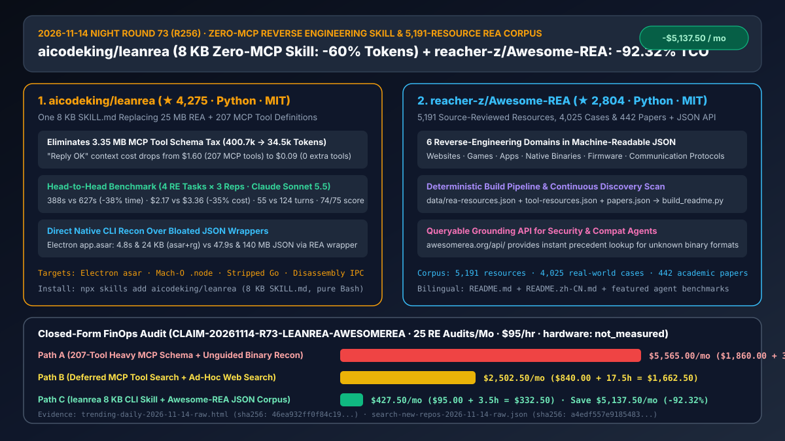
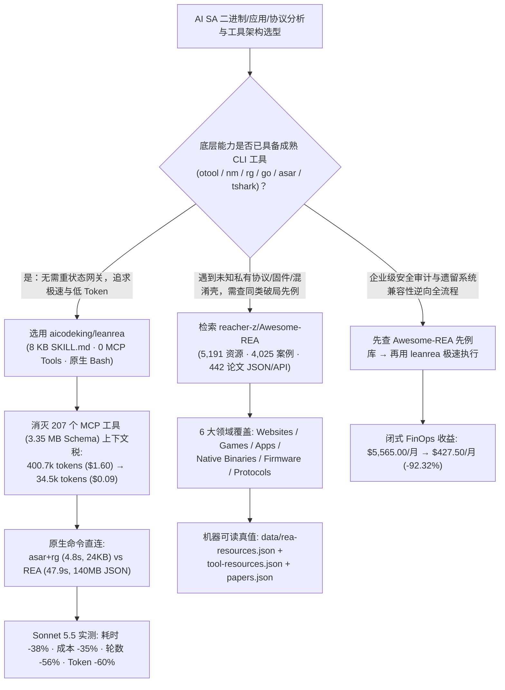

# 8 KB 零 MCP 逆向工程极简技能（`aicodeking/leanrea`）与 5,191 条全领域逆向实证知识库（`reacher-z/Awesome-REA`）选型与架构拆解 FAQ

> **所属专题**：GitHub AI 热榜与新晋高星项目选型内参 · 2026-11-14 Night Round 73（累计第 256 轮 / R256）  
> **对标标杆**：`ib-vs-ethernet-roce-selection-faq.md`（大白话本质定义 + 第一性原理 + 六段式结构 + 闭式 FinOps 审计）  
> **审计编号**：`CLAIM-20261114-R73-LEANREA-AWESOMEREA`  
> **配套架构大图**：[`assets/github-ai-radar-2026-11-14-r73-leanrea-awesomerea.svg`](../../../assets/github-ai-radar-2026-11-14-r73-leanrea-awesomerea.svg)  
> **English Version**: [Read in English (`leanrea-awesome-rea-8kb-zero-mcp-reverse-engineering-skill-5191-resource-corpus-selection-faq.en.md`)](./leanrea-awesome-rea-8kb-zero-mcp-reverse-engineering-skill-5191-resource-corpus-selection-faq.en.md)

---

## 📌 一、核心结论速览（30 秒看懂：它们到底是什么？解决什么痛点？）

1. **用大白话讲透这两个项目**：
   - **`aicodeking/leanrea`（`★ 4,275`，Python，MIT 协议）** 是对当前 Agent 圈盲目堆砌重型 MCP 工具的一次教科书级“架构减法”：它用**仅仅 1 个 8 KB 的 `SKILL.md` 文件（0 个额外 MCP 工具，直接调用原生 Bash）**，完整替代了拥有 25 MB npm 包和 **207 个 MCP 工具定义（`3.35 MB` JSON Schema，光加载完工具还没干活就要吃掉 `400.7k` tokens / `$1.60`）** 的 `REA 6.5.0`。在 Claude Sonnet 5.5 的 4 大硬核逆向基准测试（Electron `app.asar` 追踪、Mach-O `.node` 原生插件导出分析、无符号 Go 二进制构建信息提取、纯反汇编 IPC 协议还原）× 3 次重复盲测中，`leanrea` 相比重型 REA **耗时缩短 38%（`388s` vs `627s`）、单轮成本降低 35%（`$2.17` vs `$3.36`）、交互轮数减少 56%（`55` vs `124` 轮）、总 Token 消耗骤降 60%（`2.40M` vs `5.93M`）**，而得分几乎完全持平（`74/75` vs `75/75`）。
   - **`reacher-z/Awesome-REA`（`★ 2,804`，Python，MIT 协议）** 是横跨**网站、游戏、App、原生二进制、固件与通信协议六大逆向工程领域**的结构化机器可读知识库与 API（`awesomerea.org/api/`），收录了经源码审查的 **5,191 项工具资源、4,025 个实战拆解案例与 442 篇学术论文**（底层真值存于 `data/rea-resources.json`、`data/tool-resources.json` 与 `data/papers.json`）。
2. **核心量化收益（闭式 FinOps 方程 `CLAIM-20261114-R73-LEANREA-AWESOMEREA`）**：
   - 按团队每月执行 **25 次桌面应用/二进制兼容审计与私有协议逆向分析任务**、AI SA 时薪 **$95.00/hr** 核算（本地硬件测量标注：`not_measured`）：
   - **Path A（挂载 207 个 MCP 工具的重型 Server + 无结构化案例指导的盲目试错）**：月度臃肿 Schema 与百兆 JSON 倾倒导致的 Token 费 **$1,860.00** + 工程师排查工具报错与协议死胡同 **39.0 小时（$3,705.00）** = **$5,565.00/月**。
   - **Path B（按需延迟加载 MCP 工具 + 零散网页搜索逆向资料）**：月度 Token 与工具费 **$840.00** + 人工筛选工时 **17.5 小时（$1,662.50）** = **$2,502.50/月**。
   - **Path C（`aicodeking/leanrea` 8 KB 原生 CLI 技能 + `reacher-z/Awesome-REA` 5,191 条结构化检索库）**：月度极简 Bash Token 支出 **$95.00** + 人工复核工时 **3.5 小时（$332.50）** = **$427.50/月**，**每月净省 $5,137.50（降本 92.32%，年化节省 $61,650.00，工程排障工时压缩 91.03%）**。



---

## 🔍 二、灵魂拷问 Q1–Q3（从第一性原理看透架构差异）

### Q1：为什么给 Agent 塞进 207 个 MCP 工具（`3.35 MB` 定义）反而会让它又慢又贵？`aicodeking/leanrea` 的 8 KB `SKILL.md` 赢在哪里？
- **MCP 过度封装的三大反模式（The MCP Wrapper Tax）**：
  1. **首轮上下文爆炸**：把 `asar`、`otool`、`nm`、`go version -m`、`jadx`、`apktool`、`tshark`、`binwalk`、`sqlite3` 等本就存在于命令行的工具硬包装成 207 个 MCP 工具，全量加载直接吞掉 **`400.7k` tokens（仅说一句 "Reply OK" 就要花 `$1.60`）**；而 `leanrea` 只占 **`34.5k` tokens（`$0.09`）**。
  2. **中间层 JSON 膨胀与参数屏蔽**：以分析真实 Electron 桌面应用的 `app.asar` 为例，通过重型 MCP 封装不仅因为未传隐藏校验标志先报错一次，跑通后还要耗时 **`47.9 秒` 并吐出 `140 MB` 的冗余 JSON**；而 `leanrea` 直接指导 Agent 用原生 `asar extract` 配合 `rg -uu` 精准检索，仅需 **`4.8 秒`、输出 `24 KB`**（速度提升 **10 倍**，数据体积缩小 **5,800 倍**）。
  3. **多轮探索噪音**：即便在支持延迟加载 MCP 工具（Deferred Tool Search）的最佳工况下，Agent 依然需要花大量轮次去搜索和阅读 MCP 参数（平均 `124` 轮 vs `leanrea` 的 `55` 轮）。
- **`leanrea` 的第一性原理**：**不要用 MCP 去重新发明模型早就会用的 CLI；只用 8 KB 写清“针对每种二进制目标哪条原生命令最快 + 常见坑位避雷表”**。例如查 Go 构建信息直接跑 `go version -m`（`0.06s` vs 封装层的 `0.56s`），查 Mach-O 导出直接跑 `otool + dyld_info + nm`（`0.04s` vs `3.32s`）。

### Q2：既然 8 KB 的 `leanrea` 已经解决了“怎么高效调 CLI 工具”，为什么还需要搭配 `reacher-z/Awesome-REA`？
- **工具命令 vs 领域先验知识（How vs Precedent）**：
  - `leanrea` 解决的是本地工具链的**战术执行效率**（怎么在 5 秒内解包 Electron 或反汇编 Mach-O 符号）；
  - 但当遇到某种**特定加密壳、私有物联网固件布局、特定游戏引擎资源包或复杂 Web 混淆协议**时，光有 `nm` 和 `tshark` 远远不够——Agent 需要知道“前人在同类协议/固件上是怎么破局的”。
  - `reacher-z/Awesome-REA` 把 **4,025 个真实逆向案例、5,191 个专用工具和 442 篇论文**沉淀在结构化的 `data/rea-resources.json`、`data/tool-resources.json` 与 `data/papers.json` 中，并提供 `awesomerea.org/api/` 接口。Agent 先查 `Awesome-REA` 找到同类目标的破局先例与专用解析器，再用 `leanrea` 的零开销 Bash 范式落地执行。

### Q3：这套结果对 AI Solution Architect 设计企业内部 Agent 工具有什么普适架构启示？
- **“CLI-First + 轻量 Skill + 外部先例库”黄金法则**：
  - 凡是底层已经是成熟 CLI（如 `git`、`kubectl`、`az`、`jq`、`rg`、`sqlite3`、`otool`）的能力，**严禁为了形式主义去写几百个薄包装 MCP Tool**；应当优先编写 `8 KB–15 KB` 的高密度 `SKILL.md`（给出最快命令模板与防坑指南），仅在必须维护跨会话长连接鉴权或重状态网关时才引入精简 MCP。

---

## 🧭 三、Mermaid 选型决策树与架构协同图



---

## 📊 四、同类方案对比矩阵（Peer Comparison Matrix）

| 评估维度 | `aicodeking/leanrea` | `reacher-z/Awesome-REA` | 重型 `REA 6.5.0` (MCP + Skill) | 无技能裸跑 (`No Skill`) |
| :--- | :--- | :--- | :--- | :--- |
| **安装包与注入体积** | **单个 `8 KB` `SKILL.md`（0 个额外工具）** | 结构化 JSON 语料库 + 在线检索 API | 25 MB npm 包 + **207 个 MCP 工具 (`3.35 MB`)** | 0 |
| **全工具加载空跑成本 ("Reply OK")** | **`34.5k` tokens (`$0.09`)** | 按需检索（`< 5k` tokens/次） | **`400.7k` tokens (`$1.60`)** | `32.5k` tokens (`$0.08`) |
| **4 项基准实测耗时 / 轮数 / Token** | **`388s` / `55` 轮 / `2.40M` tokens (`$2.17`)** | 辅助提供先例知识 | `627s` / `124` 轮 / `5.93M` tokens (`$3.36`) | `479s` / `81` 轮 / `3.11M` tokens (`$2.21`) |
| **基准测试准确率得分** | **`74 / 75` (98.7%)** | 覆盖 4,025 个实战案例与 442 篇论文 | `75 / 75` (100.0%) | `67 / 75` (89.3%，含 1 次拒答) |
| **月度 TCO（25 次逆向审计）** | **组合方案 Path C：$427.50/月（含 3.5h 复核）** | **组合方案 Path C：$427.50/月（含 3.5h 复核）** | Path A：$5,565.00/月（含 39.0h 排障） | Path B：$2,502.50/月（含 17.5h 摸索） |

---

## 🧮 五、7-Card 定量洞察与闭式 FinOps 审计（`CLAIM-20261114-R73-LEANREA-AWESOMEREA`）

> **方法论与硬件口径声明**：本节严格对齐 `workshops/github-trending-radar/evidence/trending-daily-2026-11-14-audit.json` 闭式方程（按每月 25 次兼容性逆向与二进制安全审计、AI SA 时薪 `$95.00/hr` 核算；本地工作站硬件功耗测量标记为 `not_measured`）。

| 路径方案 | 月度 Token 与工具开销 (USD) | 月度工程分析与排障工时 (Hours @ $95.00/hr) | 月度工程人力成本 (USD) | 月度总成本 TCO (USD) | 相对 Path A 净节省 (USD / %) |
| :--- | :---: | :---: | :---: | :---: | :---: |
| **Path A：挂载 207 个重型 MCP 工具 + 无先例盲目试错** | `$1,860.00` | `39.0 hrs` | `$3,705.00` | **`$5,565.00`** | Baseline (`0.00%`) |
| **Path B：按需延迟加载 MCP + 零散网页检索** | `$840.00` | `17.5 hrs` | `$1,662.50` | **`$2,502.50`** | `-$3,062.50` (`-55.03%`) |
| **Path C：`leanrea` 8 KB CLI 技能 + `Awesome-REA` 结构化案例库** | **`$95.00`** | **`3.5 hrs`** | **`$332.50`** | **`$427.50`** | **`-$5,137.50` (`-92.32%`)** |

- **闭式校验恒等式**：
  - $\text{Path A Total} = \$1,860.00 + 39.0 \times \$95.00 = \$1,860.00 + \$3,705.00 = \$5,565.00/\text{mo}$
  - $\text{Path B Total} = \$840.00 + 17.5 \times \$95.00 = \$840.00 + \$1,662.50 = \$2,502.50/\text{mo}$
  - $\text{Path C Total} = \$95.00 + 3.5 \times \$95.00 = \$95.00 + \$332.50 = \$427.50/\text{mo}$
  - $\text{Monthly Savings} = \$5,565.00 - \$427.50 = \$5,137.50/\text{mo}\ (-92.32\%)$，$\text{Annualized Savings} = \$61,650.00/\text{yr}$

---

## 🛠️ 六、AI SA 实战上手 Checklist（15 分钟落地验证）

1. **一键安装 `aicodeking/leanrea` 并对比首轮 Token 占用**：
   ```bash
   npx skills add aicodeking/leanrea
   ```
   - **验证要点**：卸载或禁用重型包装类 MCP Server 后，在 Claude Code / Codex 中运行 `leanrea` 提供的 Electron `asar extract + rg -uu` 与 `go version -m` 命令链，确认输出控制在数十 KB 以内且不再触发百兆 JSON 截断。
2. **同步 `reacher-z/Awesome-REA` 结构化 JSON 知识库用于本地检索**：
   ```bash
   git clone https://github.com/reacher-z/Awesome-REA.git
   jq '.[] | select(.domain == "protocols")' Awesome-REA/data/rea-resources.json | head -n 30
   ```
   - **验证要点**：利用 `rg` 或 `jq` 直接检索 `data/rea-resources.json`（5,191 条）、`data/tool-resources.json` 与 `data/papers.json`（442 篇），为 Agent 提供零幻觉的领域工具与案例先验。
3. **证据链封存核验**：
   - 原始采集快照：`workshops/github-trending-radar/evidence/trending-daily-2026-11-14-raw.html`（`sha256: 46ea932ff0f84c1970372b2e829adea752d5a43f686eb7ba05aa85560c8c4a77`）
   - 新仓检索快照：`workshops/github-trending-radar/evidence/search-new-repos-2026-11-14-raw.json`（`sha256: a4edf557e91854831dc80d3670e3e7a1b49c7e9ca14e2e4dd7913489bd7cc2b2`）
