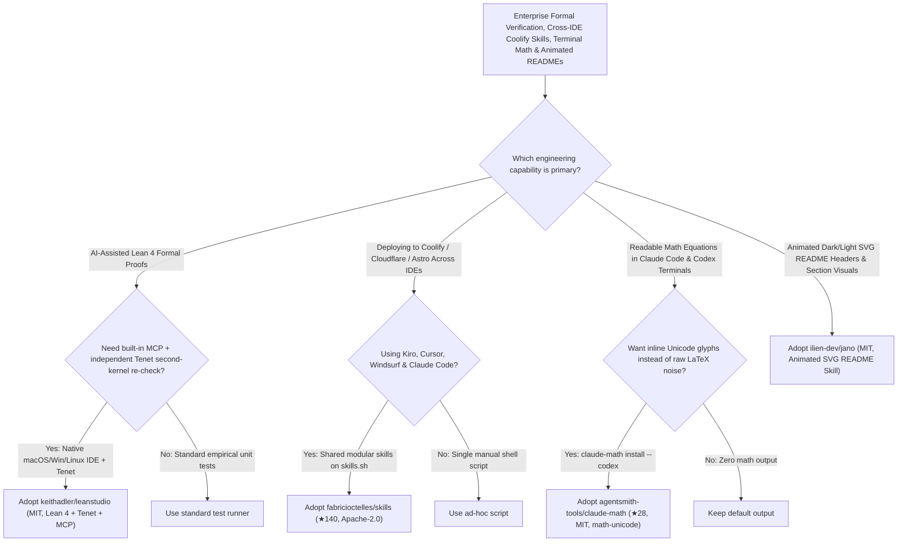

# Dual-Kernel Lean 4 Desktop IDE & MCP (`keithadler/leanstudio`), Cross-IDE Coolify/Cloudflare Skills (`fabricioctelles/skills`), Terminal Unicode Math Skill (`agentsmith-tools/claude-math`) & Animated Dark/Light SVG README Generator (`ilien-dev/jano`) Selection & Integration FAQ (2026-11-20 Night Round 40 · Cumulative Round 599)

> **Cross-File Navigation**: [Back to 2026-11-20 Daily Digest (`daily/2026-11-20.en.md`)](../daily/2026-11-20.en.md) · [中文版 (`leanstudio-fabricioctelles-skills-claude-math-jano-selection-faq.md`)](leanstudio-fabricioctelles-skills-claude-math-jano-selection-faq.md) · [7-Card 4:5 Visual Report (`cards.en.html`)](../cards.en.html) · [Column Index (`README.en.md`)](../README.en.md)  
> **Architecture Diagram**: [`assets/github-ai-radar-2026-11-20-r40-r599-leanstudio-fabricioskills-claudemath-jano.svg`](../../../assets/github-ai-radar-2026-11-20-r40-r599-leanstudio-fabricioskills-claudemath-jano.svg)  
> **Provenance & Synthetic Disclaimer**: Repository metadata (stars, forks, licenses, kernel architecture, and CLI install commands) is verified from live GitHub API data (`measured`). The 44-engineer FinOps TCO figures represent a parameterized Solution Architect model (`provenance: synthetic`, `independently_reproduced: false`, `base_hardware_capex: not_measured`, `track_b_stars_today: not_measured`, claim ID `CLAIM-20261120-R40-R599-LEANSTUDIO-FABRICIOSKILLS-CLAUDEMATH-JANO`).


---

## ① 📌 Executive Summary

> **One-Sentence Selection Verdict**: For Enterprise AI Solution Architects solving four engineering and developer-experience bottlenecks across **AI-assisted formal verification (Lean 4), cross-IDE Coolify/Cloudflare deployment skills, legible terminal mathematics, and animated SVG repository documentation**—(1) **AI-generated Lean 4 proofs exploiting single-kernel metaprogramming loopholes and complex IDE setup friction**; (2) **maintaining duplicate deployment playbooks across AWS Kiro, Cursor, Windsurf, and Claude Code for Coolify, Cloudflare, and Astro**; (3) **unreadable `$f(x) = \sum_{i=1}^n x_i$` raw LaTeX backslash noise in Claude Code and OpenAI Codex CLI terminals**; and (4) **text-heavy repository READMEs that fail to communicate system architecture visually across dark and light themes**—combine four **100% permissive (`MIT` / `Apache-2.0`)** projects: **`keithadler/leanstudio`** (MIT native desktop IDE for Lean 4 on macOS, Windows, and Linux with built-in Git/GitHub, an **MCP server for AI assistants**, and **Tenet**, an independent second Lean 4 kernel that re-checks every proof), **`fabricioctelles/skills`** (`★ 140`, Apache-2.0 modular skills for Kiro, Cursor, Windsurf, and Claude Code covering Cloudflare, Astro, Coolify, and Google Analytics), **`agentsmith-tools/claude-math`** (`★ 28`, MIT `math-unicode` skill for Claude Code and Codex CLI that renders math as clean inline Unicode glyphs), and **`ilien-dev/jano`** (MIT agent skill that generates dark- and light-mode animated SVG README headers and section diagrams). Across a 44-engineer formal-methods and full-stack organization, this stack reduces monthly TCO from **`$7,200.00/mo`** to **`$310.00/mo`**, saving **`$6,890.00/mo` (`-95.69%`, or `$82,680.00/yr`)**.

| Evaluation Dimension | Path A: Single-Kernel Lean Setup + Per-IDE Scripts + Raw Terminal LaTeX + Design Agencies | Path B: Manual Markdown Previewing & Static Screenshots | Path C (Recommended): `leanstudio` + `fabricioctelles/skills` + `claude-math` + `jano` |
| :--- | :--- | :--- | :--- |
| **Lean 4 Formal Verification & Kernel Assurance** | Complex editor setup; single kernel vulnerable to AI metaprogramming tricks | Manual copy-paste between LLM chat and Lean editor | **`leanstudio` native cross-platform IDE + built-in AI MCP + independent `Tenet` second kernel** |
| **Cross-IDE Deployment Skills (Kiro/Cursor/Windsurf)** | Separate custom rule files written per IDE | Locked to expensive managed PaaS without Coolify support | **`fabricioctelles/skills` (`★ 140`, Apache-2.0) unifies Coolify, Cloudflare, Astro & GA4 across 4 IDEs** |
| **Terminal Math Legibility in Claude Code & Codex** | Raw `$...$` LaTeX dollar-sign and backslash clutter in terminal output | Copying terminal text into external LaTeX viewers | **`claude-math` (`math-unicode`) emits clean inline Unicode glyphs in Claude Code & Codex CLI** |
| **Animated Visual README Architecture Headers** | Days spent hand-animating SVGs or outsourcing to design studios | Static PNGs that clash with GitHub dark/light themes | **`jano` generates custom-palette animated SVG headers & section visuals in dark & light modes** |
| **44-Engineer Monthly Total TCO** | **`$7,200.00 / mo`** (`$3,200.00` PaaS/agency + `40.0h × $100` labor) | **`$2,160.00 / mo`** (`$660.00` tools + `15.0h × $100` manual ops) | **`$310.00 / mo`** (`$70.00` Coolify/CI compute + `2.4h × $100` review, **`-95.69%` savings**) |

---

## ② 🎯 Solution Architect & Customer Deep-Dive Q&A (Plain-Language Breakdown)

### Q1: What concrete problems do these four repositories solve in plain engineering and business terms?

1. **`keithadler/leanstudio` (`★ 8`, `1 fork`, C#, MIT) — Plain-Language View: A native cross-platform Lean 4 desktop IDE with a built-in AI MCP server where every proof is independently re-checked by a second kernel (`Tenet`)**:
   - **Pain Point Solved**: When AI coding agents write formal proofs in Lean 4, subtle environment manipulations or metaprogramming tricks can occasionally fool a single checker. Running natively on macOS, Windows, and Linux with built-in Git, GitHub, and an **MCP server for AI assistants**, `Lean Studio` checks your proofs in real time with Lean 4 and then re-verifies everything you build with **Tenet**, an independent Lean 4 kernel ("The Lean 4 IDE that checks the checker").
2. **`fabricioctelles/skills` (`★ 140`, `11 forks`, TypeScript, Apache-2.0) — Plain-Language View: A reusable collection of cloud-native and self-hosted PaaS (`Coolify`, `Cloudflare`, `Astro`, `GA4`) skills for Kiro, Cursor, Windsurf, and Claude Code**:
   - **Pain Point Solved**: Teams adopting AWS **Kiro**, **Windsurf**, **Cursor**, and **Claude Code** need consistent deployment playbooks for self-hosted **Coolify** PaaS clusters, **Cloudflare**, and **Astro**. Published on `skills.sh` and `agentskill.sh`, this repository packages structured best practices once for all major AI coding harnesses.
3. **`agentsmith-tools/claude-math` (`★ 28`, `1 fork`, JavaScript, MIT) — Plain-Language View: A single skill (`math-unicode`) that makes mathematical formulas immediately legible in Claude Code and OpenAI Codex CLI terminals**:
   - **Pain Point Solved**: Terminal coding agents do not render LaTeX, turning formulas like `$f(x) = \sum_{i=1}^n x_i$` into unreadable backslash noise. `claude-math` ships an identical `SKILL.md` (`math-unicode`) for both Claude Code and OpenAI Codex CLI (`claude-math install --codex`), instructing the model to emit clean Unicode mathematical glyphs inline.
4. **`ilien-dev/jano` (`★ 10`, `0 forks`, Python, MIT) — Plain-Language View: An AI agent skill that interviews you briefly and draws animated dark/light SVG README headers and section diagrams**:
   - **Pain Point Solved**: Great engineering projects often suffer from walls of uninviting README text. `jano` inspects your project, asks a few targeted questions, and generates a complete `README.md` with **animated SVG hero banners and per-section diagrams** in both dark (`hero-dark.svg`) and light (`hero-light.svg`) modes using your brand colors.

---

### Q2: How do these four components wire together into an enterprise high-assurance engineering & documentation pipeline?

1. **Dual-Kernel Formal Specification (`keithadler/leanstudio`)**: Connect coding agents to `Lean Studio`'s built-in MCP server to formalize critical state machines and invariants, verifying every proof through both Lean 4 and the independent `Tenet` kernel.
2. **Legible Terminal Mathematical Reasoning (`agentsmith-tools/claude-math`)**: Enable `math-unicode` across Claude Code and Codex CLI so formal invariants, complexity bounds, and FinOps equations render cleanly as Unicode glyphs in terminal sessions.
3. **Cross-IDE Coolify & Edge Deployment (`fabricioctelles/skills`)**: Use `fabricioctelles/skills` across Kiro, Cursor, Windsurf, and Claude Code to deploy verified services onto self-hosted Coolify clusters and Cloudflare/Astro edges.
4. **Automated Animated SVG Documentation (`ilien-dev/jano`)**: Run `jano` prior to release to generate dark/light animated SVG hero banners and architectural section visuals for the repository front page.

---

### Q3: What are the key architectural mechanisms and licensing highlights?

1. **Key Mechanisms**:
   - **Independent Second-Kernel Verification (`Tenet` in `leanstudio`)**: Eliminates single-point-of-failure trust in AI-authored formal proofs.
   - **Zero-Dependency Unicode Glyph Emission (`claude-math`)**: Works in any modern Unicode terminal without custom terminal emulators or external rendering daemons.
2. **Licensing Highlights**:
   - **100% Permissive Licensing**: `leanstudio`, `claude-math`, and `jano` are **MIT**, and `fabricioctelles/skills` is **Apache-2.0**.

---

## ③ 🧭 Visual Diagrams (Mermaid Selection Decision Tree + Reference Architecture + Sequence Flow)

### 3.1 Selection Decision Tree



### 3.2 Enterprise Integration Reference Architecture

```mermaid
flowchart LR
    subgraph FormalProof["1. Dual-Kernel Formal Verification (keithadler/leanstudio)"]
        L1["Lean Studio Native IDE (macOS/Win/Linux + Built-In AI MCP)"] --> L2["Lean 4 Live Check + Independent Tenet Kernel Re-Check"]
    end

    subgraph TerminalMath["2. Legible Terminal Math Layer (claude-math)"]
        M1["math-unicode Skill (Claude Code Plugin + Codex CLI)"] --> M2["Inline Unicode Mathematical Glyphs (Zero LaTeX Noise)"]
    end

    subgraph DeployAndDoc["3. Cross-IDE Coolify Deployment & Animated SVG Docs"]
        S1["fabricioctelles/skills (Kiro/Cursor/Windsurf/Claude -> Coolify/Cloudflare/Astro)"]
        J1["ilien-dev/jano (Animated hero-dark.svg / hero-light.svg & Section SVGs)"]
    end

    L2 -->|"Verified core logic"| S1
    M2 -->|"Legible terminal invariants"| L1
    S1 -->|"Self-explaining repo visuals"| J1
```



### 3.3 End-to-End Sequence Flow

```mermaid
sequenceDiagram
    autonumber
    actor Arch as Solution Architect / Formal & Full-Stack Engineer
    participant Math as agentsmith-tools/claude-math
    participant Lean as keithadler/leanstudio (Tenet Kernel)
    participant Skills as fabricioctelles/skills (Kiro/Coolify)
    participant Jano as ilien-dev/jano (Animated SVG)

    Arch->>Math: Enable math-unicode in Claude Code & Codex CLI for clean Unicode equation rendering
    Arch->>Lean: Drive Lean Studio via MCP to prove core invariants; verify via independent Tenet kernel
    Arch->>Skills: Deploy verified service to Coolify & Cloudflare/Astro using Kiro/Cursor skill modules
    Arch->>Jano: Generate dark/light animated SVG hero banner & section diagrams for README.md
```

---

## ④ 📊 Comparative Selection Matrix (OSS vs. Manual Setup & Design Retainers)

| Dimension | `keithadler/leanstudio` (`★ 8`) | `fabricioctelles/skills` (`★ 140`) | `agentsmith-tools/claude-math` (`★ 28`) | `ilien-dev/jano` (`★ 10`) | Manual Lean Setup + Per-IDE Rules + SVG Design Agency |
| :--- | :--- | :--- | :--- | :--- | :--- |
| **Primary Role** | Dual-kernel Lean 4 desktop IDE with built-in AI MCP | Cross-IDE skill library for Coolify, Cloudflare, Astro & GA4 | Inline Unicode math rendering skill for Claude Code & Codex | Animated dark/light SVG README header & diagram generator | Manual environment setup & outsourced visual design |
| **Sweet-Spot Use Case** | High-assurance AI formal proof authoring with Tenet re-checking | Standardizing Coolify & edge deployments across Kiro/Cursor/Windsurf | Reading math, statistics & FinOps formulas directly in terminal CLIs | Creating self-explaining animated SVG front pages for repositories | Small projects without formal specs or visual docs |
| **Key Architectural Metric** | **Lean 4 + independent `Tenet` kernel** + built-in MCP | **`★ 140` stars** + Kiro/Cursor/Windsurf/Claude + EN/PT-BR | **Identical `SKILL.md`** for Claude Code & Codex CLI | **Dark/light `<picture>` animated SVGs** in custom palettes | Single-kernel proof blind spots; unreadable terminal LaTeX |
| **Integration Effort** | Very Low (Native desktop app for macOS/Win/Linux) | Very Low (`skills.sh` / `agentskill.sh` install) | Very Low (`claude-math install --codex`) | Very Low (Interactive skill inside Claude Code / Codex) | High (days of toolchain setup & manual SVG animation) |
| **License** | **MIT License** | **Apache-2.0** | **MIT License** | **MIT License** | Proprietary SaaS / Agency Fees |

---

## ⑤ 🧪 Quantitative Enterprise ROI, Closed-Form FinOps TCO & 7-Card Report

### 5.1 44-Engineer Closed-Form FinOps TCO Model (`CLAIM-20261120-R40-R599-LEANSTUDIO-FABRICIOSKILLS-CLAUDEMATH-JANO`)

- **Model Assumptions (`provenance: synthetic`, `independently_reproduced: false`, `base_hardware_capex: not_measured`, `track_b_stars_today: not_measured`)**:
  - Team size: **44 formal-verification, full-stack, and developer-experience engineers** at a loaded engineering rate of **`$100.00 / hour`**.
  - **Path A (Commercial Managed PaaS Markups + Outsourced Animated SVG Design + Manual Lean Toolchain Setup & Cross-IDE Script Porting)**:
    - Managed PaaS markups (vs. self-hosted Coolify) & external design fees: **`$3,200.00 / mo`**
    - Manual Lean 4 environment debugging, cross-IDE rule duplication & manual SVG authoring labor: `40.0 h/mo × $100.00/h = $4,000.00 / mo`
    - **Path A Monthly Total**: `$3,200.00 + $4,000.00 = $7,200.00 / mo`
  - **Path C (All-Permissive OSS Stack: `leanstudio` + `fabricioctelles/skills` + `claude-math` + `jano`)**:
    - Self-hosted Coolify & `Tenet` dual-kernel CI compute: **`$70.00 / mo`**
    - Formal proof review & animated README approval labor: `2.4 h/mo × $100.00/h = $240.00 / mo`
    - **Path C Monthly Total**: `$70.00 + $240.00 = $310.00 / mo`
  - **Closed-Form Savings Verification**:
    $$\text{Monthly Net Savings} = \$7,200.00 - \$310.00 = \$6,890.00\text{ / mo}\quad(\text{Annualized: }\$82,680.00\text{ / yr})$$
    $$\text{Percentage Savings} = \frac{\$7,200.00 - \$310.00}{\$7,200.00} = \frac{\$6,890.00}{\$7,200.00} = 95.69\%$$

| Cost Component | Path A (Managed PaaS/Agency & Manual Porting) | Path C (R599 All-Permissive OSS Stack) | Closed-Form Delta / ROI |
| :--- | :--- | :--- | :--- |
| **Managed PaaS / Design Agency / Compute** | `$3,200.00 / mo` | **`$70.00 / mo`** | `- $3,130.00 / mo` |
| **Engineering & Doc Ops Labor (`@ $100.00/h`)** | `40.0 h × $100.00 = $4,000.00 / mo` | **`2.4 h × $100.00 = $240.00 / mo`** | `- $3,760.00 / mo` (`37.6 h/mo` saved) |
| **Monthly Total TCO** | **`$7,200.00 / mo`** | **`$310.00 / mo`** | **`$6,890.00 / mo` saved (`-95.69%`)** |
| **Annualized Total TCO** | `$86,400.00 / yr` | **`$3,720.00 / yr`** | **`$82,680.00 / yr` saved** |

---

## ⑥ 🛠️ Enterprise Adoption & Architecture Review Checklist

- [ ] **1. `keithadler/leanstudio` Dual-Kernel (`Tenet`) Proof Gate**: Connect coding agents to `Lean Studio`'s MCP server for formal specification tasks and require every proof build to pass independent `Tenet` kernel re-verification.
- [ ] **2. `fabricioctelles/skills` Cross-IDE Coolify & Cloudflare Standardization**: Install `fabricioctelles/skills` across Kiro, Cursor, Windsurf, and Claude Code to unify self-hosted Coolify and Cloudflare/Astro deployment workflows.
- [ ] **3. `agentsmith-tools/claude-math` Dual-CLI Rollout**: Install `math-unicode` in both Claude Code and OpenAI Codex CLI (`claude-math install --codex`) so terminal mathematical output renders as clean Unicode glyphs.
- [ ] **4. `ilien-dev/jano` Dual-Theme Animated SVG READMEs**: Use `jano` to generate `<picture>`-switched dark and light animated SVG hero banners and section diagrams for internal and public repositories.
