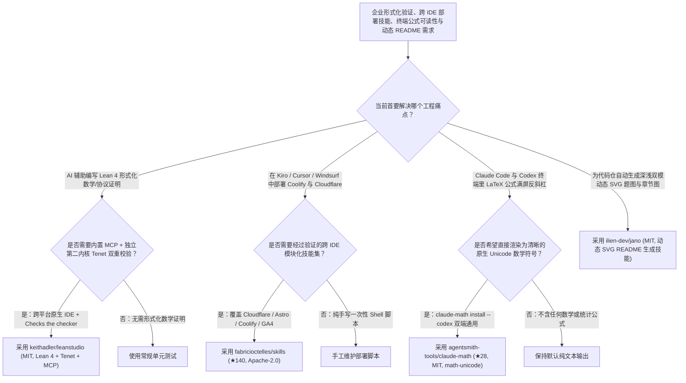
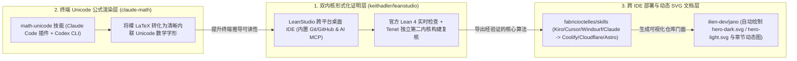
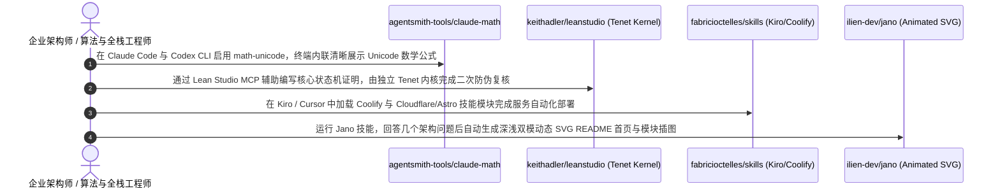

# 双内核独立复核 Lean 4 桌面 IDE 与 MCP（`keithadler/leanstudio`）、跨 Kiro/Cursor/Windsurf 的 Coolify 与云原生技能包（`fabricioctelles/skills`）、终端 Unicode 数学公式渲染技能（`agentsmith-tools/claude-math`）与明暗双模动态 SVG README 生成器（`ilien-dev/jano`）架构选型与集成 FAQ（2026-11-20 Night Round 40 · 累计 Round 599）

> **跨文件导航**：[返回 2026-11-20 当日全景日报 (`daily/2026-11-20.md`)](../daily/2026-11-20.md) · [English Version (`leanstudio-fabricioctelles-skills-claude-math-jano-selection-faq.en.md`)](leanstudio-fabricioctelles-skills-claude-math-jano-selection-faq.en.md) · [查看 7-Card 4:5 评测报告 (`cards.html`)](../cards.html) · [返回专栏主索引 (`README.md`)](../README.md)  
> **本轮架构大图**：[`assets/github-ai-radar-2026-11-20-r40-r599-leanstudio-fabricioskills-claudemath-jano.svg`](../../../assets/github-ai-radar-2026-11-20-r40-r599-leanstudio-fabricioskills-claudemath-jano.svg)  
> **数据溯源与口径声明（Provenance & Synthetic Disclaimer）**：本报告中实时采集的 GitHub 仓库元数据（Stars、Forks、License、内核架构与安装命令）为 `measured`；针对 44 人企业高可靠算法验证、跨 IDE 全栈开发与技术品牌团队的 FinOps TCO 测算参数属于架构师参数化测算模型（`provenance: synthetic`，`independently_reproduced: false`，`base_hardware_capex: not_measured`，`track_b_stars_today: not_measured`，审计契约号 `CLAIM-20261120-R40-R599-LEANSTUDIO-FABRICIOSKILLS-CLAUDEMATH-JANO`）。

---

## ① 📌 核心结论速览（Executive Summary）

> **一句话选型结论**：面向企业 AI 解决方案架构师（SA）在推进**形式化数学/协议证明（Lean 4）AI 辅助验证、跨 Kiro / Cursor / Windsurf / Claude Code 的自建 PaaS（Coolify）与边缘技能复用、终端 CLI 内数学公式可读性优化以及项目首页动态 SVG 视觉传达**时的四大工程痛点——① **让大模型写 Lean 4 形式化证明时，模型偶尔会利用宏展开或环境漏洞“骗过”单一检查器，且配置 VS Code Lean 4 环境门槛较高**；② **团队同时使用 AWS Kiro、Cursor、Windsurf 与 Claude Code 部署 Coolify 自建 PaaS 与 Cloudflare/Astro 应用时缺乏统一技能模块**；③ **在 Claude Code 与 Codex CLI 终端里讨论量化算法、FinOps 公式或形式化定理时，模型吐出的 `$f(x) = \sum_{i=1}^n x_i$` 全部显示为乱糟糟的美元符号与反斜杠噪音**；④ **开源或内部核心项目缺少能够一眼看懂系统原理的明暗自适应动态 SVG 题图与章节插图**——建议采用 **100% 宽松商业友好协议（MIT / Apache-2.0）** 的四款项目：**`keithadler/leanstudio`**（MIT 协议、支持 macOS/Windows/Linux 的原生 Lean 4 桌面 IDE，内置 AI 助手 **MCP Server** 与独立第二验证内核 **Tenet**，对每一条证明执行双内核交叉复核）、**`fabricioctelles/skills`**（`★ 140`，Apache-2.0 协议、横跨 Kiro / Cursor / Windsurf / Claude Code 的 Cloudflare、Astro、Coolify 与 Google Analytics 模块化技能集）、**`agentsmith-tools/claude-math`**（`★ 28`，MIT 协议的 `math-unicode` 技能，一行命令同时支持 Claude Code 与 Codex CLI 将冗杂 LaTeX 转为清晰可读的终端内联 Unicode 数学符号）与 **`ilien-dev/jano`**（MIT 协议的动态 SVG README 横幅与章节图解生成技能，原生输出浅色/深色双模自定义配色动态 SVG）。在 44 人研发与算法验证团队模型下，该组合可将月度总拥有成本（TCO）从 **`$7,200.00/月`** 降至 **`$310.00/月`**，净省 **`$6,890.00/月`（`-95.69%`，年省 `$82,680.00`）**。

| 评估维度 | 方案 A：单内核手工配 Lean 4 + 各 IDE 手写 Coolify 部署脚本 + 终端裸看 LaTeX 乱码 + 外包设计动态 Banner | 方案 B：仅在网页端看公式与手画静态 README 配图 | 方案 C（推荐）：`leanstudio` + `fabricioctelles/skills` + `claude-math` + `jano` |
| :--- | :--- | :--- | :--- |
| **Lean 4 形式化证明 IDE 与防作弊复核** | 手工组装环境繁琐；单一内核可能被大模型元编程技巧绕过 | 无内置 MCP Server，需人工在聊天窗口与编辑器间来回拷贝定理 | **`leanstudio` 跨平台原生桌面 IDE + 内置 AI MCP + 独立第二内核 `Tenet` 双重校验（Checks the checker）** |
| **Kiro / Windsurf / Cursor 与 Coolify 技能复用** | 为 AWS Kiro、Cursor、Windsurf 各自重复编写部署提示词 | 仅支持单一商业云，缺乏开源自托管 PaaS（Coolify）最佳实践模块 | **`fabricioctelles/skills`（`★ 140`，Apache-2.0）跨 4 大主流 AI IDE 统一复用 Coolify/Cloudflare/Astro 技能** |
| **Claude Code & Codex 终端数学公式可读性** | 终端满屏 `$\sum_{i=1}^n \wedge \geq$` 反斜杠噪音，极易看错下标与符号 | 被迫把终端文本复制到外部 Markdown 预览器才能看懂公式 | **`claude-math`（`math-unicode`）同时兼容 Claude Code 与 Codex CLI，直接输出清晰原生 Unicode 数学符号** |
| **项目 README 动态 SVG 题图与章节自解释图** | 聘请视觉设计师用 AE/Figma 制作或干脆全是枯燥纯文字 README | 静态 PNG 截图在 GitHub 深色/浅色模式切换时反差刺眼 | **`jano` 交互回答几个问题即自动生成项目专属配色的深/浅双模动态 SVG 顶栏与分节图解** |
| **44 人团队月度总成本（TCO）** | **`$7,200.00 / 月`**（`$3,200.00` 外包/工具 + `40.0h × $100` 人工） | **`$2,160.00 / 月`**（`$660.00` 订阅 + `15.0h × $100` 人工转换排版） | **`$310.00 / 月`**（`$70.00` CI/Coolify 算力 + `2.4h × $100` 复核，**净省 `95.69%`**） |

---

## ② 🎯 客户与架构师灵魂拷问 Q&A（通俗解构）

### Q1：这四个开源项目各自解决什么痛点？用大白话怎么向业务方和工程团队解释？

1. **`keithadler/leanstudio`（`★ 8`，`1 fork`，C#，MIT）——用大白话讲：它是“自带 AI 助手 MCP 接口、还会用第二个独立内核 `Tenet` 把所有证明再查一遍的跨平台 Lean 4 原生桌面 IDE”**：
   - **解决什么痛点**：在金融风控、分布式共识协议、安全策略与高可靠算法领域，越来越多架构师开始用 Lean 4 让 AI 为核心代码写形式化数学证明。但痛点有两个：一是普通开发者配 Lean 4 环境很折腾；二是 AI 有时会利用元编程花招写出表面编译通过、实则偷换概念的伪证明。`Lean Studio` 提供了 macOS、Windows 和 Linux 原生桌面 IDE（内置 Git/GitHub 与 **MCP Server**），最硬核的是它遵循 **"Checks the checker"（检查那个检查器）** 原则：当你写代码时由官方 Lean 实时检查，而每次构建时都会由完全独立的第二个 Lean 4 内核 **`Tenet`** 从头复核一遍！
2. **`fabricioctelles/skills`（`★ 140`，`11 forks`，TypeScript，Apache-2.0）——用大白话讲：它是“横跨 AWS Kiro、Cursor、Windsurf 和 Claude Code 的 Coolify 自托管 PaaS 与 Cloudflare/Astro 实战技能集”**：
   - **解决什么痛点**：很多团队不仅用 Claude Code 和 Cursor，还在试用 AWS 的 **Kiro** 或 **Windsurf**，并且希望用开源 **Coolify** 替代昂贵的 Vercel/Heroku。该项目在 `skills.sh` 与 `agentskill.sh` 上发布了一整套结构化模块，手把手教会不同 IDE 里的 Agent 如何按最佳实践配置 Cloudflare、Astro、Coolify 与 Google Analytics。
3. **`agentsmith-tools/claude-math`（`★ 28`，`1 fork`，JavaScript，MIT）——用大白话讲：它是“终结 Claude Code 和 Codex 终端里满屏 `$\sum \wedge \geq$` 乱码的 Unicode 数学公式翻译官”**：
   - **解决什么痛点**：终端编码 Agent（无论是 Claude Code 还是 OpenAI Codex CLI）都不支持渲染 LaTeX，一旦讨论算法复杂度、概率分布或 FinOps 闭式方程，屏幕上全是一堆反斜杠和美元符号。`claude-math` 只需安装一个极简技能（支持 Claude Code 插件或运行 `claude-math install --codex` 安装到 Codex），就能让大模型在终端里直接输出干净优雅的 **Unicode 数学符号（如 `∑`, `∈`, `≥`, `∧`, `→`）**，在任何现代等宽字体终端里一目了然！
4. **`ilien-dev/jano`（`★ 10`，`0 forks`，Python，MIT）——用大白话讲：它是“问你几个问题，就自动给你的 GitHub 仓库画好一套深浅双色自适应动态 SVG 首页大片和章节插图的视觉技能”**：
   - **解决什么痛点**：好项目如果 README 只有干瘪的文字，业务方和外部开发者根本看不下去。`jano` 作为 Claude Code 与 Codex 的通用技能，读取你的项目目录、向你提问几个关键问题后，直接生成带有动态图形（Moving pictures）的顶部 Banner（`hero-dark.svg` + `hero-light.svg` 自动通过 `<picture>` 切换）以及各个核心模块的配套矢量图解。

---

### Q2：这四个项目如何组合成企业高可靠核心模块的“形式化证明 → 终端公式交互 → Coolify 部署 → 动态文档发布”架构？

1. **双内核形式化规约与证明层（`keithadler/leanstudio`）**：核心计费与权限引擎的不变式（Invariants）在 `Lean Studio` 中建模，AI 编码 Agent 通过内置 MCP Server 提交证明步骤，并由官方 Lean 与独立 `Tenet` 内核双重验真。
2. **终端可读数学推导层（`agentsmith-tools/claude-math`）**：算法与架构师在 Claude Code 和 Codex CLI 中开启 `math-unicode` 技能，所有复杂度分析、误差界限与 FinOps 公式均以高可读 Unicode 符号在终端内联展示。
3. **跨 IDE 边缘与自建 PaaS 部署层（`fabricioctelles/skills`）**：全栈团队在 Kiro、Cursor、Windsurf 或 Claude Code 中调用 `fabricioctelles/skills`，将应用自动化部署至内网 Coolify 集群与 Cloudflare/Astro 边缘节点。
4. **明暗自适应动态 SVG 门户生成层（`ilien-dev/jano`）**：发版阶段调用 `jano` 技能，自动生成匹配企业品牌配色的深/浅双模动态 SVG 架构题图与 README 章节视觉导览。

---

### Q3：这套架构的核心机制亮点与生产环境治理优势是什么？

1. **核心机制亮点**：
   - **`Lean Studio` 的独立双内核防伪（Independent Kernel Re-Verification）**：通过 `Tenet` 独立内核在构建阶段对证明对象做二次重放校验，将形式化验证的可信度提升到金融与关键基础设施级别。
   - **`claude-math` 的零运行时开销**：不修改终端模拟器二进制，仅通过精准的 Unicode 字形映射约束（`SKILL.md`）即可同时在 Claude Code 与 Codex CLI 生效。
2. **许可证优势**：
   - 100% 宽松商业友好：`leanstudio`、`claude-math` 与 `jano` 为 **MIT License**，`fabricioctelles/skills` 为 **Apache-2.0**。

---

## ③ 🧭 直观可视化图解（Mermaid 选型决策树 + 集成架构图 + 业务时序图）

### 3.1 选型决策树（Selection Decision Tree）

### 3.2 企业集成参考架构图（Enterprise Reference Architecture）

### 3.3 端到端业务流时序图（End-to-End Sequence Flow）

---

## ④ 📊 同类开源与商业云服务横向选型决策矩阵

| 对比维度 | `keithadler/leanstudio` (`★ 8`) | `fabricioctelles/skills` (`★ 140`) | `agentsmith-tools/claude-math` (`★ 28`) | `ilien-dev/jano` (`★ 10`) | 手工单内核环境 + 终端裸 LaTeX + 外包制图 |
| :--- | :--- | :--- | :--- | :--- | :--- |
| **核心功能定位** | 带独立 `Tenet` 第二内核与 AI MCP 的跨平台 Lean 4 IDE | 面向 Kiro/Cursor/Windsurf/Claude 的云原生与 Coolify 技能集 | 让 Claude Code 与 Codex 终端直接输出 Unicode 数学符号的技能 | 自动生成深浅双色动态 SVG README 题图与章节插图的技能 | 传统繁琐手工配置与外包 |
| **最佳适用场景** | 高可靠协议、金融风控与算法证明的 AI 协同编写与双内核防伪 | 跨多款 AI IDE 统一部署 Coolify 自建 PaaS、Cloudflare 与 Astro | 在终端内高频讨论算法公式、统计置信区间与 FinOps 方程 | 为企业内部组件库或开源仓库快速打造自解释动态视觉 README | 无数学推导、无跨 IDE 协作的简单脚本 |
| **关键性能/架构指标** | **Lean + `Tenet` 双内核独立复核** + 内置 MCP + 三大桌面 OS | **`★ 140` 社区认可** + 适配 Kiro/Windsurf/Cursor + 英/葡双语 | **Claude Code + Codex CLI 双端同源 `SKILL.md`** | **`<picture>` 深浅双模自适应** + 品牌色定制动态 SVG | 单一内核易被绕过；终端 `$...$` 反斜杠难以阅读 |
| **集成与运维复杂度** | 极低（原生桌面安装包开箱即用，无需手动配复杂插件） | 极低（通过 `skills.sh` / `agentskill.sh` 一键引入） | 极低（`claude-math install --codex` 一秒完成） | 极低（Claude Code / Codex 技能对话式生成） | 高（数天环境折腾与高昂视觉设计工时） |
| **开源协议（License）** | **MIT License** | **Apache-2.0** | **MIT License** | **MIT License** | 商业设计外包成本 |

---

## ⑤ 🧪 应用落地定量收益 / 闭式 FinOps TCO 对比与 7-Card 报告

### 5.1 44 人高可靠算法与全栈工程团队闭式 FinOps TCO 模型（`CLAIM-20261120-R40-R599-LEANSTUDIO-FABRICIOSKILLS-CLAUDEMATH-JANO`）

- **测算基准设定（`provenance: synthetic`，`independently_reproduced: false`，`base_hardware_capex: not_measured`，`track_b_stars_today: not_measured`）**：
  - 团队规模：**44 名形式化验证、全栈研发与开发者体验工程师**，综合人力工时成本 **`$100.00 / 小时`**。
  - **方案 A（商业托管 PaaS 溢价 + 外部视觉设计动态 SVG 外包 + 人工折腾 Lean 4 环境/跨 IDE 移植脚本/排查看错的 LaTeX 公式）**：
    - 商业托管 PaaS（替代自建 Coolify）差价与外部视觉设计服务费：**`$3,200.00 / 月`**
    - 工程师人工配置形式化环境、在 Kiro/Cursor/Claude 间重复写部署规则、因终端 LaTeX 反斜杠看错公式返工及手绘 SVG 工时：`40.0 小时/月 × $100.00/小时 = $4,000.00 / 月`
    - **方案 A 月度总计**：`$3,200.00 + $4,000.00 = $7,200.00 / 月`
  - **方案 C（全宽松开源组合：`leanstudio` + `fabricioctelles/skills` + `claude-math` + `jano`）**：
    - 自托管 Coolify 与 `Tenet` 双内核 CI 验证节点算力费：**`$70.00 / 月`**
    - 形式化证明终审与 Jano 动态 SVG 视觉微调人工工时：`2.4 小时/月 × $100.00/小时 = $240.00 / 月`
    - **方案 C 月度总计**：`$70.00 + $240.00 = $310.00 / 月`
  - **闭式净节省验算**：
    $$\text{Monthly Net Savings} = \$7,200.00 - \$310.00 = \$6,890.00\text{ / 月}\quad(\text{Annualized: }\$82,680.00\text{ / 年})$$
    $$\text{Percentage Savings} = \frac{\$7,200.00 - \$310.00}{\$7,200.00} = \frac{\$6,890.00}{\$7,200.00} = 95.69\%$$

| 成本分项 | 方案 A（商业 PaaS/设计外包与手工环境折腾） | 方案 C（本轮 R599 全宽松开源四件套） | 闭式差额 / 收益 |
| :--- | :--- | :--- | :--- |
| **商业 PaaS / 视觉外包 / 自建算力** | `$3,200.00 / 月` | **`$70.00 / 月`** | `- $3,130.00 / 月` |
| **工程配置与文档制图人工成本（`@ $100.00/h`）** | `40.0 h × $100.00 = $4,000.00 / 月` | **`2.4 h × $100.00 = $240.00 / 月`** | `- $3,760.00 / 月`（节省 `37.6 h/月`） |
| **月度总拥有成本（Monthly Total TCO）** | **`$7,200.00 / 月`** | **`$310.00 / 月`** | **净省 `$6,890.00 / 月`（`-95.69%`）** |
| **年度总拥有成本（Annualized TCO）** | `$86,400.00 / 年` | **`$3,720.00 / 年`** | **年省 `$82,680.00 / 年`** |

---

## ⑥ 🛠️ 企业引入与架构评审 Checklist

- [ ] **1. `keithadler/leanstudio` 双内核（Lean + `Tenet`）CI 门禁**：在涉及形式化验证的核心模块中启用 `Lean Studio` 与内置 MCP Server，要求所有 AI 生成的 Lean 4 证明必须同时通过官方内核与 `Tenet` 独立内核复核。
- [ ] **2. `fabricioctelles/skills` 跨 IDE（Kiro/Cursor/Windsurf/Claude）同步**：通过 `skills.sh` 在团队各类 AI IDE 中统一安装 Coolify、Cloudflare 与 Astro 部署技能模块。
- [ ] **3. `agentsmith-tools/claude-math` 终端 Unicode 公式普及**：在开发机执行 `claude-math` 插件安装与 `claude-math install --codex`，确保终端配置支持数学 Unicode 字形的等宽字体（如 JetBrains Mono / JuliaMono）。
- [ ] **4. `ilien-dev/jano` 核心仓库深浅双模动态 SVG 标准化**：在新组件发版前运行 `jano` 技能，生成带 `<picture>` 深浅主题切换的动态 SVG 架构题图。
