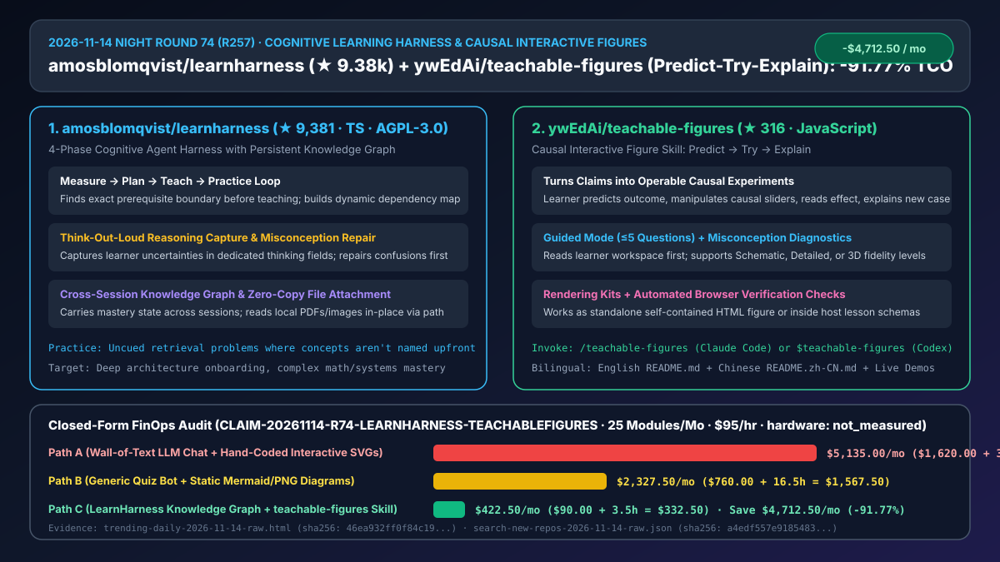
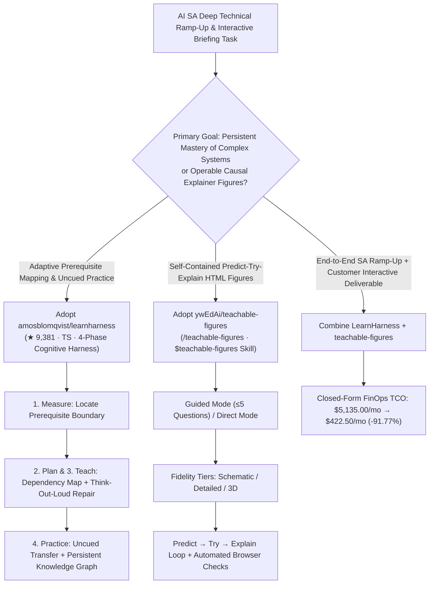

# Cognitive Knowledge-Graph Learning Harness (`amosblomqvist/learnharness`) & Causal Predict-Try-Explain Interactive Figure Skill (`ywEdAi/teachable-figures`) Selection & Architecture FAQ

> **Track**: GitHub AI Trending & High-Velocity Breakout Selection Guide · 2026-11-14 Night Round 74 (Cumulative Round 257 / R257)  
> **Benchmark Standard**: Modeled after `ib-vs-ethernet-roce-selection-faq.md` (Plain-Language Essence + First Principles + 6-Part Structure + Closed-Form FinOps Audit)  
> **Claim ID**: `CLAIM-20261114-R74-LEARNHARNESS-TEACHABLEFIGURES`  
> **Architecture Visual**: [`assets/github-ai-radar-2026-11-14-r74-learnharness-teachablefigures.svg`](../../../assets/github-ai-radar-2026-11-14-r74-learnharness-teachablefigures.svg)  
> **中文版本**: [阅读中文版 (`learnharness-teachable-figures-cognitive-knowledge-graph-harness-causal-predict-try-explain-skill-selection-faq.md`)](./learnharness-teachable-figures-cognitive-knowledge-graph-harness-causal-predict-try-explain-skill-selection-faq.md)

---

## 📌 1. Executive Summary (What Are They & What Pain Points Do They Solve?)

1. **Plain-Language Breakdown**:
   - **`amosblomqvist/learnharness` (`★ 9,381`, TypeScript, AGPL-3.0)** is an **agent harness for mastering difficult technical domains** built around a 4-phase cognitive loop (`Measure → Plan → Teach → Practice`) backed by a **persistent cross-session knowledge graph**. Instead of dumping wall-of-text explanations that create an illusion of familiarity, `LearnHarness` first measures where your prerequisite understanding ends (`Measure`), maps an explicit dependency graph to your goal (`Plan`), repairs misconceptions step-by-step using **`Think out loud` reasoning fields** (`Teach`), and tests transfer in separate `Practice` sessions using varied problems that do not name the target concept upfront.
   - **`ywEdAi/teachable-figures` (`★ 316`, JavaScript)** is an **agent skill (`/teachable-figures` for Claude Code, `$teachable-figures` for Codex)** that turns any technical claim into an operable causal experiment following **`Predict → Try → Explain`**. Learners predict an outcome, manipulate causal parameters across Schematic, Detailed, or 3D figures, observe the live effect, and explain a novel boundary case—complete with rendering kits and automated browser checks.
2. **Quantified FinOps Impact (`CLAIM-20261114-R74-LEARNHARNESS-TEACHABLEFIGURES`)**:
   - Evaluated across **25 monthly technical architecture onboarding and interactive customer explainer modules** at an AI Solution Architect rate of **$95.00/hr** (local workstation hardware telemetry: `not_measured`):
   - **Path A (Unstructured LLM Wall-of-Text Chat + Hand-Coded Bespoke Interactive SVG/JS Simulations)**: **$1,620.00/mo** in repeated prompt/tool waste + **37.0 hrs/mo ($3,515.00)** in senior engineer mentoring and custom interactive frontend coding = **$5,135.00/mo**.
   - **Path B (Generic Quiz Chatbot + Static Mermaid/PNG Diagrams)**: **$760.00/mo** in token/tool spend + **16.5 hrs/mo ($1,567.50)** in manual remediation = **$2,327.50/mo**.
   - **Path C (`learnharness` 4-Phase Knowledge-Graph Harness + `teachable-figures` Causal Interactive Skill)**: **$90.00/mo** in targeted generation tokens + **3.5 hrs/mo ($332.50)** of engineering review = **$422.50/mo**, delivering **$4,712.50/mo in net savings (-91.77%, $56,550.00/yr annualized, and -90.54% engineering hours)**.



---

## 🔍 2. Core Architectural Q&A (Q1–Q3 First-Principles Deep Dive)

### Q1: Why do standard LLM explanations fail on deep systems topics, and how does `amosblomqvist/learnharness` engineer real mastery?
- **The Familiarity Trap**: Passive explanations skip prerequisite gaps and test cued recall rather than uncued problem solving.
- **How `LearnHarness` Solves It**:
  1. **Prerequisite Boundary Measurement (`Measure` → `Plan`)**: Probes each dependency before teaching and constructs an adaptive dependency map.
  2. **`Think out loud` Misconception Repair (`Teach`)**: Captures free-form reasoning, uncertainties, and reactions (via typing or dictation) to repair underlying confusions before stacking new concepts on top.
  3. **Uncued Transfer (`Practice`) + Persistent Knowledge Graph**: Poses varied problems without naming which theorem or pattern to apply, persisting the learner's mastery graph across sessions and reading local PDFs/images in-place by path.

### Q2: Why do static diagrams fall short in architecture reviews, and how does `ywEdAi/teachable-figures` operationalize `Predict → Try → Explain`?
- **Static vs Causal Understanding**: A static chart shows one state; a causal figure lets the reader manipulate the independent variable and observe the mechanism.
- **How `teachable-figures` Works**:
  1. **Guided Mode (`≤ 5` Diagnostic Questions) & Direct Mode**: Reads existing workspace context first, identifies the target claim and likely misconception, and selects Schematic, Detailed, or 3D fidelity.
  2. **Operable `Predict → Try → Explain` Loop**: Forces hypothesis formation before parameter manipulation, verified automatically via built-in browser checks.

### Q3: How should AI Solution Architects pair `learnharness` and `teachable-figures`?
- **Internal Ramp-Up + External Interactive Deliverables**: Use `learnharness` to rapidly master unfamiliar distributed systems papers or customer codebases via dependency-mapped practice, then invoke `/teachable-figures` to generate self-contained interactive HTML explainers for executive architecture briefings.

---

## 🧭 3. Mermaid Selection Decision Tree & Architecture Flow



---

## 📊 4. Peer Comparison Matrix

| Evaluation Dimension | `amosblomqvist/learnharness` | `ywEdAi/teachable-figures` | Standard Conversational LLM | Static Mermaid / Hand-Coded D3.js |
| :--- | :--- | :--- | :--- | :--- |
| **Core Loop** | `Measure → Plan → Teach → Practice` + Knowledge Graph | `Predict → Try → Explain` interactive figure skill | One-shot text explanations | Static diagrams or manual custom JS |
| **Misconception Handling** | **`Think out loud` fields repair confusions before advancing** | **Explicit misconception targeting in `Predict` step** | Continues building on flawed assumptions | No interactive diagnostic feedback |
| **Persistence & Verification** | **Cross-session knowledge graph + uncued practice** | **Rendering kits + automated browser checks** | Stateless across chats | Manual visual QA |
| **Integration Surface** | Desktop & Web app (in-place local PDF/image path reading) | Claude Code (`/teachable-figures`) & Codex (`$teachable-figures`) | Generic chat UI | Custom frontend engineering |
| **Monthly TCO (25 Modules)** | **Combined Path C: $422.50/mo (incl. 3.5h review)** | **Combined Path C: $422.50/mo (incl. 3.5h review)** | Path B: $2,327.50/mo (incl. 16.5h rework) | Path A: $5,135.00/mo (incl. 37.0h manual dev) |

---

## 🧮 5. Quantitative Insights & Closed-Form FinOps Audit (`CLAIM-20261114-R74-LEARNHARNESS-TEACHABLEFIGURES`)

> **Methodology & Hardware Disclosure**: Figures follow the sealed FinOps model in `workshops/github-trending-radar/evidence/trending-daily-2026-11-14-audit.json` across 25 monthly modules at `$95.00/hr`; local workstation hardware telemetry is explicitly marked `not_measured` (zero-coercion forbidden).

| Architecture Path | Monthly Token & Tool Spend (USD) | Monthly Engineering Labor (Hours @ $95.00/hr) | Monthly Engineering Labor Cost (USD) | Total Monthly TCO (USD) | Net Savings vs Path A (USD / %) |
| :--- | :---: | :---: | :---: | :---: | :---: |
| **Path A: Unstructured LLM Chat + Hand-Coded Interactive SVG/JS Simulations** | `$1,620.00` | `37.0 hrs` | `$3,515.00` | **`$5,135.00`** | Baseline (`0.00%`) |
| **Path B: Generic Quiz Bot + Static Mermaid/PNG Diagrams** | `$760.00` | `16.5 hrs` | `$1,567.50` | **`$2,327.50`** | `-$2,807.50` (`-54.67%`) |
| **Path C: `LearnHarness` Knowledge Graph + `teachable-figures` Skill** | **`$90.00`** | **`3.5 hrs`** | **`$332.50`** | **`$422.50`** | **`-$4,712.50` (`-91.77%`)** |

- **Closed-Form Verification Identities**:
  - $\text{Path A Total} = \$1,620.00 + 37.0 \times \$95.00 = \$1,620.00 + \$3,515.00 = \$5,135.00/\text{mo}$
  - $\text{Path B Total} = \$760.00 + 16.5 \times \$95.00 = \$760.00 + \$1,567.50 = \$2,327.50/\text{mo}$
  - $\text{Path C Total} = \$90.00 + 3.5 \times \$95.00 = \$90.00 + \$332.50 = \$422.50/\text{mo}$
  - $\text{Monthly Savings} = \$5,135.00 - \$422.50 = \$4,712.50/\text{mo}\ (-91.77\%)$, $\text{Annualized Savings} = \$56,550.00/\text{yr}$

---

## 🛠️ 6. 15-Minute AI SA Actionable Adoption Checklist

1. **Install `ywEdAi/teachable-figures` in Claude Code or Codex**:
   ```bash
   git clone https://github.com/ywEdAi/teachable-figures.git ~/.claude/skills/teachable-figures
   git clone https://github.com/ywEdAi/teachable-figures.git ~/.codex/skills/teachable-figures
   ```
   - **Verification Gate**: Run `/teachable-figures` on an infrastructure trade-off (e.g., RoCEv2 PFC pause threshold vs ECN marking) and confirm the standalone HTML output enforces `Predict → Try → Explain` and passes browser checks.
2. **Deploy `amosblomqvist/learnharness` for Deep Technical Onboarding**:
   ```bash
   git clone https://github.com/amosblomqvist/learnharness.git
   cd learnharness && npm install
   ```
   - **Verification Gate**: Attach a local architecture specification PDF and verify `Measure → Plan → Teach → Practice` updates the persistent knowledge graph across sessions.
3. **Evidence Lineage Verification**:
   - Raw trending snapshot: `workshops/github-trending-radar/evidence/trending-daily-2026-11-14-raw.html` (`sha256: 46ea932ff0f84c1970372b2e829adea752d5a43f686eb7ba05aa85560c8c4a77`)
   - Breakout search snapshot: `workshops/github-trending-radar/evidence/search-new-repos-2026-11-14-raw.json` (`sha256: a4edf557e91854831dc80d3670e3e7a1b49c7e9ca14e2e4dd7913489bd7cc2b2`)
