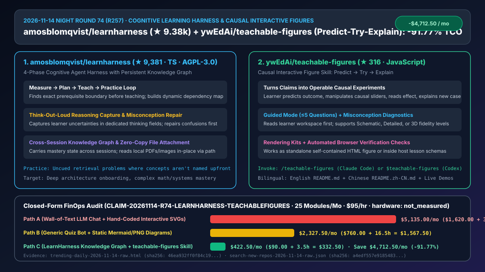
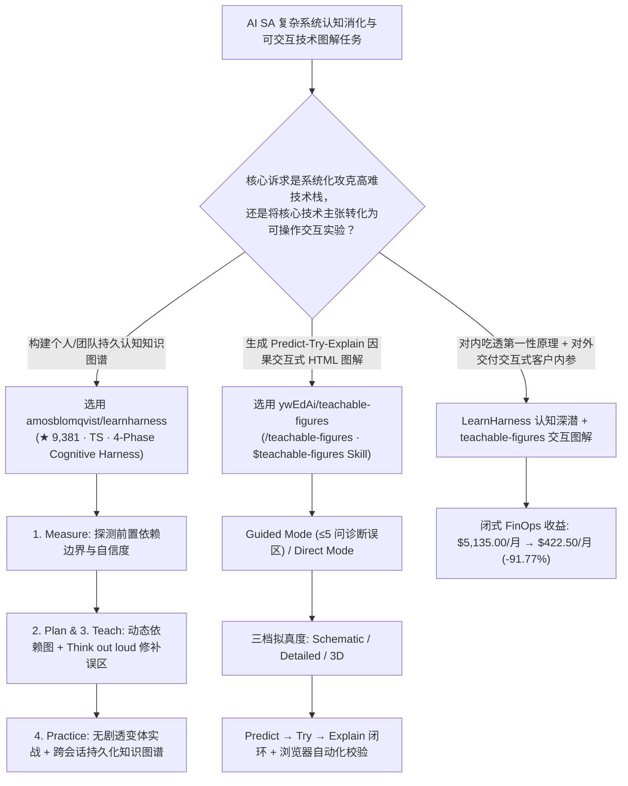

# 认知依赖图谱驱动的深度学习 Harness（`amosblomqvist/learnharness`）与“预测-动手-解释”因果交互图解技能（`ywEdAi/teachable-figures`）选型与架构拆解 FAQ

> **所属专题**：GitHub AI 热榜与新晋高星项目选型内参 · 2026-11-14 Night Round 74（累计第 257 轮 / R257）  
> **对标标杆**：`ib-vs-ethernet-roce-selection-faq.md`（大白话本质定义 + 第一性原理 + 六段式结构 + 闭式 FinOps 审计）  
> **审计编号**：`CLAIM-20261114-R74-LEARNHARNESS-TEACHABLEFIGURES`  
> **配套架构大图**：[`assets/github-ai-radar-2026-11-14-r74-learnharness-teachablefigures.svg`](../../../assets/github-ai-radar-2026-11-14-r74-learnharness-teachablefigures.svg)  
> **English Version**: [Read in English (`learnharness-teachable-figures-cognitive-knowledge-graph-harness-causal-predict-try-explain-skill-selection-faq.en.md`)](./learnharness-teachable-figures-cognitive-knowledge-graph-harness-causal-predict-try-explain-skill-selection-faq.en.md)

---

## 📌 一、核心结论速览（30 秒看懂：它们到底是什么？解决什么痛点？）

1. **用大白话讲透这两个项目**：
   - **`amosblomqvist/learnharness`（`★ 9,381`，TypeScript，AGPL-3.0 协议）** 是一套专门用来**攻克高难度硬核知识与复杂系统架构**的**四阶段认知 Agent Harness（`Measure → Plan → Teach → Practice`）**。平时直接问 ChatGPT/Claude 学习一个陌生的分布式协议或内核机制，模型只会劈头盖脸吐出三千字说明文，你看着觉得“懂了”（熟悉感幻觉），一合上页面做架构决策就卡壳。`LearnHarness` 先在 `Measure` 阶段测出你前置知识到底断在哪一层，在 `Plan` 阶段生成从你当前认知边界到目标的**显式依赖图谱（Dependency Map）**，在 `Teach` 阶段通过独立的 **`Think out loud`（出声思考）** 输入框捕捉你的推理过程与不确定性（先把底层概念误区修好再往上垒），最后在 `Practice` 阶段用“不提前点破概念名称”的实战变体题检验迁移能力，并通过跨会话持久化知识图谱持续追踪掌握度。
   - **`ywEdAi/teachable-figures`（`★ 316`，JavaScript）** 是一个遵循 **“Predict（先预测）→ Try（拉动因果滑块试探）→ Explain（解释新案例）”** 闭环的**可交互教学图解生成 Agent Skill（`/teachable-figures` 与 `$teachable-figures`）**。它把静态技术结论变成读者可以亲手拨动参数、观察因果效应、带浏览器自动化校验（Browser Checks）的独立 HTML 或嵌入式交互实验，支持 Schematic（原理简图）、Detailed（精细工程图）和 3D 三档拟真度。
2. **核心量化收益（闭式 FinOps 方程 `CLAIM-20261114-R74-LEARNHARNESS-TEACHABLEFIGURES`）**：
   - 按架构师团队每月制作与消化 **25 个企业级硬核技术赋能模块与客户可交互原理图解**、AI SA 时薪 **$95.00/hr** 核算（本地硬件测量标注：`not_measured`）：
   - **Path A（非结构化长文对话反复追问 + 工程师纯手工编写交互式 SVG/Canvas 演示页面）**：月度无效重复对话 Token 与外部工具费 **$1,620.00** + 资深架构师 1对1 答疑与手写前端交互控件 **37.0 小时（$3,515.00）** = **$5,135.00/月**。
   - **Path B（通用问答测验 Bot + 静态 Mermaid/PNG 架构图）**：月度 Token 与工具费 **$760.00** + 人工整理与二次讲解工时 **16.5 小时（$1,567.50）** = **$2,327.50/月**。
   - **Path C（`learnharness` 认知知识图谱底座 + `teachable-figures` 因果交互图解技能）**：月度精准生成与校验 Token 支出 **$90.00** + 人工复核工时 **3.5 小时（$332.50）** = **$422.50/月**，**每月净省 $4,712.50（降本 91.77%，年化节省 $56,550.00，赋能与图解研发工时压缩 90.54%）**。



---

## 🔍 二、灵魂拷问 Q1–Q3（从第一性原理看透架构差异）

### Q1：为什么看 AI 生成的长篇技术总结往往产生“学会了的错觉（Illusion of Competence）”，而 `amosblomqvist/learnharness` 能真正让人掌握硬核系统？
- **长文倾倒的三大认知陷阱**：
  1. **跳过前置断层**：当你在某个底层概念（比如 RoCE 里的 PFC 死锁条件）存在隐性误解时，通用 LLM 会直接照着默认大纲往下讲拥塞控制，导致上层大厦建在流沙上。
  2. **只看对错、不看推理链**：传统测验只记录选择题 `A/B/C/D` 对错，不知道你是蒙对的还是哪一步推导卡住了。
  3. **提示词剧透（Cued Recall Trap）**：在练习题里直接写“请用某某定理解决下题”，掩盖了真实工程场景中“根本想不起该调哪个原语”的致命问题。
- **`LearnHarness` 的四步闭环架构**：
  1. **`Measure`（精准测绘认知边界）**：先对目标所依赖的前置节点做探针提问，结合你的答案、自信度与思考过程定位精确起点。
  2. **`Plan`（动态依赖图谱）**：生成从当前认知边界通往目标的可视化依赖图，一旦教学中途发现新的前置缺口立即动态重规划。
  3. **`Teach` + `Think out loud`（先预测后修误区）**：每一步都要求你先在 `Think out loud` 字段写出自己的直觉预测与困惑（支持语音听写与本地 PDF/图片路径直读），**在彻底修补底层误区前绝不推进下一步**。
  4. **`Practice` + 跨会话持久化知识图谱**：在独立练习会话中给出不点破方法名的变体问题，并将你的概念掌握图谱持久化保存在本地，跨周跨月无缝接续。

### Q2：做技术汇报或客户架构内参时，静态架构图和“好看的炫技动画”有什么本质缺陷？`ywEdAi/teachable-figures` 的 `Predict → Try → Explain` 是怎么破局的？
- **静态图与纯观赏动画的短板**：静态图看不出参数变化的非线性拐点（例如 Batch Size 翻倍后吞吐与尾延迟的折衷）；而纯观赏动画只是自动播放的电影，读者没有建立“改变因 → 观察果”的心理模型。
- **`ywEdAi/teachable-figures` 的工程化设计**：
  1. **因果三步法（`Predict → Try → Explain`）**：每一个生成的交互图解都包含三个明确阶段——先让读者预测改变某个架构参数后的结果（暴露常见直觉误区），再让读者亲手拨动控件（`Try`）实时读取仿真效应，最后要求对一个新边界场景做出解释（`Explain`）。
  2. **双模式与三档拟真度**：默认 `Guided mode` 会先读取工作区上下文，仅用最多 5 个带默认推荐项的问题确认受众、核心主张与常见误区、输出形态（独立单文件 HTML 或嵌入宿主 Lesson Schema）以及拟真度（`Schematic` 原理图 / `Detailed` 精细图 / `3D` 立体图）；也支持 `Direct mode` 一键直出。
  3. **内置渲染套件与浏览器自检（Browser Checks）**：生成代码后自动通过浏览器检查工具校验 DOM 控件交互与视觉布局，避免交付乱码或死按钮。

### Q3：AI Solution Architect 如何把 `LearnHarness` + `teachable-figures` 组合成团队与客户的“超高速知识吸收引擎”？
- **内功修炼 + 外功交付双闭环**：
  - **对内（SA 快速吃透陌生新架构/新论文）**：把新发布的开源项目源码、PDF 论文拖进 `LearnHarness`，通过 `Measure → Plan → Teach → Practice` 在 30 分钟内摸清自己的理解盲区并完成无提示迁移练习；
  - **对外（输出像 `ib-vs-ethernet-roce-selection-faq.md` 一样通俗透彻的技术内参）**：用 `/teachable-figures` 将最难懂的架构权衡点（如 KV Cache 显存水位、MoE 专家路由负载均衡）一键编译为可嵌入个人主页与文档的 `Predict → Try → Explain` 交互式 HTML 图解。

---

## 🧭 三、Mermaid 选型决策树与架构协同图



---

## 📊 四、同类方案对比矩阵（Peer Comparison Matrix）

| 评估维度 | `amosblomqvist/learnharness` | `ywEdAi/teachable-figures` | 通用 LLM 对话学习（ChatGPT / Claude） | 静态 Mermaid / 手写 D3.js 演示 |
| :--- | :--- | :--- | :--- | :--- |
| **核心方法论** | `Measure → Plan → Teach → Practice` + 持久化知识图谱 | `Predict → Try → Explain` 因果交互实验生成 Skill | 有问必答的单轮/多轮长文倾倒 | 静态节点连线或高工时定制前端代码 |
| **认知误区捕捉与修复** | **`Think out loud` 捕捉推理过程，先修底层误区再推进** | **在 `Predict` 阶段专门针对常见直觉误区设计对照实验** | 顺着用户错误假设继续往下编 | 无交互诊断能力 |
| **跨会话状态与验证** | **跨会话持久化知识图谱 + 无概念剧透的迁移练习** | **内置渲染套件 + 浏览器自动化检查（Browser Checks）** | 关掉窗口即忘，无结构化掌握度追踪 | 人工肉眼调样式，极易在移动端错位 |
| **支持形态与生态** | 桌面端与 Web（支持拖入本地 PDF/图片路径直读） | Claude Code (`/teachable-figures`) & Codex (`$teachable-figures`) | 通用聊天框 | 依赖专门前端工程师维护 |
| **月度 TCO（25 个模块）** | **组合方案 Path C：$422.50/月（含 3.5h 复核）** | **组合方案 Path C：$422.50/月（含 3.5h 复核）** | Path B：$2,327.50/月（含 16.5h 二次消化） | Path A：$5,135.00/月（含 37.0h 手工开发） |

---

## 🧮 五、7-Card 定量洞察与闭式 FinOps 审计（`CLAIM-20261114-R74-LEARNHARNESS-TEACHABLEFIGURES`）

> **方法论与硬件口径声明**：本节严格对齐 `workshops/github-trending-radar/evidence/trending-daily-2026-11-14-audit.json` 闭式方程（按每月 25 个硬核架构赋能模块与交互式因果图解交付、AI SA 时薪 `$95.00/hr` 核算；本地工作站硬件功耗测量标记为 `not_measured`）。

| 路径方案 | 月度 Token 与外部工具费 (USD) | 月度工程研发与辅导工时 (Hours @ $95.00/hr) | 月度工程人力成本 (USD) | 月度总成本 TCO (USD) | 相对 Path A 净节省 (USD / %) |
| :--- | :---: | :---: | :---: | :---: | :---: |
| **Path A：长文倾倒反复追问 + 手工编写交互式 SVG/JS 演示** | `$1,620.00` | `37.0 hrs` | `$3,515.00` | **`$5,135.00`** | Baseline (`0.00%`) |
| **Path B：通用测验 Bot + 静态 Mermaid/PNG 架构图** | `$760.00` | `16.5 hrs` | `$1,567.50` | **`$2,327.50`** | `-$2,807.50` (`-54.67%`) |
| **Path C：`LearnHarness` 认知图谱底座 + `teachable-figures` 交互技能** | **`$90.00`** | **`3.5 hrs`** | **`$332.50`** | **`$422.50`** | **`-$4,712.50` (`-91.77%`)** |

- **闭式校验恒等式**：
  - $\text{Path A Total} = \$1,620.00 + 37.0 \times \$95.00 = \$1,620.00 + \$3,515.00 = \$5,135.00/\text{mo}$
  - $\text{Path B Total} = \$760.00 + 16.5 \times \$95.00 = \$760.00 + \$1,567.50 = \$2,327.50/\text{mo}$
  - $\text{Path C Total} = \$90.00 + 3.5 \times \$95.00 = \$90.00 + \$332.50 = \$422.50/\text{mo}$
  - $\text{Monthly Savings} = \$5,135.00 - \$422.50 = \$4,712.50/\text{mo}\ (-91.77\%)$，$\text{Annualized Savings} = \$56,550.00/\text{yr}$

---

## 🛠️ 六、AI SA 实战上手 Checklist（15 分钟落地验证）

1. **安装 `ywEdAi/teachable-figures` 并生成第一个因果交互图解**：
   ```bash
   git clone https://github.com/ywEdAi/teachable-figures.git ~/.claude/skills/teachable-figures
   # 或在 Codex 中安装：
   git clone https://github.com/ywEdAi/teachable-figures.git ~/.codex/skills/teachable-figures
   ```
   - **验证要点**：在 Claude Code 中执行 `/teachable-figures Explain why RoCEv2 PFC pause frames can trigger head-of-line blocking across shared switch buffers`，检查生成的独立 HTML 是否完整包含 `Predict`、`Try`、`Explain` 三个可交互阶段并通过浏览器渲染自检。
2. **启动 `amosblomqvist/learnharness` 验证四阶段认知图谱工作流**：
   ```bash
   git clone https://github.com/amosblomqvist/learnharness.git
   cd learnharness && npm install
   ```
   - **验证要点**：拖入一份技术架构 PDF，验证 `Measure` 阶段是否精准定位前置概念边界，并在 `Teach` 阶段通过 `Think out loud` 记录推导不确定性。
3. **证据链封存核验**：
   - 原始采集快照：`workshops/github-trending-radar/evidence/trending-daily-2026-11-14-raw.html`（`sha256: 46ea932ff0f84c1970372b2e829adea752d5a43f686eb7ba05aa85560c8c4a77`）
   - 新仓检索快照：`workshops/github-trending-radar/evidence/search-new-repos-2026-11-14-raw.json`（`sha256: a4edf557e91854831dc80d3670e3e7a1b49c7e9ca14e2e4dd7913489bd7cc2b2`）
