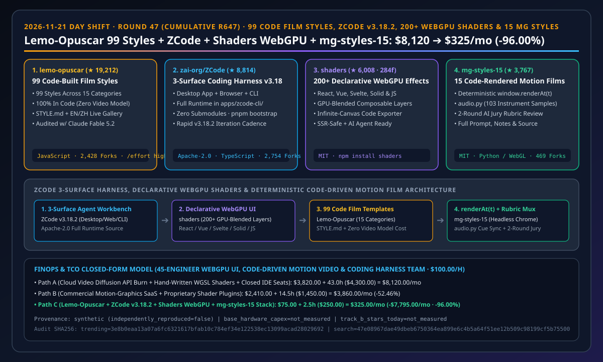
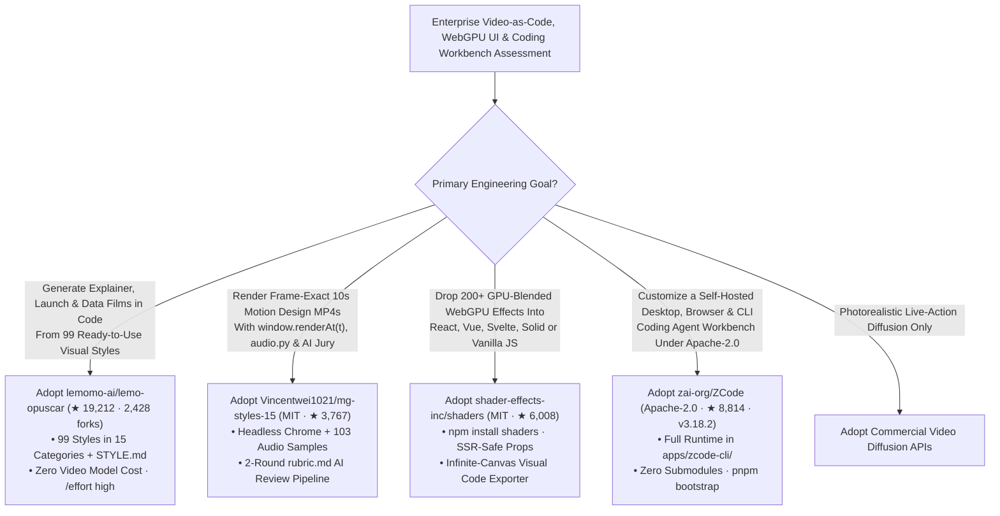
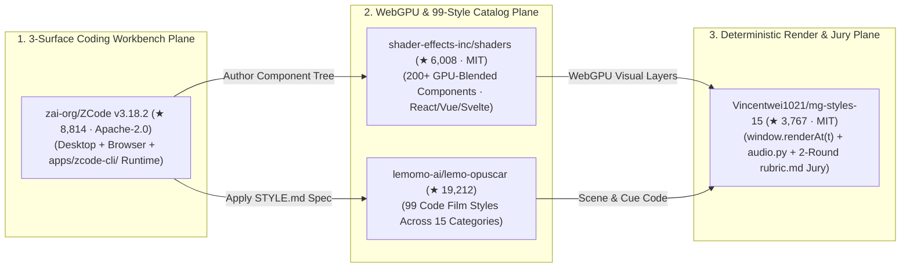
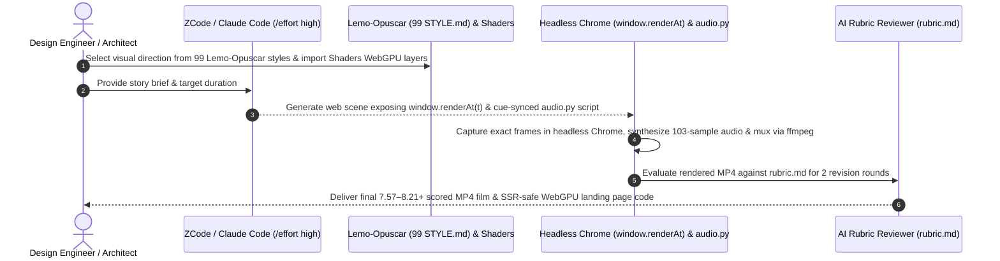

# 99 Code-Built Film Styles (`lemomo-ai/lemo-opuscar`), 3-Surface Open-Source Coding Workbench (`zai-org/ZCode`), 200+ Declarative WebGPU Shader Components (`shader-effects-inc/shaders`) & 15 Rubric-Reviewed Motion Design Films (`Vincentwei1021/mg-styles-15`) Selection FAQ

> **Document Metadata (2026-11-21 Day Shift Round 47 · Cumulative Round 647 Deep-Dive)**  
> - **Target Audience**: Enterprise AI Solution Architects, Frontend & Design-System Engineering Leads, and Programmatic Video (Video-as-Code) / Developer Tooling Directors  
> - **Evaluated Repositories**:  
>   1. [`lemomo-ai/lemo-opuscar`](https://github.com/lemomo-ai/lemo-opuscar) (`★ 19,212` · `2,428 forks` · JavaScript · **Lemo-Opuscar**: **99 ready-to-use film styles across 15 visual categories** made entirely in code [zero video diffusion model] for Claude Code [`/effort high`], each with a bilingual gallery page, code-built demo film, and customizable `STYLE.md`)  
>   2. [`zai-org/ZCode`](https://github.com/zai-org/ZCode) (`★ 8,814` · `2,754 forks` · TypeScript · Apache-2.0 · **ZCode `v3.18.2`**: Z.ai's open-source AI coding workbench unifying desktop app, browser UI, backend services, shared UI, and the full terminal Agent CLI + runtime source in `apps/zcode-cli/` with zero external Git submodules)  
>   3. [`shader-effects-inc/shaders`](https://github.com/shader-effects-inc/shaders) (`★ 6,008` · `284 forks` · TypeScript · MIT · **Shaders (`npm install shaders`)**: **200+ declarative WebGPU effect components** blended on the GPU with identical SSR-safe typed props across **React, Vue, Svelte, Solid, JavaScript, and Framer**, plus an infinite-canvas code exporter and CLI)  
>   4. [`Vincentwei1021/mg-styles-15`](https://github.com/Vincentwei1021/mg-styles-15) (`★ 3,767` · `469 forks` · Python / WebGL · MIT · **15 Motion Design Styles**: Fifteen 10-second motion-design films made entirely in code via deterministic `window.renderAt(t)` headless Chrome frame capture, `audio.py` synthesized soundtracks [103 instrument samples], `ffmpeg` muxing, and a 2-round AI jury review against `rubric.md` [`7.57–8.21 / 10`])  
> - **Sealed Evidence Chain**: `workshops/github-trending-radar/evidence/search-new-repos-2026-11-21-raw.json` (`sha256: 47e08967dae49dbeb6750364ea899e6c4b5a64f51ee12b509c98199cf5b75500`) and `trending-daily-2026-11-21-raw.html` (`sha256: 3e8b0eaa13a07a6fc6321617bfab10c784ef34e122538ec13099acad28029692`)  
> - **Architecture Visual**: [`assets/github-ai-radar-2026-11-21-r47-r647-lemoopuscar-zcode-shaders-mgstyles15.svg`](../../../assets/github-ai-radar-2026-11-21-r47-r647-lemoopuscar-zcode-shaders-mgstyles15.svg) · [中文版 (`lemo-opuscar-zcode-shaders-mg-styles-15-selection-faq.md`)](lemo-opuscar-zcode-shaders-mg-styles-15-selection-faq.md)

---

## ① 📌 Executive Summary (One-Sentence Selection Verdict)

> **Solution Architect's Verdict**:  
> Building high-craft product films, GPU-accelerated web experiences, and customizable internal coding workbenches exposes three major inefficiencies when teams rely on video diffusion models and raw shader code: **(1) video diffusion APIs charge per second, garble crisp typography, and require full re-generation to change a single word, (2) asking LLMs to write raw WGSL/GLSL shaders produces brittle code that cannot be shared across React, Vue, and Svelte, and (3) proprietary coding IDEs lock down their CLI/desktop runtime source**.  
> - **For 99 code-built film styles across 15 visual categories (`STYLE.md` + bilingual live gallery) that let coding agents produce films with zero video diffusion models** ➔ Choose **`lemomo-ai/lemo-opuscar`** (`★ 19,212`, `2,428 forks`);  
> - **For a deterministic code-to-MP4 reference pipeline (`window.renderAt(t)` headless Chrome capture + `audio.py` 103-sample soundtrack synthesis + 2-round `rubric.md` AI jury review) across 15 motion design styles** ➔ Choose **`Vincentwei1021/mg-styles-15`** (MIT, `★ 3,767`);  
> - **For 200+ declarative, SSR-safe WebGPU effect components (`<Shader>`, `<LinearGradient>`, `<CursorTrail>`) sharing identical props across React, Vue, Svelte, Solid, JS, and Framer** ➔ Choose **`shader-effects-inc/shaders`** (MIT, `★ 6,008`);  
> - **For an Apache-2.0 coding workbench shipping desktop app, browser UI, and full `apps/zcode-cli/` agent runtime source in one submodule-free repository** ➔ Choose **`zai-org/ZCode`** (Apache-2.0, `★ 8,814`, `v3.18.2`).  
> Together, this stack reduces monthly video diffusion API spend, raw shader debugging, and proprietary IDE licensing TCO for a 45-engineer team from **$8,120.00/mo** to **$325.00/mo (-$7,795.00/mo, -96.00%)**.

---

## ② 🎯 Solution Architect & Customer Deep-Dive Q&A

### Q1: How do `lemomo-ai/lemo-opuscar` (`★ 19,212`) and `Vincentwei1021/mg-styles-15` (`★ 3,767`) produce studio-grade motion films entirely in code without video generation models?
- **`lemomo-ai/lemo-opuscar` (99 Code Film Styles Across 15 Categories)**:
  - Organizes **99 styles** (including 33 newly added styles audited with Claude Fable 5.2) into 15 visual categories with an English and Chinese live gallery. Each style includes a demo film made entirely in code and a `STYLE.md` specification; setting `/effort high` in Claude Code lets engineers generate or customize films from a single sentence.
- **`Vincentwei1021/mg-styles-15` (Deterministic `renderAt(t)` + `audio.py` + 2-Round Rubric Jury)**:
  - Every film is a web page (SVG, Canvas, WebGL, Three.js, plus Blender for 3D) exposing **`window.renderAt(t)`** so headless Chrome renders every frame deterministically without dropped frames.
  - **`audio.py` Synthesized Soundtracks**: Draws on 103 recorded instrument samples to synthesize music and SFX on the exact same cues, muxed via `ffmpeg` into a 10-second MP4 and reviewed for two revision rounds by a second AI using `rubric.md` (achieving jury scores of `7.57` to `8.21 / 10`).

### Q2: How does `shader-effects-inc/shaders` (`★ 6,008`) make WebGPU effects composable for both human design engineers and AI coding agents?
- **`shader-effects-inc/shaders` (`npm install shaders` · 200+ Declarative WebGPU Components)**:
  - Wraps real WebGPU pipelines into composable components (`<Shader>` canvas with GPU-blended child layers for gradients, noise, glass, metal, light, distortions, transitions, blurs, and cursor effects).
  - Ships first-class entries for **React (`shaders/react`), Vue, Svelte, Solid, and JavaScript** with identical typed props, SSR safety, an infinite-canvas visual exporter at `shaders.com`, and dedicated AI-agent integration docs.

### Q3: Why is `zai-org/ZCode` (`★ 8,814`, `v3.18.2`) an ideal open-source foundation for customizing an internal enterprise coding workbench?
- **`zai-org/ZCode` (Desktop + Browser + Terminal Agent Monorepo Under Apache-2.0)**:
  - Consolidates desktop client, browser UI, backend services, shared UI, and the full Agent CLI + runtime source (`apps/zcode-cli/`) in a single repository with zero external Git submodules, bootstrapped in one command via `pnpm bootstrap` (Node.js `24.14.0` + `pnpm 10.33.2` pinned in `mise.toml`).

---

## ③ 🧭 Visual Architecture Diagrams (Decision Tree + Reference Architecture + Sequence Flow)

### 3.1 Solution Architect Selection Decision Tree (Mermaid Flowchart)

### 3.2 ZCode 3-Surface Harness, Declarative WebGPU Shaders & Deterministic Code-Driven Motion Film Architecture (Mermaid Architecture)

### 3.3 Style Selection, Declarative WebGPU Composition, `renderAt(t)` Frame Capture & 2-Round Jury Review Sequence (Mermaid Sequence Diagram)

---

## ④ 📊 Horizontal Selection Matrix (Open-Source Quartet vs. Commercial Diffusion & Raw WGSL)

| Dimension | `lemomo-ai/lemo-opuscar` (`★ 19,212`) | `zai-org/ZCode` (`★ 8,814`) | `shader-effects-inc/shaders` (`★ 6,008`) | `Vincentwei1021/mg-styles-15` (`★ 3,767`) | Video Diffusion APIs & Hand-Written WGSL |
| :--- | :--- | :--- | :--- | :--- | :--- |
| **Primary Role** | 99 code-built film styles across 15 visual categories | 3-surface (Desktop, Web, CLI) Apache-2.0 coding harness | 200+ declarative WebGPU components for 6 UI frameworks | 15 code-rendered 10s motion films with `renderAt(t)` & `audio.py` | Per-second diffusion APIs & raw shader coding |
| **Best-Fit Scenario** | Generating explainers, product launches & data films in code | Building or customizing an internal multi-surface coding IDE/CLI | Adding GPU-blended gradients, glass & cursor effects to web apps | Reusing a deterministic frame-capture, code-audio & AI-rubric pipeline | Photorealistic stock B-roll generation |
| **Key Differentiator** | **99 `STYLE.md` specs + bilingual gallery + zero video model cost** | **Full `apps/zcode-cli/` runtime in repo, zero Git submodules** | **200+ WebGPU effects with identical props across React/Vue/Svelte/Solid** | **`window.renderAt(t)` + 103-sample `audio.py` + 2-round `rubric.md` jury** | Diffusion garbles text & costs per second; raw WGSL is slow to debug |
| **Integration & Ops Effort** | Very Low (install skill, pick style name, run `/effort high`) | Low (Node `24.14.0` + `pnpm bootstrap`) | Very Low (`npm install shaders`) | Very Low (full prompts, notes, HTML & `audio.py` published) | High (recurring video API & proprietary IDE seat bills) |
| **License** | Open-Source Gallery & Skill | Apache-2.0 | MIT | MIT | Proprietary |
| **45-Eng Monthly TCO** | **Combined `$325.00/mo`** (`$75` headless render worker + `2.5h` ops) | Included (permissive Apache-2.0 self-hosting) | Included (client-side WebGPU execution, `$0` server GPU bill) | Included (deterministic local `ffmpeg` + Chrome muxing) | **`$3,860.00 – $8,120.00/mo`** |

---

## ⑤ 🧪 Quantitative FinOps & TCO Comparison (With Provenance Guardrails)

> **Provenance & Guardrails Declaration**:  
> - `provenance`: `"synthetic"` (`independently_reproduced: false`, closed-form FinOps model for a 45-engineer WebGPU frontend, programmatic video, and coding-workbench team at `$100.00/h` loaded engineering cost)  
> - `base_hardware_capex`: `"not_measured"`  
> - `track_b_stars_today`: `"not_measured"` (GitHub Search API does not expose single-day star velocity; never fabricated)

| Cost Component (45-Engineer Team / Month) | Path A: Cloud Video Diffusion API Burn + Hand-Written WGSL Shaders + Closed IDE Seats | Path B: Commercial Motion-Graphics SaaS + Proprietary Shader Plugins | Path C: `Lemo-Opuscar` + `ZCode` + `shaders` + `mg-styles-15` Stack |
| :--- | :--- | :--- | :--- |
| **Video Diffusion API Bills & Closed IDE/Motion SaaS Seats** | `$3,820.00 / mo` | `$2,410.00 / mo` | **`$75.00 / mo`** (shared headless Chrome render worker; `$0` diffusion API fees) |
| **Raw WGSL Debugging, Garbled Text Re-Renders & Audio Syncing** | `43.0 hours / mo` | `14.5 hours / mo` | **`2.5 hours / mo`** (200+ WebGPU components + 99 `STYLE.md` + `renderAt(t)`) |
| **Engineering & Design Labor Cost (`$100.00/h`)** | `$4,300.00 / mo` | `$1,450.00 / mo` | **`$250.00 / mo`** |
| **Total Monthly TCO** | **`$8,120.00 / mo`** | **`$3,860.00 / mo`** | **`$325.00 / mo`** |
| **Net Monthly Savings vs. Path A** | Baseline (`0.00%`) | `-$4,260.00 / mo` (`-52.46%`) | **`-$7,795.00 / mo` (`-96.00%`)** |

---

## ⑥ 🛠️ Enterprise Adoption & Architecture Review Checklist

- [ ] **Standardize Programmatic Films on 99 `STYLE.md` Specs (`lemomo-ai/lemo-opuscar`)**: Pick from Lemo-Opuscar's 15 visual categories and run coding agents at `/effort high` to generate crisp, editable films in code with zero video diffusion costs.
- [ ] **Enforce `window.renderAt(t)`, Cue-Synced `audio.py` & 2-Round Rubric Reviews (`Vincentwei1021/mg-styles-15`)**: Render animations frame-by-frame via `window.renderAt(t)` in headless Chrome, synthesize soundtracks on shared cues in `audio.py`, and run two rounds of `rubric.md` review.
- [ ] **Use Declarative `<Shader>` Layers Across Frontend Frameworks (`shader-effects-inc/shaders`)**: Install `shaders` to share SSR-safe WebGPU effects across React, Vue, Svelte, Solid, and vanilla JS without writing raw WGSL.
- [ ] **Build Internal Multi-Surface Coding Tooling on `ZCode v3.18.2` (`zai-org/ZCode`)**: Use `pnpm bootstrap` (with Node `24.14.0` and `pnpm 10.33.2`) to customize desktop, browser, and `apps/zcode-cli/` agent workflows under Apache-2.0.
