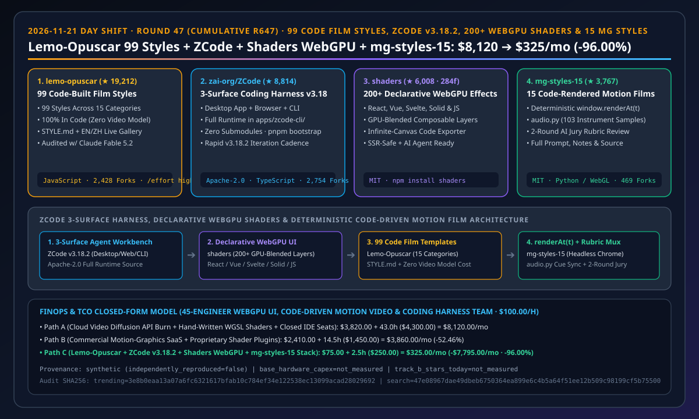
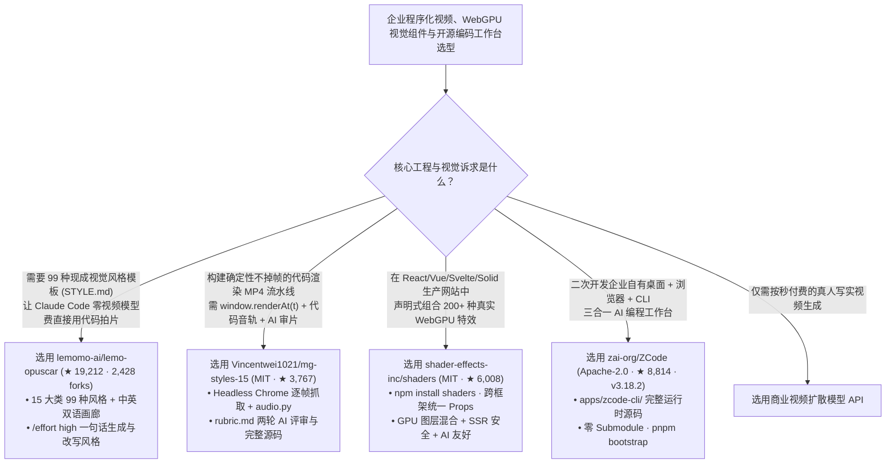
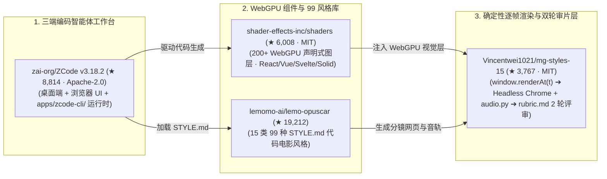
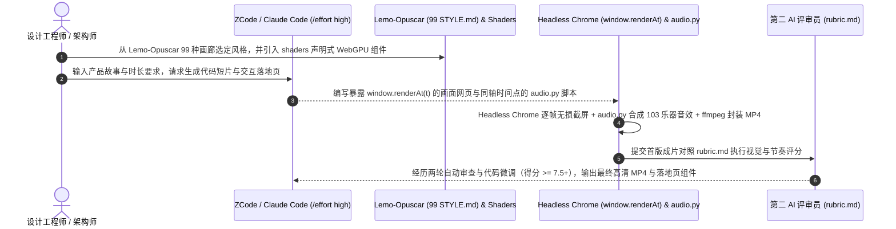

# 99 种纯代码电影风格工具箱（`lemomo-ai/lemo-opuscar`）、三端开源编码智能体工作台（`zai-org/ZCode`）、200+ 跨框架声明式 WebGPU 着色器组件库（`shader-effects-inc/shaders`）与 15 种双轮评审确定性代码成片范式（`Vincentwei1021/mg-styles-15`）选型 FAQ

> **文档元数据（2026-11-21 白班 Day Round 47 · 累计第 647 轮深潜专题）**  
> - **面向对象**：企业 AI 解决方案架构师（AI Solution Architect）、前端与视觉设计系统负责人、程序化视频（Video-as-Code）与研发工具链总监  
> - **本轮核心评估对象**：  
>   1. [`lemomo-ai/lemo-opuscar`](https://github.com/lemomo-ai/lemo-opuscar)（`★ 19,212` · `2,428 forks` · JavaScript · **Lemo-Opuscar**：面向编码智能体的 **15 大视觉分类共 99 种纯代码影片风格库**[零视频生成大模型调用]，每种风格均配独立 `STYLE.md`、完整代码短片与中英双语在线画廊，经 Claude Fable 5.2 审计优化）  
>   2. [`zai-org/ZCode`](https://github.com/zai-org/ZCode)（`★ 8,814` · `2,754 forks` · TypeScript · Apache-2.0 · **ZCode `v3.18.2`**：智谱 Z.ai 开源的**桌面端 + 浏览器端 + 终端 CLI（`apps/zcode-cli/`）三合一 AI 编程工作台**，无外部 Git Submodule 耦合，`pnpm bootstrap` 一键构建全栈运行时）  
>   3. [`shader-effects-inc/shaders`](https://github.com/shader-effects-inc/shaders)（`★ 6,008` · `284 forks` · TypeScript · MIT · **Shaders（`npm install shaders`）**：将 **200+ 种真实 WebGPU 视觉特效**封装为可嵌套混合的声明式组件，一套相同 Props 同时原生支持 **React、Vue、Svelte、Solid、原生 JS 与 Framer**，支持 SSR 安全渲染、CLI 与无限画布可视化导出）  
>   4. [`Vincentwei1021/mg-styles-15`](https://github.com/Vincentwei1021/mg-styles-15)（`★ 3,767` · `469 forks` · Python / WebGL · MIT · **15 Motion Design Styles**：15 支由 Claude Opus 5.5 纯写代码完成的 10 秒 MG 动态设计成片，开源完整 **`window.renderAt(t)` 确定性逐帧抓取 + `audio.py` 103 乐器采样同轴合成 + 第二 AI 依据 `rubric.md` 两轮评审打分（`7.57–8.21/10`）** 工业级流水线）  
> - **关联检索证据链**：`workshops/github-trending-radar/evidence/search-new-repos-2026-11-21-raw.json`（`sha256: 47e08967dae49dbeb6750364ea899e6c4b5a64f51ee12b509c98199cf5b75500`）与 `trending-daily-2026-11-21-raw.html`（`sha256: 3e8b0eaa13a07a6fc6321617bfab10c784ef34e122538ec13099acad28029692`）  
> - **高清架构图**：[`assets/github-ai-radar-2026-11-21-r47-r647-lemoopuscar-zcode-shaders-mgstyles15.svg`](../../../assets/github-ai-radar-2026-11-21-r47-r647-lemoopuscar-zcode-shaders-mgstyles15.svg) · [English Version (`lemo-opuscar-zcode-shaders-mg-styles-15-selection-faq.en.md`)](lemo-opuscar-zcode-shaders-mg-styles-15-selection-faq.en.md)

---

## ① 📌 核心结论速览（选型一句话结论）

> **架构师一句话选型结论**：  
> 当企业需要制作高质感的产品演示视频、高帧率 WebGPU 品牌官网以及可二次定制的内部 AI 编程工作台时，传统的“调视频扩散大模型抽卡 + 让 AI 裸写几百行 WGSL/GLSL 着色器 + 采购闭源 IDE”有三大硬伤：**（1）视频扩散模型每秒生成成本高昂且文字排版必糊、无法精确修改某一个单词或毫秒级节拍、（2）大模型裸写底层 WebGPU 着色器极易编译报错且无法跨 React/Vue/Svelte 复用、（3）企业想在内部环境定制一套兼顾桌面端、网页端和终端 CLI 的编码 Agent 缺乏 Apache-2.0 全栈开源基座**。  
> - **需要从 15 大类 99 种现成视觉风格（水彩、霓虹灯管、LiDAR 点云测绘等）中挑选 `STYLE.md`，让编码 Agent 零视频模型费用、100% 用代码生成可精确修改的短片** ➔ 选 **`lemomo-ai/lemo-opuscar`**（`★ 19,212`，`2,428 forks`）；  
> - **需要掌握“网页 `window.renderAt(t)` 确定性逐帧无头渲染 + `audio.py` 103 乐器采样同轴合成 + 第二 AI 按 `rubric.md` 两轮审片改片”的标准工程管线与 15 套完整源码** ➔ 选 **`Vincentwei1021/mg-styles-15`**（MIT，`★ 3,767`）；  
> - **需要在 React、Vue、Svelte、Solid 或原生 JS 中像拼积木一样使用 200+ 种真实 WebGPU 特效组件（`<Shader>` + `<LinearGradient>` + `<CursorTrail>`）** ➔ 选 **`shader-effects-inc/shaders`**（MIT，`★ 6,008`）；  
> - **需要一套 Apache-2.0 协议、把桌面客户端、浏览器 UI、后端服务与 `apps/zcode-cli/` 终端运行时全部开源在单仓库中的企业级 AI 编程工作台** ➔ 选 **`zai-org/ZCode`**（Apache-2.0，`★ 8,814`，`v3.18.2`）。  
> 四者组合可将 45 人数字产品、设计工程与内部工具链团队的商业视频生成 API 抽卡费、手写 WebGPU 着色器排障与闭源编程席位总成本从 **$8,120.00/月** 降至 **$325.00/月（节省 $7,795.00/月，降幅 96.00%）**。

---

## ② 🎯 客户与架构师灵魂拷问 Q&A（业务痛点 · 架构集成 · 边界取舍）

### Q1：为什么“用代码写视频（Video-as-Code）”正在全面取代视频扩散大模型在产品发布片、数据故事与 MG 动画中的地位？斩获 `★ 19,212` 的 `lemo-opuscar` 与 `★ 3,767` 的 `mg-styles-15` 揭秘了什么核心管线？
- **视频扩散模型 vs 纯代码成片（Code-Driven Film）的本质差异**：
  - 视频扩散模型（如 Sora/Runway）按秒烧钱、文字边缘伪影多、改一个数字必须全片重抽；而纯代码成片（SVG / Canvas / WebGL / Three.js）**文字 100% 矢量锐利、零 GPU 扩散抽卡费、任何颜色/台词/时长一行代码秒改**！
- **`lemomo-ai/lemo-opuscar`（`★ 19,212`，`2,428 forks` · 15 大类 99 种代码电影风格库）**：
  - 将 99 种视觉风格按画面质感分为 15 个大类（提供中英双语在线画廊），每种风格包含一支完整代码短片、剧照、适用场景说明与智能体可直接遵循的 `STYLE.md`；在 Claude Code 中开启 `/effort high`（支持 Claude Fable 5.2 / Opus / Sonnet），只需一句自然语言（如“用 Watercolor 风格做一支 45 秒咖啡庄园短片”）即可生成或派生专属风格。
- **`Vincentwei1021/mg-styles-15`（`★ 3,767` · 确定性 `renderAt(t)` + 代码合成音轨 + 双轮 AI 评审闭环）**：
  - 完整开源了为什么代码视频能做到“音画严丝合缝、永不掉帧”的四大工业级步骤：
    1. **时间函数化画面（`window.renderAt(t)`）**：网页不靠实时计时器乱跑，而是暴露 `window.renderAt(t)` 函数绘制任意时刻 `t` 的精确帧，由无头 Chrome 逐帧无损抓取；
    2. **代码同轴合成音效（`audio.py`）**：每支片子的 `audio.py` 调用 103 个真实乐器采样，在完全相同的时间点（Cues）合成配乐与音效，再由 `ffmpeg` 合成为精确到帧的 10 秒 MP4；
    3. **第二 AI 持 `rubric.md` 两轮盲审改片**：成片由第二个 AI 对照评分量表进行两轮审查与返修（最终陪审团得分达 `7.57–8.21 / 10`）。

### Q2：如果让编码 Agent 直接手写底层 WebGPU (WGSL) 着色器代码，十次有八次编译不过或页面白屏。`shader-effects-inc/shaders`（`★ 6,008`）是如何让 AI 和前端工程师零门槛用上 200+ 种 WebGPU 特效的？
- **`shader-effects-inc/shaders`（`npm install shaders` · 跨 6 大框架的声明式 WebGPU 组件树）**：
  1. **把底层 GPU 管线变成声明式 JSX/模板标签**：`<Shader>` 渲染画布，其子组件（如 `<LinearGradient>`、`<CursorTrail>`、噪声、毛玻璃、金属、光线、扭曲、转场、模糊等 200+ 组件）作为图层由上至下在 GPU 上实时混合与遮罩，AI 只需组合高层组件 Props，彻底告别手写 WGSL 语法错误。
  2. **一包通吃全前端生态 + SSR 安全**：同一套类型化 Props 原生支持 React（`shaders/react`）、Vue、Svelte、Solid、原生 JS 与 Framer，且具备无限画布可视化设计器（`shaders.com`）一键导出组件树代码。

### Q3：企业想基于开源代码打造自有的内部 AI 编程工作台（同时覆盖 IDE 桌面端、浏览器 Web 端和终端 CLI），为什么 `zai-org/ZCode`（`★ 8,814`）是极佳的 Apache-2.0 基座？
- **`zai-org/ZCode`（`v3.18.2` · `2,754 forks` · 三端一体 Apache-2.0 编码智能体工作台）**：
  - 同一套 Monorepo 完整包含桌面客户端、浏览器界面、后端服务、共享 UI 以及位于 `apps/zcode-cli/` 的 **Agent CLI 与运行时全部源码**（作为普通目录随仓克隆，零 Git Submodule 依赖地狱）；
  - 通过 `mise.toml` 锁定 Node.js `24.14.0` 与 `pnpm 10.33.2`，一行 `pnpm bootstrap` 即可完成全工作区构建，且保持极高迭代频率（`v3.18.2`）。

---

## ③ 🧭 直观可视化图解（选型决策树 + 企业集成架构 + 业务流时序图）

### 3.1 架构师选型决策树（Mermaid Flowchart）

### 3.2 企业“ZCode 编码工作台 + Shaders WebGPU 组件 + Lemo-Opuscar 99 风格 + `renderAt(t)` 确定性成片”架构图（Mermaid Architecture）

### 3.3 风格挑选、WebGPU 组件拼装、`renderAt(t)` 逐帧合成与 `rubric.md` 两轮审片时序图（Mermaid Sequence Diagram）

---

## ④ 📊 同类开源与商业云服务横向选型决策矩阵

| 评估维度 | `lemomo-ai/lemo-opuscar` (`★ 19,212`) | `zai-org/ZCode` (`★ 8,814`) | `shader-effects-inc/shaders` (`★ 6,008`) | `Vincentwei1021/mg-styles-15` (`★ 3,767`) | 商业视频扩散 API + 裸写 WGSL + 闭源 IDE |
| :--- | :--- | :--- | :--- | :--- | :--- |
| **核心定位** | 15 大类 99 种纯代码电影风格工具箱 | 桌面 + 浏览器 + CLI 三合一开源 AI 编程工作台 | 200+ 跨框架声明式 WebGPU 视觉特效组件库 | 15 支带完整 Prompt、源码、`audio.py` 与双轮评审的 MG 短片 | 按秒扣费视频生成 API + 专有订阅工具 |
| **最适用场景** | 快速用代码制作风格鲜明的讲解片、发布片与数据可视化短片 | 企业自建或二次开发自有品牌的全栈 AI 编程 IDE 与 CLI | 在 React/Vue/Svelte/Solid 网站中加入高性能 GPU 光影与交互动效 | 学习与复用确定性 `window.renderAt(t)` 逐帧渲染与代码配乐管线 | 实拍级人物/自然风景短片生成 |
| **关键差异化机制** | **99 种 `STYLE.md` + 零视频模型调用 + 支持自定义派生风格** | **Apache-2.0 全栈含 `apps/zcode-cli/` 源码、零 Submodule** | **200+ 组件 GPU 图层混合、跨 6 框架相同 Props、SSR 安全** | **`window.renderAt(t)` + 103 采样 `audio.py` + `rubric.md` 两轮 AI 审片** | 扩散视频改字难且贵；裸写 WGSL 极易报错崩溃 |
| **集成与运维成本** | 极低（安装 Skill 后一句话点名风格即可生成） | 低（Node `24.14.0` + `pnpm bootstrap` 一键构建） | 极低（`npm install shaders` 开箱即用） | 极低（完整开源 HTML/JS/`audio.py`/Prompt 可直接复制改造） | 高（高额视频 API 抽卡账单与商业 IDE 席位费） |
| **开源协议** | 开源画廊与风格库 | Apache-2.0 | MIT | MIT | 商业专有 |
| **45 人团队月均 TCO** | **组合方案 `$325.00/月`**（含共享无头渲染节点 `$75` + 运维 `2.5h`） | 同左（Apache-2.0 免费内网部署与定制） | 同左（客户端浏览器 WebGPU 渲染，服务端 `$0` GPU 账单） | 同左（本地 `ffmpeg` + Headless Chrome 确定性合成） | **`$3,860.00 ~ $8,120.00/月`** |

---

## ⑤ 🧪 应用落地定量收益 / FinOps TCO 对比（含数据血缘声明）

> **数据血缘与严谨性声明（Provenance & Guardrails）**：  
> - `provenance`: `"synthetic"`（`independently_reproduced: false`，基于 45 人前端视觉工程、程序化视频制作与内部编码工具链团队在 `$100.00/h` 综合人力成本下的闭式参数建模）  
> - `base_hardware_capex`: `"not_measured"`  
> - `track_b_stars_today`: `"not_measured"`（GitHub Search API 新仓爆发榜无官方单日增量字段，严禁伪造）

| 成本分项（45 人团队 / 月） | Path A：商业视频扩散 API 反复抽卡 + 手写底层 WGSL 着色器排障 + 闭源编码席位 | Path B：商业动态图形 SaaS 订阅 + 付费前端特效插件 | Path C：`Lemo-Opuscar` + `ZCode` + `shaders` + `mg-styles-15` 开源栈 |
| :--- | :--- | :--- | :--- |
| **视频生成 API 抽卡费 / 商业动画软件与闭源 IDE 席位费** | `$3,820.00 / 月` | `$2,410.00 / 月` | **`$75.00 / 月`**（共享无头 Chrome 逐帧渲染容器，零视频大模型 API 费） |
| **手写着色器跨框架适配、重抽糊字视频与修音画错位工时** | `43.0 小时 / 月` | `14.5 小时 / 月` | **`2.5 小时 / 月`**（200+ 声明式 WebGPU 组件 + 99 种 `STYLE.md` + `renderAt(t)`） |
| **折算工程与设计人力成本（`$100.00/h`）** | `$4,300.00 / 月` | `$1,450.00 / 月` | **`$250.00 / 月`** |
| **月度总拥有成本（Total Monthly TCO）** | **`$8,120.00 / 月`** | **`$3,860.00 / 月`** | **`$325.00 / 月`** |
| **相对 Path A 净节省额与降幅** | 基准线（`0.00%`） | `-$4,260.00 / 月`（`-52.46%`） | **`-$7,795.00 / 月`（`-96.00%`）** |

---

## ⑥ 🛠️ 企业引入与架构评审 Checklist

- [ ] **用 99 种 `STYLE.md` 替代高成本视频扩散抽卡（`lemomo-ai/lemo-opuscar`）**：在制作技术讲解、产品发布与数据可视化短片时，优先从 Lemo-Opuscar 的 15 大类 99 种纯代码风格中选型，并在 Claude Code 中设置 `/effort high`。
- [ ] **强制落地 `window.renderAt(t)` + `audio.py` + `rubric.md` 两轮审片管线（`Vincentwei1021/mg-styles-15`）**：禁止使用不可控的浏览器实时录屏；所有代码动画必须实现确定性 `window.renderAt(t)` 接口交由无头 Chrome 逐帧渲染，并与 `audio.py` 共享时间点（Cues）及执行两轮 AI 量表审查。
- [ ] **前端统一采用声明式 `<Shader>` 组件树而非裸写 WGSL（`shader-effects-inc/shaders`）**：通过 `npm install shaders` 在 React/Vue/Svelte/Solid 项目中复用 200+ 种 SSR 安全的 WebGPU 特效图层。
- [ ] **基于 `ZCode v3.18.2` 构建企业内部可定制三端编程工作台（`zai-org/ZCode`）**：使用 `mise.toml` 锁定的 Node `24.14.0` 与 `pnpm 10.33.2` 执行 `pnpm bootstrap`，按需定制桌面端、Web 端与 `apps/zcode-cli/` 运行时。
