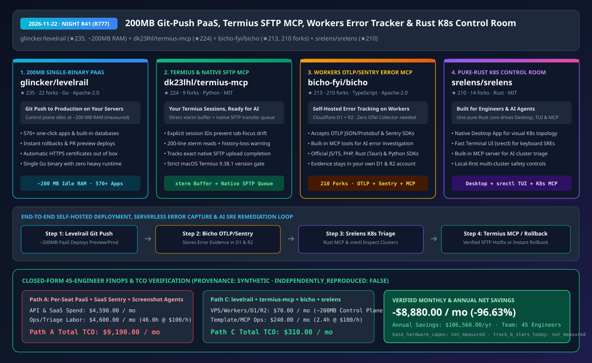
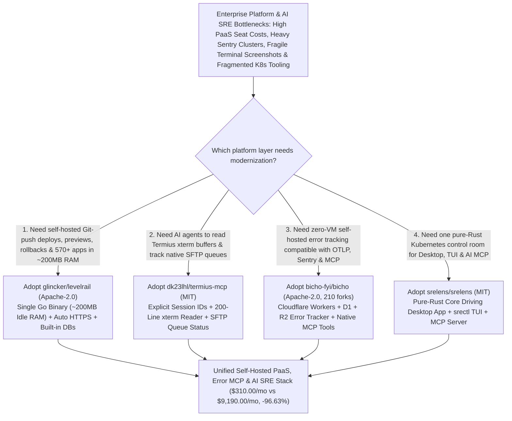
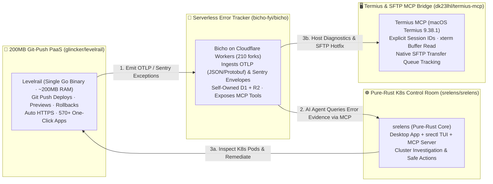
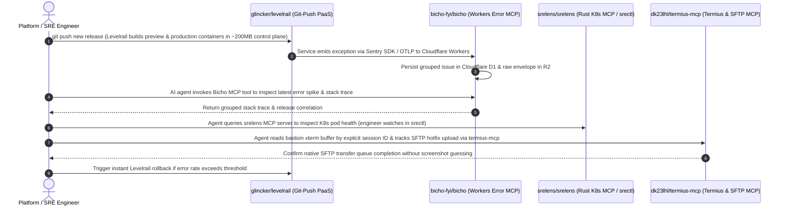

# 200MB Single-Binary Git-Push PaaS (`glincker/levelrail`), Native Termius & SFTP Queue MCP (`dk23lhl/termius-mcp`), Self-Hosted Cloudflare OTLP/Sentry Error Tracker MCP (`bicho-fyi/bicho`) & Pure-Rust Kubernetes AI Control Room (`srelens/srelens`) — Enterprise Selection & Architecture FAQ

> **Document Type**: Enterprise AI Solution Architect Application Landing & Comparative Selection Guide (2026-11-22 Night Round 41 / Cumulative Round `R777`)  
> **Evaluated Repositories**: `glincker/levelrail` (`★ 235`, `22 forks`, Go, Apache-2.0) · `dk23lhl/termius-mcp` (`★ 224`, `9 forks`, Python, MIT) · `bicho-fyi/bicho` (`★ 213`, `210 forks`, JavaScript, Apache-2.0) · `srelens/srelens` (`★ 210`, `14 forks`, Rust, MIT)  
> **Provenance Declaration**: Live GitHub repository metadata comes from our 2026-11-22 sealed evidence snapshot and GitHub REST API. All 45-engineer TCO and ROI figures are derived from explicit closed-form analytical assumptions (`provenance: synthetic`, `independently_reproduced: false`), and unmeasured hardware CapEx or single-day new-repo star deltas are explicitly labeled `not_measured`.

---

## ① 📌 Executive Summary (One-Sentence Selection Verdict)

> **One-Sentence Verdict**: For a 45-engineer platform engineering, DevOps, and AI-assisted SRE organization, **stop paying steep per-seat commercial PaaS markups for internal previews, maintaining 20-container self-hosted Sentry stacks, burning multimodal Computer-Use screenshot tokens just to read Termius logs or guess SFTP upload completion, or letting AI agents run raw unguarded `kubectl` commands**; instead, deploy the open-source stack of **`glincker/levelrail` (single Go binary Git-push PaaS idling at ~200 MB RAM with 570+ one-click apps) + `dk23lhl/termius-mcp` (explicit session-ID xterm reader and native SFTP queue tracker for Termius) + `bicho-fyi/bicho` (210-fork self-hosted OTLP & Sentry error tracker on Cloudflare Workers + D1 + R2 with MCP tools) + `srelens/srelens` (pure-Rust Kubernetes control room powering Desktop App, `srectl` TUI, and MCP Server)**, cutting monthly TCO from **`$9,190.00/mo`** to **`$310.00/mo`** (net savings of **`$8,880.00/mo`**, or **`96.63%`**).

| Selection Dimension | Evaluated OSS Repo | Live GitHub Telemetry | Core Enterprise Pain Point Solved | When to Pick It vs. Managed Cloud PaaS |
| :--- | :--- | :--- | :--- | :--- |
| **200MB Single-Binary Git-Push PaaS** | **`glincker/levelrail`** | `★ 235` · `22 forks` · Go · Apache-2.0 | Commercial PaaS platforms charge per seat and bandwidth tier, while heavy self-hosted PaaS control planes consume 2–4 GB of idle RAM | Pick **`levelrail`** when you want **`git push` to production on your own servers in one Go binary (~200 MB idle RAM) with built-in previews, rollbacks, automatic HTTPS, databases, and 570+ one-click apps**; pick Azure Container Apps for managed serverless scale |
| **Termius Terminal & Native SFTP MCP** | **`dk23lhl/termius-mcp`** | `★ 224` · `9 forks` · Python · MIT | Driving Termius via screenshot-and-click Computer Use loses scrolled output, types into the wrong tab when focus shifts, and misreads SFTP progress bars | Pick **`termius-mcp`** when you need **explicit session IDs, direct 200-line xterm buffer reads with history-loss warnings, and native SFTP transfer queue tracking inside macOS Termius 9.38.1** |
| **Cloudflare Workers OTLP/Sentry Error MCP** | **`bicho-fyi/bicho`** | `★ 213` · `210 forks` · JavaScript · Apache-2.0 | SaaS error trackers bill per event spike, while self-hosting legacy Sentry requires maintaining ClickHouse, Kafka, Postgres, and Redis clusters | Pick **`bicho`** (`210 forks`) when you want **zero-VM error tracking on your own Cloudflare Workers + D1 + R2 that ingests OTLP (JSON/Protobuf) and Sentry envelopes directly and exposes MCP investigation tools** |
| **Pure-Rust Kubernetes Control Room** | **`srelens/srelens`** | `★ 210` · `14 forks` · Rust · MIT | Human SREs use GUI/TUI dashboards while AI agents use separate ad-hoc shell scripts with inconsistent cluster visibility and safety boundaries | Pick **`srelens`** when you want **one pure-Rust core driving a Desktop App, a Terminal UI (`srectl`), and an MCP Server for safe human-and-agent Kubernetes operations** |

---

## ② 🎯 Solution Architect & Customer Deep-Dive Q&A

### Q1: Why do platform engineering and SRE teams hit cost and reliability walls with commercial PaaS, Sentry SaaS, and screenshot-driven terminal agents—and how do these four projects solve them?

**Plain-Language Breakdown for Platform & SRE Leaders**:
1. **Self-Hosted Git-Push PaaS in a ~200 MB Single Go Binary (`glincker/levelrail`)**: Paying $20–$40/user/month for commercial PaaS seats across 45 engineers adds up fast, yet heavy open-source PaaS control planes eat gigabytes of RAM before deploying a single container. `levelrail` (`brew install glincker/tap/levelrail-cli`) compiles the entire deployment platform into one Go binary whose control plane idles at **~200 MB of RAM (measured)**, delivering `git push` production deploys, PR preview environments, instant rollbacks, automatic HTTPS, managed databases, and **570+ one-click apps**.
2. **Replacing Fragile Terminal Screenshots With Deterministic xterm & SFTP State (`dk23lhl/termius-mcp`)**: While Computer Use is helpful for dialogs, using screenshots to operate an SSH/SFTP client fails when logs scroll past the viewport, tab focus changes mid-command, or a progress bar looks full before SFTP checksums finish. `termius-mcp` connects to macOS Termius `9.38.1` (strictly rejecting mismatched versions before injection) to give MCP clients like Codex **explicit session IDs**, **direct xterm buffer text with command-output markers**, and **native SFTP transfer queue tracking**.
3. **Serverless OTLP & Sentry Error Tracking With Native MCP Tools (`bicho-fyi/bicho`, `210 forks`)**: `bicho` runs entirely on **Cloudflare Workers** backed by your own **D1 database and R2 bucket**—requiring **no OpenTelemetry Collector and no always-on VMs**. It accepts OTLP/HTTP (JSON and binary protobuf) alongside **Sentry SDK error envelopes**, provides native SDKs for JavaScript/TypeScript, PHP 8.2+, Rust (including Tauri apps), and Python, and exposes **MCP tools** so coding agents can inspect grouped exceptions directly from your D1/R2 evidence store.
4. **One Pure-Rust Kubernetes Core for Desktop, Terminal (`srectl`), and AI Agents (`srelens/srelens`)**: Instead of maintaining separate tools for human GUI users, terminal power users, and AI agents, `srelens` uses a single pure-Rust core to power a **Desktop App**, a **Terminal UI (`srectl`)**, and an **MCP Server**, ensuring engineers and AI agents share identical cluster diagnostics and safe action guardrails.

### Q2: How do these four projects integrate into a closed-loop "Git Push → Serverless Error Capture → K8s/Termius AI Triage → Instant Rollback" architecture?

**End-to-End Integration Architecture**:
1. **Git-Push Deployment & Preview Plane (`glincker/levelrail`)**: Developers push branches to `levelrail` (~200 MB RAM control plane), which provisions preview or production services wired with `bicho` OTLP/Sentry endpoints.
2. **Serverless Error Ingestion & Evidence Plane (`bicho-fyi/bicho`)**: Application exceptions flow over OTLP or Sentry SDKs into `bicho` on Cloudflare Workers, persisting structured error groups in D1 and payloads in R2.
3. **Kubernetes & Host/SFTP Remediation Plane (`srelens/srelens` + `dk23lhl/termius-mcp`)**:
   - AI agents query `bicho`'s MCP server to inspect new error regressions;
   - For Kubernetes workloads, the agent invokes `srelens` MCP tools (while human SREs watch in `srectl` or the Desktop App) to inspect pod logs/events and execute safe remediations;
   - For VM/bare-metal hosts managed in Termius, the agent uses `termius-mcp` to run diagnostics by explicit session ID and verify native SFTP hotfix uploads—or triggers an instant `levelrail` rollback.

### Q3: What operational boundaries must architects account for?

**Boundaries & Guardrails**:
- **Version-Pinned macOS Termius Adapter**: `termius-mcp` targets macOS Termius `9.38.1` via its local debugging interface and refuses to inject into other versions; for cross-platform Windows/Linux AI SSH, pair with `scarletkc/Hatoba` (Round 38 / `R774`).
- **Cloudflare D1 Write Concurrency**: `bicho` on Workers + D1 + R2 is ideal for low-to-medium error volumes with zero idle cost; massive high-frequency trace firehoses should sample before D1 ingestion.

---

## ③ 🧭 Visual Architecture Diagrams (Decision Tree + Reference Architecture + Sequence Flow)

### 3.1 Selection Decision Tree (Mermaid Flowchart)

### 3.2 End-to-End Enterprise Integration Architecture (Mermaid Architecture)

### 3.3 Automated Error Detection, K8s/Termius Triage & Rollback Sequence (Mermaid Sequence)

---

## ④ 📊 Comparative Selection Matrix (OSS vs. Commercial Cloud PaaS)

| Comparison Dimension | `glincker/levelrail` | `dk23lhl/termius-mcp` | `bicho-fyi/bicho` | `srelens/srelens` | Commercial PaaS + SaaS Sentry + Screenshot Agents |
| :--- | :--- | :--- | :--- | :--- | :--- |
| **Primary Role** | Single-binary Git-push PaaS (~200 MB idle RAM) | MCP bridge for Termius terminals & native SFTP queues | Self-hosted OTLP & Sentry error tracker on Workers/D1/R2 | Pure-Rust Kubernetes control room (Desktop + TUI + MCP) | Per-seat cloud PaaS + event-metered Sentry + Computer-Use screenshots |
| **Resource & Ops Footprint** | **~200 MB idle RAM** in one Go binary; 570+ built-in apps | Reuses existing Termius sessions; zero vision token burn | **Zero VMs or OTel Collectors**; runs on Cloudflare Workers + D1 + R2 | **Single pure-Rust core** unifying GUI, `srectl` TUI & MCP | Self-hosted Sentry needs 20+ containers; screenshot agents burn vision tokens |
| **Reliability & Governance** | Instant rollbacks, preview environments & auto HTTPS | **Strict version check (`9.38.1`)**, explicit session IDs & SFTP queue state | **210 forks**;JS/PHP/Rust/Python SDKs + self-owned D1/R2 evidence | Local-first cluster access with shared human/agent safety boundaries | Screenshot agents type into wrong tabs or misjudge SFTP progress bars |
| **License** | **Apache-2.0** | **MIT** | **Apache-2.0** | **MIT** | Proprietary SaaS |

---

## ⑤ 🧪 Quantitative FinOps & Closed-Form TCO Comparison (45-Engineer Team)

### 5.1 Explicit Closed-Form Assumptions (`provenance: synthetic`, `independently_reproduced: false`)
- **Team & Labor Baseline**: `team_size_engineers = 45` engineers; blended platform/SRE hourly rate `hourly_rate_usd = $100.00/hr`; `base_hardware_capex = not_measured`; `track_b_stars_today = not_measured`.
- **Path A (Baseline: Commercial Per-Seat PaaS + Commercial Sentry Event Quotas + Screenshot-Driven Terminal Automation & Manual Triage)**:
  - **API & Commercial SaaS Spend (`path_a_api_saas_usd`)**: 45-seat commercial PaaS subscriptions, commercial error-tracking quotas, and multimodal screenshot token burn = **`$4,590.00/mo`**;
  - **Manual Ops & Triage Labor (`path_a_labor_hours`)**: **`46.0 hours/mo`** spent context-switching across disconnected K8s/error/SSH tools and recovering from failed screenshot-driven terminal actions = `46.0 × $100.00 =` **`$4,600.00/mo`** (`path_a_labor_usd`);
  - **Path A Total Monthly TCO (`path_a_total_usd`)**: `$4,590.00 + $4,600.00 =` **`$9,190.00/mo`**.
- **Path C (Hybrid Open-Source Stack: `levelrail` + `termius-mcp` + `bicho` + `srelens`)**:
  - **Self-Hosted VPS & Cloudflare Workers Compute (`path_c_compute_usd`)**: `levelrail` (~200 MB RAM) on existing infrastructure plus `bicho` on Cloudflare Workers + D1 + R2 = **`$70.00/mo`**;
  - **Platform Maintenance Labor (`path_c_labor_hours`)**: **`2.4 hours/mo`** maintaining `levelrail` templates and `bicho`/`srelens` MCP configs = `2.4 × $100.00 =` **`$240.00/mo`** (`path_c_labor_usd`);
  - **Path C Total Monthly TCO (`path_c_total_usd`)**: `$70.00 + $240.00 =` **`$310.00/mo`**.
- **Closed-Form Net Savings & Percentage Reduction**:
  - **Monthly Net Savings (`net_savings_usd`)**: `$9,190.00 - $310.00 =` **`$8,880.00/mo`** (`$106,560.00/yr`);
  - **Percentage TCO Reduction (`pct_savings`)**: `$8,880.00 / $9,190.00 × 100% =` **`96.63%`**.

| Deployment Path | Monthly API/SaaS or Compute | Monthly Platform/SRE Labor | Total Monthly TCO | Net Savings vs. Path A | Architectural Outcome |
| :--- | :--- | :--- | :--- | :--- | :--- |
| **Path A: Commercial Per-Seat PaaS + SaaS Sentry + Screenshot Terminal Agents** | `$4,590.00` | `$4,600.00` (`46.0h`) | **`$9,190.00/mo`** | Baseline (`0.00%`) | High per-seat/per-event bills; fragile screenshot terminal automation |
| **Path B: Self-Hosted Heavy Sentry Cluster + Heavy OSS PaaS** | `$2,320.00` | `$1,300.00` (`13.0h`) | **`$3,620.00/mo`** | `-$5,570.00/mo` (`-60.61%`) | Heavy ClickHouse/Kafka RAM footprint and ongoing upgrade toil |
| **Path C: `levelrail` + `termius-mcp` + `bicho` + `srelens` (Recommended)** | **`$70.00`** | **`$240.00`** (`2.4h`) | **`$310.00/mo`** | **`-$8,880.00/mo` (`-96.63%`)** | **200MB Git-push PaaS + serverless OTLP/Sentry MCP + Rust K8s room + SFTP MCP** |

---

## ⑥ 🛠️ Enterprise Onboarding & Architecture Review Checklist

- [ ] **200MB Control-Plane & Preview/Rollback Verification (`glincker/levelrail`)**: Install `levelrail` on self-hosted Linux nodes, confirm ~200 MB idle RAM footprint, and test `git push` preview environments, automatic HTTPS, and one-click rollbacks.
- [ ] **Version-Gated Termius xterm & SFTP Queue Integration (`dk23lhl/termius-mcp`)**: Verify macOS Termius `9.38.1` version gating, test explicit session-ID terminal reads (200-line cap with history-loss warning), and validate native SFTP upload completion tracking.
- [ ] **Serverless OTLP & Sentry Error Ingestion (`bicho-fyi/bicho`)**: Deploy `bicho` to enterprise Cloudflare Workers + D1 + R2, point existing Sentry SDKs or OTLP/HTTP exporters to the Worker endpoint, and verify AI agent error triage via `bicho` MCP tools.
- [ ] **Unified Rust Kubernetes Desktop / `srectl` / MCP Rollout (`srelens/srelens`)**: Connect `srelens` across staging and production Kubernetes clusters so human SREs (`srectl` / Desktop App) and AI agents (MCP server) operate over a single pure-Rust control plane.
