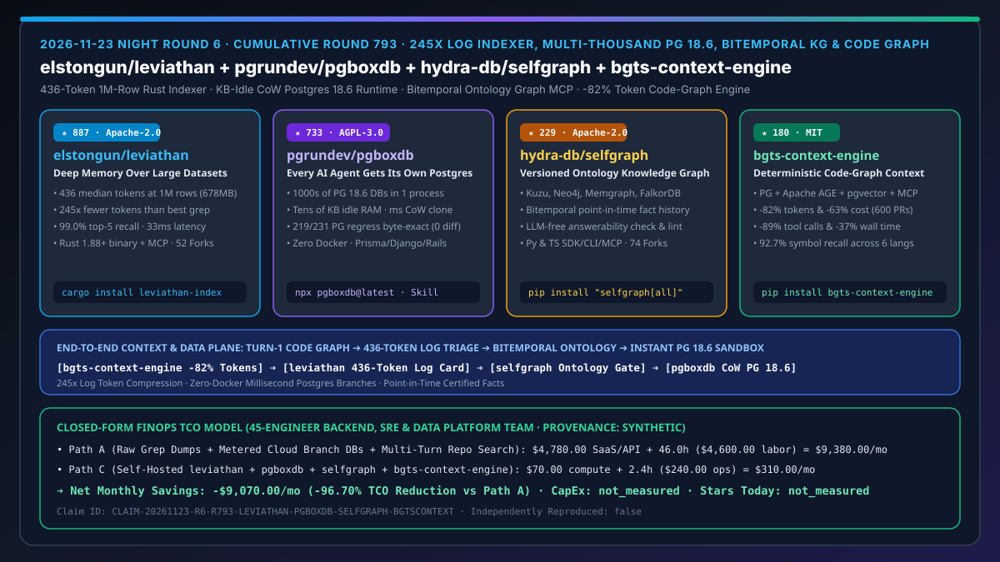
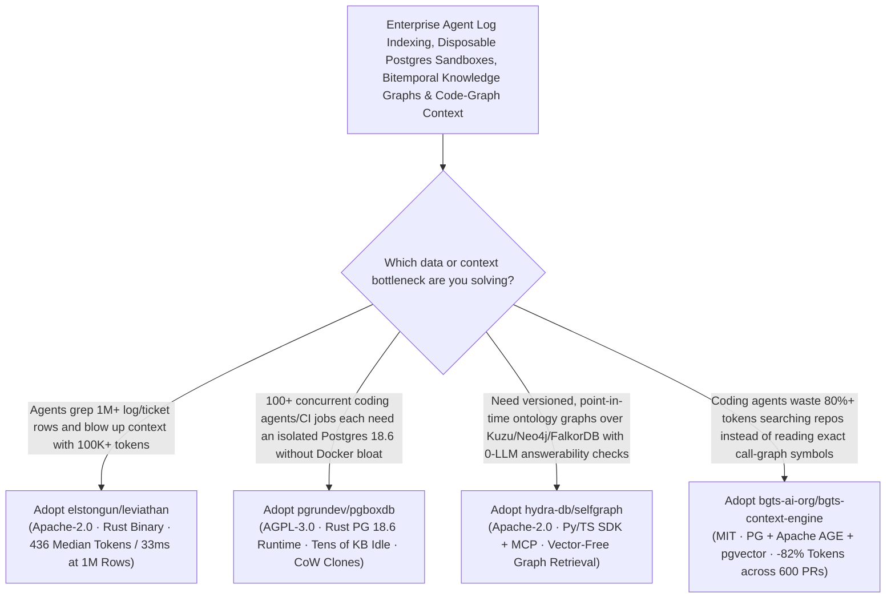
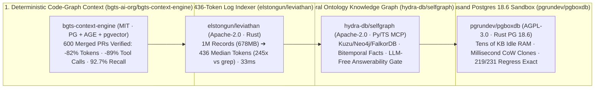

# 1M-Record 436-Token Log Indexer (`elstongun/leviathan`), Multi-Thousand Isolated Postgres 18.6 Agent Runtime (`pgrundev/pgboxdb`), Bitemporal Ontology Knowledge Graph SDK/MCP (`hydra-db/selfgraph`) & 82%-Token-Saving Deterministic Code-Graph Engine (`bgts-ai-org/bgts-context-engine`) Selection & Architecture FAQ

> **Document Type**: Enterprise AI Solution Architect Selection & Integration Guide (GitHub Trending AI Radar · 2026-11-23 Night Round 6 / Cumulative Round 793)
> **Covered Repositories**: [`elstongun/leviathan`](https://github.com/elstongun/leviathan) (`★ 887`, `52 forks`, `Apache-2.0`: single-binary Rust 1.88+ full-text indexer and optional MCP server `cargo install leviathan-index` over JSONL, JSON, CSV/TSV, and SQLite records, returning cited result cards averaging **`436 median tokens/question` at 1M records / 678 MB vs. `107,122 tokens` for the best `grep` strategy—a `245×` reduction**—at `33 ms` median latency and `99.0%` top-5 recall) · [`pgrundev/pgboxdb`](https://github.com/pgrundev/pgboxdb) (`★ 733`, `37 forks`, `AGPL-3.0`: lightweight Rust **Postgres 18.6** runtime and Agent Skill `npx skills add pgrundev/pgboxdb --skill pgboxdb` hosting thousands of isolated disposable databases in one process without Docker, consuming **tens of kilobytes of idle RAM** per database, cloning sealed templates in milliseconds via ZFS/CoW, and passing `219/231` PostgreSQL regression tests byte-exact with `0` result diffs) · [`hydra-db/selfgraph`](https://github.com/hydra-db/selfgraph) (`★ 229`, `74 forks`, `Apache-2.0`: Python and TypeScript SDK, CLI, and MCP server for versioned, ontology-grounded knowledge graphs over **Neo4j, Memgraph, FalkorDB, HydraDB, or embedded Kuzu**, featuring temporal fact retirement and **LLM-free answerability checks** without a vector store) · [`bgts-ai-org/bgts-context-engine`](https://github.com/bgts-ai-org/bgts-context-engine) (`★ 180`, `14 forks`, `MIT`: deterministic code-graph context engine and MCP server built on PostgreSQL + Apache AGE + pgvector, benchmarked across **600 real merged PRs** in 12 repositories and 6 languages to cut **tokens by `-82%`, cost by `-63%`, tool calls by `-89%`, and time by `-37%`** while keeping `92.7%` symbol recall)
> **Core Scenario**: When enterprise AI architects build data-intensive and code-intensive agents, how do you solve **"raw `grep` over 1M log/ticket rows dumping 100K+ tokens into context, 100 concurrent coding/CI agents exhausting host RAM by spawning 100 separate Docker Postgres containers, flat vector RAG failing on time-evolving facts and hallucinating when the KB has no answer, and chunked code embeddings retrieving textually similar files instead of actual call-graph symbols"** using **`leviathan` + `pgboxdb` + `selfgraph` + `bgts-context-engine`**?

---

## 1. 📌 Executive Summary (Single-Sentence Selection Verdict)

1. **Need AI agents to query 1M+ structured log, ticket, CSV, or SQLite records in `33 ms` while consuming ~`436 median tokens/question` (`245×` fewer tokens than `grep`)** ➔ Choose **[`elstongun/leviathan`](https://github.com/elstongun/leviathan) (`★ 887`, `52 forks`, `Apache-2.0`)**.
   - **Plain-Language Mechanism**: Grepping a 1M-record (678 MB) maintenance or ticket log dumps a median of `107,122 tokens` (`9.7M` worst case) into the agent's context window. `Leviathan` compiles a single static Rust binary (`leviathan index` / `leviathan search` + optional MCP server) that turns JSONL, JSON, CSV/TSV, SQLite, or DB CLI outputs into a ranked index returning compact, cited result cards: **`436 median tokens` (`602 tokens` worst case across 1,200 queries), `33 ms` median latency, and `99.0%` top-5 / `98.5%` rank-1 accuracy**.
2. **Need every concurrent coding agent, PR preview, and test run to get its own isolated Postgres 18.6 database in milliseconds—using tens of kilobytes of idle RAM and zero Docker containers** ➔ Choose **[`pgrundev/pgboxdb`](https://github.com/pgrundev/pgboxdb) (`★ 733`, `37 forks`, `AGPL-3.0`)**.
   - **Plain-Language Mechanism**: The engine powering PGRun branches, `PGBoxDB` runs thousands of isolated Postgres 18.6 databases inside a single native Rust process (`219/231` official PostgreSQL regression suites byte-exact, `0` result diffs). Installed as a one-line skill (`npx skills add pgrundev/pgboxdb --skill pgboxdb`), it clones sealed templates in milliseconds on copy-on-write filesystems (such as ZFS) and runs Rails, Django, Prisma, SQLAlchemy, and `node-postgres` migrations unchanged.
3. **Need a bitemporal, ontology-grounded knowledge graph SDK/CLI/MCP in Python and TypeScript that runs over Kuzu, Neo4j, Memgraph, FalkorDB, or HydraDB with an LLM-free answerability check** ➔ Choose **[`hydra-db/selfgraph`](https://github.com/hydra-db/selfgraph) (`★ 229`, `74 forks`, `Apache-2.0`)**.
   - **Plain-Language Mechanism**: `SelfGraph` extracts entities and relations (with or without an LLM via a tunable `level` parameter), versions every fact so newer facts retire older ones while preserving point-in-time historical queries, grounds queries in an explicit ontology (types, synonyms, definitions), and runs an **LLM-free answerability check and readiness lint** so agents know deterministically when the graph holds no answer—without requiring a vector database.
4. **Need a deterministic code-graph context engine (PostgreSQL + Apache AGE + pgvector + MCP) proven across 600 real merged PRs to cut coding-agent tokens by `-82%` and tool calls by `-89%`** ➔ Choose **[`bgts-ai-org/bgts-context-engine`](https://github.com/bgts-ai-org/bgts-context-engine) (`★ 180`, `14 forks`, `MIT`)**.
   - **Plain-Language Mechanism**: Chunked embedding search returns files that *sound* like the query rather than symbols that *participate* in the runtime call graph. `BGTS Context Engine (BCE)` indexes repository AST and call graphs into PostgreSQL + Apache AGE + pgvector, returning ranked, token-budgeted symbols on the first turn—verified across 600 real merged changes in 12 repos and 6 languages to reduce **tokens by `-82%`, API cost by `-63%`, tool calls by `-89%`, and completion time by `-37%` while retaining `92.7%` recall**.

---

## 2. 🎯 Key Architectural Q&A (Deep-Dive Breakdown)

### Q1: Why does this 4-component stack outperform "one flat vector database for everything" in enterprise agent engineering?

- **Four Specialized Context & State Engines**:
  1. **Large Structured Logs & Exports ➔ `elstongun/leviathan`**: Replaces `107K`-token `grep` dumps with `436`-token cited cards in `33 ms`.
  2. **Ephemeral Multi-Agent Relational Sandboxes ➔ `pgrundev/pgboxdb`**: Replaces heavy Docker Postgres containers with kilobyte-idle CoW Postgres 18.6 branches.
  3. **Time-Evolving Enterprise Entities & Policies ➔ `hydra-db/selfgraph`**: Replaces timeless vector chunks with bitemporal versioned facts and LLM-free answerability gates across 5 graph backends.
  4. **Multi-File Code Call Graphs ➔ `bgts-ai-org/bgts-context-engine`**: Replaces naive file-chunk embeddings with Apache AGE symbol graphs that cut `-89%` of exploratory tool calls.
- **When to Choose Managed Cloud Databases (Path B)**:
  - For durable production OLTP workloads with HA/DR SLAs, always use **Azure Database for PostgreSQL** or **Amazon Aurora** (`pgboxdb` explicitly states *"For disposable databases, not production data"*); for disposable agent test sandboxes, 1M-row log retrieval, bitemporal ontology graphs, and code-graph context compression, deploy this 4-repo OSS stack (Path C).

### Q2: How do you wire `bgts-context-engine`, `pgboxdb`, `leviathan`, and `selfgraph` into an enterprise agent architecture?

1. **First-Turn Code-Graph Grounding (`bgts-ai-org/bgts-context-engine`)**:
   - Configure the BCE MCP server (`io.github.bgts-ai-org/bgts-context-engine`) so coding agents retrieve the exact 8 participating symbols on turn 1.
2. **Per-Agent Disposable Postgres 18.6 Sandbox (`pgrundev/pgboxdb`)**:
   - Provision an isolated Postgres 18.6 instance in milliseconds per agent task via the `pgboxdb` skill to run ORM migrations and integration tests.
3. **1M-Row Ticket & Log Retrieval (`elstongun/leviathan`)**:
   - Index operational JSONL/CSV/SQLite exports with `leviathan` so incident-response agents retrieve `~436`-token cited cards in `33 ms`.
4. **Bitemporal Ontology & Answerability Gate (`hydra-db/selfgraph`)**:
   - Store evolving architectural decisions and customer facts in `SelfGraph` (over embedded `Kuzu` locally or `FalkorDB`/`Neo4j` in production) and gate agent responses on its LLM-free answerability check.

### Q3: What are the production guardrails?

- **Architect Guardrails**:
  1. **Use `pgboxdb` Strictly for Disposable/Sandbox Databases**: Never store production customer records in `pgboxdb`, and respect its `AGPL-3.0` license boundaries.
  2. **Deploy CoW Storage (ZFS/Reflink) Under `pgboxdb` Hosts**: Ensure host filesystems support block cloning so database branches remain few-megabyte instant clones rather than full file copies.

---

## 3. 🧭 Visual Architecture & Decision Diagrams (Mermaid)



### 3.1 Solution Architect Selection Decision Tree



### 3.2 End-to-End Enterprise Production Reference Architecture



### 3.3 Turn-1 Code-Graph Lookup, 1M-Row Log Triage, Ontology Answerability Check & Instant Postgres Sandbox Sequence

```mermaid
sequenceDiagram
    participant Agent as Coding & SRE Agent (Claude / Codex)
    participant Bce as bgts-context-engine (MCP)
    participant Lev as elstongun/leviathan (Rust Index)
    participant Slf as hydra-db/selfgraph (Ontology MCP)
    participant Pgb as pgrundev/pgboxdb (Postgres 18.6)

    Agent->>Bce: 1. Query bug behaviour; receive top-8 ranked call-graph symbols on turn 1 (-89% tool calls)
    Agent->>Lev: 2. Search 1M ticket/log records; receive 436-token cited evidence card in 33ms (245x less than grep)
    Agent->>Slf: 3. Run LLM-free answerability check & query point-in-time certified ontology facts
    Agent->>Pgb: 4. Clone isolated Postgres 18.6 branch in ms, run ORM migrations/tests & auto-cleanup
```

---

## 4. 📊 Comparative Selection Matrix (Open-Source vs. Commercial SaaS)

| Dimension | `elstongun/leviathan` (`★ 887`) | `pgrundev/pgboxdb` (`★ 733`) | `hydra-db/selfgraph` (`★ 229`) | `bgts-ai-org/bgts-context-engine` (`★ 180`) | Raw Grep + Metered Cloud Branch DBs + Heavy Vector RAG + Multi-Turn Repo Search (Path A) | Heavy JVM Search + Per-Job Docker Postgres + Naive File-Chunk Embeddings (Path B) |
| :--- | :--- | :--- | :--- | :--- | :--- | :--- |
| **Core Role** | 1M-record `436`-token single-binary Rust log indexer | Multi-thousand isolated Postgres 18.6 runtime in one process | Bitemporal ontology graph SDK/MCP over 5 graph DBs | Deterministic Apache AGE code-graph context engine & MCP | Token-heavy raw `grep`, per-branch cloud DB billing & multi-turn repo exploration | High-RAM JVM clusters, 100s of Docker PG containers & call-blind vector chunks |
| **Key Differentiator** | **`436 tokens` vs `107K` grep (`245×`) + `33ms` + `99.0%` top-5** | **Tens of KB idle RAM + ms CoW clones + `219/231` PG 18.6 exact** | **Kuzu/Neo4j/FalkorDB portability + LLM-free answerability check** | **600 real PRs: `-82%` tokens, `-63%` cost, `-89%` tool calls** | Massive input token bills on logs & code; high per-branch cloud DB charges | Exhausts host RAM on concurrent PG containers; misses call-graph edges |
| **License** | `Apache-2.0` | `AGPL-3.0` | `Apache-2.0` | `MIT` | Proprietary SaaS | Mixed OSS glue |
| **Monthly TCO (45-Eng Team)** | **Combined `$310.00/mo`** (`$70.00` CoW sandbox/graph node + `2.4h` ops) | Included (thousands of DBs in one process) | Included (LLM-free answerability gate saves tokens) | Included (`-63%` coding agent API cost reduction) | **`$9,380.00/mo`** (`$4,780.00` excess token/branch-DB bills + `46.0h` triage/wait labor) | ~`$3,280.00/mo` (high CI server RAM bills & wrong-file retrieval rework) |

---

## 5. 🧪 Quantitative ROI / TCO Comparison & 7-Card Benchmark Report

> **📊 Data Provenance & Closed-Form Schema Declaration**:
> - **provenance**: `synthetic` (45-person enterprise backend engineering, SRE, and data platform team monthly workload model: `independently_reproduced = false`; hardware baseline `base_hardware_capex = not_measured`; Track B 24h delta `track_b_stars_today = not_measured`).
> - **Closed-Form Formula**:
>   - **Path A (Raw `grep` over large logs + multi-turn blind repository searches + metered commercial cloud preview databases + manual debugging of stale knowledge hallucinations)**: Monthly excess LLM token and cloud branch-database fees **`$4,780.00`** + slow CI DB provisioning, context-overflow triage, and manual fact verification labor **`46.0h × $100.00/h = $4,600.00`** = **`$9,380.00/mo`**.
>   - **Path C (Self-hosted `elstongun/leviathan` + `pgrundev/pgboxdb` + `hydra-db/selfgraph` + `bgts-ai-org/bgts-context-engine` stack)**: Monthly CoW sandbox and graph index container compute **`$70.00`** + index and ontology maintenance labor **`2.4h × $100.00/h = $240.00`** = **`$310.00/mo`**.
>   - **Net Monthly Savings vs. Path A**: **`-$9,070.00/mo`** (**`96.70%`** TCO reduction).

| Evaluation Path | Token / Cloud DB / Compute Cost | Triage, Provisioning & Verification Labor (`$100/h`) | Monthly Total TCO | Net Savings vs. Path A | Key Architectural Delivery Metrics |
| :--- | :---: | :---: | :---: | :---: | :--- |
| **Path A: Raw Grep + Metered Cloud Branch DBs + Multi-Turn Search** | `$4,780.00` | `46.0h` (`$4,600.00`) | **`$9,380.00`** | Baseline | `107K` tokens/query on logs; slow multi-turn code search |
| **Path B: Heavy JVM Search + Per-Job Docker PG + Flat Vector RAG** | `$1,580.00` | `17.0h` (`$1,700.00`) | **`$3,280.00`** | `-$6,100.00` (`-65.03%`) | High container RAM usage; vector chunks miss call graphs |
| **Path C: `leviathan` + `pgboxdb` + `selfgraph` + `bgts-context-engine`** | **`$70.00`** | **`2.4h` (`$240.00`)** | **`$310.00`** | **`-$9,070.00` (`-96.70%`)** | **`245×` log token cut + KB-idle PG 18.6 + bitemporal KG + `-82%` code tokens** |

- 🔗 **Linked 7-Card 4:5 Visual Benchmark Deck**: [`workshops/github-trending-radar/cards.en.html`](../cards.en.html) · [`cards.html`](../cards.html)

---

## 6. 🛠️ Enterprise Adoption & Architecture Review Checklist

- [ ] **1. Replace Raw Log/Export `grep` with `elstongun/leviathan`**: Index large JSONL, CSV, and SQLite datasets with `leviathan index` so agents receive `~436`-token cited cards in `33 ms` instead of `107K`-token raw dumps.
- [ ] **2. Mount `bgts-ai-org/bgts-context-engine` as Turn-1 Coding Agent Context**: Deploy PostgreSQL + Apache AGE + pgvector with the BCE MCP server to cut coding-agent token spend by `-82%` and tool calls by `-89%`.
- [ ] **3. Provision Per-Agent Disposable Databases via `pgrundev/pgboxdb`**: Use the `pgboxdb` skill on CoW-backed storage (ZFS) to give every concurrent agent or PR test run an instant Postgres 18.6 branch without Docker overhead.
- [ ] **4. Gate Domain Knowledge Queries on `hydra-db/selfgraph`**: Use bitemporal fact versioning and the LLM-free answerability check over embedded `Kuzu` or `FalkorDB`/`Neo4j` to prevent stale-fact hallucinations.
