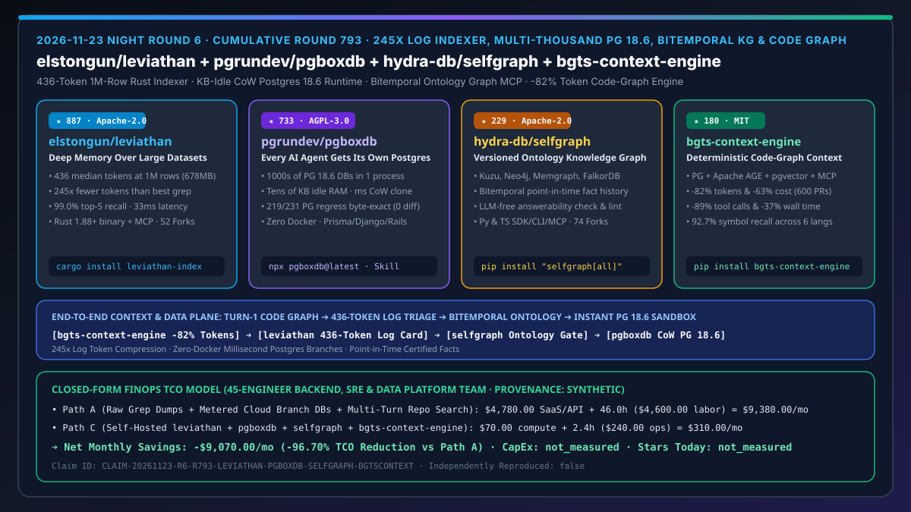
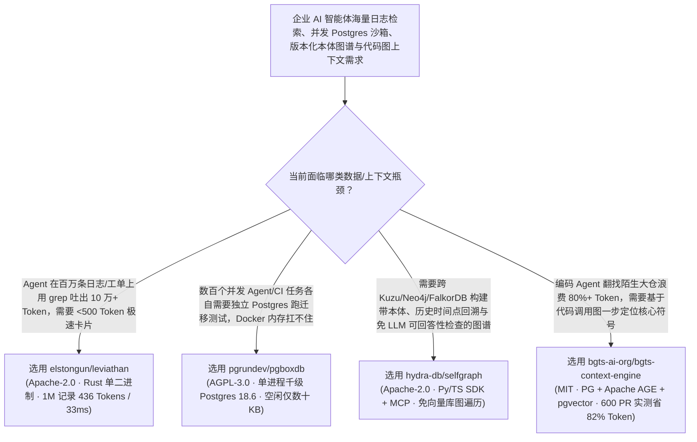
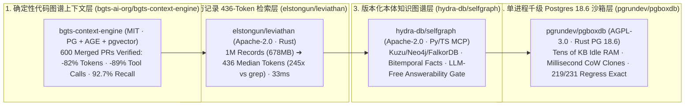
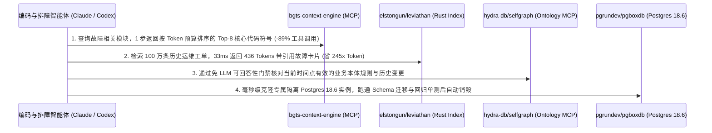

# 百万条日志 436 Token 单二进制检索器（`elstongun/leviathan`）、单进程承载数千隔离 Postgres 18.6 的智能体数据库运行时（`pgrundev/pgboxdb`）、跨五大图数据库带本体与无 LLM 可回答性门禁的时序知识图谱（`hydra-db/selfgraph`）与实测 600 个真实 PR 省 82% Token 的确定性代码图谱引擎（`bgts-ai-org/bgts-context-engine`）选型与集成架构 FAQ

> **文档类型**：企业 AI 解决方案架构师（AI Solution Architect）选型决策指南（GitHub Trending AI 雷达 2026-11-23 Night Round 6 / 累计第 793 轮）
> **覆盖项目**：[`elstongun/leviathan`](https://github.com/elstongun/leviathan)（`★ 887`、`52 forks`、`Apache-2.0`：Rust 1.88+ 单静态二进制大数据集深度记忆与 MCP 索引器 `cargo install leviathan-index`，在 100 万条记录 / 678 MB 数据集上将中位单问消耗从最佳 `grep` 策略的 `107,122 tokens` 压至 **`436 tokens`（省 `245×`）**、中位延迟 `33ms`、Top-5 召回率达 `99.0%`）· [`pgrundev/pgboxdb`](https://github.com/pgrundev/pgboxdb)（`★ 733`、`37 forks`、`AGPL-3.0`：用 Rust 编写的轻量级 **Postgres 18.6** 兼容运行时与 Agent Skill `npx skills add pgrundev/pgboxdb --skill pgboxdb`，免 Docker 在单进程内承载数千个隔离临时数据库，每个空闲库仅占**几十 KB 内存**、基于 ZFS/CoW 毫秒级克隆，通过 `219/231` 项 PostgreSQL 官方回归测试字节级一致）· [`hydra-db/selfgraph`](https://github.com/hydra-db/selfgraph)（`★ 229`、`74 forks`、`Apache-2.0`：兼容 **Neo4j、Memgraph、FalkorDB、HydraDB 与嵌入式 Kuzu** 的双时态版本化本体知识图谱 Python/TS SDK、CLI 与 MCP Server，内置**免 LLM 可回答性检查（LLM-Free Answerability Check）**、同义词本体对齐与免向量库图遍历检索）· [`bgts-ai-org/bgts-context-engine`](https://github.com/bgts-ai-org/bgts-context-engine)（`★ 180`、`14 forks`、`MIT`：基于 PostgreSQL + Apache AGE + pgvector 的确定性代码图谱上下文引擎与 MCP，在 12 个仓库、6 种语言、**600 个真实合并 PR** 上实测减少 **`-82%` Token、`-63%` 成本、`-89%` 工具调用次数与 `-37%` 耗时**，同时保留 `92.7%` 关键符号召回率）
> **核心场景**：当企业架构师在构建数据密集型与代码密集型 AI Agent 时，面对**“Agent 用 `grep` 扫百万行运维日志单次塞进 10 万+ Token 瞬间撑爆上下文、并发跑 100 个编码/测试 Agent 时每个启一个 Docker Postgres 容器瞬间耗尽数百 GB 内存、传统向量 RAG 查不出跨时间演进的企业实体关系且不知何时该拒答、以及代码库向量切片只召回字面相似文件却漏掉真实调用链符号”**四大瓶颈，如何构建一套**“百万行日志 436-Token 检索（`leviathan`）+ 单进程千级 CoW Postgres 沙箱（`pgboxdb`）+ 跨五库双时态本体图谱（`selfgraph`）+ 省 82% Token 代码调用图引擎（`bgts-context-engine`）”**的数据与上下文底座？

---

## 一、📌 核心结论速览（选型一句话结论）

1. **想让智能体在百万条工单、审计日志或 CSV/SQLite 表上回答问题时，彻底告别动辄吐出十万 Token 的暴力 `grep`，每次查询只返回带引用的 `~436 tokens` 精选卡片（省 `245×` Token）** ➔ 选 **[`elstongun/leviathan`](https://github.com/elstongun/leviathan)（`★ 887`，`52 forks`，`Apache-2.0`）**。
   - **通俗原理**：当数据集达到 100 万条（678 MB）时，哪怕是最精巧的 `grep` 组合策略，单问中位输出也高达 `107,122 tokens`（最差情况 `9.7M tokens`），延迟 `92 ms`。`Leviathan` 是一个零外部依赖的 Rust 单二进制（附可选 MCP Server），对任意 JSONL/JSON/CSV/TSV/SQLite 建立全文相关性索引：实测 100 万条记录下**单问中位仅需 `436 tokens`（最坏情况 1,200 问中最高仅 `602 tokens`）**，中位延迟 **`33 ms`**，且 Top-5 命中率达 **`99.0%`（Rank-1 达 `98.5%`）**。
2. **想为每一个并发编码 Agent、每一个 PR 预览环境或每一次集成测试分配一个完全隔离、毫秒级创建且空闲内存仅几十 KB 的专属 Postgres 18.6 数据库（无需启动笨重的 Docker 容器）** ➔ 选 **[`pgrundev/pgboxdb`](https://github.com/pgrundev/pgboxdb)（`★ 733`，`37 forks`，`AGPL-3.0`）**。
   - **通俗原理**：多 Agent 并发改数据库 Schema 时，共用一个库会互相踩踏，而每开一个标准 Postgres Docker 容器就要吃掉上百 MB 内存和数秒启动时间。`PGBoxDB`（PGRun 分支引擎底层）在**单个 Rust 进程内托管数千个隔离的 Postgres 18.6 实例**：在 ZFS 等写时复制（CoW）存储上从封存模板克隆新库仅需几毫秒与几 MB 空间，空闲实例仅占**几十 KB 内存**，且完整兼容 Postgres 线协议（Rails、Django、Prisma、SQLAlchemy、`node-postgres` 迁移脚本零改动直跑，通过 `219/231` 官方回归测试零结果差异）。
3. **想把非结构化企业文档转化为带本体（Ontology）同义词约束、支持按任意历史时间点回溯（“当时已知什么 vs 后来更正了什么”）、且具备免 LLM 可回答性门禁的知识图谱** ➔ 选 **[`hydra-db/selfgraph`](https://github.com/hydra-db/selfgraph)（`★ 229`，`74 forks`，`Apache-2.0`）**。
   - **通俗原理**：提供 Python 与 TypeScript 双栈 SDK、CLI 与 MCP Server，底层用同一套 API 无缝切换 **嵌入式 Kuzu（零服务器）、Neo4j、Memgraph、FalkorDB 或 HydraDB**。它通过 `level` 参数在“纯确定性零成本抽取”与“LLM 深度抽取”间自由切换，无需向量数据库即可通过图遍历返回原始段落，并独创 **LLM-Free Answerability Check（免大模型可回答性门禁）**——在调大模型前先用本体与已认证事实（Certified Facts）判定图谱里到底有没有答案，从根源消灭瞎编乱造。
4. **想让编码 Agent 在面对陌生大型多语言代码库时，不再靠向量切片盲猜“长得像”的文件，而是第一步直接拿到真正参与该业务逻辑的 Top-8 核心符号（实测省 82% Token、减少 89% 工具调用）** ➔ 选 **[`bgts-ai-org/bgts-context-engine`](https://github.com/bgts-ai-org/bgts-context-engine)（`★ 180`，`14 forks`，`MIT`）**。
   - **通俗原理**：向量检索代码的最大缺陷是“搜登录超时，返回 5 个包含 timeout 单词的文案文件，却漏掉真正触发超时的 Webhook 调用链”。`BGTS Context Engine (BCE)` 基于 **PostgreSQL + Apache AGE 图扩展 + pgvector** 构建确定性代码图谱并通过 MCP 暴露：在横跨 12 个仓库、6 种语言、**600 个真实已合并 PR** 的严格对照基准中，让编码 Agent 先调一次 BCE，实现 **Token 消耗降低 `-82%`、API 账单降低 `-63%`、盲目搜索工具调用减少 `-89%`、端到端耗时缩短 `-37%`**，同时保持 **`92.7%`** 的真实修改符号召回率！

---

## 二、🎯 客户与架构师灵魂拷问 Q&A（深度架构拆解）

### Q1：在企业级 Agent 数据与上下文架构中，为什么说“单靠一个向量数据库（Vector DB）打天下”的时代已经结束？这四个项目如何各司其职？

- **四类数据形态的精准分流**：
  1. **百万级结构化日志/工单/表格 ➔ `elstongun/leviathan`**：不需要昂贵的稠密向量 Embedding，直接用 Rust 全文排序卡片将 100 万行日志检索压缩到 `436 tokens`、`33 ms`。
  2. **多 Agent 并发数据库迁移与集成测试沙箱 ➔ `pgrundev/pgboxdb`**：每个 Agent 任务一行命令领走独立的毫秒级 Postgres 18.6 CoW 分支库，任务结束自动清理。
  3. **随时间演进的企业实体、制度与客户关系 ➔ `hydra-db/selfgraph`**：用本体定义（如识别“事务所”属于 `Company`）、版本化事实更替与免 LLM 可回答性门禁，解决向量库无法区分新旧过期事实的顽疾。
  4. **跨文件复杂代码调用链定位 ➔ `bgts-ai-org/bgts-context-engine`**：用 Apache AGE 图关系 + Token 预算排序替代纯文本块向量匹配，砍掉 89% 的无效文件翻找。
- **何时直接选用云厂商托管数据底座（Path B）？**
  - 若是高可用生产交易主库（Production OLTP），必须使用 **Azure Database for PostgreSQL** 等云托管高可用服务（`pgboxdb` 官方明确声明仅用于沙箱/测试等临时库而非生产主库）；但在 Agent 沙箱分支库、大日志卡片检索、跨图库本体 MCP 与代码图谱上下文压缩层，采用本轮四合一开源栈（Path C）可获得数量级的成本与延迟优势。

### Q2：典型企业级“代码图谱定位 (`bgts-context-engine`) + 千级 Postgres 沙箱测试 (`pgboxdb`) + 百万日志排查 (`leviathan`) + 双时态本体记忆 (`selfgraph`)”参考架构怎么搭？

1. **代码调用图精准上下文层（`bgts-ai-org/bgts-context-engine`）**：
   - 编码 Agent 接单后第一步通过 MCP 调用 BCE，直接获取按 Token 预算裁剪的 Top-8 真实关联符号与调用链。
2. **每 Agent 独立 Postgres 18.6 验证沙箱层（`pgrundev/pgboxdb`）**：
   - Agent 通过 `pgboxdb` Skill 在数毫秒内克隆出一个隔离的 Postgres 18.6 实例，执行 ORM 迁移与集成测试，互不污染。
3. **百万级运维日志与工单极速取证层（`elstongun/leviathan`）**：
   - 当排障需要检索百万行历史工单或导出表时，调用 `leviathan search` 以 `33 ms` 延迟取回 `~436 tokens` 高相关度证据卡。
4. **跨会话版本化本体知识图谱层（`hydra-db/selfgraph`）**：
   - 将架构决策、客户变更与领域术语写入 `SelfGraph`（本地开发用嵌入式 `Kuzu`，生产挂 `FalkorDB`/`Neo4j`），通过免 LLM 可回答性门禁向 Agent 供应零幻觉事实。

### Q3：这套架构的合规与生产落地红线是什么？

- **架构师落地红线**：
  1. **严禁将 `pgrundev/pgboxdb` 用于生产持久化主库，并注意 `AGPL-3.0` 边界**：官方明确标注 `For disposable databases, not production data`，仅将其作为开发机、CI Pipeline 与 Agent Sandbox 的临时数据库运行时。
  2. **启用 CoW 文件系统以最大化 `pgboxdb` 密度**：在 Linux 宿主节点优先配置支持块克隆的文件系统（如 ZFS / Btrfs / XFS reflink），避免退化为全量文件拷贝。

---

## 三、🧭 直观可视化图解（Mermaid 决策树 + 集成架构 + 时序图）

### 3.1 架构师选型决策树

### 3.2 企业端到端生产集成参考架构图

### 3.3 代码调用图定位、百万工单取证、本体可回答性校验与专属 Postgres 沙箱验证时序图

---

## 四、📊 同类开源与商业云服务横向选型决策矩阵

| 对比维度 | `elstongun/leviathan` (`★ 887`) | `pgrundev/pgboxdb` (`★ 733`) | `hydra-db/selfgraph` (`★ 229`) | `bgts-ai-org/bgts-context-engine` (`★ 180`) | 暴力全量 Grep + 商业云分支数据库按实例计费 + 商业重型 GraphRAG + 盲目多轮搜代码 (Path A) | 传统全文 ES 集群 + 每任务启 Docker PG + 纯向量切片 RAG (Path B) |
| :--- | :--- | :--- | :--- | :--- | :--- | :--- |
| **核心能力定位** | 百万条结构化记录 `~436 Token` 单二进制检索器 | 单进程承载数千隔离 Postgres 18.6 的沙箱运行时 | 跨 5 大图数据库的双时态版本化本体图谱与 MCP | 基于 Apache AGE 的确定性代码图谱上下文引擎 | 消耗海量上下文 Token 的暴力搜索与按实例/存储计费的商业云分支库 | 运维笨重的 JVM 搜索集群、吃满内存的容器群与丢调用链的向量切片 |
| **核心技术突破** | **1M 记录仅 `436 tokens/问`（比 grep 省 `245×`）+ `33ms` 延迟** | **空闲仅几十 KB 内存 + 毫秒级 CoW 克隆 + 免 Docker 原生运行** | **跨 Kuzu/Neo4j/FalkorDB 统一 API + 免 LLM 可回答性检查** | **600 真实 PR 实测省 `-82%` Token、`-89%` 工具调用、保 `92.7%` 召回** | `grep` 百万日志单次 10 万+ Token 极贵；云端数百个预览数据库账单高昂 | 100 个并发 Docker PG 吃掉数十 GB 内存；纯向量搜代码经常找错文件 |
| **开源协议** | `Apache-2.0` | `AGPL-3.0` | `Apache-2.0` | `MIT` | 闭源商业 SaaS | 开源自拼脚本 |
| **月度 TCO（45 人团队）** | **组合仅 `$310.00/月`**（`$70.00` 共享图谱与 CoW 沙箱节点 + `2.4h` 维护） | 同左（单进程千库省下 90% 测试机内存） | 同左（内置免 LLM 门禁省无效推理费） | 同左（直接砍掉 `-63%` 编码 Agent API 账单） | **`$9,380.00/月`**（`$4,780.00` 冗余 Token/云分支库账单 + `46.0h` 排障与环境等待工时） | 约 `$3,280.00/月`（高昂的测试集群内存扩容与向量误召回返工） |

---

## 五、🧪 应用落地定量收益/TCO 对比与 7-Card 报告

> **📊 数据来源与闭式核算声明（Provenance & Closed-Form Schema）**：
> - **provenance**: `synthetic`（基于 45 人企业后端研发、数据工程与智能体排障团队月度工作负载模型：`independently_reproduced = false`；硬件采购基线 `base_hardware_capex = not_measured`；Track B 单日增量 `track_b_stars_today = not_measured`）。
> - **核算公式**：
>   - **Path A（Agent 暴力 `grep` 大日志与多轮盲搜代码库消耗天量 Token + 按实例购买商业云端预览/分支数据库 + 工程师等待重型容器启动与手工排查过期知识幻觉）**：月度冗余大模型 Token 与商业云分支数据库账单 **`$4,780.00`** + 慢速环境构建、无效上下文排障与人工核对历史数据工时 **`46.0h × $100.00/h = $4,600.00`** = **`$9,380.00/月`**。
>   - **Path C（自建 `elstongun/leviathan` + `pgrundev/pgboxdb` + `hydra-db/selfgraph` + `bgts-ai-org/bgts-context-engine` 开源上下文与数据底座栈）**：单机 CoW 数据库与图谱索引容器开销 **`$70.00`** + 索引更新与本体规则维护人工 **`2.4h × $100.00/h = $240.00`** = **`$310.00/月`**。
>   - **净节省（Net Savings vs Path A）**：**`-$9,070.00/月`**（成本降低 **`96.70%`**）。

| 评估方案 | Token / 云数据库 / 容器成本 | 环境等待与上下文排障人工（`$100/h`） | 月度总 TCO | 相对 Path A 净节省 | 关键架构交付指标 |
| :--- | :---: | :---: | :---: | :---: | :--- |
| **Path A：暴力 Grep/多轮盲搜 + 商业云分支库 + 无版本 RAG** | `$4,780.00` | `46.0h` (`$4,600.00`) | **`$9,380.00`** | Baseline | 百万日志单问 10.7 万 Token；多轮盲搜代码慢且贵 |
| **Path B：传统全文搜索集群 + 每任务独立 Docker PG + 纯向量切片** | `$1,580.00` | `17.0h` (`$1,700.00`) | **`$3,280.00`** | `-$6,100.00` (`-65.03%`) | 容器内存开销大；向量切片漏掉真实代码调用边 |
| **Path C：`leviathan` + `pgboxdb` + `selfgraph` + `bgts-context-engine`** | **`$70.00`** | **`2.4h` (`$240.00`)** | **`$310.00`** | **`-$9,070.00` (`-96.70%`)** | **日志检索 `245×` 省 Token + 千级 CoW PG + 双时态本体 + 代码图省 `82%` Token** |

- 🔗 **关联 7-Card 4:5 视觉评测报告**：[`workshops/github-trending-radar/cards.html`](../cards.html) · [`cards.en.html`](../cards.en.html)

---

## 六、🛠️ 企业引入与架构评审 Checklist

- [ ] **1. 用 `elstongun/leviathan` 替换大日志文件与导出表上的裸 `grep`**：对超过 1 万行的 JSONL/CSV/SQLite 工单与运维日志建立 `leviathan index`，将 Agent 单次查询上下文严格控制在 `~450 tokens` 以内。
- [ ] **2. 部署 `bgts-ai-org/bgts-context-engine` 作为编码 Agent 第一步上下文门禁**：在 PostgreSQL + Apache AGE + pgvector 上构建代码调用图，让 Agent 在动手改代码前一步获取 Top-8 高相关符号，削减 80%+ 盲目搜索轮次。
- [ ] **3. 引入 `pgrundev/pgboxdb` 承载 CI 与多 Agent 并发临时数据库**：在支持 CoW 的测试主机上通过 `pgboxdb` Skill 为每个并发 Agent 分配毫秒级隔离 Postgres 18.6 实例（严禁用于生产持久化主库）。
- [ ] **4. 使用 `hydra-db/selfgraph` 管理随时间演进的企业制度与客户图谱**：启用版本化事实退役（Temporal Fact Retirement）与免 LLM 可回答性检查（Answerability Check），阻断过期事实引发的业务幻觉。
