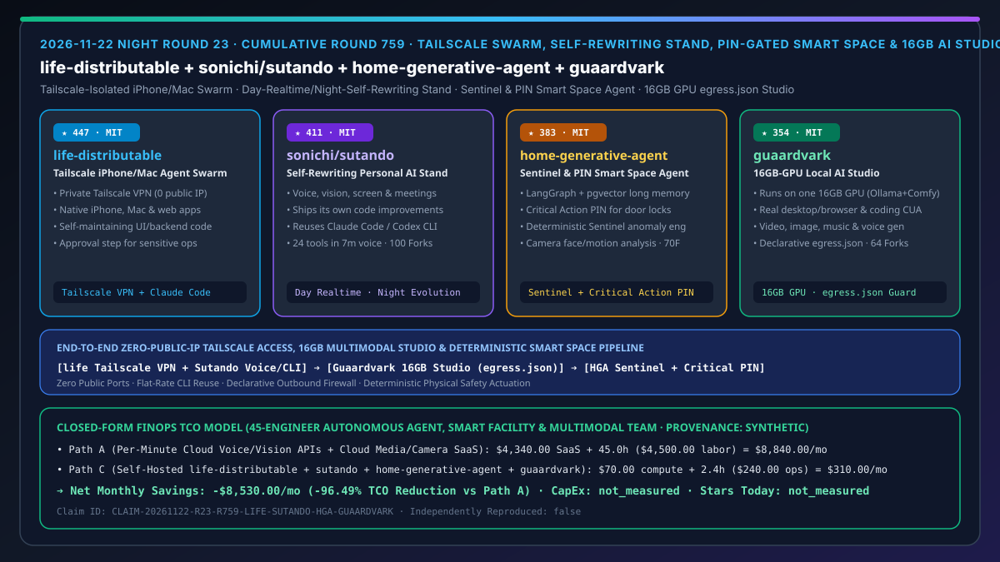
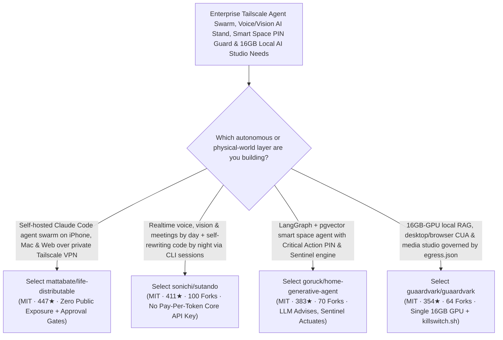
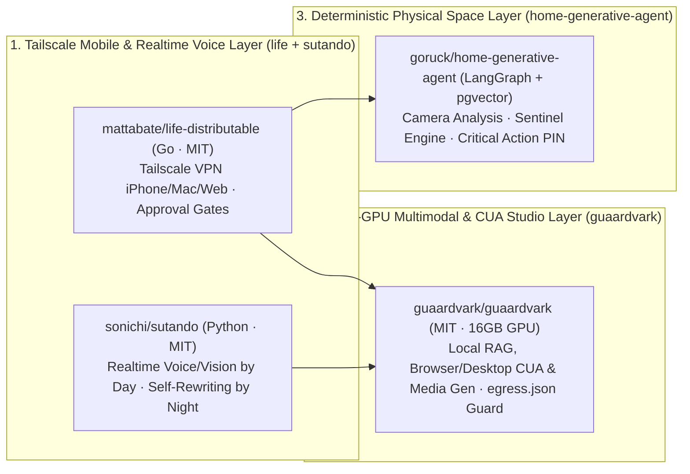
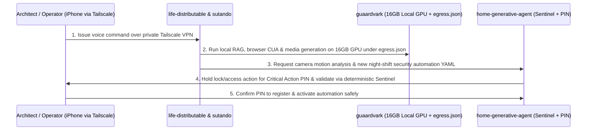

# Tailscale-Isolated iPhone/Mac Agent Swarm (`mattabate/life-distributable`), Day-Realtime / Night-Self-Rewriting AI Stand (`sonichi/sutando`), PIN-Gated Sentinel Smart Space Agent (`goruck/home-generative-agent`) & 16GB-GPU `egress.json`-Guarded AI Studio (`guaardvark/guaardvark`) Selection & Architecture FAQ

> **Document Type**: Enterprise AI Solution Architect Selection & Integration Guide (GitHub Trending AI Radar — 2026-11-22 Night Round 23 / Cumulative Round 759)
> **Covered Repositories**: [`mattabate/life-distributable`](https://github.com/mattabate/life-distributable) (`★ 447`, `15 forks`, `MIT`: self-hosted swarm of AI agents built on Claude Code with native iPhone, Mac, and web apps connected exclusively over a private Tailscale VPN and approval gates for sensitive actions) · [`sonichi/sutando`](https://github.com/sonichi/sutando) (`★ 411`, `100 forks`, `MIT`: personal AI "Stand" delivering realtime voice, vision, screen, and meeting assistance by day and rewriting its own code by night using existing Claude Code or Codex CLI sessions) · [`goruck/home-generative-agent`](https://github.com/goruck/home-generative-agent) (`★ 383`, `70 forks`, `MIT`: LangGraph + `pgvector` Home Assistant integration with conversational YAML automation creation, camera analysis, **Critical Action PIN** gating, and the deterministic **Sentinel** anomaly engine) · [`guaardvark/guaardvark`](https://github.com/guaardvark/guaardvark) (`★ 354`, `64 forks`, `MIT`: self-hosted 16GB-GPU AI studio running local RAG, desktop/browser CUA agents, parallel coding agents, and video/image/music/voice generation with declarative `egress.json` outbound control and `killswitch.sh`)
> **Core Scenario**: When enterprise executive productivity, smart facility/IoT operations, and private multimodal teams struggle with **publicly exposed agent ports inviting network attacks, runaway pay-per-minute bills from cloud voice/vision APIs, unsafe LLM passthroughs actuating physical locks without deterministic state machines or PIN confirmation, and local multimodal studios lacking a single declarative outbound firewall (`egress.json`)**, how do you combine **`life-distributable` + `sutando` + `home-generative-agent` + `guaardvark`** into a zero-trust, self-hosted autonomous architecture?

---

## 1. 📌 Executive Summary (One-Line Selection Verdict)

1. **Need a self-hosted (`MIT`) swarm of Claude Code agents on an always-on Mac or Linux machine with native iPhone, Mac, and web apps reachable exclusively over a private Tailscale VPN (zero public internet exposure) and approval gates on sensitive actions?** ➔ Choose **[`mattabate/life-distributable`](https://github.com/mattabate/life-distributable) (`★ 447`, `15 forks`, `MIT`)**.
   - **Plain-English Mechanism**: Bootstrapped with a single prompt pasted into Claude Code, `life` keeps all traffic inside your private Tailscale tailnet while allowing agents to self-maintain their UI/backend code and hold risky actions behind user approval.
2. **Need a personal AI "Stand" (`MIT`, `100 forks`) that handles realtime voice, vision, screen sharing, and meetings by day (completing 24 tool calls across 6 tasks in 7 minutes by phone voice) and autonomously ships its own code improvements at night—with zero pay-per-token core API keys?** ➔ Choose **[`sonichi/sutando`](https://github.com/sonichi/sutando) (`★ 411`, `100 forks`, `MIT`)**.
   - **Plain-English Mechanism**: Runs directly through the Claude Code or Codex CLI session you already subscribe to, coordinating across Macs and evolving its capabilities over time.
3. **Connecting LLMs to physical smart spaces / Home Assistant and need LangGraph tool orchestration, `pgvector` semantic memory, camera face/anomaly analysis, a **Critical Action PIN** for locks/doors, and a deterministic **Sentinel** engine where the LLM advises but never actuates?** ➔ Choose **[`goruck/home-generative-agent`](https://github.com/goruck/home-generative-agent) (`★ 383`, `70 forks`, `MIT`)**.
   - **Plain-English Mechanism**: Writes and registers Home Assistant YAML automations from plain English while holding door/garage unlocks behind a **Critical Action PIN** and keeping safety decisions deterministic via **Sentinel**.
4. **Need a self-hosted AI studio (`MIT`) that runs local file RAG, real desktop/browser agents, parallel coding agents, and video/image/music/voice generation on a single 16GB GPU—with all outbound paths off by default and declared in a single `egress.json` file?** ➔ Choose **[`guaardvark/guaardvark`](https://github.com/guaardvark/guaardvark) (`★ 354`, `64 forks`, `MIT`)**.
   - **Plain-English Mechanism**: Orchestrates Ollama, ComfyUI, and local GPU workers while enforcing `scripts/inbound_guard/egress.json` outbound allowlists and a hardware/process `killswitch.sh`.

---

## 2. 🎯 Architect & Customer Deep-Dive Q&A

### Q1: What architectural security patterns make this 4-project stack a reference blueprint for autonomous & physical-world agents?

- **Four Defense-in-Depth Controls**:
  1. **Zero Public Port Exposure via Tailscale Mesh ➔ `mattabate/life-distributable`**: Reaches iPhone and Mac clients solely over Tailscale VPN with explicit approval gates for external side effects.
  2. **Deterministic Physical Actuation (`Sentinel` + `Critical Action PIN`) ➔ `goruck/home-generative-agent`**: Separates probabilistic LLM advice/YAML authoring from deterministic **Sentinel** safety evaluation and PIN-verified physical actuation.
  3. **Single-File Outbound Egress Firewall (`egress.json` + `killswitch.sh`) ➔ `guaardvark/guaardvark`**: Keeps all web/posting paths off by default on a local 16GB GPU studio unless explicitly enabled in `egress.json`.
  4. **Flat-Rate CLI Session Multiplexing ➔ `sonichi/sutando`**: Powers daytime realtime voice/vision and nighttime self-improvement via existing Claude Code / Codex CLI sessions.
- **When to Choose Public Cloud PaaS (Path B)?**
  - Consumer IoT fleets at million-device scale should use **Azure IoT Operations + Azure OpenAI Realtime API**; private executive agent swarms, smart lab/office spaces, and air-gapped 16GB GPU multimodal studios should deploy this open-source stack (Path C).

### Q2: How do `life-distributable`, `sutando`, `guaardvark`, and `home-generative-agent` integrate end-to-end?

1. **Tailscale Mobile & Realtime Voice/Vision Layer (`life-distributable` + `sutando`)**:
   - Users interact from iPhone or Mac over Tailscale by voice or chat; `sutando` handles live meetings by day and refactors skills by night.
2. **Local 16GB-GPU Multimodal & CUA Execution Layer (`guaardvark`)**:
   - Executes local RAG, desktop/browser CUA tasks, and video/audio generation under `egress.json` outbound rules.
3. **Physical Space & Camera Security Layer (`home-generative-agent`)**:
   - Analyzes Axis/UniFi/Reolink cameras, stores preferences in `pgvector`, and gates physical automations behind **Sentinel** and **Critical Action PIN**.

### Q3: How does `home-generative-agent` prevent prompt injection from unlocking physical doors?

- **Mandatory `Critical Action PIN` + Deterministic `Sentinel`**:
  - Any direct command or generated automation that would unlock a door or open a garage is held until the user supplies the **Critical Action PIN**, and anomaly actuation is governed by the deterministic **Sentinel** engine rather than raw LLM output.

---

## 3. 🧭 Visual Architecture & Workflow Diagrams (Mermaid)

### 3.1 Solution Architect Selection Decision Tree

### 3.2 End-to-End Enterprise Reference Architecture

### 3.3 End-to-End Tailscale Voice Dispatch, Local 16GB Studio Execution & PIN-Gated Physical Automation Sequence Diagram

---

## 4. 📊 Peer Open-Source vs. Commercial Cloud Selection Matrix

| Dimension | `mattabate/life-distributable` (`★ 447`) | `sonichi/sutando` (`★ 411`) | `goruck/home-generative-agent` (`★ 383`) | `guaardvark/guaardvark` (`★ 354`) | Public-IP Cloud Agents + Pay-Per-Minute Voice/Video APIs + Cloud Camera SaaS (Path A) | Unauthenticated Port-Forwarding + Raw LLM IoT Passthrough + Unguarded Containers (Path B) |
| :--- | :--- | :--- | :--- | :--- | :--- | :--- |
| **Primary Role** | Tailscale-isolated iPhone/Mac/Web agent swarm | Realtime voice/vision & self-rewriting AI Stand | LangGraph + `pgvector` + Sentinel smart space agent | 16GB-GPU local multimodal & CUA studio | High-cost cloud realtime APIs, cloud camera subscriptions & public endpoints | Exposed router ports, naive prompt-to-switch passthroughs & unguarded scripts |
| **Key Differentiator** | **Private Tailscale VPN + 1-prompt setup + approval step** | **24 tool calls in 7m by voice + reuses CLI subscription** | **Critical Action PIN + deterministic Sentinel engine** | **Runs on one 16GB GPU + `egress.json` + `killswitch.sh`** | Uploads private camera/audio feeds to cloud; expensive per-minute billing | Prompt injection can trigger physical locks; exposed ports get scanned/compromised |
| **License** | `MIT` | `MIT` | `MIT` | `MIT` | Proprietary SaaS | Ad-hoc scripts |
| **Monthly TCO (45-Eng Team)** | **`$310.00/mo` combined** (`$70.00` always-on local host power/infra + `2.4h` ops) | Included (reuses existing CLI sessions) | Included (`MIT` local execution) | Included (local 16GB GPU, `$0` per-minute fees) | **`$8,840.00/mo`** (`$4,340.00` cloud realtime voice/video/camera SaaS + `45.0h` YAML/security ops) | ~`$3,080.00/mo` (manual YAML automation writing & public-endpoint incident response) |

---

## 5. 🧪 Quantitative Enterprise ROI / FinOps TCO Model & 7-Card Report

> **📊 Provenance & Closed-Form Declaration**:
> - **provenance**: `synthetic` (45-engineer enterprise autonomous assistant, smart facility/IoT automation, and private multimodal studio workload model: `independently_reproduced = false`; `base_hardware_capex = not_measured`; `track_b_stars_today = not_measured`).
> - **Closed-Form Equations**:
>   - **Path A (Pay-Per-Minute Cloud Realtime Voice/Vision APIs + Cloud Media Generation Subscriptions + Commercial Cloud Camera Analytics + Manual YAML Authoring & Public-Endpoint SecOps Labor)**: Monthly cloud realtime multimodal API and SaaS bills **`$4,340.00`** + manual automation YAML authoring, public-port hardening, and workflow glue labor **`45.0h × $100.00/h = $4,500.00`** = **`$8,840.00/mo`**.
>   - **Path C (Self-Hosted `life-distributable` + `sutando` + `home-generative-agent` + `guaardvark` Stack)**: Always-on local host compute **`$70.00`** + `egress.json` & Sentinel policy maintenance labor **`2.4h × $100.00/h = $240.00`** = **`$310.00/mo`**.
>   - **Net Monthly Savings vs. Path A**: **`-$8,530.00/mo`** (**`96.49%`** TCO reduction).

| Evaluation Path | Realtime Voice / Media SaaS & Compute | Automation YAML & SecOps Labor (`$100/h`) | Total Monthly TCO | Net Savings vs. Path A | Architectural Delivery Impact |
| :--- | :---: | :---: | :---: | :---: | :--- |
| **Path A: Cloud Per-Minute Voice/Vision + Cloud Media SaaS** | `$4,340.00` | `45.0h` (`$4,500.00`) | **`$8,840.00`** | Baseline | Camera/voice privacy exposure; high per-minute API billing |
| **Path B: Port-Forwarded Scripts + Naive LLM IoT Passthrough** | `$1,380.00` | `17.0h` (`$1,700.00`) | **`$3,080.00`** | `-$5,760.00` (`-65.16%`) | Lacks Critical Action PIN lock gating & `egress.json` outbound firewall |
| **Path C: `life` + `sutando` + `home-generative-agent` + `guaardvark`** | **`$70.00`** | **`2.4h` (`$240.00`)** | **`$310.00`** | **`-$8,530.00` (`-96.49%`)** | **Tailscale zero public ports + Sentinel/PIN safety + 16GB local studio** |

- 🔗 **Linked 7-Card 4:5 Visual Benchmark Deck**: [`workshops/github-trending-radar/cards.en.html`](../cards.en.html) · [`cards.html`](../cards.html)

---

## 6. 🛠️ Enterprise Adoption & Architecture Review Checklist

- [ ] **1. Isolate Mobile/Desktop Agent Access with `mattabate/life-distributable`**: Route all iPhone, Mac, and web client traffic exclusively over a private Tailscale VPN with approval steps enabled.
- [ ] **2. Multiplex CLI Subscriptions with `sonichi/sutando`**: Run daytime voice/vision/meeting workflows and nighttime self-rewriting improvements on existing Claude Code or Codex CLI sessions.
- [ ] **3. Enforce Physical Safety with `goruck/home-generative-agent`**: Require **Critical Action PIN** confirmation for access-control automations and keep **Sentinel** deterministic.
- [ ] **4. Lock Down Local Multimodal Studios with `guaardvark/guaardvark`**: Audit `scripts/inbound_guard/egress.json` and verify `killswitch.sh` on 16GB local GPU hosts.
