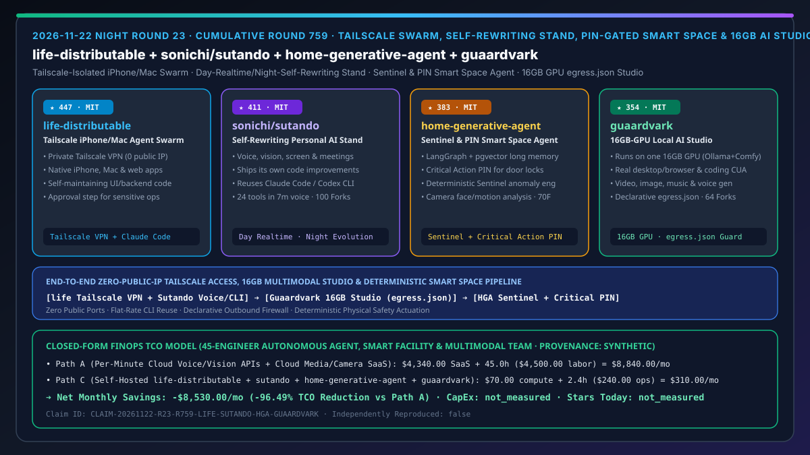
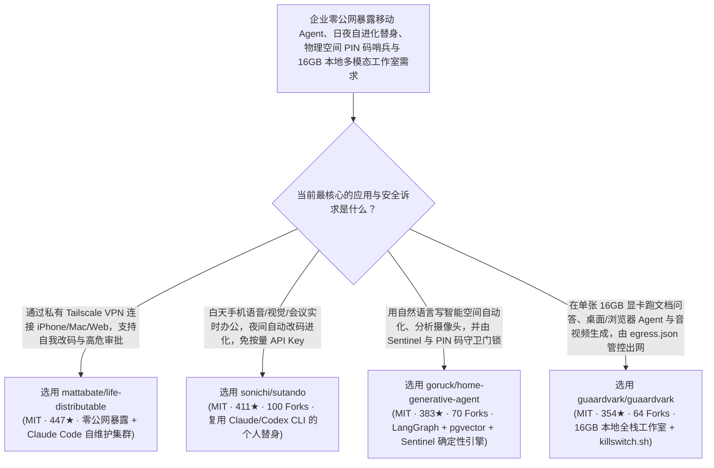
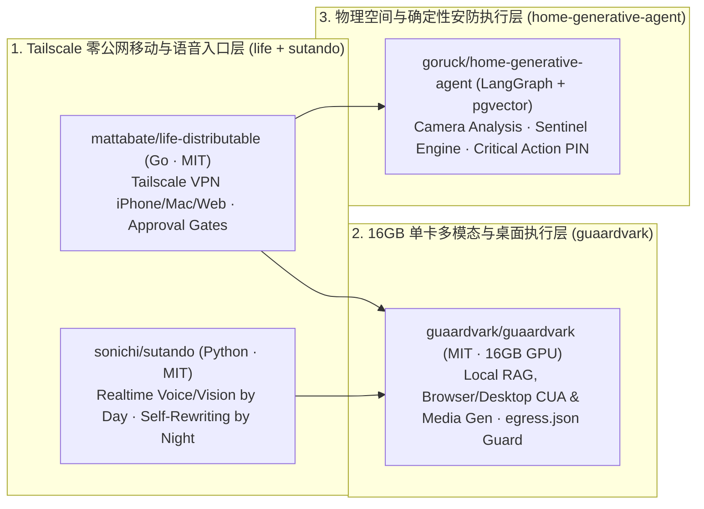
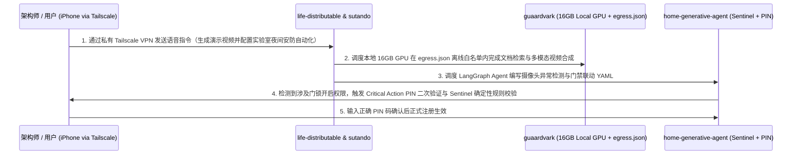

# Tailscale 零公网暴露自进化 iPhone/Mac 智能体群（`mattabate/life-distributable`）、日间实时语音/夜间自我改码的个人替身（`sonichi/sutando`）、带 PIN 码与确定性 Sentinel 哨兵的物理空间 Agent（`goruck/home-generative-agent`）与 16GB 单卡 `egress.json` 出网白名单全栈 AI 工作室（`guaardvark/guaardvark`）选型与集成架构 FAQ

> **文档类型**：企业 AI 解决方案架构师（AI Solution Architect）选型决策指南（GitHub Trending AI 雷达 2026-11-22 Night Round 23 / 累计第 759 轮）
> **覆盖项目**：[`mattabate/life-distributable`](https://github.com/mattabate/life-distributable)（`★ 447`、`15 forks`、`MIT`，基于 Claude Code 构建、仅通过私有 Tailscale VPN 连接 iPhone/Mac/Web 客户端的自托管智能体集群，支持按需自我修改前后端代码与高危操作审批）· [`sonichi/sutando`](https://github.com/sonichi/sutando)（`★ 411`、`100 forks`、`MIT`，“白天实时语音/视觉/会议交互，夜间自主重写进化代码”的个人 AI 替身 Stand，直接复用现有 Claude Code 或 Codex CLI 会话而无需按 Token 付费 API Key）· [`goruck/home-generative-agent`](https://github.com/goruck/home-generative-agent)（`★ 383`、`70 forks`、`MIT`，基于 LangGraph + `pgvector` 的 Home Assistant 智能空间集成，内置 **Critical Action PIN** 门锁确认码与确定性 **Sentinel** 异常引擎——大模型仅提建议绝不直接盲目触发安防动作）· [`guaardvark/guaardvark`](https://github.com/guaardvark/guaardvark)（`★ 354`、`64 forks`、`MIT`，单张 16GB 显卡即可在本地运行文档对话、真实桌面/浏览器操作、并行编码及音视频生成的自托管 AI 工作室，所有出网路径由单一 `egress.json` 默认关闭并严格管控）
> **核心场景**：当企业高管数字助理、智能楼宇/实验室物联网（IoT）管控与私有化多模态内容团队面临**“把具有发邮件/改文件权限的个人 Agent 暴露在公网极易被扫描入侵、语音与视觉多模态助理按分钟调用云端 Realtime API 账单惊人、让大模型直接控制门禁/安防摄像头缺乏确定性状态机与 PIN 码二次拦截、以及本地跑多模态生成与浏览器 Agent 时缺乏统一的出网开关（`egress.json`）与紧急熔断脚本（`killswitch.sh`）”**四大痛点时，如何组合**`life-distributable` + `sutando` + `home-generative-agent` + `guaardvark`** 打造零公网暴露、确定性物理安防与单卡全闭环的智能体体系？

---

## 一、📌 核心结论速览（选型一句话结论）

1. **想在办公室或家里常开的 Mac mini / Linux 主机上跑支“零公网端口暴露、仅通过私有 Tailscale VPN 连上你 iPhone 和 Mac 原生 App、还能根据你的口头要求自己改前后端 UI 并把发邮件等高危动作卡在审批步后面”的自托管智能体战队** ➔ 选 **[`mattabate/life-distributable`](https://github.com/mattabate/life-distributable)（`★ 447`，`15 forks`，`MIT`）**。
   - **通俗原理**：只要把 `Clone github.com/mattabate/life-distributable...` 一句话粘贴进 Claude Code 即可引导安装。整套系统绝不监听公网 IP，且智能体具备自我维护源码（Self-Maintaining Code）与每周拉取 `ADDENDA.md` 增量进化的能力。
2. **想要一个像《JOJO 的奇妙冒险》“替身（Stand）”一样的个人全能 AI——白天通过手机语音、屏幕视觉和会议同传实时帮你干活（实测手机纯语音 7 分钟完成 6 个任务、24 次工具调用），晚上趁你休息时自动提 PR 迭代自己的代码，且零按量 API 账单（直接跑在 Claude Code / Codex CLI 会话上）** ➔ 选 **[`sonichi/sutando`](https://github.com/sonichi/sutando)（`★ 411`，`100 forks`，`MIT`）**。
   - **通俗原理**：不仅跨多台 Mac 协同，还设计了“日间实时交互 + 夜间自我进化”的双时相运行架构。
3. **想把大模型接入智能楼宇、实验室或智能家居（Home Assistant），既能用大白话自动生成并注册自动化 YAML、结合 `pgvector` 记忆分析 UniFi/Reolink/Axis 监控画面，又强制要求“开门锁/开卷帘门必须输入 Critical Action PIN 码，且安防异常由确定性 Sentinel 引擎裁决（LLM 只给建议绝不乱动开关）”** ➔ 选 **[`goruck/home-generative-agent`](https://github.com/goruck/home-generative-agent)（`★ 383`，`70 forks`，`MIT`）**。
   - **通俗原理**：用 LangGraph 构建完整工具图谱，将“大模型语义理解/视觉识别”与“Sentinel 确定性安防状态机 + PIN 码确认”严格解耦，支持纯本地模型运行。
4. **想在一张 16GB 显存的消费级显卡上，把本地知识库问答、真实桌面与浏览器操作 Agent、并行编码 Agent 以及视频/图像/音乐/语音生成全部跑在自己机器上，并用一份声明式 `egress.json` 和 `killswitch.sh` 锁死所有出网通道** ➔ 选 **[`guaardvark/guaardvark`](https://github.com/guaardvark/guaardvark)（`★ 354`，`64 forks`，`MIT`）**。
   - **通俗原理**：整合 Ollama 与 ComfyUI 等本地 GPU 服务，默认关闭一切公网访问与外发行为，所有允许出网的域名与动作集中声明在 `scripts/inbound_guard/egress.json` 中。

---

## 二、🎯 客户与架构师灵魂拷问 Q&A（深度架构拆解）

### Q1：这四个项目在“安全边界（Security Perimeter）”设计上给企业架构师带来了哪些教科书级启发？

- **四道硬核安全防线**：
  1. **网络层零公网暴露（Tailscale Overlay Only）➔ `mattabate/life-distributable`**：彻底放弃公网端口映射，仅允许个人 Tailscale 虚拟局域网内的受信任 iPhone/Mac 访问。
  2. **物理执行层“LLM 建议 + 确定性引擎拍板 + PIN 码拦截”➔ `goruck/home-generative-agent`**：针对物理门禁与设备控制，首创 **Sentinel 确定性异常引擎**（LLM Advises, Never Actuates）与 **Critical Action PIN**，即便模型遭遇提示词注入也无法直接打开物理门锁。
  3. **出网层声明式默认全关（`egress.json` + `killswitch.sh`）➔ `guaardvark/guaardvark`**：把所有外联请求集中收敛到单个 `egress.json` 配置文件并提供一键物理断流脚本。
  4. **算力层复用固定包月 CLI 会话 ➔ `sonichi/sutando`**：白天语音/视觉交互与夜间代码自进化全部跑在固定额度的 Claude Code / Codex CLI 上，杜绝天价 API 账单。
- **何时直接用云厂商托管方案（Path B）？**
  - 若是面向百万终端消费者的公有云智能音箱或跨国园区楼宇云，应采用 **Azure IoT Operations + Azure OpenAI Realtime API**；若面向企业高管私有数字分身、涉密实验室智能空间管控与 16GB 单卡离线多模态工作室，则采用本轮开源栈（Path C）。

### Q2：典型企业级“Tailscale 随身入口 (`life`) + 日夜双态替身 (`sutando`) + 16GB 本地多模态工作室 (`guaardvark`) + 物理空间哨兵 (`home-generative-agent`)”怎么搭？

1. **零信任移动与桌面随身入口层（`mattabate/life-distributable` + `sonichi/sutando`）**：
   - 用户在 iPhone 或 Mac 端通过 Tailscale 隧道与 `life` / `sutando` 语音及文字交互，日间处理会议与日常任务，夜间自动优化工具脚本。
2. **本地 16GB GPU 多模态与桌面执行层（`guaardvark/guaardvark`）**：
   - 复杂文档检索、浏览器操作与音视频生成交由本地 `guaardvark` 处理，受 `egress.json` 出网策略保护。
3. **物理空间与安防物联网受控执行层（`goruck/home-generative-agent`）**：
   - 涉及办公区/实验室摄像头分析与环境自动化时，由 LangGraph + `pgvector` 生成方案，经 **Sentinel** 确定性引擎与 **Critical Action PIN** 核验后执行。

### Q3：为什么物理物联网（IoT/智能空间）绝不能让大模型直接做最终执行器（Actuator）？

- **概率模型不能直接驱动高危物理开关**：
  - `home-generative-agent` 的核心洞见在于：摄像头画面理解、用自然语言写 YAML 自动化归属概率型大模型；但“是否触发安防告警”由确定性 **Sentinel** 引擎判定，“是否解锁大门”强制拦截等待人工输入 **Critical Action PIN**。

---

## 三、🧭 直观可视化图解（Mermaid 决策树 + 集成架构 + 时序图）

### 3.1 架构师选型决策树

### 3.2 企业端到端生产集成参考架构图

### 3.3 手机 Tailscale 语音下令、`Guaardvark` 本地执行与 `HGA` PIN 码物理管控时序图

---

## 四、📊 同类开源与商业云服务横向选型决策矩阵

| 对比维度 | `mattabate/life-distributable` (`★ 447`) | `sonichi/sutando` (`★ 411`) | `goruck/home-generative-agent` (`★ 383`) | `guaardvark/guaardvark` (`★ 354`) | 公网暴露云主机 Agent + 按分钟计费云端语音视觉 API + 云端摄像头订阅 (Path A) | 裸跑端口转发脚本 + 简单 Prompt 透传插件 + 无出网管控本地容器 (Path B) |
| :--- | :--- | :--- | :--- | :--- | :--- | :--- |
| **核心能力定位** | Tailscale 私有连接 iPhone/Mac 自维护 Agent 群 | 日间实时语音视觉/夜间自我改码的个人替身 | 带 PIN 码与确定性 Sentinel 的智能空间 Agent | 16GB 单卡 `egress.json` 受控本地 AI 工作室 | 按调用/分钟高额收费且存在公网暴露与视频隐私外泄风险的云服务组合 | 无鉴权端口暴露、无 PIN 码保护直接控制开关、无出网白名单的裸脚本 |
| **核心技术突破** | **零公网暴露 Tailscale 专网 + 一句 Prompt 安装 + 高危审批** | **7 分钟语音 24 次工具调用 + 夜间自主改码 + 免按量 API Key** | **LangGraph + `pgvector` + Sentinel 确定性安防 + Critical Action PIN** | **单 16GB 卡全包揽 + `egress.json` 默认禁出网 + `killswitch.sh`** | 家庭/办公室监控视频上传公有云隐私风险高；实时语音 API 极贵 | 模型幻觉可能误开物理门锁；公网开放端口极易被黑客批量攻破 |
| **开源协议** | `MIT` | `MIT` | `MIT` | `MIT` | 闭源商业 SaaS | 内部零散脚本 |
| **月度 TCO（45 人团队）** | **组合仅 `$310.00/月`**（`$70.00` 本地常开主机电费与 Tailscale 免费层 + `2.4h` 维护） | 同左（直接复用现有 CLI 订阅） | 同左（`MIT` 本地运行零云端录像费） | 同左（单张 16GB 本地显卡零 Token 费） | **`$8,840.00/月`**（`$4,340.00` 云端实时语音/多模态生成与云录像订阅 + `45.0h` 运维排障） | 约 `$3,080.00/月`（大量人工排查公网暴露安全告警与手写 YAML 自动化工时） |

---

## 五、🧪 应用落地定量收益/TCO 对比与 7-Card 报告

> **📊 数据来源与闭式核算声明（Provenance & Closed-Form Schema）**：
> - **provenance**: `synthetic`（基于 45 人企业全天候数字助理、智能办公/实验室空间管控与本地多模态内容团队月度工作负载模型：`independently_reproduced = false`；硬件采购基线 `base_hardware_capex = not_measured`；Track B 单日增量 `track_b_stars_today = not_measured`）。
> - **核算公式**：
>   - **Path A（采购按分钟计费的云端实时语音/视觉 API + 云端音视频生成订阅 + 商业安防云分析套餐 + 工程师维护公网反代安全与手写智能空间自动化 YAML 人工）**：月度云端实时多模态 API 与商业云订阅账单 **`$4,340.00`** + 手工编写调试设备联动 YAML、排查公网暴露风险与多模态工作流拼接人工 **`45.0h × $100.00/h = $4,500.00`** = **`$8,840.00/月`**。
>   - **Path C（自建 `life-distributable` + `sutando` + `home-generative-agent` + `guaardvark` 本地零信任多模态与物理空间栈）**：常开宿主机与本地容器开销 **`$70.00`** + `egress.json` 规则与 Sentinel 策略维护人工 **`2.4h × $100.00/h = $240.00`** = **`$310.00/月`**。
>   - **净节省（Net Savings vs Path A）**：**`-$8,530.00/月`**（成本降低 **`96.49%`**）。

| 评估方案 | 多模态/云录像订阅与算力成本 | 自动化编写与安全运维人工（`$100/h`） | 月度总 TCO | 相对 Path A 净节省 | 关键架构交付指标 |
| :--- | :---: | :---: | :---: | :---: | :--- |
| **Path A：云端按分钟实时语音/视觉 API + 商业云多模态订阅** | `$4,340.00` | `45.0h` (`$4,500.00`) | **`$8,840.00`** | Baseline | 监控画面与内部文件外发公有云；实时多模态 API 账单失控 |
| **Path B：公网端口映射 + Prompt 透传插件 + 无管控容器** | `$1,380.00` | `17.0h` (`$1,700.00`) | **`$3,080.00`** | `-$5,760.00` (`-65.16%`) | 缺少 Critical Action PIN 门锁拦截与 `egress.json` 默认禁出网 |
| **Path C：`life` + `sutando` + `home-generative-agent` + `guaardvark`** | **`$70.00`** | **`2.4h` (`$240.00`)** | **`$310.00`** | **`-$8,530.00` (`-96.49%`)** | **Tailscale 零公网暴露 + Sentinel/PIN 物理护栏 + 16GB 本地全栈** |

- 🔗 **关联 7-Card 4:5 视觉评测报告**：[`workshops/github-trending-radar/cards.html`](../cards.html) · [`cards.en.html`](../cards.en.html)

---

## 六、🛠️ 企业引入与架构评审 Checklist

- [ ] **1. 使用 `mattabate/life-distributable` 收敛移动远程访问**：强制通过私有 Tailscale VPN 连接 iPhone/Mac 客户端，保持高危动作（如外发邮件）人工审批开启。
- [ ] **2. 部署 `sonichi/sutando` 复用既有 Claude Code / Codex CLI 订阅**：将日间语音/视觉实时协作与夜间自动化代码改进绑定在受控会话内。
- [ ] **3. 在物理空间与实验室启用 `goruck/home-generative-agent`**：强制开启 **Critical Action PIN** 与确定性 **Sentinel** 引擎，严禁 LLM 直接无确认触发门禁硬件。
- [ ] **4. 在本地 16GB GPU 工作站部署 `guaardvark/guaardvark`**：通过 `scripts/inbound_guard/egress.json` 审计所有出网白名单并配置 `killswitch.sh` 应急脚本。
