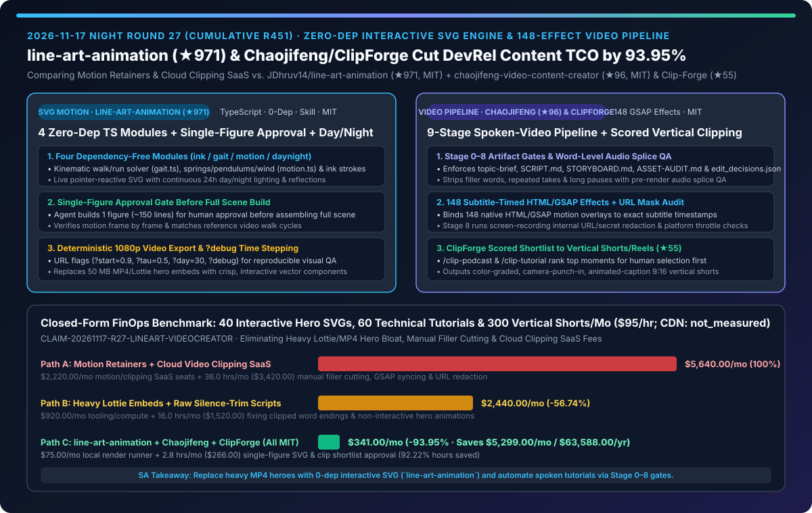

# 零依赖交互式昼夜线稿 SVG 引擎（`JDhruv14/line-art-animation`）与 9 阶段 148 特效口播长转短流水线（`chaojifeng-video-content-creator` & `Clip-Forge`）架构选型 FAQ

> **文档类型**：AI Solution Architect（AI 解决方案架构师）实战选型指南（六段式标准 FAQ）  
> **所属轮次**：2026-11-17 Night Round 27（Cumulative Round 451）  
> **追踪目标**：
> - **`JDhruv14/line-art-animation`**（`★ 971`，TypeScript / Node 22.18+ / 零第三方依赖 4 大核心库 + Claude Skill，`MIT`）：当日 GitHub 新仓黑马榜前列！包含墨迹原语（`ink.ts`）、步态运动学求解器（`gait.ts`）、弹簧/钟摆/风力物理（`motion.ts`）与 24 小时昼夜调色盘（`daynight.ts`），支持鼠标交互与单角色先行审批（`~150 行`）的矢量 SVG 动画引擎
> - **`mileson/chaojifeng-video-content-creator`**（`★ 96`，Python / 148 个原生 HTML/GSAP 特效，`MIT`）& **`lowdevco/Clip-Forge`**（`★ 55`，Python / Claude Skill，`MIT`）：从选题、口播去口水词与剪口音轨质检、按真实字幕时间戳排布 148 个 HTML/GSAP 特效、屏录内网地址遮盖审计到长视频打分精选转 9:16 竖屏短视频（`ClipForge`）的完整开发者关系（DevRel）内容工程链  
> **计量审计 ID**：`CLAIM-20261117-R27-LINEART-VIDEOCREATOR`（基础静态资源 CDN 流量费标记为 `not_measured`）

---

## 📌 一、核心结论速览（Executive Summary）

1. **为什么企业开发者关系（DevRel）、技术品牌官网与产品培训团队在做“官网首屏叙事动画”和“技术口播长视频/切片短视频”时，常面临“Lottie/MP4 首屏体积巨大且无法鼠标交互”与“人工剪口水词、配花字、切竖屏极其耗时且容易泄露录屏里的内网地址”两大痛点？**
   - **官网视觉叙事痛点**：传统官网 Hero 区若嵌入几十 MB 的高清视频或大型 Lottie JSON，不仅拖慢首屏 LCP 性能、放大后边缘发虚，而且无法响应用户的鼠标点击、微风吹拂或跟随系统时间从白天平滑过渡到夜晚灯光；若直接让大模型硬写裸 SVG 动画，画出来的人物走路姿势往往像僵尸一样僵硬。
   - **技术口播与长转短切片痛点**：技术布道师录完一条 10 分钟的产品实操视频或播客，人工剪掉“呃、那个、重来一遍”等口水词、对齐 100 多个字幕特效节拍、再从中挑出 5 个高光片段切成竖屏 Shorts/视频号，往往要耗费整整一天；更危险的是，屏幕录制里常忘打码测试环境的 `localhost` 端口或内部后台 URL。
   - **架构师黄金组合（`line-art-animation` + `chaojifeng-video-content-creator` + `Clip-Forge`，全系 `MIT`）**：在品牌官网与技术交互文档层部署 **`JDhruv14/line-art-animation`**（4 个零依赖 TS 物理与步态模块，先生成 `~150` 行单角色经人工审批后再构建完整昼夜交互街景，支持 `?debug` 逐帧核验与 1080p 导出）；在口播生产与长转短分发层部署 **`chaojifeng-video-content-creator`**（Stage 0–8 门禁产物、词级去口水词与剪口音轨质检、字幕驱动 148 个 HTML/GSAP 特效及屏录地址遮盖自检）配合 **`Clip-Forge`**（先输出高光打分候选单由人工挑中，再自动完成 9:16 满屏重构、调色、重点镜头推镜与动态字幕）。
2. **闭式 FinOps 量化收益（企业 DevRel 与品牌工程团队每月交付 40 个交互式官网/文档 SVG 场景、60 条技术口播教程与 300 条竖屏高光切片，综合时薪 `$95.00/hr`）**：
   - 从 **Path A（外包动效设计 + 商业云端 AI 切片 SaaS 订阅，`$5,640.00/月`）** 切换至 **Path C（`line-art-animation` 零依赖 SVG + `chaojifeng` 148 特效流水线 + `Clip-Forge` 精选切片，`$341.00/月`）**，每月净省 **`$5,299.00/月`（降幅 `-93.95%`，年化节省 `$63,588.00/年`）**，动效返工、手动剪口水词与录屏脱敏排查工时从 `36.0 小时/月` 降至 `2.8 小时/月`（节省 **`92.22%`**）。

---

## 💬 二、灵魂拷问 Q1–Q3（大白话拆解应用场景与架构本质）

### Q1：`JDhruv14/line-art-animation` 为什么能在短短几天狂揽 `★ 971`？它是怎么让 AI 画出自然的行走步态与昼夜光影 SVG 的？
- **大白话本质定义**：这是一套**“把纸上水墨线稿变成带物理引擎、步态求解器与昼夜光影的零依赖 TypeScript 矢量库 + Claude 技能”**。
- **为什么直接让大模型写 SVG 动画会失败，而 `line-art-animation` 能成功？**
  1. **用确定性数学物理模块替代大模型瞎猜坐标（4 个零依赖 TS 模块）**：
     - `ink.ts`：手绘墨迹笔触原语（保持任何缩放倍率下锐利不发虚）；
     - `gait.ts`：**步态运动学求解器（Walk/Run Solver）**——大模型不再需要手算每一帧腿部弯曲角度，只需指定速度与体型，求解器自动算出自然的行走、奔跑与骑行关节轨迹（甚至支持传入参考视频测量并复刻其步态）；
     - `motion.ts`：内置弹簧（Springs）、钟摆（Pendulums）与跟随鼠标移动的微风物理场（Wind）；
     - `daynight.ts`：连续时间轴（`?start=0.0` 午夜至 `0.5` 正午，`?day=30` 30 秒走完一天）驱动的天空、街灯、窗户亮起与水面长倒影调色盘。
  2. **“先审一个角色，再建整条街”的防跑偏门禁**：Claude 读取 `SKILL.md` 后，绝不一上来就写几千行大场景，而是**先用约 150 行代码画出一个角色（如提公文包走过路灯、点击会脱帽致意的行人 `examples/walker/`）交由人类确认画风与步态**，通过后再组装包含茶屋、运河船夫、猫鸟互动与十余种点击彩蛋的完整场景（`examples/village/`），并在交付前用 `?debug` 逐帧自检。

### Q2：`mileson/chaojifeng-video-content-creator` 与 `lowdevco/Clip-Forge` 是如何把粗糙的录屏口播和长视频变成专业成片的？
- **`chaojifeng-video-content-creator`（9 阶段门禁产物驱动的口播工程线，`MIT`）**：
  - **可从任意阶段切入的契约化产物**：阶段 0–3 产出 `topic-brief.md`、`research.md`、`BRIEF.md`、`SCRIPT.md`；阶段 4–5 产出 `STORYBOARD.md` 与 `ASSET-AUDIT.md`；
  - **阶段 6 词级去口水词与“渲染前剪口音轨质检”**：自动清洗口水词、重复录制句与长停顿，生成 `edit_decisions.json`，并在渲染画面前专门对剪口处的音频衔接做平滑质检（防止吞字或爆音）；
  - **阶段 7–8 字幕时间戳驱动 148 个原生 HTML/GSAP 特效 + 屏录安全脱敏**：按真实字幕时间戳排布 148 个 HTML/GSAP 动效叠加轨（Hyperframes）并抽帧目检；最后在发布包阶段自动执行**屏录内网地址/敏感信息遮盖检查**与平台限流风控自检。
- **`lowdevco/Clip-Forge`（先打分选片、再自动精剪的竖屏高光工厂，`MIT`）**：
  - 针对技术教程（`/clip-tutorial`）、播客访谈（`/clip-podcast`）或发布会录像（`/clip-video`），先分析全片输出一份**带评分的高光片段短名单（Scored Shortlist）**；
  - 人工挑中满意的片段后，自动完成 9:16 全屏构图重构、色彩分级、高潮时刻镜头推近（Camera Punch-In）以及动态标题与字幕压制。

### Q3：企业 AI 架构师如何把这三款工具组合进技术品牌与内容工程体系？
- **官网与交互式技术白皮书**：使用 `line-art-animation` 生成零依赖、体积仅数 KB、支持昼夜切换与指针交互的 SVG 架构叙事插画；
- **长视频口播教程与短视频全域分发**：主讲人只需录好原始口播视频 `raw.mp4`，先交由 `chaojifeng-video-content-creator` 自动去口水词、挂载 148 个 GSAP 字幕特效并完成录屏 URL 脱敏自检产出 16:9 横屏主片；随后将主片喂给 `Clip-Forge`（`/clip-tutorial`）一键派生 3–5 条 9:16 竖屏技术精华短视频。

---

## 🧭 三、端到端集成参考架构与选型决策树（Mermaid）

---

## 📊 四、同赛道方案横向选型对比矩阵（Decision Matrix）

| 评估维度 | 方案 A：外包动效设计 + 商业云端 AI 切片 SaaS（OpusClip 等） | 方案 B：大体积 MP4/Lottie 嵌入 + 简单 FFmpeg 静音截断脚本 | **方案 C（推荐）：`line-art-animation` + `chaojifeng` + `Clip-Forge`（全系 MIT）** |
| :--- | :--- | :--- | :--- |
| **官网动画体积、清晰度与实时交互** | ⚠️ 外包周期长达数周，交付死视频无法响应鼠标或昼夜时间 | ❌ 数十 MB 视频拖慢首屏；大模型裸写 SVG 人物动作僵硬失真 | ✅ **零依赖 TS 物理/步态库（`gait.ts`/`daynight.ts`），体积仅数 KB，任意缩放锐利且支持实时交互** |
| **口播去口水词与剪口音轨平滑度** | ⚠️ 商业云端按分钟计费，且无法针对中文技术口播做精细阶段控制 | ❌ 粗暴按音量阈值截断常把单词尾音切碎，听感生硬 | ✅ **词级清洗口水词/重复句 + 独立 `edit_decisions.json` 与渲染前剪口音轨质检** |
| **动态花字/特效与屏录安全脱敏** | ⚠️ 模板千篇一律，无屏录敏感 URL 遮盖检查 | ❌ 需在剪辑软件里手工一帧帧对齐字幕贴纸 | ✅ **内置 148 个按真实字幕时间戳排节拍的 HTML/GSAP 特效 + 发布前屏录地址遮盖自检** |
| **长视频转竖屏 Shorts 的人机控制权** | ❌ 云端黑盒一次切出几十条废片，消耗大量月度分钟配额 | ❌ 需人工拉时间轴找高光并手调 9:16 裁剪框 | ✅ **`Clip-Forge` 先给出打分高光短名单由人类拍板，再自动完成推镜、调色与动态字幕** |
| **月度总拥有成本（TCO，40 动画 + 60 长片 + 300 切片）** | **`$5,640.00 / 月`**（含 `$2,220` 外包/SaaS + `36.0h` 剪辑与打码返工） | **`$2,440.00 / 月`**（含 `$920` 算力 + `16.0h` 手工对齐特效与修音轨） | **`$341.00 / 月`**（**净省 `-93.95%`**，仅 `$75` 本地渲染 + `2.8h` 单角色与选片确认） |

---

## 🧮 五、7-Card 定量洞察与闭式 FinOps 核算（`CLAIM-20261117-R27-LINEART-VIDEOCREATOR`）

> **核算范围与边界声明**：面向企业 DevRel 与技术品牌团队，每月交付 **40 个交互式官网/文档矢量场景、60 条技术口播长视频与 300 条 9:16 竖屏高光短视频**（综合时薪 `$95.00/hr`；静态站点基础 CDN 流量费标记为 `not_measured`）：

$$\text{Total Monthly TCO} = \text{Motion/Clipping SaaS Spend} + (\text{Filler Cutting, Effect Sync \& Redaction Hours} \times \$95.00)$$

| 成本构成项 | Path A：外包动效 + 商业云切片 SaaS | Path B：Lottie 嵌入 + 简单静音截断脚本 | **Path C：`line-art` + `chaojifeng` + `Clip-Forge`（MIT）** |
| :--- | :---: | :---: | :---: |
| **月度动效外包 / 云切片 SaaS 订阅或本地渲染开销** | `$2,220.00` | `$920.00` | **`$75.00`** |
| **月度手动剪口水词、对齐 148 特效与录屏打码工时** | `36.0 hrs` | `16.0 hrs` | **`2.8 hrs`**（直降 **`92.22%`**） |
| **月度 DevRel 与前端工程师人工成本（`@ $95.00/hr`）** | `$3,420.00` | `$1,520.00` | **`$266.00`** |
| **月度总拥有成本（Monthly TCO）** | **`$5,640.00`** | **`$2,440.00`**（`-56.74%`） | **`$341.00`**（**`-93.95%`**） |
| **相对 Path A 净节省（月度 / 年化）** | 基线（`$0.00`） | `$3,200.00 / 月`（`$38,400/年`） | **`$5,299.00 / 月`（`$63,588.00 / 年`）** |

---

## ✅ 六、AI 解决方案架构师实战上手 Checklist（SA Action Checklist）

- [ ] **Step 1 — 安装 `JDhruv14/line-art-animation` 技能并执行“单角色先行审批”**：执行 `git clone https://github.com/JDhruv14/line-art-animation ~/.claude/skills/line-art-animation`，要求 Agent 复用 `lib/`（`ink.ts`, `gait.ts`, `motion.ts`, `daynight.ts`）先生成 150 行单角色原型，审批通过后再扩展昼夜交互全场景并用 `?debug` 逐帧验收。
- [ ] **Step 2 — 挂载 `chaojifeng-video-content-creator` 规范口播教程 9 阶段门禁**：运行 `npx skills add mileson/chaojifeng-video-content-creator`，对录好的原始口播视频从 Stage 6 切入，自动完成去口水词、剪口音轨质检与 148 个 HTML/GSAP 字幕时间戳特效绑定。
- [ ] **Step 3 — 强制执行 Stage 8 屏录敏感地址遮盖自检**：在导出任何内部产品演示视频前，运行 Stage 8 门禁检查，确保屏幕录制中的内部管理后台 URL、API Key 与测试域名已完成遮盖。
- [ ] **Step 4 — 用 `Clip-Forge`（`/clip-tutorial` / `/clip-podcast`）批量生成竖屏高光切片**：将长视频输入 `Clip-Forge`，先由人工在打分短名单（Scored Shortlist）中勾选最佳片段，再自动生成带推镜与动态字幕的 9:16 竖屏短视频。
