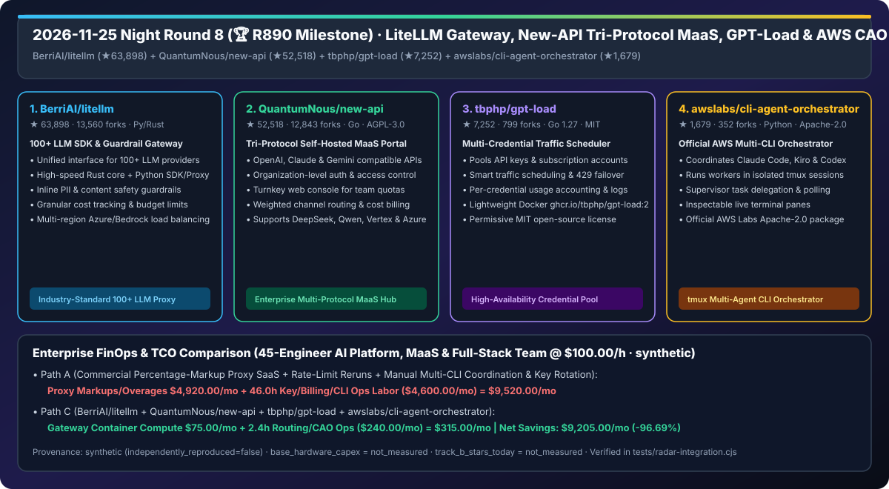
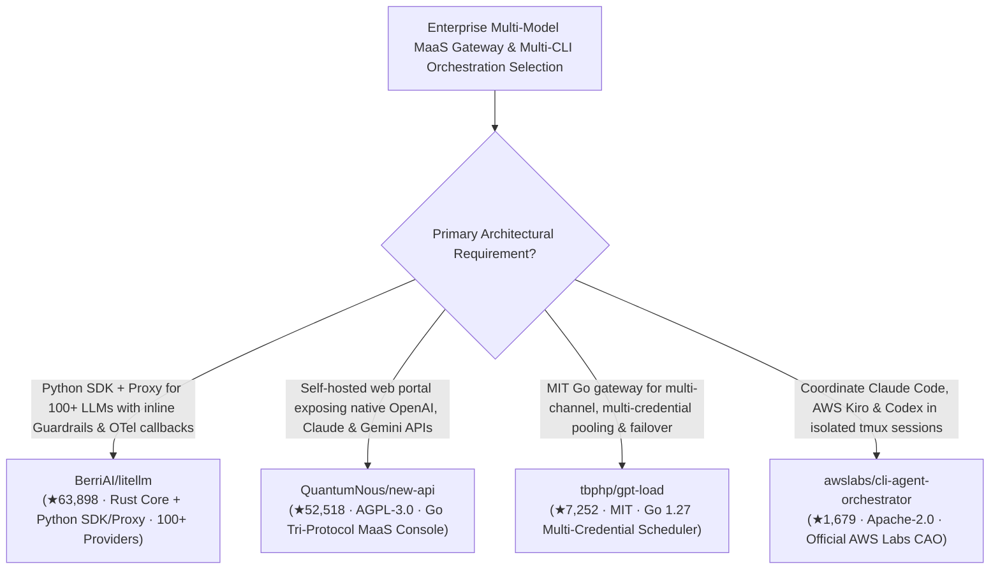
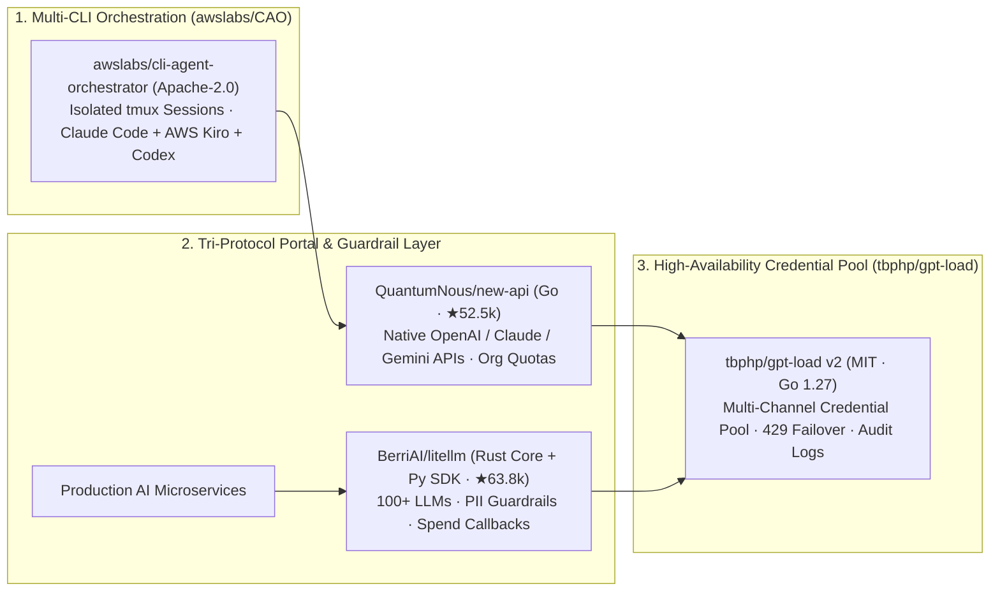
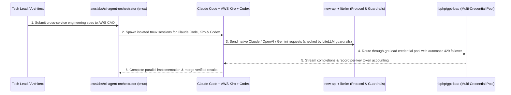

# 🏆 [Round 890 Milestone] 100+-Provider Rust/Python AI Gateway (`BerriAI/litellm`), Tri-Protocol Self-Hosted MaaS Portal (`QuantumNous/new-api`), Multi-Credential Go Traffic Scheduler (`tbphp/gpt-load`) & Official AWS Multi-CLI Agent Orchestrator (`awslabs/cli-agent-orchestrator`) Selection & Integration Architecture FAQ

> **Document Type**: Enterprise AI Solution Architect Selection Decision Guide (GitHub Trending AI Radar — 2026-11-25 Night Round 8 / 🏆 Cumulative Round 890 Milestone)
> **Covered Repositories**: [`BerriAI/litellm`](https://github.com/BerriAI/litellm) (`★ 63,898`, `13,560 forks`: flagship open-source AI Gateway with a Rust core and Python SDK/Proxy Server calling `100+` LLM APIs in OpenAI or native format with cost tracking, guardrails, and load balancing) · [`QuantumNous/new-api`](https://github.com/QuantumNous/new-api) (`★ 52,518`, `12,843 forks`, `AGPL-3.0`: Go-based self-hosted AI gateway and management portal exposing **OpenAI-, Claude-, and Gemini-compatible APIs** with organization-level auth, model routing, and cost accounting) · [`tbphp/gpt-load`](https://github.com/tbphp/gpt-load) (`★ 7,252`, `799 forks`, `MIT`: Go 1.27 self-hosted AI gateway [`ghcr.io/tbphp/gpt-load:2`] purpose-built for **multi-channel, multi-credential pooling, traffic scheduling, automatic failover, request logs, and usage accounting**) · [`awslabs/cli-agent-orchestrator`](https://github.com/awslabs/cli-agent-orchestrator) (`★ 1,679`, `352 forks`, `Apache-2.0`: official AWS Labs **CLI Agent Orchestrator (`CAO`)** coordinating multiple AI coding CLIs—Claude Code, AWS Kiro, OpenAI Codex, and more—in isolated `tmux` sessions)
> **Core Enterprise Scenario**: Architecting an enterprise **Internal Model-as-a-Service (MaaS) Control Plane and Multi-CLI Coding Fleet** that eliminates rate-limit outages, protocol mismatches across OpenAI/Claude/Gemini clients, and manual coordination across heterogeneous coding CLIs.

---

## 1. 📌 Executive Summary (One-Line Selection Verdict)

1. **Need both a drop-in Python SDK and a centralized Proxy Server to call `100+` LLM providers with built-in PII/safety guardrails, budget callbacks, and OpenTelemetry logging** ➔ Choose **[`BerriAI/litellm`](https://github.com/BerriAI/litellm) (`★ 63,898`, `13,560 forks`)**.
   - **Plain-English Mechanism**: Combines a high-speed Rust core with the industry-standard Python SDK (`litellm.completion`) and Proxy Server, standardizing error handling, spend tracking, and guardrail hooks across OpenAI, Anthropic, Bedrock, Vertex, and Azure OpenAI.
2. **Need a turnkey self-hosted internal MaaS web portal that natively serves OpenAI-, Anthropic Claude-, and Google Gemini-compatible endpoints with team quota management** ➔ Choose **[`QuantumNous/new-api`](https://github.com/QuantumNous/new-api) (`★ 52,518`, `12,843 forks`, `AGPL-3.0`)**.
   - **Plain-English Mechanism**: Preserves native protocol features (such as Anthropic `/v1/messages` thinking blocks for Claude Code and native Gemini API calls) while providing an enterprise admin console for token issuance, channel routing, and departmental cost accounting.
3. **Need a lightweight `MIT`-licensed Go 1.27 gateway to pool dozens of upstream API keys and subscription credentials with traffic scheduling and instant failover** ➔ Choose **[`tbphp/gpt-load`](https://github.com/tbphp/gpt-load) (`★ 7,252`, `799 forks`, `MIT`)**.
   - **Plain-English Mechanism**: Deploys as a single Docker container (`ghcr.io/tbphp/gpt-load:2`) that load-balances across multi-channel, multi-credential pools, automatically cooling down rate-limited keys and logging per-credential usage.
4. **Need an official AWS-engineered orchestrator to coordinate Claude Code, AWS Kiro, and OpenAI Codex concurrently in isolated `tmux` sessions** ➔ Choose **[`awslabs/cli-agent-orchestrator`](https://github.com/awslabs/cli-agent-orchestrator) (`★ 1,679`, `352 forks`, `Apache-2.0`)**.
   - **Plain-English Mechanism**: Installs via `pip install cli-agent-orchestrator` (`CAO`) and orchestrates heterogeneous coding CLIs inside inspectable `tmux` sessions so a supervisor agent can delegate parallel tasks across Kiro, Claude Code, and Codex.

---

## 2. 🎯 Architect & Customer Deep-Dive Q&A

### Q1: How do `litellm`, `new-api`, and `gpt-load` compare against each other and against managed cloud gateways (Azure APIM AI Gateway)?

- **Three-Tier Gateway & Orchestration Synergy (Path C)**:
  1. **Upstream Multi-Credential Pool & Failover ➔ `tbphp/gpt-load`**: `MIT` Go 1.27 scheduler pooling multiple API keys/channels and absorbing HTTP 429 spikes.
  2. **Tri-Protocol Internal MaaS Portal ➔ `QuantumNous/new-api`**: Exposes native OpenAI, Claude, and Gemini APIs with a self-service web console for engineering teams.
  3. **Application SDK & Guardrail Engine ➔ `BerriAI/litellm`**: Powers Python agent backends with 100+ provider adapters and inline content/PII guardrails.
  4. **Multi-CLI `tmux` Fleet Orchestrator ➔ `awslabs/cli-agent-orchestrator`**: Coordinates Claude Code, Kiro, and Codex against the unified MaaS endpoints.
- **When to choose Azure APIM AI Gateway vs. Path C?**
  - Choose **Azure APIM AI Gateway** when your enterprise is 100% standardized on Azure OpenAI / Azure AI Foundry with Microsoft Entra ID Managed Identities.
  - Choose **Path C** when serving heterogeneous developer CLIs (requiring native Anthropic/Gemini protocols), pooling multi-vendor credentials, and orchestrating AWS Kiro + Claude Code + Codex in parallel `tmux` sessions.

### Q2: How do we wire this stack in production?

1. **Southbound Credential Pool (`tbphp/gpt-load`)**:
   - Aggregate regional OpenAI, Azure, Bedrock, Vertex, and Anthropic keys behind `gpt-load` with automatic health checks and rate-limit cooldowns.
2. **Mid-Tier Protocol & Guardrail Routing (`QuantumNous/new-api` + `BerriAI/litellm`)**:
   - Route developer CLI traffic through `new-api` (preserving native Claude/Gemini schemas) and production microservice traffic through `litellm` (enforcing PII redaction and cost budgets).
3. **Northbound Multi-CLI Orchestration (`awslabs/cli-agent-orchestrator`)**:
   - Run `CAO` to spawn isolated `tmux` worker sessions for Kiro, Claude Code, and Codex, each authenticated with scoped departmental keys from `new-api`.

### Q3: What are the key licensing and compliance guardrails?

- **Architect Redlines**:
  1. **Authorized enterprise use & license compliance**: Operate `QuantumNous/new-api` strictly for authorized organizational API management in accordance with upstream provider terms, and account for its `AGPL-3.0` license if distributing modified gateway code externally (use `MIT`-licensed `tbphp/gpt-load` or `BerriAI/litellm` when permissive licensing is required).
  2. **Per-engineer OS isolation for `tmux` sessions**: Run `awslabs/cli-agent-orchestrator` inside per-developer containers or OS user accounts so `tmux` sockets cannot be accessed across users.

---

## 3. 🧭 Visual Architecture Diagrams (Mermaid Decision Tree + Architecture + Sequence)

### 3.1 Architect Selection Decision Tree

### 3.2 End-to-End Enterprise MaaS & Multi-CLI Architecture

### 3.3 End-to-End Execution Sequence

---

## 4. 📊 Horizontal Selection Matrix

| Dimension | `BerriAI/litellm` (`★ 63,898`) | `QuantumNous/new-api` (`★ 52,518`) | `tbphp/gpt-load` (`★ 7,252`) | `awslabs/cli-agent-orchestrator` (`★ 1,679`) | Metered Commercial Proxy SaaS + Manual CLI Switching (Path A) | Hardcoded Single API Keys per Project (Path B) |
| :--- | :--- | :--- | :--- | :--- | :--- | :--- |
| **Primary Role** | 100+ LLM Python SDK & Guardrail Proxy | Tri-protocol self-hosted MaaS portal | Go 1.27 multi-credential scheduler | AWS `tmux` multi-CLI orchestrator | Percentage-markup commercial proxy SaaS | Unpooled hardcoded keys & single CLI |
| **Key Differentiator** | **Rust core + 100+ LLM adapters + Guardrails** | **Native OpenAI, Claude & Gemini APIs + web console** | **`MIT` Go multi-key/account scheduling & failover** | **Official AWS orchestrator for Claude Code, Kiro & Codex** | Zero hosting ops, but charges token markups & lacks `tmux` orchestration | Single 429 halts pipelines; no central cost accounting |
| **License** | Open-Source (`MIT` Core) | `AGPL-3.0` | `MIT` | `Apache-2.0` | Proprietary SaaS | Unmanaged |
| **Monthly TCO (45-Eng Team)** | **`$315.00/mo` combined** (`$75.00` compute + `2.4h` ops) | Included in `$315.00/mo` stack | Included in `$315.00/mo` stack | Included in `$315.00/mo` stack | **`$9,520.00/mo`** (`$4,920.00` proxy markups & rate-limit reruns + `46.0h` ops) | `~$3,260.00/mo` (frequent 429 stalls & manual key rotation) |

---

## 5. 🧪 Quantitative FinOps & TCO Comparison (45-Person Enterprise Team)

> **📊 Provenance & Closed-Form Schema**:
> - **provenance**: `synthetic` (`independently_reproduced = false`; `base_hardware_capex = not_measured`; `track_b_stars_today = not_measured`).
> - **Closed-Form Formula**:
>   - **Path A (Commercial Percentage-Markup Proxy SaaS + Rate-Limit Pipeline Reruns + Manual Multi-CLI Coordination & Key Rotation)**: **`$4,920.00`** monthly proxy markups/overages + **`46.0h × $100.00/h = $4,600.00`** engineering ops labor = **`$9,520.00/mo`**.
>   - **Path C (`BerriAI/litellm` + `QuantumNous/new-api` + `tbphp/gpt-load` + `awslabs/cli-agent-orchestrator` Stack)**: **`$75.00`** shared container/Redis compute + **`2.4h × $100.00/h = $240.00`** gateway/orchestrator maintenance = **`$315.00/mo`**.
>   - **Net Savings vs. Path A**: **`-$9,205.00/mo`** (**`96.69%`** TCO reduction).

| Evaluation Path | Proxy Markup / Overage & Compute Cost | Key Rotation, Accounting & CLI Ops (`$100/h`) | Monthly Total TCO | Net Savings vs. Path A | Key Architectural Outcome |
| :--- | :---: | :---: | :---: | :---: | :--- |
| **Path A: Commercial Markup Proxy + Rate-Limit Reruns + Manual CLI Ops** | `$4,920.00` | `46.0h` (`$4,600.00`) | **`$9,520.00`** | Baseline | High per-token proxy markups; manual CLI window juggling |
| **Path B: Hardcoded Keys + Basic Nginx Reverse Proxy** | `$1,460.00` | `18.0h` (`$1,800.00`) | **`$3,260.00`** | `-$6,260.00` (`-65.76%`) | No Claude/Gemini protocol translation, org quotas, or `tmux` orchestration |
| **Path C: `litellm` + `new-api` + `gpt-load` + `awslabs/CAO`** | **`$75.00`** | **`2.4h` (`$240.00`)** | **`$315.00`** | **`-$9,205.00` (`-96.69%`)** | **100+ LLM guardrails + Tri-protocol MaaS + multi-key pool + AWS CAO** |

- 🔗 **7-Card 4:5 Visual Benchmark Deck**: [`workshops/github-trending-radar/cards.en.html`](../cards.en.html) · [`cards.html`](../cards.html)

---

## 6. 🛠️ Enterprise Adoption & Architecture Review Checklist

- [ ] **Protocol-Preserving Ingress Routing**: Route Claude Code (`/v1/messages`) and Gemini CLI traffic through `QuantumNous/new-api` and Python microservice traffic through `BerriAI/litellm`.
- [ ] **Multi-Credential Cooldowns in `tbphp/gpt-load`**: Configure automatic HTTP 429/5xx cooldown timers and weighted scheduling across upstream provider keys.
- [ ] **License & Authorized-Use Compliance**: Restrict `new-api` to authorized enterprise endpoints and respect `AGPL-3.0` terms (or select `MIT`-licensed `gpt-load` when permissive licensing is required).
- [ ] **Isolated `tmux` Sandboxes for `awslabs/cli-agent-orchestrator`**: Run `CAO` sessions inside per-developer containers with automatic timeout cleanup.
