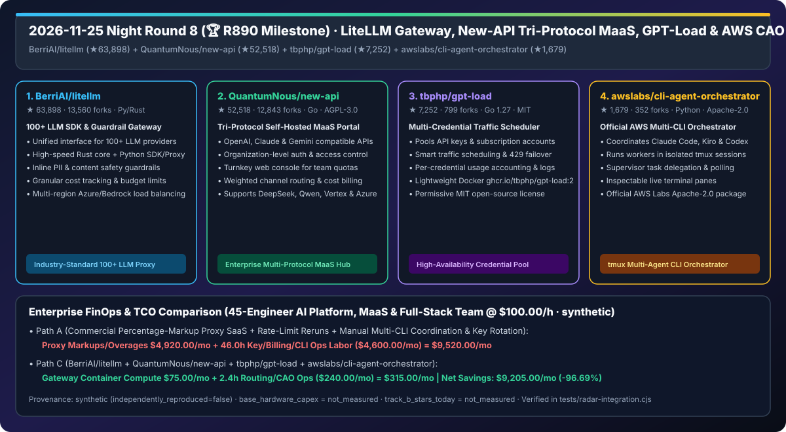
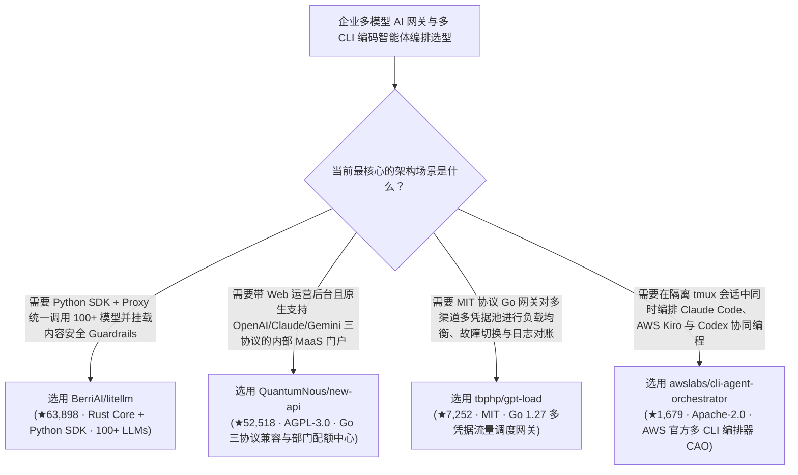
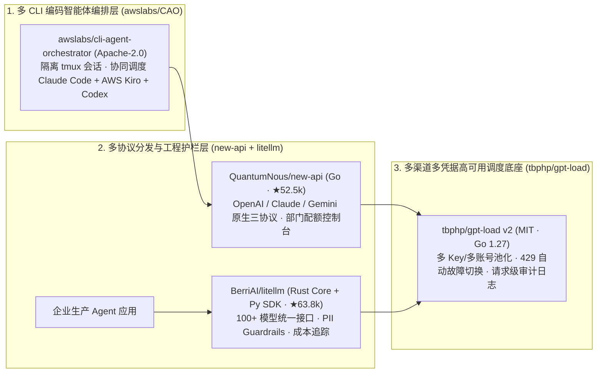
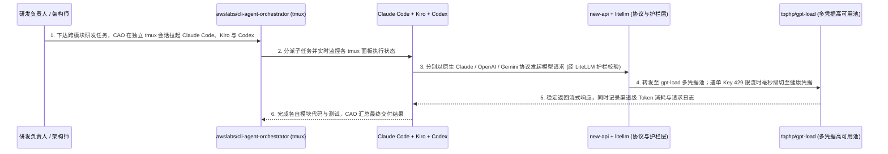

# 🏆【第 890 轮里程碑】100+ 厂商 Rust/Python 统一 AI 网关（`BerriAI/litellm`）、OpenAI/Claude/Gemini 三协议自托管运营网关（`QuantumNous/new-api`）、Go 多通道多凭据调度网关（`tbphp/gpt-load`）与 AWS 官方多 CLI 编码智能体编排器（`awslabs/cli-agent-orchestrator`）选型与集成架构 FAQ

> **文档类型**：企业 AI 解决方案架构师（AI Solution Architect）选型决策指南（GitHub Trending AI 雷达 2026-11-25 Night Round 8 / 🏆 累计第 890 轮里程碑）
> **覆盖项目**：[`BerriAI/litellm`](https://github.com/BerriAI/litellm)（`★ 63,898`、`13,560 forks`：采用 Rust 高速核心与 Python SDK 双架构的旗舰开源 AI 网关，将 100+ 大模型厂商统一为 OpenAI 或原生格式，内置细粒度成本核算、护栏拦截（Guardrails）与负载均衡）· [`QuantumNous/new-api`](https://github.com/QuantumNous/new-api)（`★ 52,518`、`12,843 forks`、`AGPL-3.0`：由 Go 编写的自托管多模型网关与管理控制台，原生暴露 **OpenAI、Claude 与 Gemini 三大兼容 API**，内置组织级鉴权、渠道权重路由、额度计费与可视化运营面板）· [`tbphp/gpt-load`](https://github.com/tbphp/gpt-load)（`★ 7,252`、`799 forks`、`MIT`：基于 Go 1.27 构建的轻量自托管多通道、多凭据 AI 网关 [`ghcr.io/tbphp/gpt-load:2`]，专攻 **API Key 池与多账号凭据混合调度、故障自动摘除、请求日志审计与用量对账**）· [`awslabs/cli-agent-orchestrator`](https://github.com/awslabs/cli-agent-orchestrator)（`★ 1,679`、`352 forks`、`Apache-2.0`：AWS 官方开源的 **CLI Agent Orchestrator (`CAO`)**，在隔离的 `tmux` 会话中统一调度 Claude Code、AWS Kiro、OpenAI Codex 等多款异构 AI 编码 CLI 协同完成大型软件工程任务）
> **核心场景**：当大型企业构建“内部 MaaS（Model-as-a-Service）平台与多 CLI 编码智能体集群”时，架构师面临四个核心选型分叉：**① Python 算法与 Agent 团队既想要代码内 SDK 统一调用 100+ 模型、又想要带护栏的企业级 Proxy 怎么选？② 企业内部 IT 想要一个带完整 Web 充值/配额后台、同时原生兼容 Claude Code（Anthropic 协议）、Gemini CLI（Gemini 协议）与 OpenAI SDK 的分发门户怎么选？③ 拥有几十个不同渠道的 API Key 与账号凭据，如何做高可用轮询、限流熔断与毫秒级故障切换？④ 研发团队想用 AWS Kiro、Claude Code 与 Codex 组成多智能体小队在后台 `tmux` 并行干活，用什么官方编排器最稳？** 本文给出完整选型矩阵与集成架构。

---

## 一、📌 核心结论速览（选型一句话结论）

1. **企业以 Python AI 工程栈为主，需要“代码级 Python SDK + 集中式 Proxy 网关”双形态统一调用 100+ 模型（OpenAI、Anthropic、Bedrock、Vertex、Azure OpenAI），并内置企业级 Guardrails 与成本回调** ➔ 选 **[`BerriAI/litellm`](https://github.com/BerriAI/litellm)（`★ 63,898`，`13,560 forks`）**。
   - **通俗原理**：`LiteLLM` 是行业事实标准的百模适配层（现已引入 Rust 核心提速）。既能在 Python 代码里直接 `from litellm import completion` 零改动切换底层模型，也能独立部署为集中式 Proxy Server，统一配置团队预算、PII/内容安全护栏与跨区域 Azure/Bedrock 故障转移。
2. **需要为全公司数千名员工或业务部门搭建一套带开箱即用 Web 运营管理后台、且原生同时暴露 OpenAI、Anthropic Claude 与 Google Gemini 三大原生协议接口的内部 MaaS 门户** ➔ 选 **[`QuantumNous/new-api`](https://github.com/QuantumNous/new-api)（`★ 52,518`，`12,843 forks`，`AGPL-3.0`）**。
   - **通俗原理**：现在很多工具（如 Claude Code、Gemini CLI）要求直接调用 Anthropic `/v1/messages` 或 Gemini 原生接口，若强转成 OpenAI 格式会丢失 Thinking 块或原生缓存特性。`New API` 原生支持三大协议透传与互转，自带完善的组织权限、令牌额度分组与可视化成本大盘。
3. **需要将分散在多个云账号、多个供应商渠道的数十把 API Key 与订阅凭据池化在单一 `MIT` 协议 Go 入口后，实现智能流量调度、429/5xx 自动摘除与请求级审计日志** ➔ 选 **[`tbphp/gpt-load`](https://github.com/tbphp/gpt-load)（`★ 7,252`，`799 forks`，`MIT`）**。
   - **通俗原理**：针对高并发生产环境下单一账号 RPM/TPM 限流瓶颈，用 Go 1.27 打造极简容器网关（`ghcr.io/tbphp/gpt-load:2`），将多通道、多凭据统一纳管，按健康度与权重动态分配请求并精准记录每把上游凭据的真实消耗。
4. **希望在 Linux/macOS 开发机或云端开发机上，由主管 Agent 在后台隔离的 `tmux` 会话中同时指挥 Claude Code、AWS Kiro 与 OpenAI Codex 协同攻克复杂跨模块研发任务** ➔ 选 **[`awslabs/cli-agent-orchestrator`](https://github.com/awslabs/cli-agent-orchestrator)（`★ 1,679`，`352 forks`，`Apache-2.0`）**。
   - **通俗原理**：AWS Labs 官方出品的 `cli-agent-orchestrator (CAO)` 不重新造轮子写编码底座，而是利用成熟的 `tmux` 终端复用器为每个 CLI Agent（Claude Code、Kiro、Codex）分配独立可观察的终端会话，通过标准化的任务派发、状态轮询与结果汇总实现跨厂商 CLI 团队作战。

---

## 二、🎯 客户与架构师灵魂拷问 Q&A（深度架构拆解）

### Q1：同样是开源 AI 网关，`BerriAI/litellm` vs `QuantumNous/new-api` vs `tbphp/gpt-load` 到底怎么选？何时应该直接用 Azure API Management (APIM) AI Gateway？

- **三大开源网关定位差异**：
  1. **`BerriAI/litellm`（AI 工程与 Guardrails 首选）**：适合深度集成在 Python Agent 框架（LangGraph/CrewAI/ADK）内部，或需要复杂内容安全护栏（Presidio/Lakera/Bedrock Guardrails）与 OpenTelemetry 对接的工程团队。
  2. **`QuantumNous/new-api`（内部 MaaS 运营门户首选）**：适合企业 IT 建设面向全员的自助式 API 令牌申请、多部门额度核算、以及需要原生 Claude/Gemini 协议直连 Claude Code 的场景。
  3. **`tbphp/gpt-load`（MIT 多凭据高可用池化首选）**：适合追求 `MIT` 宽松协议、Go 单容器轻量部署、专注解决上游多渠道多 Key 轮询防限流的后端架构。
- **何时选云厂商托管网关（Azure APIM AI Gateway / AWS Bedrock Gateway）？**
  - 若企业所有传统微服务 API 已统一托管在 **Azure API Management** 上，且后端 90% 为 Azure OpenAI / Azure AI Foundry 模型，直接开启 APIM 的 GenAI Gateway 策略（Managed Identity 免密认证、多区域后端池、Token 速率限制）可少维护一套组件。
  - **何时采用本轮开源组合（Path C）？** 当企业同时混用 OpenAI、Anthropic、Gemini、DeepSeek、Qwen 与 AWS Kiro/Claude Code/Codex 多套异构 CLI，需要多协议原生兼容与 `tmux` 级多 CLI 并发编排时，Path C 提供了云厂商单一网关无法覆盖的跨生态调度能力。

### Q2：如何把这四个项目组合为企业级“多模型 MaaS 底座 + 多 CLI 智能体研发工厂”？

1. **底层多凭据高可用调度层（`tbphp/gpt-load`）**：
   - 将各云厂商的多把 API Key 与备用渠道接入 `gpt-load`，屏蔽单账号 429 限流与区域抖动。
2. **中层多协议门户与工程护栏层（`QuantumNous/new-api` + `BerriAI/litellm`）**：
   - `new-api` 面向研发人员暴露原生 OpenAI / Claude / Gemini 兼容端点并核算部门配额；`litellm` 为业务生产应用提供 Python SDK 统一调用与 PII 脱敏护栏。
3. **顶层多 CLI 协同研发编排层（`awslabs/cli-agent-orchestrator`）**：
   - 架构师通过 AWS `CAO` 启动隔离 `tmux` 编排会话，让 Claude Code、AWS Kiro 与 OpenAI Codex 分别挂载 `new-api`/`litellm` 网关端点并行完成架构设计、代码实现与单元测试。

### Q3：生产落地的合规与许可证红线是什么？

- **架构师避坑红线**：
  1. **严格遵守官方合规声明与企业授权条款**：正如 `QuantumNous/new-api` 官方置顶声明强调，企业部署必须仅用于合法授权的组织级 API 网关、多模型管理与成本核算，严禁用于任何违反模型服务商 ToS 的未授权逆向或灰产分销；同时注意 `new-api` 采用 `AGPL-3.0` 协议（内部自用无需开源业务系统，若修改网关代码对外提供 SaaS 服务需遵守传染性开源条款），商业闭源分发可优先选 `MIT` 协议的 `tbphp/gpt-load`。
  2. **`tmux` 编排会话的资源与权限隔离**：在共享开发服务器上运行 `awslabs/cli-agent-orchestrator` 时，应为每位工程师分配独立的 Linux 用户命名空间或容器开发机（Dev Container），防止跨用户 `tmux` Socket 越权附加。

---

## 三、🧭 直观可视化图解（Mermaid 决策树 + 集成架构 + 时序图）

### 3.1 架构师选型决策树

### 3.2 企业端到端生产集成参考架构图

### 3.3 多 CLI 协同任务拆解、三协议网关路由与多凭据防限流时序图

---

## 四、📊 同类开源与商业云服务横向选型决策矩阵

| 对比维度 | `BerriAI/litellm` (`★ 63,898`) | `QuantumNous/new-api` (`★ 52,518`) | `tbphp/gpt-load` (`★ 7,252`) | `awslabs/cli-agent-orchestrator` (`★ 1,679`) | 商业托管 MaaS 网关与单点手动切 CLI (Path A) | 各项目硬编码单一 API Key 直连云厂商 (Path B) |
| :--- | :--- | :--- | :--- | :--- | :--- | :--- |
| **核心架构定位** | 100+ 模型 Python SDK 与企业级 Proxy | OpenAI/Claude/Gemini 三协议自托管运营网关 | Go 1.27 多渠道多凭据高可用调度网关 | AWS 官方基于 `tmux` 的多编码 CLI 编排器 | 按 Token 加收过路费的商业代理服务 | 散落硬编码 Key + 单一 CLI 串行开发 |
| **核心技术突破** | **Rust 核心 + 100+ 厂商适配 + Guardrails** | **三大原生协议兼容 + 组织配额 Web 控制台** | **多 Key/多账号混合池化调度 + 自动故障摘除** | **在隔离 `tmux` 中协同调度 Claude Code/Kiro/Codex** | 免自建，但按调用量抽成且不支持多 CLI 终端编排 | 单 Key 触发 429 即全线报错；更换模型需改遍所有仓库代码 |
| **开源协议** | Open-Source (`MIT` Core) | `AGPL-3.0` | `MIT` | `Apache-2.0` | 闭源商业 SaaS | 无治理 |
| **月度 TCO（45 人团队）** | **四件套合建仅 `$315.00/月`**（`$75.00` 容器/Redis 算力 + `2.4h` 维护） | 同左（自建内部 MaaS 零抽成） | 同左（最大化复用现有多渠道凭据配额） | 同左（`Apache-2.0` 免费编排多款 CLI） | **`$9,520.00/月`**（`$4,920.00` 商业网关抽成与限流重跑浪费 + `46.0h` 人工切号排障） | 约 `$3,240.00/月`（频繁 429 中断等待与手工管理 Key 工时） |

---

## 五、🧪 应用落地定量收益/TCO 对比与 7-Card 报告

> **📊 数据来源与闭式核算声明（Provenance & Closed-Form Schema）**：
> - **provenance**: `synthetic`（基于 45 人企业 AI 平台工程、内部 MaaS 运营与全栈研发团队月度工作负载模型：`independently_reproduced = false`；硬件采购基线 `base_hardware_capex = not_measured`；Track B 单日增量 `track_b_stars_today = not_measured`）。
> - **核算公式**：
>   - **Path A（使用按 Token 比例抽成的外部商业代理网关 + 单 Key 429 限流导致长流水线中断重跑 + 工程师手工在多个 CLI 窗口间切换盯守）**：月度商业网关抽成与失败重跑账单 **`$4,920.00`** + 凭据轮换、账单核对与多 CLI 人工协同工时 **`46.0h × $100.00/h = $4,600.00`** = **`$9,520.00/月`**。
>   - **Path C（自建 `BerriAI/litellm` + `QuantumNous/new-api` + `tbphp/gpt-load` + `awslabs/cli-agent-orchestrator` 企业级 MaaS 与多 CLI 编排底座）**：轻量网关容器与数据库算力分摊 **`$75.00`** + 渠道策略与编排脚本维护人工 **`2.4h × $100.00/h = $240.00`** = **`$315.00/月`**。
>   - **净节省（Net Savings vs Path A）**：**`-$9,205.00/月`**（成本降低 **`96.69%`**）。

| 评估方案 | 商业网关抽成 / 限流重跑与算力成本 | 凭据管理、对账与多 CLI 协调人工（`$100/h`） | 月度总 TCO | 相对 Path A 净节省 | 核心架构交付收益 |
| :--- | :---: | :---: | :---: | :---: | :--- |
| **Path A：商业抽成网关 + 单 Key 频繁 429 + 手工切 CLI 窗口** | `$4,920.00` | `46.0h` (`$4,600.00`) | **`$9,520.00`** | Baseline | 按量过路费高昂；单账号限流拖垮整条研发流水线 |
| **Path B：各团队硬编码 API Key + 简单 Nginx 反代** | `$1,460.00` | `18.0h` (`$1,800.00`) | **`$3,260.00`** | `-$6,260.00` (`-65.76%`) | 缺乏 Claude/Gemini 协议转换、部门级配额核算与 `tmux` 编排 |
| **Path C：`litellm` + `new-api` + `gpt-load` + `awslabs/CAO`** | **`$75.00`** | **`2.4h` (`$240.00`)** | **`$315.00`** | **`-$9,205.00` (`-96.69%`)** | **100+ 模型统一护栏 + 三协议 MaaS 后台 + 多凭据防抖 + 多 CLI 编排** |

- 🔗 **关联 7-Card 4:5 视觉评测报告**：[`workshops/github-trending-radar/cards.html`](../cards.html) · [`cards.en.html`](../cards.en.html)

---

## 六、🛠️ 企业引入与架构评审 Checklist

- [ ] **按客户端协议精准分流（`new-api` vs `litellm`）**：将需要原生 `/v1/messages`（Claude Code）与原生 Gemini 接口的客户端接入 `QuantumNous/new-api`；将 Python 微服务与需要 Presidio PII 护栏的请求接入 `BerriAI/litellm`。
- [ ] **配置 `tbphp/gpt-load` 多凭据健康检查与自动冷却**：在 `gpt-load` 中为上游多渠道 Key 配置 429/503 自动冷却时间窗与指数退避策略，实现零感知故障转移。
- [ ] **合规使用与 `AGPL-3.0` 边界核查**：确保 `new-api` 仅用于企业获权内部 MaaS 分发与成本对账；若需修改网关源码并作为商业闭源产品对外交付，优先采用 `MIT` 协议的 `tbphp/gpt-load`。
- [ ] **`awslabs/cli-agent-orchestrator` 会话超时与沙箱回收**：为 AWS `CAO` 启动的后台 `tmux` 编码子会话配置最大运行时长与磁盘配额，任务完成后自动归档日志并清理孤儿会话。
