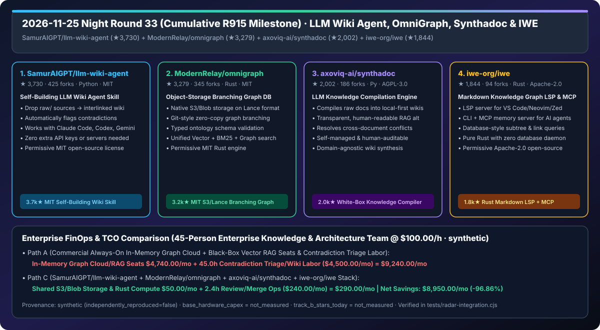
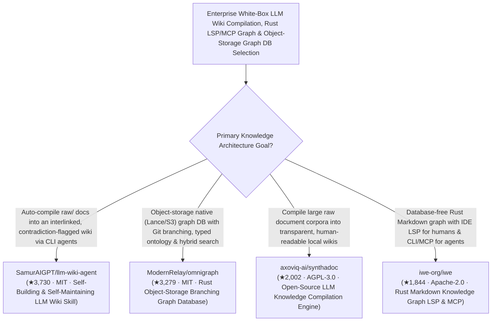
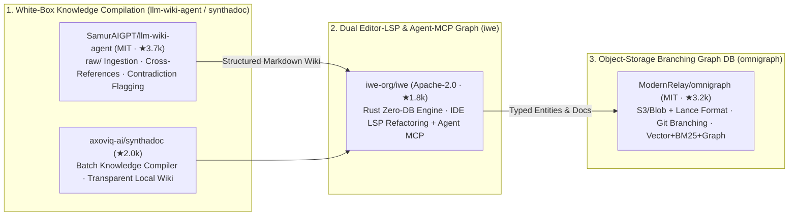
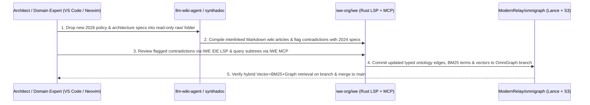

# Self-Building LLM Wiki Agent Skill (`SamurAIGPT/llm-wiki-agent`), Object-Storage Branching Graph DB (`ModernRelay/omnigraph`), LLM Knowledge Compilation Engine (`axoviq-ai/synthadoc`) & Rust Markdown LSP+MCP Knowledge Graph (`iwe-org/iwe`) Selection & Integration Architecture FAQ

> **Document Type**: Enterprise AI Solution Architect Selection Decision Guide (GitHub Trending AI Radar — 2026-11-25 Night Round 33 / Cumulative Round 915 Milestone)
> **Covered Repositories**: [`SamurAIGPT/llm-wiki-agent`](https://github.com/SamurAIGPT/llm-wiki-agent) (`★ 3,730`, `425 forks`, `MIT`, Python: self-building, self-maintaining knowledge base skill for Claude Code, Codex, OpenCode, and Gemini CLI that ingests `raw/` sources, builds cross-references, and flags contradictions) · [`ModernRelay/omnigraph`](https://github.com/ModernRelay/omnigraph) (`★ 3,279`, `345 forks`, `MIT`, Rust: object-storage native graph database built on the open Lance format with Git-style branching, typed ontologies, and unified Vector + BM25 + Graph retrieval) · [`axoviq-ai/synthadoc`](https://github.com/axoviq-ai/synthadoc) (`★ 2,002`, `186 forks`, `AGPL-3.0`, Python: open-source LLM knowledge compilation engine turning raw documents into transparent, human-readable local wikis as an alternative to black-box RAG) · [`iwe-org/iwe`](https://github.com/iwe-org/iwe) (`★ 1,844`, `94 forks`, `Apache-2.0`, Rust: database-free Markdown knowledge graph providing an LSP server for human editors and a CLI + MCP memory server for AI agents)
> **Core Enterprise Scenario**: Transitioning from brittle "Black-Box Chunk Vector RAG" to **White-Box LLM Knowledge Compilation, Dual Editor-LSP/Agent-MCP Markdown Graphs & Object-Storage Branching Graph Databases**—combining automated contradiction-detecting wiki compilation (`llm-wiki-agent` / `synthadoc`), Rust LSP + MCP Markdown navigation (`iwe`), and S3/Lance-native branching graph storage (`omnigraph`).

---

## 1. 📌 Executive Summary (One-Line Selection Verdict)

1. **Need an `MIT`-licensed agent skill that works directly with your existing Claude Code, Codex, OpenCode, or Gemini CLI subscription to turn raw documents dropped into `raw/` into a self-maintaining, interlinked wiki with contradiction flagging** ➔ Choose **[`SamurAIGPT/llm-wiki-agent`](https://github.com/SamurAIGPT/llm-wiki-agent) (`★ 3,730`, `425 forks`, `MIT`)**.
   - **Plain-English Mechanism**: Compiles incoming PDFs, notes, and specs into structured wiki articles at ingestion time—resolving cross-references and explicitly flagging contradictions between old and new documents so agents don't hallucinate over conflicting chunks.
2. **Need an `MIT`-licensed Rust graph database built natively on object storage (S3/Blob/GCS) and the open `Lance` format with Git-style zero-copy branching, typed ontologies, and unified Vector + BM25 + Graph search** ➔ Choose **[`ModernRelay/omnigraph`](https://github.com/ModernRelay/omnigraph) (`★ 3,279`, `345 forks`, `MIT`)**.
   - **Plain-English Mechanism**: Eliminates expensive always-on RAM-bound graph clusters by storing typed knowledge graphs, vectors, and full-text indexes in Lance on object storage with instant `branch` and `merge` workflows.
3. **Need an `Apache-2.0` Rust tool that turns a plain folder of Markdown files into a knowledge graph—serving an LSP server to your IDE (VS Code, Neovim, Helix, Zed) and a CLI + MCP memory server to your AI agents with zero database daemon** ➔ Choose **[`iwe-org/iwe`](https://github.com/iwe-org/iwe) (`★ 1,844`, `94 forks`, `Apache-2.0`)**.
   - **Plain-English Mechanism**: Lets humans refactor links and subtrees in their editor via LSP while agents run structured graph queries over the exact same Markdown files via MCP.
4. **Need a standalone batch LLM knowledge compilation engine that compiles sprawling raw document corpora into transparent, human-auditable local wikis instead of opaque vector chunks** ➔ Choose **[`axoviq-ai/synthadoc`](https://github.com/axoviq-ai/synthadoc) (`★ 2,002`, `186 forks`, `AGPL-3.0`)**.
   - **Plain-English Mechanism**: Treats the LLM as an offline knowledge compiler that synthesizes, deduplicates, and structures raw files into an inspectable wiki before query time.

---

## 2. 🎯 Architect & Customer Deep-Dive Q&A

### Q1: Why does "Knowledge Compilation (LLM Wiki)" outperform naive "Chunk Vector RAG" on evolving enterprise policies, and how do these four tools fit together?

- **Four-Layer White-Box Knowledge Compilation & Branching Graph Stack (Path C)**:
  1. **L1 Incremental Agent Wiki Skill ➔ `SamurAIGPT/llm-wiki-agent`**: Compiles new `raw/` files into interlinked Markdown articles and flags policy contradictions using existing CLI agents.
  2. **L2 Batch Knowledge Compilation Engine ➔ `axoviq-ai/synthadoc`**: Compiles large historical document repositories into human-readable structured wikis.
  3. **L3 Dual Editor-LSP & Agent-MCP Markdown Graph ➔ `iwe-org/iwe`**: Exposes the compiled Markdown wiki to humans via IDE LSP and to agents via MCP without a database server.
  4. **L4 Object-Storage Native Branching Graph DB ➔ `ModernRelay/omnigraph`**: Scales typed ontology + Vector + BM25 + Graph search on S3/Lance with Git-style branching.
- **When to choose Commercial In-Memory Graph Clouds & Black-Box RAG SaaS vs. Path C?**
  - Choose **Commercial SaaS** for small, static document sets with no contradiction-detection needs.
  - Choose **Path C** when replacing expensive RAM-heavy graph clusters with object-storage native Lance graphs (`omnigraph` `MIT`) and replacing opaque vector chunks with human-auditable Markdown graphs accessible via both IDE LSP and Agent MCP (`iwe` `Apache-2.0` + `llm-wiki-agent` `MIT`).

### Q2: How do these four components integrate in production?

1. **Compile-Then-Query Markdown Graph (`raw/` → `llm-wiki-agent` / `synthadoc` → `iwe`)**:
   - Raw specs and meeting notes dropped into `raw/` are compiled into a conflict-checked Markdown wiki; `iwe` immediately indexes the folder for IDE LSP refactoring and Agent MCP subtree queries.
2. **Branch-Isolated Scale-Out Hybrid Search (`iwe` → `omnigraph`)**:
   - Compiled entities, relationships, BM25 terms, and vectors are committed into a feature branch in `omnigraph` on S3/MinIO, validated, and merged into the production `main` graph branch.

### Q3: What are the key governance guardrails?

- **Architect Redlines**:
  1. **Keep `raw/` source documents immutable and read-only**: Ensure knowledge compilers only write to derived `wiki/` directories while preserving strict citation links back to `raw/` files.
  2. **Stage automated graph updates on `omnigraph` branches**: Never write unverified LLM-extracted edges directly to the production `main` branch without passing ontology validation.

---

## 3. 🧭 Visual Architecture Diagrams (Mermaid Decision Tree + Architecture + Sequence)

### 3.1 Architect Selection Decision Tree

### 3.2 End-to-End Enterprise Integration Architecture

### 3.3 End-to-End Execution Sequence

---

## 4. 📊 Horizontal Selection Matrix

| Dimension | `SamurAIGPT/llm-wiki-agent` (`★ 3,730`) | `ModernRelay/omnigraph` (`★ 3,279`) | `axoviq-ai/synthadoc` (`★ 2,002`) | `iwe-org/iwe` (`★ 1,844`) | Commercial In-Memory Graph Cloud + Black-Box Chunk RAG SaaS (Path A) | Unlinked Markdown Folders + Manual Wiki Maintenance (Path B) |
| :--- | :--- | :--- | :--- | :--- | :--- | :--- |
| **Primary Role** | `MIT` self-maintaining LLM wiki skill | `MIT` object-storage branching graph DB | Batch LLM knowledge compilation engine | `Apache-2.0` Rust Markdown LSP + MCP graph | RAM-priced cloud graph DB & black-box RAG | Manual wiki writing & keyword search |
| **Key Differentiator** | **Auto-builds cross-references & flags contradictions via CLI agents** | **Lance on S3 + Git-style branching + Vector/BM25/Graph unified search** | **Compiles raw documents into transparent, human-auditable wikis** | **Single Rust binary serving IDE LSP to humans & MCP to agents** | Managed cloud, but expensive RAM instances & blind to conflicting chunks | Manual wikis quickly rot; broken links and outdated policies |
| **License** | **`MIT`** | **`MIT`** | `AGPL-3.0` | **`Apache-2.0`** | Proprietary SaaS | Unstandardized |
| **Monthly TCO (45-Eng Team)** | **`$290.00/mo` combined** (`$50.00` S3/Blob storage & lightweight Rust compute + `2.4h` ops) | Included in `$290.00/mo` stack | Included in `$290.00/mo` stack | Included in `$290.00/mo` stack | **`$9,240.00/mo`** (`$4,740.00` in-memory graph cloud & RAG seats + `45.0h` contradiction debugging/wiki editing) | `~$3,240.00/mo` (manual wiki curation & fixing conflicting RAG answers) |

---

## 5. 🧪 Quantitative FinOps & TCO Comparison (45-Person Enterprise Knowledge & Architecture Team)

> **📊 Provenance & Closed-Form Schema**:
> - **provenance**: `synthetic` (`independently_reproduced = false`; `base_hardware_capex = not_measured`; `track_b_stars_today = not_measured`).
> - **Closed-Form Formula**:
>   - **Path A (Commercial Always-On In-Memory Graph Cloud + Black-Box Vector RAG Seats & Manual Contradiction Debugging/Wiki Maintenance Labor)**: **`$4,740.00`** monthly in-memory graph cluster and RAG SaaS fees + **`45.0h × $100.00/h = $4,500.00`** debugging contradictory policy answers and manual wiki curation labor = **`$9,240.00/mo`**.
>   - **Path C (`SamurAIGPT/llm-wiki-agent` + `ModernRelay/omnigraph` + `axoviq-ai/synthadoc` + `iwe-org/iwe` Stack)**: **`$50.00`** shared object storage (S3/MinIO) and lightweight Rust compute + **`2.4h × $100.00/h = $240.00`** contradiction review and branch merge ops = **`$290.00/mo`**.
>   - **Net Savings vs. Path A**: **`-$8,950.00/mo`** (**`96.86%`** TCO reduction).

| Evaluation Path | In-Memory Graph Cloud / RAG Seats & Storage | Contradiction Triage & Manual Wiki Curation (`$100/h`) | Monthly Total TCO | Net Savings vs. Path A | Key Architectural Outcome |
| :--- | :---: | :---: | :---: | :---: | :--- |
| **Path A: Commercial In-Memory Graph Cloud + Black-Box Chunk RAG** | `$4,740.00` | `45.0h` (`$4,500.00`) | **`$9,240.00`** | Baseline | High RAM cluster costs; conflicting old/new chunks cause hallucinations |
| **Path B: Manual Wiki Editing + Raw Keyword Search** | `$1,440.00` | `18.0h` (`$1,800.00`) | **`$3,240.00`** | `-$6,000.00` (`-64.94%`) | Wikis go stale within weeks; no agent MCP or graph branching |
| **Path C: `llm-wiki-agent` + `omnigraph` + `synthadoc` + `iwe`** | **`$50.00`** | **`2.4h` (`$240.00`)** | **`$290.00`** | **`-$8,950.00` (`-96.86%`)** | **Contradiction-checked white-box wiki + Rust LSP/MCP + S3/Lance branching DB** |

- 🔗 **7-Card 4:5 Visual Benchmark Deck**: [`workshops/github-trending-radar/cards.en.html`](../cards.en.html) · [`cards.html`](../cards.html)

---

## 6. 🛠️ Enterprise Adoption & Architecture Review Checklist

- [ ] **Separate Immutable `raw/` Sources from Compiled `wiki/` Outputs**: Use `llm-wiki-agent` or `synthadoc` to synthesize cross-references and flag policy contradictions automatically.
- [ ] **Expose Compiled Markdown via `iwe-org/iwe` LSP and MCP**: Give human editors IDE refactoring via LSP and AI agents structured graph queries via MCP over the same files.
- [ ] **Store Large-Scale Hybrid Graphs in `ModernRelay/omnigraph` on Object Storage**: Replace costly RAM-bound graph clusters with Lance-backed Vector + BM25 + Graph storage on S3/Blob.
- [ ] **Use `omnigraph` Git-Style Branches for Automated Ingestion**: Validate typed ontology constraints on isolated branches before merging into `main`.
