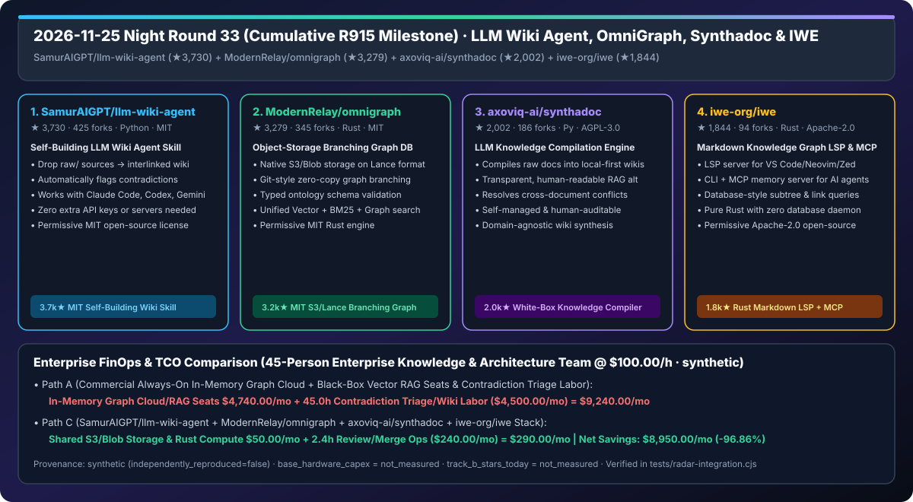
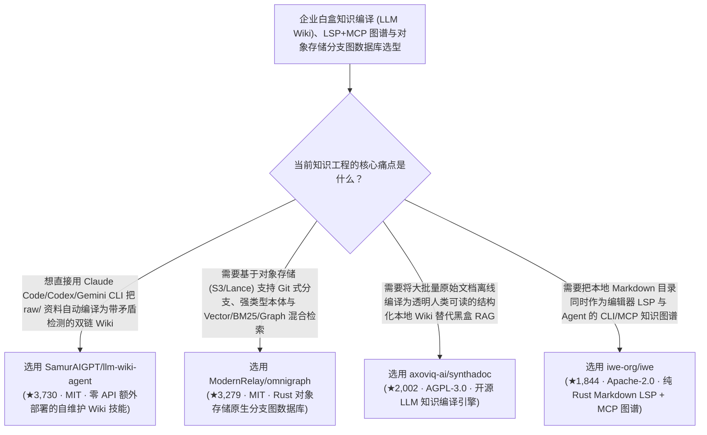
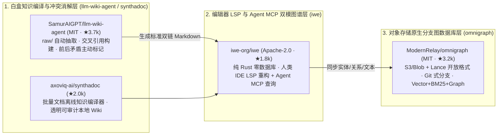
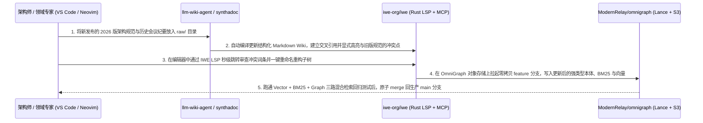

# 自构建自维护编码智能体 Wiki 技能（`SamurAIGPT/llm-wiki-agent`）、对象存储原生带 Git 分支与强类型本体的图数据库（`ModernRelay/omnigraph`）、开源 LLM 知识编译引擎（`axoviq-ai/synthadoc`）与编辑器 LSP+Agent MCP 双模 Markdown 图谱引擎（`iwe-org/iwe`）选型与集成架构 FAQ

> **文档类型**：企业 AI 解决方案架构师（AI Solution Architect）选型决策指南（GitHub Trending AI 雷达 2026-11-25 Night Round 33 / 累计第 915 轮里程碑）
> **覆盖项目**：[`SamurAIGPT/llm-wiki-agent`](https://github.com/SamurAIGPT/llm-wiki-agent)（`★ 3,730`、`425 forks`、`MIT`：把原始资料丢进 `raw/` 即由 Claude Code/Codex/Gemini CLI 自动抽取概念、标记矛盾并持续自维护双链百科的 Agent Skill）· [`ModernRelay/omnigraph`](https://github.com/ModernRelay/omnigraph)（`★ 3,279`、`345 forks`、`MIT`：纯 Rust 编写、原生运行在对象存储 [S3/Blob] 与开放 Lance 格式上的图数据库，内置 Git 式零拷贝分支 [Branching]、强类型本体与 Vector+BM25+Graph 统一检索）· [`axoviq-ai/synthadoc`](https://github.com/axoviq-ai/synthadoc)（`★ 2,002`、`186 forks`、`AGPL-3.0`：开源 LLM 知识编译引擎，将原始文档编译为人类可读、透明可审计的结构化本地 Wiki 以替代黑盒向量 RAG）· [`iwe-org/iwe`](https://github.com/iwe-org/iwe)（`★ 1,844`、`94 forks`、`Apache-2.0`：纯 Rust 编写的零数据库 Markdown 知识图谱——面向编辑器提供 LSP Server，面向 AI Agent 提供 CLI 与 MCP Memory Server）
> **核心场景**：2026 年企业知识工程正在发生一场从“黑盒切块向量 RAG（Chunk-based Vector RAG）”向“**白盒知识编译（Knowledge Compilation / LLM Wiki）+ 对象存储原生分支图数据库**”的范式转移。架构师常面临四个核心问题：**“为什么把几百份原始制度直接切块塞进向量库总是答错，怎么先用编译器思路把原始文档编译成消除了前后矛盾的人类可读 Wiki（`synthadoc` / `llm-wiki-agent`）？编译出来的 Markdown 文件夹怎么不用装任何数据库，就能让人类在 IDE 里用 LSP 重构、让 Agent 通过 MCP 做结构化子树查询（`iwe`）？当图谱规模扩展到亿级边且需要像 Git 一样开分支做实验并直接存放在廉价对象存储（S3/Azure Blob）上时，选哪款 `MIT` Rust 引擎（`omnigraph`）？”** 本文给出完整解答。

---

## 一、📌 核心结论速览（选型一句话结论）

1. **不想写复杂后端代码或配额外 API Key，只想给团队现有的 Claude Code、Codex、OpenCode 或 Gemini CLI 装一个 `MIT` 技能，把会议纪要、论文和设计文档丢进 `raw/` 目录就自动编译并维护一套“已建好交叉引用、已标出前后矛盾”的持久化双链 Wiki** ➔ 选 **[`SamurAIGPT/llm-wiki-agent`](https://github.com/SamurAIGPT/llm-wiki-agent)（`★ 3,730`，`425 forks`，`MIT`）**。
   - **通俗原理**：践行 Karpathy 提出的“LLM Wiki”理念——不要等提问时再去临时搜杂乱无章的原始笔记，而是在每次新增资料入库时就让 Agent 像维基百科编辑一样阅读全篇、更新实体词条、建立双向链接并主动高亮新旧文档之间的冲突。
2. **需要一套 `MIT` 开源、用 Rust 编写、直接以开放列存格式（Lance）存储在廉价云对象存储（S3 / Azure Blob / MinIO）上的大规模图数据库，同时原生融合“强类型本体校验 + Git 式零拷贝分支（Branching）+ Vector/BM25/Graph 三路混合检索”** ➔ 选 **[`ModernRelay/omnigraph`](https://github.com/ModernRelay/omnigraph)（`★ 3,279`，`345 forks`，`MIT`）**。
   - **通俗原理**：传统图数据库必须把全量图常驻在昂贵的服务器内存里且不支持分支；`omnigraph` 把图、向量和全文索引以 Lance 开放格式直接落在对象存储上，支持秒级 `branch` 出一个隔离沙箱让 Agent 写入实验性图谱变更，验证无误后再 `merge` 回主分支。
3. **希望把普通 Markdown 文件夹瞬间变成一套“无需任何数据库进程、人类在 VS Code / Neovim / Zed 里通过 **LSP** 导航重构、AI Agent 通过 **CLI + MCP Server** 执行结构化子树查询”的高速 Rust 知识图谱** ➔ 选 **[`iwe-org/iwe`](https://github.com/iwe-org/iwe)（`★ 1,844`，`94 forks`，`Apache-2.0`）**。
   - **通俗原理**：用 Rust 在内存中极速解析本地 Markdown 标题层级与链接关系，人类重命名一个标题时 LSP 自动更新全仓引用，Agent 调用 MCP 即可精确查询“返回架构决策子树下所有状态为已批准的节点”。
4. **在合规要求极严的法务、医疗或工程规范场景中，业务方拒绝接受“看不见中间推理、每次检索块都不一样”的黑盒向量数据库，需要一套独立的“知识编译流水线”将多源原始文档离线编译为可逐行审查的结构化 Wiki** ➔ 选 **[`axoviq-ai/synthadoc`](https://github.com/axoviq-ai/synthadoc)（`★ 2,002`，`186 forks`，`AGPL-3.0`）**。
   - **通俗原理**：把大模型当成“知识编译器（Knowledge Compiler）”而非在线聊天机器人，在入库阶段完成去重、冲突消解与结构化编排，产出 100% 透明、人类可直接阅读和修订的静态知识百科。

---

## 二、🎯 客户与架构师灵魂拷问 Q&A（深度架构拆解）

### Q1：“LLM 知识编译（LLM Wiki）”相比传统“切块向量 RAG（Chunk Vector RAG）”为什么在企业规章与技术架构场景胜率高得多？这四个项目如何协同？

- **传统切块 RAG 的先天缺陷 vs 四层白盒知识编译与分支图谱栈（Path C）**：
  - 当企业有 2024 版和 2026 版两份报销制度时，传统切块向量 RAG 会同时召回新旧两个文本块，导致大模型回答自相矛盾；而 **知识编译（`llm-wiki-agent` / `synthadoc`）** 在入库时就会编译出唯一的最新词条并显式标注“2024 版某条款已被 2026 版废止”。
  - **四层协同架构（Path C）**：
    1. **L1 轻量日常增量 Wiki 编译技能 ➔ `SamurAIGPT/llm-wiki-agent`**：供工程师与分析师在 CLI 中随手将日常 `raw/` 文档增量为交叉引用的 Markdown 词条。
    2. **L2 批量文档离线知识编译引擎 ➔ `axoviq-ai/synthadoc`**：对成百上千份历史制度与手册执行体系化知识编译与冲突消解。
    3. **L3 人机共用的 Rust LSP + MCP Markdown 图谱层 ➔ `iwe-org/iwe`**：将编译生成的 Markdown 百科直接挂载为人类编辑器的 LSP 与 Agent 的 MCP 记忆服务。
    4. **L4 企业级对象存储原生分支图数据库 ➔ `ModernRelay/omnigraph`**：当知识图谱与向量规模达到千万/亿级且需多 Agent 并发开分支实验时，沉淀至基于 Lance 格式的 `omnigraph`。
- **何时选商业云方案（全托管高价内存图数据库 + 商业知识管理云） vs 自建本轮开源四件套（Path C）？**
  - 若团队无技术能力且文档量极少，可用商业 SaaS。
  - **何时采用本轮开源四件套（Path C）？** 当企业希望**用廉价对象存储（S3/Blob）替代每月数千美元的全内存商业图数据库**（`omnigraph` `MIT`）、希望让知识库 100% 变成人类可审查的白盒 Markdown 并同时支持 IDE LSP 与 Agent MCP（`iwe` `Apache-2.0` + `llm-wiki-agent` `MIT`）时，Path C 可节省 **96%+** 的常驻内存图库账单与幻觉排障成本。

### Q2：这四个项目在生产流水线中如何串联？

1. **从原始文件到白盒 Markdown 图谱（`raw/` → `llm-wiki-agent` / `synthadoc` → `iwe`）**：
   - 原始 PDF/文档进入 `raw/`，经 `llm-wiki-agent` 或 `synthadoc` 编译为消除歧义的标准 Markdown Wiki；`iwe` 零配置将其映射为知识图谱，供架构师在 VS Code 中通过 LSP 审查重构，同时通过 `iwe` MCP Server 供业务 Agent 毫秒级检索。
2. **Git 式分支实验与三路混合检索（`iwe` → `omnigraph`）**：
   - 全量结构化实体、BM25 词项与 Embedding 向量同步至对象存储上的 `omnigraph`；每当后台 Agent 需要大规模更新知识图谱时，先在 `omnigraph` 创建零拷贝 `branch`，验证无误后再原子合并至 `main` 分支。

### Q3：生产落地的治理红线是什么？

- **架构师避坑红线**：
  1. **严禁直接让 Agent 修改 `raw/` 原始证据目录**：`raw/` 目录必须设为只读（Append-Only Source of Truth），知识编译器只在 `wiki/` 目录生成和更新衍生词条，并保留指向 `raw/` 原始文件的溯源链接。
  2. **利用 `omnigraph` 的 Typed Ontology 与 Branching 机制隔离未审核的图谱写入**：禁止线上生产查询直接读取正在被后台 Agent 批量修改的未合并分支。

---

## 三、🧭 直观可视化图解（Mermaid 决策树 + 集成架构 + 时序图）

### 3.1 架构师选型决策树

### 3.2 企业端到端生产集成参考架构图

### 3.3 原始文档入库、矛盾自动标记、IWE LSP/MCP 人机共检与 OmniGraph 分支合并时序图

---

## 四、📊 同类开源与商业云服务横向选型决策矩阵

| 对比维度 | `SamurAIGPT/llm-wiki-agent` (`★ 3,730`) | `ModernRelay/omnigraph` (`★ 3,279`) | `axoviq-ai/synthadoc` (`★ 2,002`) | `iwe-org/iwe` (`★ 1,844`) | 全内存商业托管图数据库云 + 黑盒向量切片 RAG SaaS (Path A) | 散乱 Markdown 文件夹无链接检查 + 手工维护静态 Wiki (Path B) |
| :--- | :--- | :--- | :--- | :--- | :--- | :--- |
| **核心能力定位** | `MIT` 自构建自维护编码 Agent Wiki 技能 | `MIT` 对象存储原生分支与强类型图数据库 | 开源 LLM 知识编译引擎 | `Apache-2.0` Rust Markdown LSP + MCP 图谱 | 高昂按内存计费图云 + 黑盒切片检索服务 | 纯人工写 Wiki（写完即过期） |
| **核心技术突破** | **复用现有 CLI Agent 自动建交叉引用并标记跨文档矛盾** | **Lance 开放格式直存 S3 + Git 式分支 + Vector/BM25/Graph 三合一** | **将杂乱文档离线编译为人类可审查的白盒结构化 Wiki** | **单 Rust 二进制零数据库同时提供 IDE LSP 与 Agent MCP** | 免部署，但全内存图库月费数千美元且黑盒切片无法消解新旧文档矛盾 | 人类根本没精力持续更新交叉引用，几周后 Wiki 沦为死文档坟场 |
| **开源协议** | **`MIT`** | **`MIT`** | `AGPL-3.0` | **`Apache-2.0`** | 闭源商业 SaaS | 无工程化工具 |
| **月度 TCO（45 人团队）** | **四件套合建仅 `$290.00/月`**（`$50.00` 廉价对象存储与极轻 Rust 算力 + `2.4h` 维护） | 同左（`MIT` 基于对象存储成本比全内存图库低 90%） | 同左（离线一次编译，在线零冗余大段检索开销） | 同左（`Apache-2.0` 纯本地/无数据库零常驻内存税） | **`$9,240.00/月`**（`$4,740.00` 高配全内存商业图云与 RAG SaaS 账单 + `45.0h` 排查新旧文档冲突幻觉与手工整编） | 约 `$3,240.00/月`（大量人工整理 Wiki 链接与修复黑盒 RAG 答错事故工时） |

---

## 五、🧪 应用落地定量收益/TCO 对比与 7-Card 报告

> **📊 数据来源与闭式核算声明（Provenance & Closed-Form Schema）**：
> - **provenance**: `synthetic`（基于 45 人企业架构治理、制度合规与 AI 知识底座团队月度工作负载模型：`independently_reproduced = false`；硬件采购基线 `base_hardware_capex = not_measured`；Track B 单日增量 `track_b_stars_today = not_measured`）。
> - **核算公式**：
>   - **Path A（采购高价全内存商业托管图数据库集群 + 商业黑盒向量 RAG SaaS 席位 + 因黑盒切块无法识别新旧制度冲突导致的线上误答排查与人工编写维护企业 Wiki 工时）**：月度全内存商业图云与 RAG 席位账单 **`$4,740.00`** + 新旧制度冲突排查、断链修复与手工整编 Wiki 人工 **`45.0h × $100.00/h = $4,500.00`** = **`$9,240.00/月`**。
>   - **Path C（自建 `SamurAIGPT/llm-wiki-agent` + `ModernRelay/omnigraph` + `axoviq-ai/synthadoc` + `iwe-org/iwe` 白盒知识编译与对象存储分支图谱栈）**：内网 S3/MinIO 对象存储与 Rust 轻量容器算力分摊 **`$50.00`** + 编译产物冲突复核与分支合并日常巡检人工 **`2.4h × $100.00/h = $240.00`** = **`$290.00/月`**。
>   - **净节省（Net Savings vs Path A）**：**`-$8,950.00/月`**（成本降低 **`96.86%`**）。

| 评估方案 | 全内存图云 / RAG 席位与存储算力成本 | 文档冲突核查、断链修复与手工编纂人工（`$100/h`） | 月度总 TCO | 相对 Path A 净节省 | 核心业务交付收益 |
| :--- | :---: | :---: | :---: | :---: | :--- |
| **Path A：全内存商业图数据库云 + 黑盒切块 RAG SaaS** | `$4,740.00` | `45.0h` (`$4,500.00`) | **`$9,240.00`** | Baseline | 全内存图实例极贵；新旧规章同时被切块召回引发幻觉 |
| **Path B：纯手工编写维护团队 Wiki + 原始全文检索** | `$1,440.00` | `18.0h` (`$1,800.00`) | **`$3,240.00`** | `-$6,000.00` (`-64.94%`) | 手工写 Wiki 极易断更；缺乏图谱分支回滚与 MCP 接口 |
| **Path C：`llm-wiki-agent` + `omnigraph` + `synthadoc` + `iwe`** | **`$50.00`** | **`2.4h` (`$240.00`)** | **`$290.00`** | **`-$8,950.00` (`-96.86%`)** | **白盒自动编译消解矛盾 + Rust LSP/MCP + 对象存储分支图库** |

- 🔗 **关联 7-Card 4:5 视觉评测报告**：[`workshops/github-trending-radar/cards.html`](../cards.html) · [`cards.en.html`](../cards.en.html)

---

## 六、🛠️ 企业引入与架构评审 Checklist

- [ ] **建立“`raw/` 只读原始档案 + `wiki/` 自动知识编译”双目录规范**：用 `llm-wiki-agent` 或 `synthadoc` 自动提炼交叉引用并标记新旧文档矛盾点。
- [ ] **在架构师编辑器（VS Code/Neovim）与 Agent 运行时同时挂载 `iwe-org/iwe`**：确保人类通过 LSP 重构的知识树与 Agent 通过 MCP 查询的图谱始终基于同一份本地 Markdown。
- [ ] **将大规模多模态/多跳图谱持久化在基于对象存储与 Lance 格式的 `ModernRelay/omnigraph` 上**：大幅压降常驻内存成本。
- [ ] **对所有自动化图谱批量更新启用 `omnigraph` 的 Git 式分支（Branch-Test-Merge）**：验证混合检索（Vector + BM25 + Graph）指标不退化后再合并入主分支。
