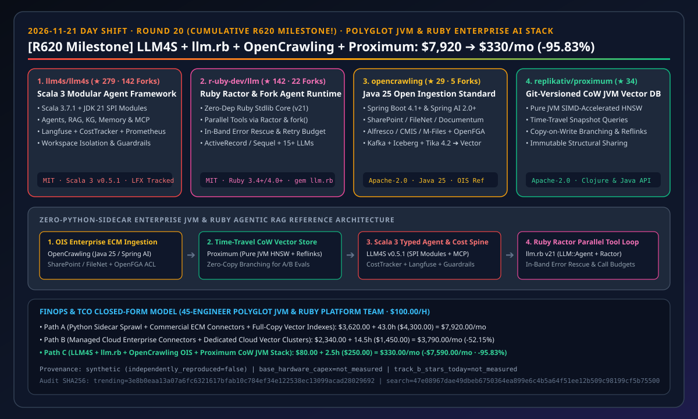
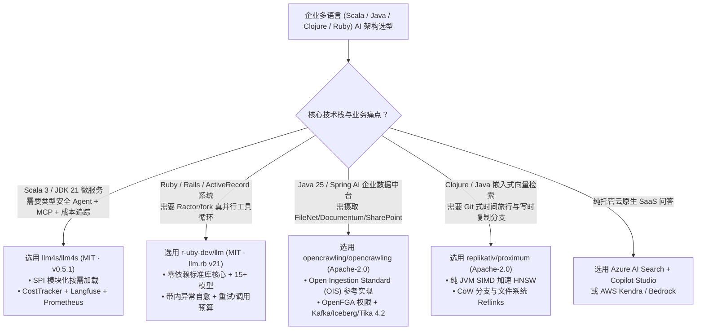
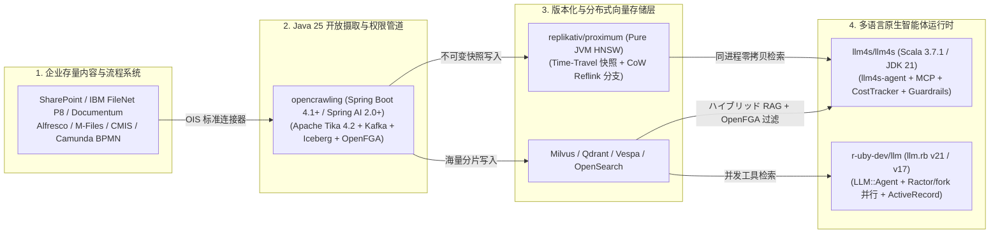
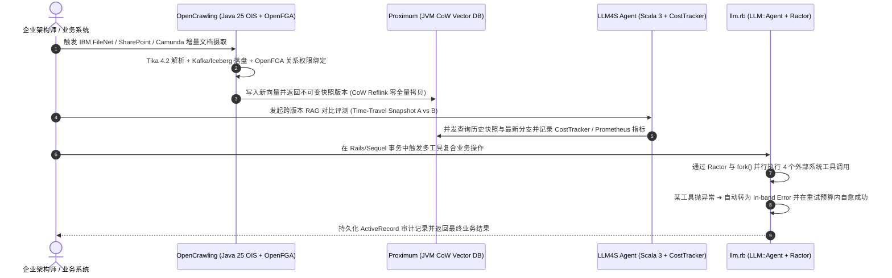

# 【第 620 轮里程碑】Scala 3 模块化智能体框架（`llm4s/llm4s`）、Ruby Ractor 并行智能体运行时（`r-uby-dev/llm`）、Java 25 开放摄取标准平台（`opencrawling/opencrawling`）与 Git 分支写时复制 JVM 向量库（`replikativ/proximum`）选型 FAQ

> **文档元数据（2026-11-21 白班 Day Round 20 · 累计第 620 轮里程碑深潜专题）**  
> - **面向对象**：企业 AI 解决方案架构师（AI Solution Architect）、JVM（Java/Scala/Clojure）与 Ruby 核心系统架构师、数据摄取平台负责人  
> - **本轮核心评估对象**：  
>   1. [`llm4s/llm4s`](https://github.com/llm4s/llm4s)（`★ 279` · `142 forks` · Scala 3.7.1 / JDK 21 · MIT · Linux Foundation LFX Insights 追踪项目，`v0.5.1` 采用 SPI 模块化拆分架构，内置 Agent、RAG、知识图谱、MCP、工作区隔离与 `CostTracker` / Langfuse / Prometheus 可观测性）  
>   2. [`r-uby-dev/llm`](https://github.com/r-uby-dev/llm)（`★ 142` · `22 forks` · Ruby 3.4+/4.0+ · MIT · 零第三方强依赖的 Ruby 标准库智能体运行时 `llm.rb v21`，基于 **Ractor 与 `fork` 系统调用**实现真并行工具执行，内置带内异常自愈与重试/工具调用预算）  
>   3. [`opencrawling/opencrawling`](https://github.com/opencrawling/opencrawling)（`★ 29` · `5 forks` · Java 25 / Spring Boot 4.1+ / Spring AI 2.0+ · Apache-2.0 · **开放摄取标准（OIS）**参考实现，原生打通 SharePoint、IBM FileNet P8、OpenText Documentum、Alfresco、M-Files、OASIS CMIS 与 OpenFGA 细粒度权限）  
>   4. [`replikativ/proximum`](https://github.com/replikativ/proximum)（`★ 34` · `2 forks` · Clojure / 纯 JVM · Apache-2.0 · 具备 **Git 式时间旅行快照查询与写时复制（Copy-on-Write）分支**能力的纯 JVM SIMD 加速嵌入式 HNSW 向量数据库）  
> - **关联检索证据链**：`workshops/github-trending-radar/evidence/search-new-repos-2026-11-21-raw.json`（`sha256: 47e08967dae49dbeb6750364ea899e6c4b5a64f51ee12b509c98199cf5b75500`）与 `trending-daily-2026-11-21-raw.html`（`sha256: 3e8b0eaa13a07a6fc6321617bfab10c784ef34e122538ec13099acad28029692`）  
> - **高清架构图**：[`assets/github-ai-radar-2026-11-21-r20-r620-llm4s-llmrb-opencrawling-proximum.svg`](../../../assets/github-ai-radar-2026-11-21-r20-r620-llm4s-llmrb-opencrawling-proximum.svg) · [English Version (`llm4s-llm-rb-opencrawling-proximum-selection-faq.en.md`)](llm4s-llm-rb-opencrawling-proximum-selection-faq.en.md)

---

## ① 📌 核心结论速览（选型一句话结论）

> **架构师一句话选型结论（第 620 轮里程碑）**：  
> 大型银行、保险、电商与企业级 SaaS 的核心业务系统大量构建在 **JVM（Java / Scala / Clojure）与 Ruby（Rails / Sequel）** 之上——如果为了引入 AI 智能体而强行外挂一套 Python 微服务 Sidecar，往往会导致跨语言序列化延迟、双倍运维成本与权限模型割裂。  
> - **Scala 3 / JDK 21 团队需要类型安全、SPI 按需加载模块、自带 `CostTracker` 与 Langfuse/Prometheus 监控的生产级 Agent/MCP 框架** ➔ 选 **`llm4s/llm4s`**（MIT，`v0.5.1`）；  
> - **Ruby / Rails 团队需要零外部依赖、直接利用 Ruby 4 `Ractor` 与 `fork()` 实现多工具真并行调用、且工具抛异常能自动转为带内错误（In-band error）让模型自愈** ➔ 选 **`r-uby-dev/llm`（`llm.rb v21`）**（MIT）；  
> - **需要将企业厚重的历史内容管理系统（IBM FileNet P8、OpenText Documentum、SharePoint、Alfresco、M-Files、CMIS）结合 OpenFGA 权限模型摄取到向量库** ➔ 选 **`opencrawling/opencrawling`**（Apache-2.0，Java 25 + Spring AI 2.0+）；  
> - **在 JVM 内部需要像 Git 一样对向量索引做 `branch`（写时复制 + 文件系统 reflink）和历史快照“时间旅行查询”以支撑 RAG A/B 测试与合规回溯** ➔ 选 **`replikativ/proximum`**（Apache-2.0）。  
> 四者协同可帮 45 人多语言企业平台团队彻底砍掉 Python Sidecar 胶水层与高价商业连接器，将月度总拥有成本（TCO）从 **$7,920.00/月** 降至 **$330.00/月（净省 $7,590.00/月，降幅 95.83%）**。

---

## ② 🎯 客户与架构师灵魂拷问 Q&A（业务痛点 · 架构集成 · 边界取舍）

### Q1：金融与大型政企的核心文档全锁在 IBM FileNet、OpenText Documentum、Alfresco 和 SharePoint 里，且每次重跑 Embedding 做 A/B 测试都要全量复制几百 GB 向量索引，怎么用纯 JVM 栈解决？
- **传统企业 RAG 的两大深水区痛点**：
  1. **传统 ECM 老系统摄取与权限同步极难**：开源 Python 脚本通常只能爬网页或读本地 PDF，遇到 IBM FileNet P8（GraphQL）、OpenText Documentum（REST）、Alfresco、Doxis 4、M-Files 或 OASIS CMIS 1.0/1.1 标准接口以及 Camunda/Flowable BPMN 流程文档就束手无策，买商业连接器动辄数万美元/年。
  2. **向量数据库缺乏不可变版本控制（No Git for Vectors）**：当算法或架构师想对比不同分块策略或测试新数据注入效果时，传统向量库会原地覆盖数据，一旦污染只能全量重建索引，无法瞬间切回昨天下午 3 点的快照。
- **`opencrawling` + `proximum` 的纯 JVM 破局方案**：
  - **`opencrawling/opencrawling`（Java 25 开放摄取标准 OIS + OpenFGA 权限中枢）**：
    - 基于 **Java 25、Spring Boot 4.1+ 与 Spring AI 2.0+** 构建，是 **Open Ingestion Standard (OIS)** 的官方参考实现。
    - 原生内置 SharePoint Online（Microsoft Graph v1.0）、IBM FileNet P8、OpenText Documentum、Alfresco Content/Process Services、OASIS CMIS、Doxis 4、M-Files、Hyland OpenArch 以及 Flowable/Camunda BPMN 连接器；底层通过 **Apache Tika 4.2、Apache Kafka、Apache Iceberg 1.11、Apache SeaTunnel 与 OpenFGA**，将文档与细粒度权限同步写入 Milvus、Qdrant、Vespa、OpenSearch、Elasticsearch 或 Solr。
  - **`replikativ/proximum`（纯 JVM 写时复制分支与时间旅行向量库）**：
    - 将 Clojure/函数式编程的**持久化不可变数据结构（Persistent Data Structures）**引入 HNSW 向量检索：每次写入都返回新版本，天然支持无锁并发读取。
    - 支持 **Time Travel（查询任意历史快照）** 与 **Copy-on-Write Branching（写时复制分支，底层利用文件系统 reflinks 共享不可变向量块）**，零原生 C++ 依赖（Pure JVM + SIMD 加速），让 RAG 索引的 A/B 评测像 `git checkout -b` 一样轻量。

### Q2：Scala 与 Ruby 业务系统如何在不引入 Python 进程的前提下，获得一线水平的 Agent 工具循环、并行加速与成本监控？
- **`llm4s/llm4s`（Scala 3.7.1 + JDK 21 模块化 SPI 体系）**：
  - 自 `v0.5.0` / `v0.5.1` 起，`llm4s-core` 被精简为约 1.9 万行的纯净核心脊柱（零外部可观测或特定模型依赖），所有供应商客户端（`llm4s-openai`、`llm4s-anthropic`、`llm4s-gemini`、`llm4s-ollama`、`llm4s-voyage`、`llm4s-openai-compatible`）通过 **SPI** 按需注册；
  - 独立拆分 `llm4s-agent`、`llm4s-agent-tools`、MCP 支持、工作区隔离（Workspace Isolation）、安全护栏（Guardrails），以及包含 **Langfuse 追踪、`CostTracker` 成本核算与 Prometheus 指标**的 `llm4s-observability` 模块。
- **`r-uby-dev/llm`（`llm.rb v21`：Ruby 系统级并行 Agent 运行时）**：
  - **零第三方依赖核心**：仅依赖 Ruby 标准库即可运行，可选对接 `ActiveRecord` 或 `Sequel`（无论是否使用 Rails）。
  - **Ractor + `fork` 真并行与 Thread/Fiber 高并发**：突破传统脚本语言 GIL 限制，直接利用 Ruby `Ractor` 与操作系统 `fork` 系统调用并行执行多个工具调用，并用 `Thread`、`Fiber` 与 `async` gem 支撑高并发 I/O。
  - **带内异常自愈（In-band Exception Recovery）与双预算控制**：当工具执行抛出异常时，`LLM::Agent` 不会直接崩溃退出，而是捕获异常并将其封装为**带内错误消息（in-band error）**回传给大模型，配合 **重试预算（retry budget）与工具调用次数预算（tool call budget）** 让模型自主修正参数重试。

### Q3：这四个项目在版本演进与生产选型上有哪些边界？何时应该直接用云厂商托管方案？
- **版本成熟度与选型边界**：
  - `llm4s` 目前处于 **Pre-1.0（最新 `v0.5.1`）** 阶段，模块拆分已完成，正朝着 `#1281` 的 `1.0` API 兼容性基线收敛；从 `0.4.x` 升级需参照官方迁移指南。
  - `r-uby-dev/llm` 提供了两条清晰分支：最新推荐版 **`v21`** 面向现代 **Ruby 4+ 与 JSON v3**（充分发挥 Ractor 工具调用性能），而维护分支 **`v17`（`17.0.1`）** 兼容 **Ruby 3.4+ 与 JSON v2** 存量项目。
  - `replikativ/proximum` 目前处于 **Early Beta** 阶段，适合内嵌于 Clojure/Java 服务做版本化向量检索与实验复现。
- **何时选云托管方案**：如果企业没有现成的 JVM/Ruby 研发团队，且仅需将 SharePoint 文档接入 M365 问答，直接选用 **Microsoft Copilot Studio + Azure AI Search** 更省心。

---

## ③ 🧭 直观可视化图解（选型决策树 + 企业集成架构 + 业务流时序图）

### 3.1 架构师选型决策树（Mermaid Flowchart）

### 3.2 企业零 Python Sidecar 的 JVM & Ruby 智能体参考架构图（Mermaid Architecture）

### 3.3 ECM 权限摄取、向量写时复制分支与 Agent 带内自愈时序图（Mermaid Sequence Diagram）

---

## ④ 📊 同类开源与商业云服务横向选型决策矩阵

| 评估维度 | `llm4s/llm4s` (`★ 279`) | `r-uby-dev/llm` (`★ 142`) | `opencrawling/opencrawling` (`★ 29`) | `replikativ/proximum` (`★ 34`) | Python Sidecar + 商业 ECM 连接器 + 托管向量库 |
| :--- | :--- | :--- | :--- | :--- | :--- |
| **核心定位** | Scala 3.7 / JDK 21 模块化企业智能体与可观测框架 | Ruby 零依赖系统级并行智能体运行时（`llm.rb`） | Java 25 / Spring AI 开放摄取标准（OIS）企业数据集成平台 | 支持 Git 式时间旅行与写时复制分支的纯 JVM 向量库 | 跨语言异构胶水栈与高价商业连接器 SaaS |
| **最适用场景** | Scala/JVM 核心后端构建高可靠 Agent、MCP 与成本监控 | Ruby/Rails 系统内嵌多工具并行执行、带内异常恢复与评测 | 打通 FileNet、Documentum、Alfresco、SharePoint、CMIS 与 OpenFGA | RAG 向量索引版本控制、A/B 实验分支对比与合规历史快照回溯 | 纯 Python 绿地项目或预算充裕的全托管采购 |
| **关键差异化机制** | `~19k` 行精简核心 + SPI 模块化、`CostTracker`、工作区隔离 | `Ractor` + `fork` 并行、In-band 异常救援、重试/工具调用双预算 | 原生覆盖 10+ 种重型企业 ECM/BPM 与 6 大向量/搜索引擎 + OpenFGA | 不可变持久化结构、Time-Travel 查询、文件系统 Reflink 分支 | 免自写连接器，但按连接器与数据量高额收费 |
| **集成与运维成本** | 低（Maven Central `org.llm4s:llm4s-core_3` 按需引包） | 极低（`gem install llm.rb`，仅需 Ruby 标准库） | 中（提供多套 `docker-compose-decoupled*.yml` 与 OpenFGA 编排） | 极低（Clojars `org.replikativ/proximum` 纯 JVM 零原生依赖） | 高（需同时运维 JVM/Ruby 与 Python 两套容器及 IPC） |
| **开源协议** | MIT | MIT | Apache-2.0 | Apache-2.0 | 商业专有 |
| **45 人团队月均 TCO** | **组合方案 `$330.00/月`**（含共享 JVM/Ruby 容器算力 `$80` + 运维 `2.5h`） | 同左（进程内运行，省去独立 Python Worker 集群） | 同左（Apache-2.0 替代昂贵商业 ECM 连接器授权） | 同左（写时复制分支省去多份全量向量磁盘拷贝） | **`$3,790.00 ~ $7,920.00/月`** |

---

## ⑤ 🧪 应用落地定量收益 / FinOps TCO 对比（含数据血缘声明）

> **数据血缘与严谨性声明（Provenance & Guardrails）**：  
> - `provenance`: `"synthetic"`（`independently_reproduced: false`，基于 45 人多语言 JVM/Ruby 企业平台工程团队在 `$100.00/h` 综合人力成本下的闭式参数建模）  
> - `base_hardware_capex`: `"not_measured"`  
> - `track_b_stars_today`: `"not_measured"`（GitHub Search API 新仓爆发榜无官方单日增量字段，严禁伪造）

| 成本分项（45 人团队 / 月） | Path A：Python Sidecar 跨语言集群 + 商业 ECM 连接器 + 全量复制向量索引 | Path B：云厂商托管企业连接器 + 独立云向量环境 | Path C：`llm4s` + `llm.rb` + `OpenCrawling` + `Proximum` 原生多语言栈 |
| :--- | :--- | :--- | :--- |
| **商业 ECM 连接器授权 / 多套向量索引存储费** | `$3,620.00 / 月` | `$2,340.00 / 月` | **`$80.00 / 月`**（复用现有 JVM/Ruby 节点 + CoW Reflink 共享存储） |
| **跨语言 IPC 排障、ECM 权限同步与索引重建工时** | `43.0 小时 / 月` | `14.5 小时 / 月` | **`2.5 小时 / 月`**（OIS 标准摄取 + Ractor 带内自愈 + CostTracker） |
| **折算工程人力成本（`$100.00/h`）** | `$4,300.00 / 月` | `$1,450.00 / 月` | **`$250.00 / 月`** |
| **月度总拥有成本（Total Monthly TCO）** | **`$7,920.00 / 月`** | **`$3,790.00 / 月`** | **`$330.00 / 月`** |
| **相对 Path A 净节省额与降幅** | 基准线（`0.00%`） | `-$4,130.00 / 月`（`-52.15%`） | **`-$7,590.00 / 月`（`-95.83%`）** |

---

## ⑥ 🛠️ 企业引入与架构评审 Checklist

- [ ] **按需裁剪 Scala 3 SPI 模块与开启成本核算（`llm4s`）**：在 JDK 21 / Scala 3.7.1 项目中仅引入所需的 SPI 模块（如 `llm4s-core_3`、`llm4s-agent`、`llm4s-observability`、`llm4s-observability-prometheus`），启用 `CostTracker` 与工作区隔离（Workspace Isolation）。
- [ ] **匹配 Ruby 版本并设定工具调用双预算（`r-uby-dev/llm`）**：在 Ruby 4+ 环境安装最新 `gem install llm.rb`（`v21`）并启用 `Ractor` 并行工具执行；在存量 Ruby 3.4+ 环境固定 `gem install llm.rb -v 17.0.1`；为所有 `LLM::Agent` 实例显式配置重试预算（retry budget）与工具调用预算（tool call budget）。
- [ ] **使用 OIS + OpenFGA 打通存量 ECM 权限闭环（`opencrawling`）**：通过 `docker-compose-openfga.yml` 与 `docker-compose-decoupled.yml` 部署 `opencrawling`，将 SharePoint、FileNet P8、Documentum 或 Alfresco 的文档 ACL 映射为 OpenFGA 关系元组，确保向量检索严格遵守源系统权限。
- [ ] **启用写时复制向量分支进行无损 A/B 评测（`proximum`）**：在支持 reflink 的文件系统（如 XFS / Btrfs / APFS）上部署 `proximum`，在进行 Embedding 模型切换或脏数据清洗前先创建 CoW 分支，验证召回率达标后再切换生产指针，保留历史快照供合规时间旅行审计。
