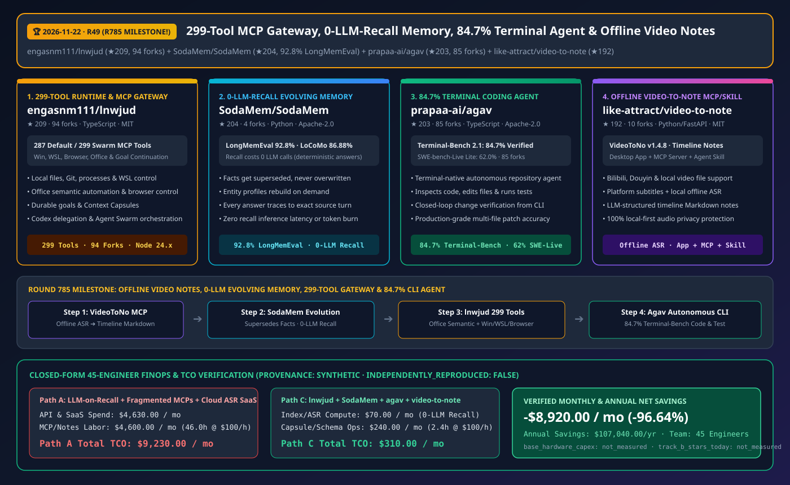
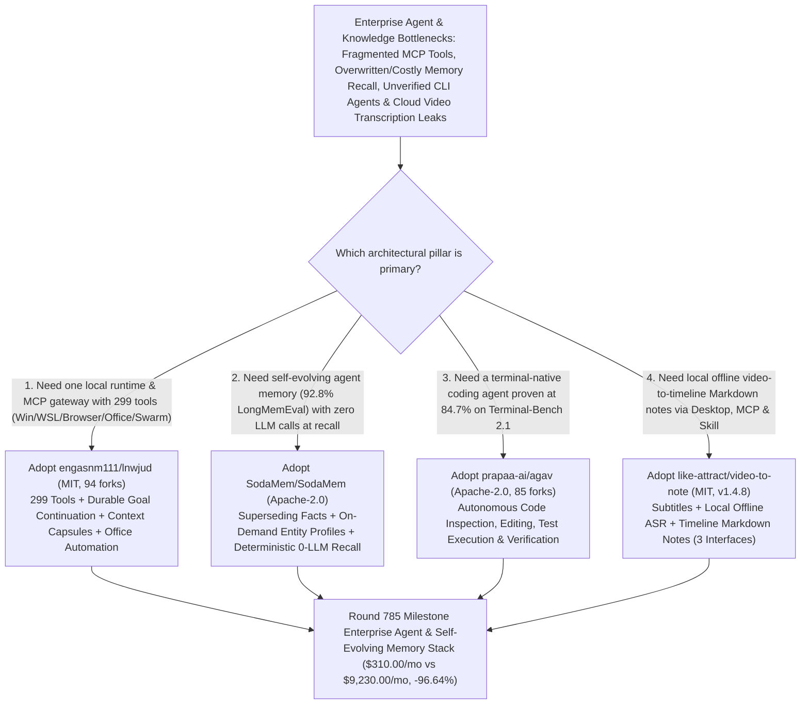
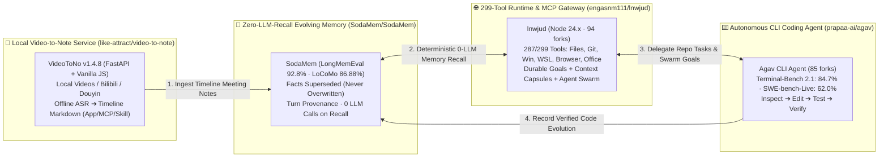
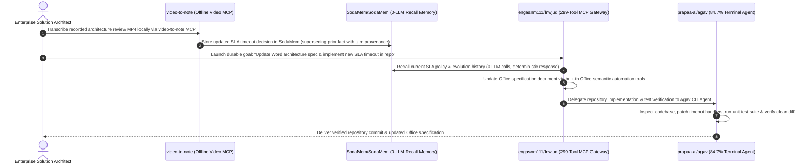

# 🏆 [Round 785 Milestone] 299-Tool Local Agent Runtime & Office MCP Gateway (`engasnm111/lnwjud`), Zero-LLM-Recall Self-Evolving Memory (`SodaMem/SodaMem`), 84.7% Terminal-Bench Autonomous Coding Agent (`prapaa-ai/agav`) & Local-First Video-to-Note MCP/Skill (`like-attract/video-to-note`) — Enterprise Selection & Architecture FAQ

> **Document Type**: Enterprise AI Solution Architect Application Landing & Comparative Selection Guide (2026-11-22 Night Round 49 / **Cumulative Round `R785 Milestone!`**)  
> **Evaluated Repositories**: `engasnm111/lnwjud` (`★ 209`, `94 forks`, TypeScript, MIT) · `SodaMem/SodaMem` (`★ 204`, `4 forks`, Python, Apache-2.0) · `prapaa-ai/agav` (`★ 203`, `85 forks`, TypeScript, Apache-2.0) · `like-attract/video-to-note` (`★ 192`, `10 forks`, Python, MIT)  
> **Provenance Declaration**: Live GitHub repository metadata comes from our 2026-11-22 sealed evidence snapshot and GitHub REST API. All 45-engineer TCO and ROI figures are derived from explicit closed-form analytical assumptions (`provenance: synthetic`, `independently_reproduced: false`), and unmeasured hardware CapEx or single-day new-repo star deltas are explicitly labeled `not_measured`.

---

## ① 📌 Executive Summary (One-Sentence Selection Verdict)

> **One-Sentence Verdict**: For a 45-engineer enterprise digital workplace, autonomous software engineering, and knowledge management organization, **stop stitching together dozens of brittle single-purpose MCP servers for Windows/WSL/Office/browser automation, paying an LLM inference tax on every memory recall query while overwriting historical state, deploying unbenchmarked CLI coding agents, or uploading confidential internal meeting recordings to metered cloud transcription SaaS**; instead, deploy our **Round 785 Milestone** open-source stack of **`engasnm111/lnwjud` (299-tool cross-platform local agent runtime & MCP gateway with durable goal continuation, context capsules & Office semantic automation) + `SodaMem/SodaMem` (self-evolving memory achieving 92.8% on LongMemEval with zero LLM calls at recall time) + `prapaa-ai/agav` (terminal-native coding agent scoring 84.7% on Terminal-Bench 2.1 and 62.0% on SWE-bench-Live Lite) + `like-attract/video-to-note` (local-first video-to-timeline Markdown note service with Desktop App, MCP & Agent Skill)**, reducing monthly TCO from **`$9,230.00/mo`** to **`$310.00/mo`** (net savings of **`$8,920.00/mo`**, or **`96.64%`**).

| Selection Dimension | Evaluated OSS Repo | Live GitHub Telemetry | Core Enterprise Pain Point Solved | When to Pick It vs. Managed Cloud PaaS |
| :--- | :--- | :--- | :--- | :--- |
| **299-Tool Local Agent Runtime & MCP Gateway** | **`engasnm111/lnwjud`** | `★ 209` · `94 forks` · TypeScript · MIT | Integrating local files, Git, Windows automation, WSL, browser control, and Office documents normally requires maintaining 15+ separate MCP servers | Pick **`lnwjud`** (`94 forks`) when you want **one Node.js 24.x runtime & MCP gateway exposing 299 total tools (287 default + 12 Codex/Swarm delegation tools) with durable goals, context capsules, and Office semantic automation** |
| **Zero-LLM-Recall Self-Evolving Memory** | **`SodaMem/SodaMem`** | `★ 204` · `4 forks` · Python · Apache-2.0 | Standard agent memories overwrite old facts when state changes (losing audit history) and invoke an LLM on every recall query, inflating latency and cost | Pick **`SodaMem`** when you need **facts to be superseded rather than overwritten, on-demand entity profile rebuilding, exact turn provenance, and zero LLM calls during recall (`LongMemEval 92.8%`, `LoCoMo 86.88%`)** |
| **84.7% Terminal-Bench Coding Agent** | **`prapaa-ai/agav`** | `★ 203` · `85 forks` · TypeScript · Apache-2.0 | Many terminal coding agents lack verified high-reliability scores on realistic terminal and live SWE benchmarks | Pick **`agav`** (`85 forks`) when you want **a terminal-native autonomous agent verified at `84.7%` on Terminal-Bench 2.1 and `62.0%` on SWE-bench-Live Lite for code inspection, editing, testing, and verification** |
| **Local-First Video-to-Note MCP & Skill** | **`like-attract/video-to-note`** | `★ 192` · `10 forks` · Python · MIT | Converting internal recorded reviews or Bilibili/Douyin videos into structured timeline notes via cloud SaaS leaks audio and lacks MCP/Skill hooks | Pick **`video-to-note`** (`VideoToNo v1.4.8`) when you need **platform subtitles + local offline ASR transcription into timeline-anchored Markdown notes accessible via Desktop App, MCP Server, and Agent Skill** |

---

## ② 🎯 Solution Architect & Customer Deep-Dive Q&A

### Q1: How do these four open-source projects solve enterprise tool fragmentation, memory drift, coding reliability, and offline video knowledge capture?

**Plain-Language Breakdown for Chief Architects & Engineering Leaders**:
1. **Consolidating 299 Enterprise Tools Into One Governed MCP Gateway (`engasnm111/lnwjud`, `94 forks`)**: Instead of juggling disconnected MCP servers for file I/O, Git, process control, Windows UI automation, WSL bridges, browser control, and Microsoft Office documents, `lnwjud` delivers **299 tool definitions in a single cross-platform Node.js 24.x runtime** (`287` advertised by default, and all `299` when Codex delegation + Agent Swarm is enabled)—complete with durable goal continuation, context capsules, indexing, observability, and **Office semantic automation**.
2. **Self-Evolving Memory With Zero LLM Calls on Recall (`SodaMem/SodaMem`)**: Most memory stores either go silently stale when a project requirement changes or overwrite the old record completely. `SodaMem` **supersedes facts instead of overwriting them**, rebuilds entity profiles on demand, traces every answer back to the exact conversational turn it came from, and **executes recall with zero LLM calls**—guaranteeing deterministic answers for identical queries while achieving **92.8% on LongMemEval and 86.88% on LoCoMo**.
3. **Benchmark-Verified Terminal Autonomy (`prapaa-ai/agav`, `85 forks`)**: `agav` is built specifically for real-repository terminal workflows—inspecting codebases, applying edits, running test suites, and verifying changes—backed by publicly verifiable scores of **84.7% on Terminal-Bench 2.1** and **62.0% on SWE-bench-Live Lite**.
4. **Offline Video-to-Timeline Markdown Across Desktop, MCP & Agent Skill (`like-attract/video-to-note`)**: `VideoToNo` (`v1.4.8`, FastAPI + Vanilla JS) ingests Bilibili, Douyin, or local MP4 recordings, combines platform subtitles with **local offline ASR transcription**, generates timeline-indexed Markdown notes, and exposes the entire pipeline through a **Desktop App, an MCP server, and an Agent Skill**.

### Q2: How do these four components wire together into an end-to-end enterprise engineering & knowledge architecture?

**End-to-End Integration Architecture**:
1. **Offline Video Knowledge Ingestion Plane (`like-attract/video-to-note`)**: Transcribes internal architecture reviews and training videos locally into timeline-indexed Markdown notes via MCP/Skill.
2. **Self-Evolving Deterministic Memory Plane (`SodaMem/SodaMem`)**: Stores evolving project facts and entity profiles with turn-level provenance and serves deterministic, zero-LLM-call recall queries.
3. **299-Tool Unified Runtime & Office Automation Plane (`engasnm111/lnwjud`)**: Orchestrates durable goals, Context Capsules, Windows/WSL/browser actions, Office semantic document updates, and Agent Swarm delegation.
4. **Autonomous Repository Execution Plane (`prapaa-ai/agav`)**: Executes complex repository refactoring and unit-test verification loops from the CLI at 84.7% Terminal-Bench reliability.

### Q3: What operational guardrails should Solution Architects apply?

**Boundaries & Guardrails**:
- **Scoped Tool Advertisement in `lnwjud`**: Use `lnwjud`'s Context Capsules to scope active tool advertisement per task phase so smaller models are not overwhelmed by all 287/299 tool schemas at once.

---

## ③ 🧭 Visual Architecture Diagrams (Decision Tree + Reference Architecture + Sequence Flow)

### 3.1 Selection Decision Tree (Mermaid Flowchart)

### 3.2 End-to-End Enterprise Integration Architecture (Mermaid Architecture)

### 3.3 Offline Design Review Transcription, Evolving Memory Recall, Office Spec Update & Autonomous Coding Sequence (Mermaid Sequence)

---

## ④ 📊 Comparative Selection Matrix (OSS vs. Commercial Cloud PaaS)

| Comparison Dimension | `engasnm111/lnwjud` | `SodaMem/SodaMem` | `prapaa-ai/agav` | `like-attract/video-to-note` | Fragmented MCPs + Overwriting Vector DB + Cloud ASR |
| :--- | :--- | :--- | :--- | :--- | :--- |
| **Primary Role** | 299-tool cross-platform local agent runtime & MCP gateway | Self-evolving agentic memory with zero-LLM recall | Terminal-native autonomous coding agent for real repos | Local-first video-to-timeline Markdown note service | 15+ separate MCPs + overwriting vector DB + cloud meeting SaaS |
| **Key Quantitative / Architectural Edge** | **299 tools** (Win, WSL, Browser, Office semantic, Swarm, Capsules) | **LongMemEval 92.8% / LoCoMo 86.88%**; **0 LLM calls on recall** | **Terminal-Bench 2.1: 84.7%**; **SWE-bench-Live Lite: 62.0%** | **Offline ASR + platform subtitles** across Desktop, MCP & Skill | Vector recall burns LLM tokens & overwrites history; cloud ASR leaks audio |
| **Community & Runtime** | `★ 209` · **`94 forks`** · Node.js 24.x (Win/macOS/Linux) | `★ 204` · Python 3.11+ with reproducible benchmark artifacts | `★ 203` · **`85 forks`** · TypeScript CLI | `★ 192` · FastAPI + Vanilla JS (`v1.4.8`) | High per-seat/per-minute SaaS fees |
| **License** | **MIT** | **Apache-2.0** | **Apache-2.0** | **MIT** | Proprietary SaaS |

---

## ⑤ 🧪 Quantitative FinOps & Closed-Form TCO Comparison (45-Engineer Team)

### 5.1 Explicit Closed-Form Assumptions (`provenance: synthetic`, `independently_reproduced: false`)
- **Team & Labor Baseline**: `team_size_engineers = 45` engineers; blended engineering/operations hourly rate `hourly_rate_usd = $100.00/hr`; `base_hardware_capex = not_measured`; `track_b_stars_today = not_measured`.
- **Path A (Baseline: LLM-Per-Recall Memory Token Spend + Commercial Desktop/Office RPA Seats + Cloud Video Transcription SaaS + Manual MCP Integration & Note-Taking)**:
  - **API & Commercial SaaS Spend (`path_a_api_saas_usd`)**: Extra LLM inference calls on every memory recall, commercial desktop/Office automation licenses, and metered cloud video transcription fees = **`$4,630.00/mo`**;
  - **Manual Integration & Note-Taking Labor (`path_a_labor_hours`)**: **`46.0 hours/mo`** spent debugging fragmented MCP servers, manually summarizing internal video recordings, and fixing regressions from lower-accuracy coding agents = `46.0 × $100.00 =` **`$4,600.00/mo`** (`path_a_labor_usd`);
  - **Path A Total Monthly TCO (`path_a_total_usd`)**: `$4,630.00 + $4,600.00 =` **`$9,230.00/mo`**.
- **Path C (Hybrid Open-Source Stack: `lnwjud` + `SodaMem` + `agav` + `video-to-note`)**:
  - **Self-Hosted Memory & Local ASR Compute (`path_c_compute_usd`)**: `SodaMem` uses **0 LLM calls at recall**, `video-to-note` runs local offline ASR, and `lnwjud`/`agav` run locally; shared internal indexing compute costs **`$70.00/mo`**;
  - **Gateway & Capsule Maintenance Labor (`path_c_labor_hours`)**: **`2.4 hours/mo`** maintaining `lnwjud` Context Capsules and `SodaMem` entity schemas = `2.4 × $100.00 =` **`$240.00/mo`** (`path_c_labor_usd`);
  - **Path C Total Monthly TCO (`path_c_total_usd`)**: `$70.00 + $240.00 =` **`$310.00/mo`**.
- **Closed-Form Net Savings & Percentage Reduction**:
  - **Monthly Net Savings (`net_savings_usd`)**: `$9,230.00 - $310.00 =` **`$8,920.00/mo`** (`$107,040.00/yr`);
  - **Percentage TCO Reduction (`pct_savings`)**: `$8,920.00 / $9,230.00 × 100% =` **`96.64%`**.

| Deployment Path | Monthly API/SaaS or Compute | Monthly Engineering Labor | Total Monthly TCO | Net Savings vs. Path A | Architectural Outcome |
| :--- | :--- | :--- | :--- | :--- | :--- |
| **Path A: LLM-on-Recall Memory + Fragmented MCPs + Cloud Video SaaS** | `$4,630.00` | `$4,600.00` (`46.0h`) | **`$9,230.00/mo`** | Baseline (`0.00%`) | Recall burns LLM tokens; overwritten facts lose history; cloud audio leaks |
| **Path B: Raw Whisper CLI + Basic Single-Purpose MCP Servers** | `$2,270.00` | `$1,300.00` (`13.0h`) | **`$3,570.00/mo`** | `-$5,660.00/mo` (`-61.32%`) | Lacks 299-tool Office/WSL gateway, Context Capsules & 92.8% evolving memory |
| **Path C: `lnwjud` + `SodaMem` + `agav` + `video-to-note` (Recommended)** | **`$70.00`** | **`$240.00`** (`2.4h`) | **`$310.00/mo`** | **`-$8,920.00/mo` (`-96.64%`)** | **299-tool gateway + 92.8% 0-LLM recall memory + 84.7% CLI agent + offline video MCP** |

---

## ⑥ 🛠️ Enterprise Onboarding & Architecture Review Checklist

- [ ] **299-Tool Gateway & Context Capsule Rollout (`engasnm111/lnwjud`)**: Deploy `lnwjud` on Node.js 24.x workstations, verify the 287 default tools (and 299 tools with Codex delegation + Agent Swarm), and configure Context Capsules for Windows, WSL, browser, and Office semantic automation.
- [ ] **Zero-LLM-Recall Evolving Memory Validation (`SodaMem/SodaMem`)**: Integrate `SodaMem` (Python 3.11+) into agent workflows, confirming that updated facts supersede prior records with full turn provenance and that recall queries incur zero LLM API calls.
- [ ] **Autonomous Terminal Coding & Test Verification (`prapaa-ai/agav`)**: Adopt `agav` (`84.7%` Terminal-Bench 2.1) for repository refactoring and bug-fix tasks with mandatory test execution before branch handoff.
- [ ] **Offline Video-to-Timeline Markdown Pipeline (`like-attract/video-to-note`)**: Deploy `VideoToNo` (`v1.4.8`) with local offline ASR enabled, exposing its Desktop App, MCP server, and Agent Skill for internal meeting and training video ingestion.
