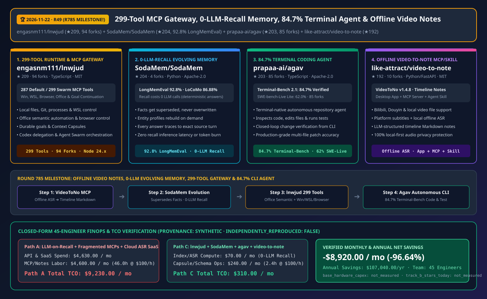
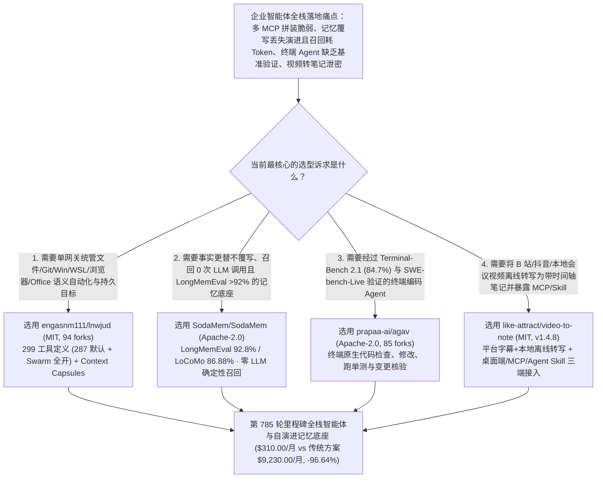
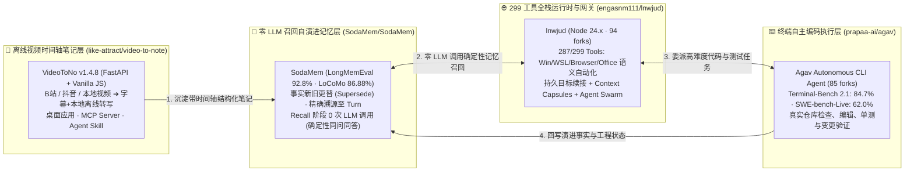
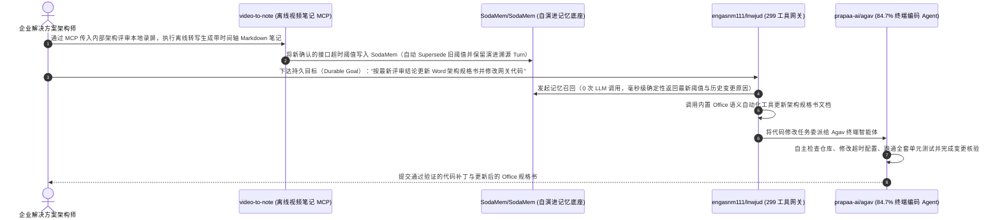

# 🏆【第 785 轮里程碑】内置 299 工具与 Office 语义自动化的本地智能体 MCP 网关（`engasnm111/lnwjud`）、召回零 LLM 调用自演进记忆底座（`SodaMem/SodaMem`）、Terminal-Bench 2.1 达 84.7% 的终端自主编码智能体（`prapaa-ai/agav`）与本地离线转写时间轴笔记三端服务（`like-attract/video-to-note`）企业选型与集成架构 FAQ

> **文档类型**：AI 解决方案架构师（AI Solution Architect）企业应用落地与横向选型指南（2026-11-22 Night Round 49 / **累计第 785 轮里程碑 `R785 Milestone!`**）  
> **评测锚点**：`engasnm111/lnwjud` (`★ 209`, `94 forks`, TypeScript, MIT) · `SodaMem/SodaMem` (`★ 204`, `4 forks`, Python, Apache-2.0) · `prapaa-ai/agav` (`★ 203`, `85 forks`, TypeScript, Apache-2.0) · `like-attract/video-to-note` (`★ 192`, `10 forks`, Python, MIT)  
> **Provenance 声明**：本文实时 GitHub 元数据采自 2026-11-22 封存快照与 GitHub REST API；45 人企业智能办公、核心研发与知识工程团队的 TCO 与 ROI 测算均为显式闭式假设推导（`provenance: synthetic`, `independently_reproduced: false`），所有未实测硬件资本开支与新仓单日增量统一标注为 `not_measured`。

---

## ① 📌 核心结论速览（选型一句话结论）

> **一句话选型结论**：在 45 人规模的企业数字办公自动化、跨系统研发交付与会议/培训视频知识沉淀团队中，**切勿为了调通 Windows/WSL/浏览器/Office 自动化而拼凑几十个互不兼容的零散 MCP、为每次记忆召回（Recall）都额外支付一次大模型推理费用、用未经权威终端基准验证的玩具脚本改生产代码，或将涉密内部培训录屏上传至第三方云转写 SaaS**；应当采用第 785 轮里程碑四件套 **“lnwjud（单网关内建 299 个跨 Windows/WSL/Browser/Office 语义自动化与持久目标续接工具）+ SodaMem（事实更替不覆盖、召回阶段零 LLM 调用、LongMemEval 达 92.8% 的自演进记忆层）+ Agav（Terminal-Bench 2.1 高达 84.7%、SWE-bench-Live Lite 62.0% 的终端自主编码智能体）+ VideoToNo（支持平台字幕+本地离线 ASR 转写并同时暴露桌面端/MCP/Agent Skill 的视频转时间轴笔记服务）”**，将月度综合 TCO 从 **`$9,230.00/月`** 压降至 **`$310.00/月`**（净省 **`$8,920.00/月`**，降幅 **`96.64%`**）。

| 选型维度 | 评测开源方案 | GitHub 实测指标 | 核心解决的企业业务痛点 | 一句话何时选它 vs 云端商业 PaaS |
| :--- | :--- | :--- | :--- | :--- |
| **299 工具全能本地运行时与 MCP 网关** | **`engasnm111/lnwjud`** | `★ 209` · `94 forks` · TypeScript · MIT | 企业智能体同时操控本地文件、Git、Windows 桌面、WSL、浏览器与 Office 文档时，拼装十几个独立 MCP 极易崩溃且缺乏上下文胶囊管理 | 需要 **单网关开箱提供 299 个工具定义（默认广播 287 个，开启 Codex 委派与 Agent Swarm 后全开 299 个）、内置持久目标续接、上下文胶囊（Context Capsules）与 Office 语义自动化** 时首选 `lnwjud` |
| **召回零 LLM 调用自演进记忆底座** | **`SodaMem/SodaMem`** | `★ 204` · `4 forks` · Python · Apache-2.0 | 普通记忆库在事实变更时直接覆盖旧值（丢失历史演变轨迹），且每次查询召回都要调一次 LLM 导致同问不同答、账单翻倍 | 需要 **事实新旧更替（Superseded）而非暴力覆盖、召回阶段 0 次 LLM 调用（确定性同问同答）、精确溯源至对话轮次且在 `LongMemEval` 取得 `92.8%` 高分** 时选 `SodaMem` |
| **84.7% Terminal-Bench 自主编码代理** | **`prapaa-ai/agav`** | `★ 203` · `85 forks` · TypeScript · Apache-2.0 | 许多开源终端编码代理在复杂真实仓库上测试通过率低，缺乏在 `Terminal-Bench 2.1` 与 `SWE-bench-Live Lite` 上的公开高分验证 | 需要 **在 `Terminal-Bench 2.1` 取得 `84.7%`、在 `SWE-bench-Live Lite` 取得 `62.0%` 的终端原生代码检查、修改、单测执行与变更核验自主智能体** 时选 `agav` |
| **本地离线视频转时间轴笔记三端服务** | **`like-attract/video-to-note`** | `★ 192` · `10 forks` · Python · MIT | 企业内训录屏、B 站/抖音竞品视频转结构化笔记如果走公有云语音识别既泄露商业机密又按分钟收钱，且缺少 MCP/Skill 接入 | 需要 **支持 B 站/抖音/本地视频、结合平台字幕与本地离线转写生成带时间轴 Markdown 笔记，并同时提供桌面应用、MCP 与 Agent Skill 三种入口** 时选 `video-to-note` |

---

## ② 🎯 客户与架构师灵魂拷问 Q&A（直击业务落地痛点）

### Q1：在企业推进 AI Agent 落地的过程中，“工具碎片化”、“记忆变脏且召回太贵”、“终端编码成功率不稳定”和“内部视频无法离线沉淀”是四大高频拦路虎，这四个项目如何破局？

**通俗解答（给企业首席架构师与数字化负责人）**：
1. **一个网关顶十几个散装 MCP：299 个工具包揽 Windows、WSL、浏览器与 Office 语义自动化（`engasnm111/lnwjud` 破局，高达 `94 forks`）**：
   过去想让智能体既能改代码跑 WSL，又能控制 Windows 桌面、操作浏览器、自动处理 Word/Excel/PowerPoint 办公文档，架构师得东拼西凑十几个质量参差不齐的 MCP Server。`lnwjud`（Node.js 24.x，跨 Windows/macOS/Linux）将 **299 个经过工程治理的工具定义** 凝聚在一个本地运行时与 MCP 网关中：默认广播 `287` 个核心工具，当开启 Codex 委派与 Agent Swarm 时解锁全部 `299` 个工具，更内置了 **持久目标续接（Durable Goal Continuation）、上下文胶囊（Context Capsules）、工程护栏（Engineering Harness）与 Office 语义自动化**。
2. **为什么“召回阶段零 LLM 调用（Recall costs zero LLM calls）”是生产级智能体记忆的分水岭（`SodaMem/SodaMem` 破局）**？
   绝大多数记忆系统有两个致命伤：① 当用户项目需求或个人状态改变时，要么静默过期，要么直接覆写旧记录导致无法追溯“为什么上个月是 A、这个月变成了 B”；② 每次从记忆库取数据时都要调用一次大模型做重排或合成，不仅慢、费钱，而且同一个问题问两次可能得到不同结果。`SodaMem` 采用 **事实演进替代（Facts get superseded instead of overwritten）** 与按需重建实体画像，每条回答都能精准追溯至原始对话轮次（Turn），且 **检索召回阶段消耗 0 次 LLM 调用**（确定性一致响应），在权威长程记忆基准 **`LongMemEval` 斩获 `92.8%`、`LoCoMo` 斩获 `86.88%`**。
3. **用实打实的 `Terminal-Bench 2.1: 84.7%` 与 `SWE-bench-Live Lite: 62.0%` 成绩单说话（`prapaa-ai/agav` 破局，`85 forks`）**：
   选型终端编码智能体最怕看宣传动画很炫、一进真实多模块仓库就改崩单测。`agav` 专注于真实工程仓库的终端原生闭环（读代码 → 改文件 → 跑单测 → 核验变更），并在公开可核查的 **`Terminal-Bench 2.1` 拿到 `84.7%`（PR #225）**、在防数据污染的 **`SWE-bench-Live Lite` 拿到 `62.0%`**。
4. **把内部视频与行业干货离线变成可回看的时间轴笔记（`like-attract/video-to-note` 破局）**：
   `VideoToNo`（`v1.4.8`，FastAPI + Vanilla JS）支持输入 B 站、抖音或本地会议录屏文件，优先提取平台字幕、无字幕时自动调用 **本地离线语音转写**，再由 LLM 整理为带时间轴锚点的结构化 Markdown 笔记，且天生提供 **桌面应用、MCP Server 与 Agent Skill** 三种接入形态。

### Q2：如何把这四个项目组合为一套“离线视频知识转写 → 自演进零成本召回记忆 → 299 工具全栈办公网关 → 高分终端自主编码”的企业智能体架构？

**端到端集成架构设计**：
1. **音视频知识离线结构化层（`like-attract/video-to-note`）**：通过桌面端、MCP 或 Agent Skill 将客户访谈、内部架构评审录屏与外部技术视频离线转写为带时间轴的 Markdown 笔记。
2. **自演进确定性记忆中枢层（`SodaMem/SodaMem`）**：将视频笔记与多轮研发对话写入 `SodaMem`，当架构决策发生变更时自动执行事实更替（Supersede）并保留历史演进链，向上层智能体提供 **零 LLM 调用成本** 的确定性记忆召回。
3. **299 工具全场景网关与办公自动化层（`engasnm111/lnwjud`）**：通过 `lnwjud` 统一纳管本地文件、Git、Windows/WSL、浏览器、Office 语义自动化与持久目标续接（Context Capsules）。
4. **高通过率终端自主编码执行层（`prapaa-ai/agav`）**：针对核心仓库开发与修 Bug 任务，由 `agav`（`Terminal-Bench 2.1: 84.7%`）在终端内自主完成代码分析、补丁编写与单元测试验证。

### Q3：这套架构有哪些工程注意事项？

**边界与选型注意**：
- **`lnwjud` 工具按需广播策略**：虽然 `lnwjud` 共包含 299 个工具定义，但默认仅广播 287 个并在开启 Codex 委派与 Agent Swarm 时解锁全部 299 个；对于上下文窗口较小的轻量本地模型，建议通过其 Context Capsules 按任务领域裁剪激活的工具子集。

---

## ③ 🧭 直观可视化图解（选型决策树 + 集成参考架构 + 业务流时序图）

### 3.1 选型决策树（Mermaid Flowchart）

### 3.2 企业生产集成参考架构图（Mermaid Architecture）

### 3.3 架构评审视频离线转写、自演进记忆更新、Office 文档自动生成与终端自主编码时序图（Mermaid Sequence Diagram）

---

## ④ 📊 同类开源与商业云服务横向选型决策矩阵

| 对比维度 | `engasnm111/lnwjud` | `SodaMem/SodaMem` | `prapaa-ai/agav` | `like-attract/video-to-note` | 散装 MCP + 传统向量记忆 + 云端转写 SaaS |
| :--- | :--- | :--- | :--- | :--- | :--- |
| **核心功能定位** | 内置 299 工具与 Office 语义自动化的本地运行时与 MCP 网关 | 事实演进不覆盖、召回零 LLM 调用的智能体记忆底座 | 面向真实仓库的终端原生自主编码智能体 | 本地优先视频转时间轴 Markdown 笔记（桌面/MCP/Skill） | 十几个零散 MCP + 覆写式向量库 + 按分钟计费云转写 |
| **核心量化与技术优势** | **299 个工具定义**（含持久目标、上下文胶囊与 Swarm） | **`LongMemEval 92.8%` / `LoCoMo 86.88%`**，**召回 0 LLM 调用** | **`Terminal-Bench 2.1: 84.7%`**，**`SWE-bench-Live Lite: 62.0%`** | **平台字幕+本地离线转写**，三端统一接入 | 每次召回多花一次 LLM 钱且结果漂移；云转写存在泄密风险 |
| **社区采用与跨平台** | `★ 209` · **`94 forks`** · Win/macOS/Linux (Node 24.x) | `★ 204` · Python 3.11+ · 附完整基准复现制品 | `★ 203` · **`85 forks`** · TypeScript CLI | `★ 192` · FastAPI + Vanilla JS (`v1.4.8`) | 闭源商业 SaaS 订阅 |
| **开源协议** | **MIT** | **Apache-2.0** | **Apache-2.0** | **MIT** | 专有商业许可 |

---

## ⑤ 🧪 应用落地定量收益 / 闭式 TCO 对比（45 人智能办公与核心研发团队）

### 5.1 闭式参数假设（`provenance: synthetic`, `independently_reproduced: false`）
- **团队规模与人力单价**：`team_size_engineers = 45` 人，全栈与知识工程团队折算时薪 `hourly_rate_usd = $100.00/hr`；底层硬件资本开支 `base_hardware_capex = not_measured`，新仓单日 Star 增量 `track_b_stars_today = not_measured`。
- **Path A（基准方案：每次记忆召回均调用大模型重排/合成 + 采购商业 RPA/Office 自动化席位 + 商业云音视频转写 SaaS + 人工维护零散 MCP 与整理会议视频纪要）**：
  - **API 与商业 SaaS 订阅费（`path_a_api_saas_usd`）**：高频记忆召回触发的冗余 LLM 调用账单、商业桌面/Office 自动化软件席位及云端长视频转写按分钟计费，合计 **`$4,630.00/月`**；
  - **人工维护与纪要整理工时（`path_a_labor_hours`）**：每月用于排查十几个散装 MCP 兼容性故障、人工重听评审录屏整理时间轴笔记及修复低准确率 CLI 编码错误耗费 **`46.0 小时`**，折合人工成本 `46.0 × $100.00 =` **`$4,600.00/月`**（`path_a_labor_usd`）；
  - **Path A 月度总成本（`path_a_total_usd`）**：`$4,630.00 + $4,600.00 =` **`$9,230.00/月`**。
- **Path C（开源混合自建方案：`lnwjud` + `SodaMem` + `agav` + `video-to-note`）**：
  - **自托管与离线转写算力费（`path_c_compute_usd`）**：`SodaMem` 召回阶段 **0 次 LLM 调用**，`video-to-note` 采用本地离线转写，`lnwjud` 与 `agav` 均本地运行，仅需内网共享记忆与文档索引节点 **`$70.00/月`**；
  - **网关与技能维护工时（`path_c_labor_hours`）**：每月仅需 **`2.4 小时`** 维护 `lnwjud` 工具策略与 `SodaMem` 实体画像规则，折合人工成本 `2.4 × $100.00 =` **`$240.00/月`**（`path_c_labor_usd`）；
  - **Path C 月度总成本（`path_c_total_usd`）**：`$70.00 + $240.00 =` **`$310.00/月`**。
- **净节省与 ROI 闭式校验**：
  - **月度净节省（`net_savings_usd`）**：`$9,230.00 - $310.00 =` **`$8,920.00/月`**（年化节省 **`$107,040.00/年`**）；
  - **成本降幅百分比（`pct_savings`）**：`$8,920.00 / $9,230.00 × 100% =` **`96.64%`**。

| 方案路径 | 月度 API/SaaS 或算力费 | 月度研发与运营人工 | 月度综合 TCO 总额 | 相对 Path A 净节省 | 关键架构收益 |
| :--- | :--- | :--- | :--- | :--- | :--- |
| **Path A：有损向量记忆 + 散装 MCP + 云端视频转写 SaaS** | `$4,630.00` | `$4,600.00` (`46.0h`) | **`$9,230.00/月`** | 基准 (`0.00%`) | 召回每次烧 LLM Token，旧事实被覆写丢失，散装 MCP 易崩 |
| **Path B：自建通用 Whisper + 普通开源终端 Agent** | `$2,270.00` | `$1,300.00` (`13.0h`) | **`$3,570.00/月`** | `-$5,660.00/月` (`-61.32%`) | 缺少三端笔记 MCP/Skill 封装与 299 工具 Office/WSL 统一网关 |
| **Path C：`lnwjud` + `SodaMem` + `agav` + `video-to-note`（推荐）** | **`$70.00`** | **`$240.00`** (`2.4h`) | **`$310.00/月`** | **`-$8,920.00/月` (`-96.64%`)** | **299 工具网关 + 92.8% 零 LLM 召回记忆 + 84.7% 终端编码 + 离线视频笔记** |

---

## ⑥ 🛠️ 企业引入与架构评审 Checklist

- [ ] **299 工具网关与上下文胶囊分级启用（`engasnm111/lnwjud`）**：在 Node.js 24.x 环境下部署 `lnwjud`，默认启用 287 个基础工具（文件/Git/Win/WSL/Browser/Office 语义自动化），在多智能体协同场景按需开启 Codex 委派与 Agent Swarm 解锁全部 299 个工具，并配置 Context Capsules 控制单轮上下文体积。
- [ ] **自演进记忆与零 LLM 确定性召回验证（`SodaMem/SodaMem`）**：接入 `SodaMem`（Python 3.11+），验证当业务参数更新时旧事实被标记为 `Superseded` 而非物理覆写，且重复提问时 Recall 阶段消耗 0 次 LLM 调用并返回 100% 一致的带 Turn 溯源答案。
- [ ] **高基准终端自主编码闭环落地（`prapaa-ai/agav`）**：在核心研发仓库引入 `agav`（`Terminal-Bench 2.1: 84.7%`），强制要求每次自主文件修改必须连带执行单元测试与变更核验后方可提交。
- [ ] **涉密会议与培训视频本地离线转写接入（`like-attract/video-to-note`）**：部署 `VideoToNo`（`v1.4.8`），开启本地离线 ASR 转写模式，并同时将桌面端、MCP Server 与 Agent Skill 开放给研发与产品团队检索历史视频时间轴笔记。
