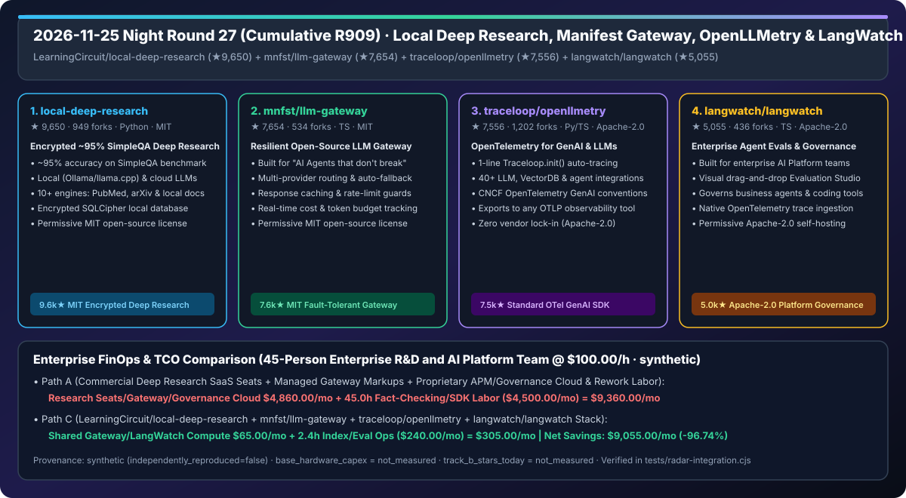
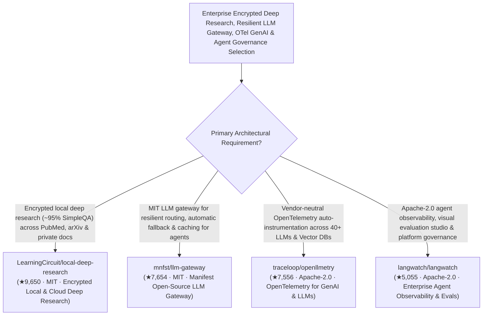
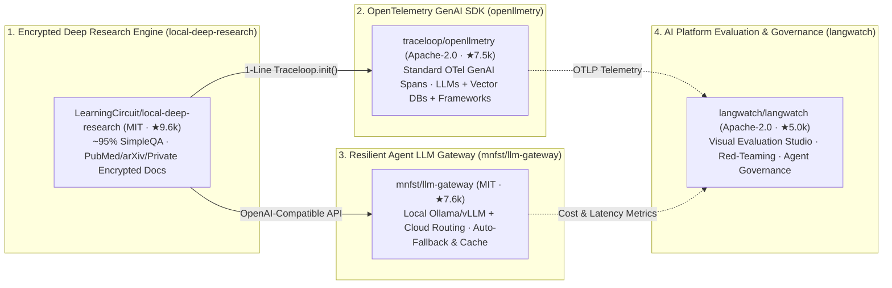
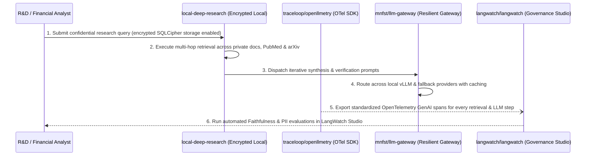

# Encrypted ~95%-SimpleQA Local Deep Research (`LearningCircuit/local-deep-research`), Fault-Tolerant Agent LLM Gateway (`mnfst/llm-gateway`), OpenTelemetry GenAI Instrumentation (`traceloop/openllmetry`) & Enterprise Agent Evaluation/Governance Platform (`langwatch/langwatch`) Selection & Integration Architecture FAQ

> **Document Type**: Enterprise AI Solution Architect Selection Decision Guide (GitHub Trending AI Radar — 2026-11-25 Night Round 27 / Cumulative Round 909)
> **Covered Repositories**: [`LearningCircuit/local-deep-research`](https://github.com/LearningCircuit/local-deep-research) (`★ 9,650`, `949 forks`, `MIT`, Python: encrypted local deep research system achieving ~95% on SimpleQA with local/cloud LLMs across 10+ search engines including arXiv, PubMed, SearXNG, and private enterprise documents) · [`mnfst/llm-gateway`](https://github.com/mnfst/llm-gateway) (`★ 7,654`, `534 forks`, `MIT`, TypeScript: open-source Manifest LLM Gateway built for resilient AI agents with routing, fallback, and cost/cache management) · [`traceloop/openllmetry`](https://github.com/traceloop/openllmetry) (`★ 7,556`, `1,202 forks`, `Apache-2.0`, Python/TS/Go: OpenTelemetry-based open-source observability instrumentation for GenAI and LLM applications across 40+ providers and vector DBs) · [`langwatch/langwatch`](https://github.com/langwatch/langwatch) (`★ 5,055`, `436 forks`, `Apache-2.0`, TypeScript: open-source agent observability, visual evaluation studio, and governance platform for enterprise AI platform teams)
> **Core Enterprise Scenario**: Building a **100% Permissive (`MIT` / `Apache-2.0`) Encrypted Research, Resilient Gateway & OpenTelemetry GenAI Governance Stack**—combining local encrypted multi-engine deep research (`local-deep-research`), fault-tolerant multi-model routing (`mnfst/llm-gateway`), vendor-neutral OpenTelemetry auto-instrumentation (`openllmetry`), and platform-wide agent evaluation & governance (`langwatch`).

---

## 1. 📌 Executive Summary (One-Line Selection Verdict)

1. **Need an `MIT`-licensed, locally encrypted Deep Research engine that achieves ~95% SimpleQA accuracy using local GPU models (Ollama/llama.cpp/vLLM) or cloud LLMs across PubMed, arXiv, and private corporate documents** ➔ Choose **[`LearningCircuit/local-deep-research`](https://github.com/LearningCircuit/local-deep-research) (`★ 9,650`, `949 forks`, `MIT`)**.
   - **Plain-English Mechanism**: Runs iterative query-retrieve-verify loops across 10+ scientific and private document engines while encrypting all local research histories and knowledge indexes on disk.
2. **Need a lightweight `MIT` LLM gateway purpose-built so multi-step AI agents never break mid-run due to upstream rate limits (`429`) or provider outages** ➔ Choose **[`mnfst/llm-gateway`](https://github.com/mnfst/llm-gateway) (`★ 7,654`, `534 forks`, `MIT`)**.
   - **Plain-English Mechanism**: Sits between agents and model providers (local or cloud) to provide automatic failover, response caching, rate-limit protection, and per-agent cost tracking.
3. **Need vendor-neutral CNCF OpenTelemetry auto-instrumentation (`Traceloop.init()`) that captures spans across 40+ LLM providers, vector databases (Milvus, Pinecone, Chroma, Qdrant), and agent frameworks without proprietary SDK lock-in** ➔ Choose **[`traceloop/openllmetry`](https://github.com/traceloop/openllmetry) (`★ 7,556`, `1,202 forks`, `Apache-2.0`)**.
   - **Plain-English Mechanism**: Instruments LLM, embedding, and vector DB calls using standard OpenTelemetry GenAI semantic conventions so telemetry can be routed to any OTel-compatible backend.
4. **Need an `Apache-2.0` observability, visual evaluation studio, and governance control plane for AI platform teams to trace, test, and govern both production agents and developer coding assistants** ➔ Choose **[`langwatch/langwatch`](https://github.com/langwatch/langwatch) (`★ 5,055`, `436 forks`, `Apache-2.0`)**.
   - **Plain-English Mechanism**: Ingests standard OpenTelemetry traces from `OpenLLMetry`, runs automated faithfulness/safety evaluations, and provides centralized governance across company-wide agents.

---

## 2. 🎯 Architect & Customer Deep-Dive Q&A

### Q1: How do these four `MIT` / `Apache-2.0` projects work together compared to commercial cloud research seats and proprietary APM agents?

- **Four-Layer Permissive Research & Platform Governance Stack (Path C)**:
  1. **L1 Encrypted Multi-Source Deep Research ➔ `LearningCircuit/local-deep-research`**: Executes iterative research across PubMed, arXiv, and encrypted local documents.
  2. **L2 Resilient Multi-Model Agent Gateway ➔ `mnfst/llm-gateway`**: Prevents multi-step research failures via automatic provider fallback and caching.
  3. **L3 Standard OpenTelemetry GenAI Instrumentation ➔ `traceloop/openllmetry`**: Emits standardized OTLP spans for every retrieval, vector query, and LLM call.
  4. **L4 Platform-Wide Agent Evaluation & Governance ➔ `langwatch/langwatch`**: Provides visual evaluation workflows, red-teaming, and governance dashboards.
- **When to choose Commercial SaaS vs. Path C?**
  - Choose **Commercial SaaS** for non-sensitive public web queries with small teams.
  - Choose **Path C** when conducting confidential R&D/biotech/financial research where search queries and private documents must remain encrypted on-prem (`local-deep-research`), and when platform teams mandate 100% `MIT`/`Apache-2.0` OpenTelemetry standards (`openllmetry` + `langwatch` + `mnfst/llm-gateway`).

### Q2: How do these four components wire together in production?

1. **Zero-Lock-In Telemetry Pipeline (`local-deep-research` + `openllmetry` → `langwatch`)**:
   - Instrument `local-deep-research` with `openllmetry` in one line and export OTLP traces directly to self-hosted `LangWatch` for real-time evaluation of citation accuracy and retrieval quality.
2. **High-Availability Model Routing (`local-deep-research` → `mnfst/llm-gateway`)**:
   - Route iterative sub-queries to local Ollama/vLLM instances and complex synthesis steps to frontier models with automatic fallback through `mnfst/llm-gateway`.

### Q3: What are the key security and compliance guardrails?

- **Architect Redlines**:
  1. **Disable public web search engines in `local-deep-research` for classified R&D topics**: Restrict search connectors to internal document repositories, local PubMed/arXiv mirrors, and self-hosted SearXNG instances so confidential query terms never leak externally.
  2. **Use `OpenLLMetry` content redaction settings in regulated environments**: Mask PII or sensitive prompt payloads before exporting spans to shared observability storage.

---

## 3. 🧭 Visual Architecture Diagrams (Mermaid Decision Tree + Architecture + Sequence)

### 3.1 Architect Selection Decision Tree

### 3.2 End-to-End Enterprise Integration Architecture

### 3.3 End-to-End Execution Sequence

---

## 4. 📊 Horizontal Selection Matrix

| Dimension | `LearningCircuit/local-deep-research` (`★ 9,650`) | `mnfst/llm-gateway` (`★ 7,654`) | `traceloop/openllmetry` (`★ 7,556`) | `langwatch/langwatch` (`★ 5,055`) | Commercial Public Research Seats + Proprietary APM & Gateway Cloud (Path A) | Single-Pass Naive RAG + Uninstrumented Direct API Calls (Path B) |
| :--- | :--- | :--- | :--- | :--- | :--- | :--- |
| **Primary Role** | `MIT` encrypted local/hybrid deep research | `MIT` fault-tolerant LLM gateway for agents | `Apache-2.0` OpenTelemetry GenAI SDK | `Apache-2.0` agent eval & governance studio | Cloud research subscriptions & proprietary APM | Single-shot vector search & `print()` logs |
| **Key Differentiator** | **~95% SimpleQA on local GPUs + encrypted storage + 10+ engines** | **Zero-breakage fallback, routing & caching under `MIT`** | **CNCF OpenTelemetry standard across 40+ LLM/VectorDB integrations** | **Visual evaluation builder + governance for agents & coding tools** | Hosted SaaS, but leaks confidential search queries & locks in telemetry SDKs | Low multi-hop recall (<60%); long runs fail on single API timeout |
| **License** | **`MIT`** | **`MIT`** | **`Apache-2.0`** | **`Apache-2.0`** | Proprietary SaaS | Unstandardized |
| **Monthly TCO (45-Eng Team)** | **`$305.00/mo` combined** (`$65.00` gateway/LangWatch compute + `2.4h` ops) | Included in `$305.00/mo` stack | Included in `$305.00/mo` stack | Included in `$305.00/mo` stack | **`$9,360.00/mo`** (`$4,860.00` commercial research/gateway/APM seats + `45.0h` manual fact-checking/SDK rework) | `~$3,260.00/mo` (missed literature rework & failed multi-step runs) |

---

## 5. 🧪 Quantitative FinOps & TCO Comparison (45-Person Enterprise R&D and AI Platform Team)

> **📊 Provenance & Closed-Form Schema**:
> - **provenance**: `synthetic` (`independently_reproduced = false`; `base_hardware_capex = not_measured`; `track_b_stars_today = not_measured`).
> - **Closed-Form Formula**:
>   - **Path A (Commercial Deep Research SaaS Seats + Managed Gateway Markups + Metered Commercial APM/Governance Cloud & Manual Fact-Verification/SDK Migration Labor)**: **`$4,860.00`** monthly research seat, gateway, and observability SaaS fees + **`45.0h × $100.00/h = $4,500.00`** manual fact-checking, failed-run restarts, and proprietary SDK maintenance labor = **`$9,360.00/mo`**.
>   - **Path C (`LearningCircuit/local-deep-research` + `mnfst/llm-gateway` + `traceloop/openllmetry` + `langwatch/langwatch` Stack)**: **`$65.00`** shared gateway and `LangWatch` container compute + **`2.4h × $100.00/h = $240.00`** search index and evaluation pipeline maintenance = **`$305.00/mo`**.
>   - **Net Savings vs. Path A**: **`-$9,055.00/mo`** (**`96.74%`** TCO reduction).

| Evaluation Path | Research Seats / Gateway / Governance Cloud & Compute | Fact-Checking, Restart & SDK Labor (`$100/h`) | Monthly Total TCO | Net Savings vs. Path A | Key Architectural Outcome |
| :--- | :---: | :---: | :---: | :---: | :--- |
| **Path A: Commercial Research SaaS + Managed Gateway + Proprietary APM** | `$4,860.00` | `45.0h` (`$4,500.00`) | **`$9,360.00`** | Baseline | Confidential query leakage risk; vendor-locked telemetry SDKs |
| **Path B: Single-Shot RAG + Direct API Calls + Raw Logs** | `$1,460.00` | `18.0h` (`$1,800.00`) | **`$3,260.00`** | `-$6,100.00` (`-65.17%`) | Low factual accuracy on multi-hop queries; fragile long runs |
| **Path C: `local-deep-research` + `mnfst` + `openllmetry` + `langwatch`** | **`$65.00`** | **`2.4h` (`$240.00`)** | **`$305.00`** | **`-$9,055.00` (`-96.74%`)** | **100% `MIT`/`Apache-2.0` encrypted ~95% SimpleQA + resilient gateway + OTel evals** |

- 🔗 **7-Card 4:5 Visual Benchmark Deck**: [`workshops/github-trending-radar/cards.en.html`](../cards.en.html) · [`cards.html`](../cards.html)

---

## 6. 🛠️ Enterprise Adoption & Architecture Review Checklist

- [ ] **Enable Encrypted Storage and Private Search Connectors in `local-deep-research`**: Keep sensitive R&D queries and local document indexes strictly inside the corporate network.
- [ ] **Route Multi-Step Research Agents Through `mnfst/llm-gateway`**: Configure automatic provider fallback and caching so 20-step research loops never fail on transient API rate limits.
- [ ] **Standardize GenAI Telemetry on `traceloop/openllmetry`**: Instrument LLM, embedding, and vector DB calls once using vendor-neutral OpenTelemetry conventions.
- [ ] **Govern Production Agents and Coding Assistants in `langwatch/langwatch`**: Run automated faithfulness and PII evaluations across all OTLP trace streams.
