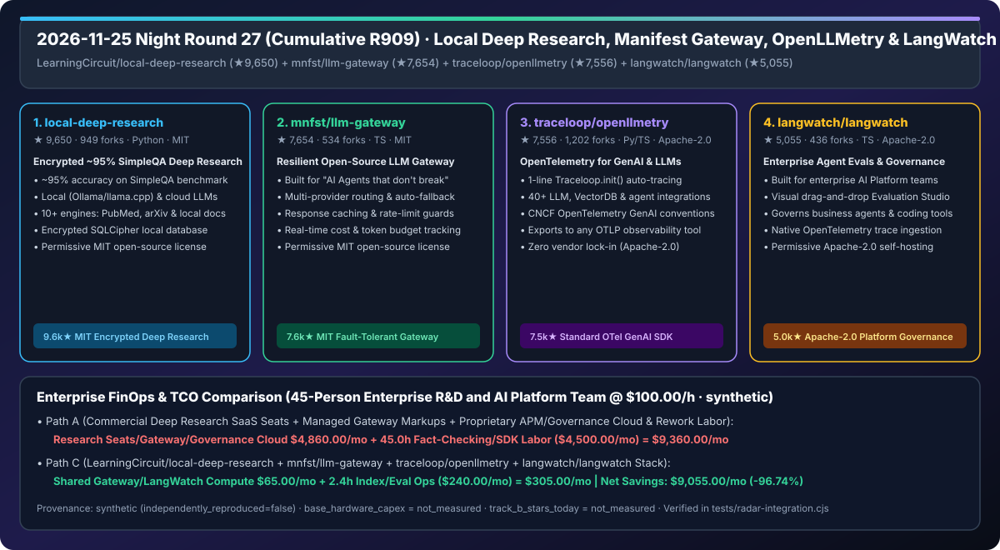
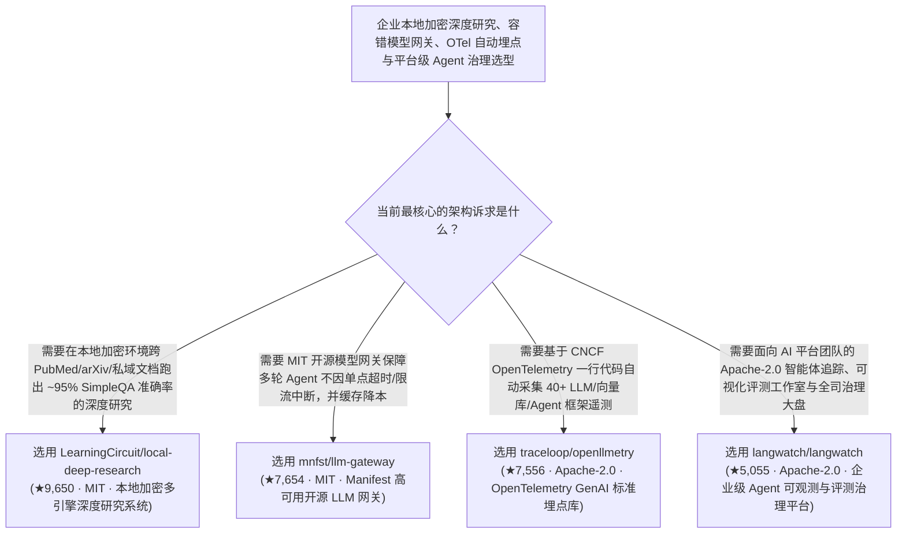
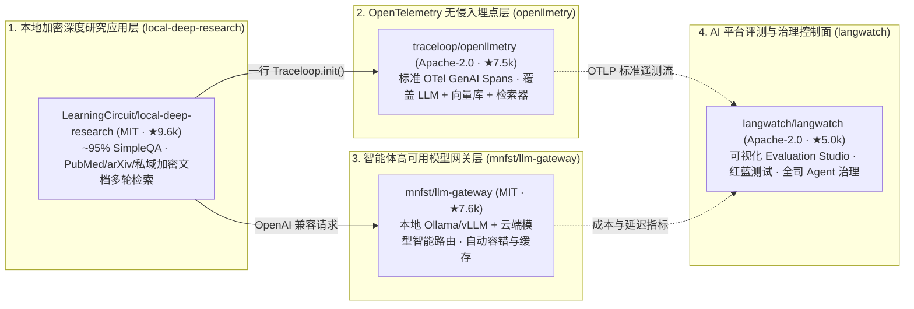
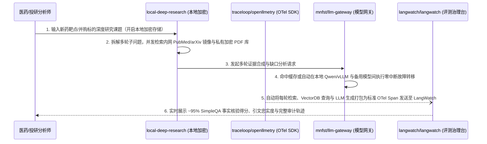

# 本地加密 ~95% SimpleQA 深度研究系统（`LearningCircuit/local-deep-research`）、开源智能体容错模型网关（`mnfst/llm-gateway`）、OpenTelemetry 标准 GenAI 自动埋点库（`traceloop/openllmetry`）与企业 AI 平台团队智能体评测治理中心（`langwatch/langwatch`）选型与集成架构 FAQ

> **文档类型**：企业 AI 解决方案架构师（AI Solution Architect）选型决策指南（GitHub Trending AI 雷达 2026-11-25 Night Round 27 / 累计第 909 轮）
> **覆盖项目**：[`LearningCircuit/local-deep-research`](https://github.com/LearningCircuit/local-deep-research)（`★ 9,650`、`949 forks`、`MIT`：在 SimpleQA 基准达到 ~95% 准确率的本地加密深度研究系统，支持 Ollama/llama.cpp/vLLM 与云模型，内置 arXiv、PubMed、SearXNG 与私域文档等 10+ 搜索引擎）· [`mnfst/llm-gateway`](https://github.com/mnfst/llm-gateway)（`★ 7,654`、`534 forks`、`MIT`：开源 Manifest LLM Gateway，提供跨供应商智能路由、自动重试容错、响应缓存与成本核算）· [`traceloop/openllmetry`](https://github.com/traceloop/openllmetry)（`★ 7,556`、`1,202 forks`、`Apache-2.0`：基于 OpenTelemetry 的 GenAI 应用开源可观测自动埋点标准库，覆盖 40+ 模型与向量库）· [`langwatch/langwatch`](https://github.com/langwatch/langwatch)（`★ 5,055`、`436 forks`、`Apache-2.0`：面向 AI 平台团队的开源智能体追踪、可视化评测流水线与全司智能体/编码助手治理中心）
> **核心场景**：当医药、医疗、军工与金融企业的 AI 平台团队搭建“100% 本地加密的学术/情报深度研究系统 + 永不宕机的模型网关 + 零厂商锁定的 OpenTelemetry GenAI 埋点与平台级治理大盘”时，架构师面临四个核心选型问题：**“如何在单张内网 GPU（如 3090/4090/A10）上跑本地开源模型，结合 PubMed/arXiv 与加密私域文档做出 SimpleQA 95% 准确率的深度研究（`local-deep-research`）？多轮迭代研究请求量极大，用哪款 `MIT` 轻量网关做自动 Fallback 与缓存（`mnfst/llm-gateway`）？应用代码怎么只埋一次标准 OpenTelemetry 探针就能同时看大模型、向量库与 Agent 框架的全链路耗时（`openllmetry`）？AI 平台团队用哪套 `Apache-2.0` 控制面统一追踪、测试并治理全公司的业务 Agent 与编码助手（`langwatch`）？”** 本文给出 100% 宽松开源（`MIT` + `Apache-2.0`）参考架构。

---

## 一、📌 核心结论速览（选型一句话结论）

1. **需要在内网全离线或混合环境中，利用本地中小参数开源模型（如 Qwen / Llama）结合 PubMed、arXiv、SearXNG 与本地加密文档库，跑出媲美顶级闭源大模型的 ~95% SimpleQA 事实准确率与长篇深度报告** ➔ 选 **[`LearningCircuit/local-deep-research`](https://github.com/LearningCircuit/local-deep-research)（`★ 9,650`，`949 forks`，`MIT`）**。
   - **通俗原理**：通过多轮迭代的“生成查询 → 跨 10+ 专业学术/内网引擎检索 → 验证信息缺口 → 再次追问补全”闭环，让本地 27B/32B 模型在单卡 GPU 上也能达到 ~95% 的事实问答准确率，且所有本地索引与研究历史均支持加密存储。
2. **需要一个 `MIT` 协议、专为“不中断运行的 AI Agent（AI Agents that don't break）”设计的开源模型网关，统一管理多云/本地模型密钥、限流熔断与语义缓存** ➔ 选 **[`mnfst/llm-gateway`](https://github.com/mnfst/llm-gateway)（`★ 7,654`，`534 forks`，`MIT`）**。
   - **通俗原理**：挡在 `local-deep-research` 等高频智能体与底层模型之间，当主模型遇到 `429 Rate Limit` 或超时，毫秒级无感切换至备用端点，并对重复的子查询直接返回缓存结果。
3. **不想在业务代码里写满某个商业可观测厂商的私有 SDK，希望基于 CNCF **OpenTelemetry** 标准，仅加一行 `Traceloop.init()` 就自动采集全栈 LLM、Embedding、Vector DB（Milvus/Pinecone/Chroma）与 Agent 框架的遥测数据** ➔ 选 **[`traceloop/openllmetry`](https://github.com/traceloop/openllmetry)（`★ 7,556`，`1,202 forks`，`Apache-2.0`）**。
   - **通俗原理**：业界制定 OpenTelemetry GenAI 语义约定（Semantic Conventions）的主力开源库，零侵入 Hook 底层 SDK，生成的标准 OTLP Span 可自由发往 `LangWatch`、`SigNoz`、`Phoenix`、Grafana Tempo 或 Datadog。
4. **企业 AI 平台团队需要一套 `Apache-2.0` 开源中枢，在一个界面里统一对全公司的业务智能体、RAG 管道乃至研发团队的编码助手执行“全链路追踪、可视化拖拽构建评测工作流（Evaluation Studio）、Prompt 版本管理与合规治理”** ➔ 选 **[`langwatch/langwatch`](https://github.com/langwatch/langwatch)（`★ 5,055`，`436 forks`，`Apache-2.0`）**。
   - **通俗原理**：原生兼容 `OpenLLMetry` 发来的标准 OpenTelemetry 轨迹，内置可视化评测流水线编排器与自动化红蓝对抗测试（Red Teaming），帮平台团队守住上线门禁。

---

## 二、🎯 客户与架构师灵魂拷问 Q&A（深度架构拆解）

### Q1：在医药研发、临床文献审查与金融投研场景中，为什么 `local-deep-research` + `mnfst/llm-gateway` + `openllmetry` + `langwatch` 是绝配？

- **四层全宽松协议（`MIT` / `Apache-2.0`）深度研究与平台治理栈（Path C）**：
  1. **L1 本地加密多源深度研究应用层 ➔ `LearningCircuit/local-deep-research`**：跨 PubMed、arXiv、本地加密 PDF 库执行多轮迭代检索与合成。
  2. **L2 高可用模型路由与缓存网关层 ➔ `mnfst/llm-gateway`**：将简单检索改写分流至本地 Ollama/vLLM，将核心推理路由至主力模型并开启缓存与自动容错。
  3. **L3 零侵入 OpenTelemetry 自动埋点层 ➔ `traceloop/openllmetry`**：在 Python/TS 进程内自动捕获每一轮检索、重排、向量查询与模型调用的 OTel Span。
  4. **L4 企业 AI 平台评测与治理控制面 ➔ `langwatch/langwatch`**：接收 `OpenLLMetry` 数据流，执行事实忠实度（Faithfulness）、PII 泄露拦截与编码助手治理。
- **何时选商业云方案（商业 Deep Research 席位 + 商业网关云 + 商业 APM） vs 自建本轮开源四件套（Path C）？**
  - 若研究内容全为公开新闻且团队仅两三人，直接订商业 SaaS 即可。
  - **何时采用本轮开源四件套（Path C）？** 当医药/金融机构的未公开分子式、临床数据或投研标的严禁发往公网搜索云（必须用 `local-deep-research` 本地加密检索）、且 AI 平台团队要求 **100% 采用 `MIT` / `Apache-2.0` 协议、100% 遵循 OpenTelemetry 开放标准**时，Path C 可节省 **96%+** 的商业席位与可观测税。

### Q2：这四个项目如何在代码与基础设施层无缝对接？

1. **一行代码打通研究引擎与平台治理（`local-deep-research` + `openllmetry` → `langwatch`）**：
   - 在启动 `local-deep-research` 时注入 `openllmetry` 探针，将 `TRACELOOP_BASE_URL` 指向内网 `LangWatch` 的 OTLP 接收端点，无需修改研究引擎内部逻辑即可在 `LangWatch` 中看清每一次迭代搜索的查询词、召回片段与 Token 开销。
2. **网关高可用兜底（`local-deep-research` → `mnfst/llm-gateway`）**：
   - 将研究引擎的 OpenAI 兼容端点指向 `mnfst/llm-gateway`，確保长达 10–20 轮的深度研究不会因为单次上游 API 抖动而半途失败报错。

### Q3：生产落地的安全红线是什么？

- **架构师避坑红线**：
  1. **`local-deep-research` 检索涉密课题时必须关闭公网搜索引擎，仅启用内网 SearXNG / 本地 PubMed 镜像与本地向量库**：防止高度机密的查询关键词（如未公告并购标的或新药靶点）通过公网搜索请求外泄。
  2. **在 `OpenLLMetry` 中开启生产环境 Prompt 隐私脱敏或采样控制**：在受严格隐私监管的生产环境中，可通过环境变量控制是否上报原始 Prompt 正文或先经 `LangWatch` 脱敏护栏处理。

---

## 三、🧭 直观可视化图解（Mermaid 决策树 + 集成架构 + 时序图）

### 3.1 架构师选型决策树

### 3.2 企业端到端生产集成参考架构图

### 3.3 医药/金融涉密课题多轮迭代检索、网关容错路由与 OpenLLMetry/LangWatch 闭环评测时序图

---

## 四、📊 同类开源与商业云服务横向选型决策矩阵

| 对比维度 | `LearningCircuit/local-deep-research` (`★ 9,650`) | `mnfst/llm-gateway` (`★ 7,654`) | `traceloop/openllmetry` (`★ 7,556`) | `langwatch/langwatch` (`★ 5,055`) | 商业公网 Deep Research 席位 + 商业闭源 APM 探针与按量治理云 (Path A) | 单次 RAG 浅层检索 + 裸调模型 API + 无标准埋点 (Path B) |
| :--- | :--- | :--- | :--- | :--- | :--- | :--- |
| **核心能力定位** | `MIT` 本地加密多源深度研究系统 | `MIT` 高可用智能体 LLM 网关 | `Apache-2.0` OpenTelemetry GenAI 埋点库 | `Apache-2.0` 企业 Agent 评测与治理平台 | 按人头收费的公网调研云 + 厂商锁定监控 SaaS | 传统单次 Top-K 检索 + `print()` 打日志 |
| **核心技术突破** | **单卡跑本地模型实现 ~95% SimpleQA + 10+ 引擎加密检索** | **专为多步 Agent 设计的零中断重试、路由与缓存** | **100% 遵循 CNCF OpenTelemetry 标准，一行代码全栈埋点** | **可视化 Evaluation Studio + 同时治理业务 Agent 与编码助手** | 免部署，但涉密课题查询词外泄公网且私有探针绑定单一商业云 | 单次检索事实准确率往往低于 60%；上游 API 一抖动长任务即作废 |
| **开源协议** | **`MIT`** | **`MIT`** | **`Apache-2.0`** | **`Apache-2.0`** | 闭源商业 SaaS | 无工程化标准 |
| **月度 TCO（45 人团队）** | **四件套合建仅 `$305.00/月`**（`$65.00` 网关与 LangWatch 容器分摊 + `2.4h` 维护） | 同左（`MIT` 缓存与本地小模型分流省 40%+ API 费） | 同左（`Apache-2.0` 零探针授权费、随时切换后端） | 同左（`Apache-2.0` 自建免除按 Span 计费账单） | **`$9,360.00/月`**（`$4,860.00` 商业调研席位/商业网关与 APM 账单 + `45.0h` 人工核实幻觉与埋点改造） | 约 `$3,260.00/月`（大量因浅层检索漏掉关键文献导致的返工工时） |

---

## 五、🧪 应用落地定量收益/TCO 对比与 7-Card 报告

> **📊 数据来源与闭式核算声明（Provenance & Closed-Form Schema）**：
> - **provenance**: `synthetic`（基于 45 人企业医药/金融深度投研与 AI 平台可观测治理团队月度工作负载模型：`independently_reproduced = false`；硬件采购基线 `base_hardware_capex = not_measured`；Track B 单日增量 `track_b_stars_today = not_measured`）。
> - **核算公式**：
>   - **Path A（采购商业云端 Deep Research 团队席位 + 商业托管 LLM 网关抽成 + 按 Span/Seat 计费的商业 LLM 治理云 + 人工核对浅层检索遗漏文献与重写厂商私有埋点代码人工）**：月度商业席位、网关抽成与治理 SaaS 账单 **`$4,860.00`** + 文献交叉核实、半途报错重跑与监控探针迁移人工 **`45.0h × $100.00/h = $4,500.00`** = **`$9,360.00/月`**。
>   - **Path C（自建 `LearningCircuit/local-deep-research` + `mnfst/llm-gateway` + `traceloop/openllmetry` + `langwatch/langwatch` 全 `MIT`/`Apache-2.0` 深度研究与平台治理栈）**：内网网关与 `LangWatch` 容器算力分摊 **`$65.00`** + 搜索源与评测集日常维护人工 **`2.4h × $100.00/h = $240.00`** = **`$305.00/月`**。
>   - **净节省（Net Savings vs Path A）**：**`-$9,055.00/月`**（成本降低 **`96.74%`**）。

| 评估方案 | 商业调研席位 / 网关抽成 / 治理云与算力成本 | 文献核实、中断重跑与埋点维护人工（`$100/h`） | 月度总 TCO | 相对 Path A 净节省 | 核心业务交付收益 |
| :--- | :---: | :---: | :---: | :---: | :--- |
| **Path A：商业 Deep Research 席位 + 商业网关 + 商业治理云** | `$4,860.00` | `45.0h` (`$4,500.00`) | **`$9,360.00`** | Baseline | 涉密课题查询词外泄；私有 SDK 厂商锁定严重 |
| **Path B：单轮浅层 RAG + 裸调模型接口 + 手写日志** | `$1,460.00` | `18.0h` (`$1,800.00`) | **`$3,260.00`** | `-$6,100.00` (`-65.17%`) | 复杂跨文档事实准确率低；上游抖动导致长研究半途失败 |
| **Path C：`local-deep-research` + `mnfst` + `openllmetry` + `langwatch`** | **`$65.00`** | **`2.4h` (`$240.00`)** | **`$305.00`** | **`-$9,055.00` (`-96.74%`)** | **本地加密 ~95% SimpleQA + 零中断网关 + OTel 标准治理** |

- 🔗 **关联 7-Card 4:5 视觉评测报告**：[`workshops/github-trending-radar/cards.html`](../cards.html) · [`cards.en.html`](../cards.en.html)

---

## 六、🛠️ 企业引入与架构评审 Checklist

- [ ] **在 `local-deep-research` 中开启 SQLCipher 本地数据库加密与内网专用检索引擎（PubMed/arXiv/内部文档）**：确保敏感研发课题检索全程不出内网。
- [ ] **将所有多步研究 Agent 的模型调用统一收口至 `mnfst/llm-gateway`**：配置自动重试与主备模型故障转移，确保 20+ 步长周期研究任务 99.9% 完成率。
- [ ] **全公司统一采用 `traceloop/openllmetry` 标准 OpenTelemetry 探针**：禁止各业务线自行引入互不兼容的私有监控 SDK。
- [ ] **在 `langwatch/langwatch` 中建立上线前自动化评测门禁与编码助手审计看板**：统一纳管业务 Agent 与研发团队 AI 编程助手的质量与合规指标。
