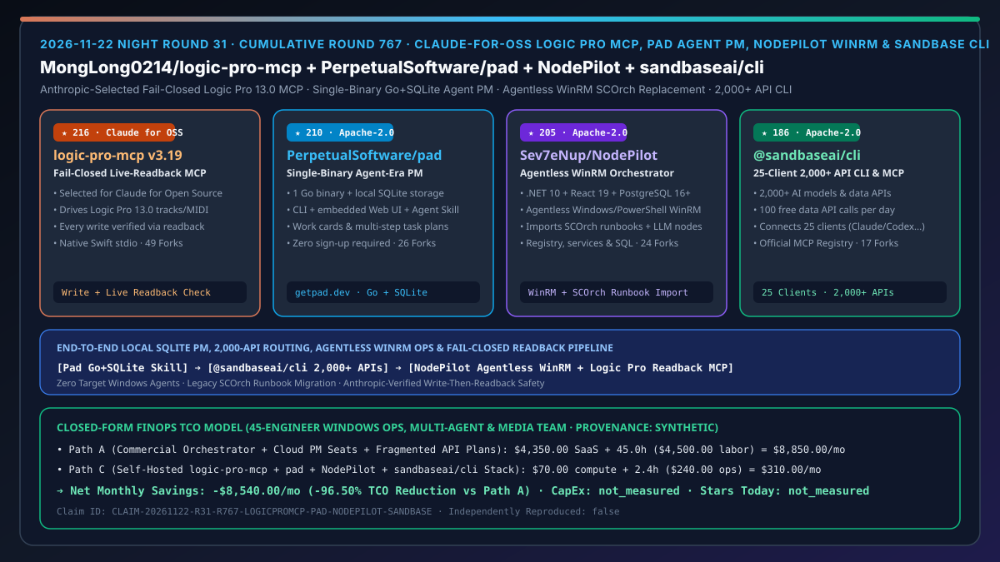
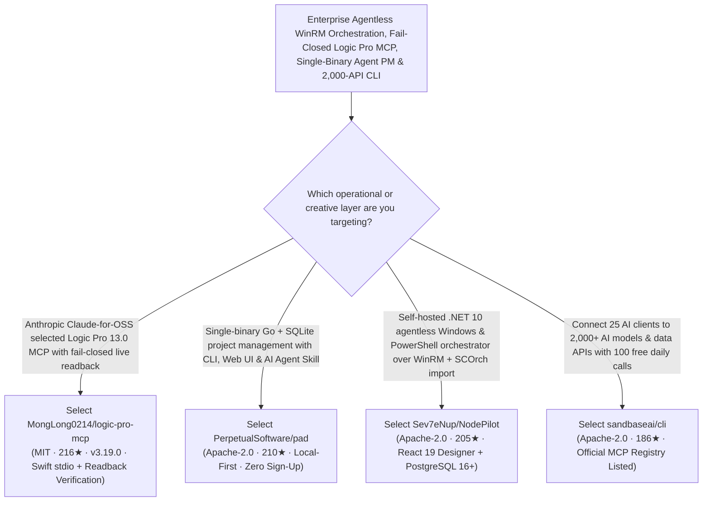
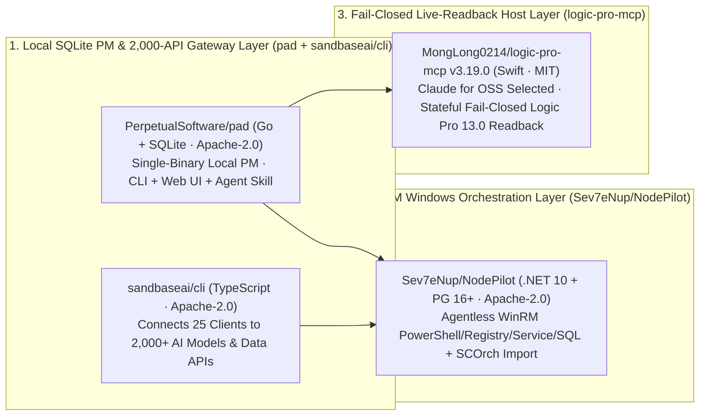
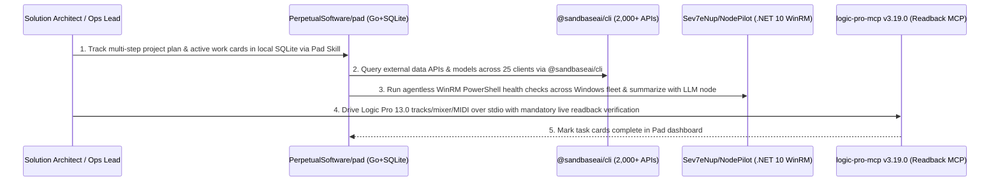

# Anthropic-Selected Logic Pro Live-Readback MCP (`MongLong0214/logic-pro-mcp`), Single-Binary Go+SQLite Agent PM (`PerpetualSoftware/pad`), Agentless WinRM SCOrch Replacement (`Sev7eNup/NodePilot`) & 25-Client 2,000-API Unified CLI/MCP (`sandbaseai/cli`) Selection & Architecture FAQ

> **Document Type**: Enterprise AI Solution Architect Selection & Integration Guide (GitHub Trending AI Radar — 2026-11-22 Night Round 31 / Cumulative Round 767)
> **Covered Repositories**: [`MongLong0214/logic-pro-mcp`](https://github.com/MongLong0214/logic-pro-mcp) (`★ 216`, `49 forks`, `MIT`, `v3.19.0`: **officially selected for Anthropic's Claude for Open Source program**, a local Swift MCP server for macOS Logic Pro 13.0 with stateful, fail-closed control and live project readback verification) · [`PerpetualSoftware/pad`](https://github.com/PerpetualSoftware/pad) (`★ 210`, `26 forks`, `Apache-2.0`: single-binary, local-first Go + SQLite project management for the agent era with CLI, embedded web UI, and AI agent skill) · [`Sev7eNup/NodePilot`](https://github.com/Sev7eNup/NodePilot) (`★ 205`, `24 forks`, `Apache-2.0`: `.NET 10` + React 19 + PostgreSQL 16+ self-hosted agentless Windows and PowerShell workflow orchestrator over WinRM with System Center Orchestrator `SCOrch` runbook import and LLM summary nodes) · [`sandbaseai/cli`](https://github.com/sandbaseai/cli) (`★ 186`, `17 forks`, `Apache-2.0`: Official MCP Registry-listed CLI and local MCP server connecting 25 clients—Claude Code, Cursor, Codex, ChatGPT, Hermes, OpenClaw—to 2,000+ AI models and data APIs with 100 free data API calls/day)
> **Core Scenario**: When enterprise Windows infrastructure operations, multi-agent engineering, and creative production teams struggle with **retiring Microsoft System Center Orchestrator (SCOrch) runbooks without installing heavy agents on every Windows Server, managing fragmented API keys across 25 different AI clients, bloated cloud project trackers that coding agents cannot query locally in a single SQLite file, and desktop DAW/application MCPs that fire blind commands without verifying host state**, how do you combine **`logic-pro-mcp` + `pad` + `NodePilot` + `sandbaseai/cli`** into a resilient enterprise automation stack?

---

## 1. 📌 Executive Summary (One-Line Selection Verdict)

1. **Modernizing Windows Server automation or migrating off Microsoft System Center Orchestrator (SCOrch) and need a self-hosted (`Apache-2.0`, `.NET 10` + React 19 + PostgreSQL 16+) visual workflow engine that executes PowerShell, file, registry, Windows service, SQL, and REST steps **agentlessly over WinRM** with built-in LLM summary/decision nodes?** ➔ Choose **[`Sev7eNup/NodePilot`](https://github.com/Sev7eNup/NodePilot) (`★ 205`, `24 forks`, `Apache-2.0`)**.
   - **Plain-English Mechanism**: Imports legacy SCOrch runbooks and runs multi-step workflows across your Windows estate over WinRM without deploying target agents.
2. **Need an **Anthropic "Claude for Open Source"-selected** (`MIT`, `v3.19.0`, Swift) local MCP server that drives macOS Logic Pro 13.0 (`com.apple.logic10`) transport, tracks, mixer, MIDI, and plug-ins with **fail-closed execution and live readback verification on every write**?** ➔ Choose **[`MongLong0214/logic-pro-mcp`](https://github.com/MongLong0214/logic-pro-mcp) (`★ 216`, `49 forks`, `MIT`)**.
   - **Plain-English Mechanism**: Talks over `stdio` and verifies every tempo, panning, track, or MIDI change against what Logic Pro reports back before proceeding.
3. **Need a single-binary, local-first (`Apache-2.0`, Go + SQLite) project management system built for the agent era that gives you a CLI, an embedded Web UI, and an AI Agent Skill with zero sign-up?** ➔ Choose **[`PerpetualSoftware/pad`](https://github.com/PerpetualSoftware/pad) (`★ 210`, `26 forks`, `Apache-2.0`)**.
   - **Plain-English Mechanism**: Keeps active work cards, multi-step task plans (`4 of 7 tasks done`), and "what needs attention next" in a local SQLite database shared by you and your coding agents.
4. **Want one CLI and local MCP server (`@sandbaseai/cli`, `Apache-2.0`, listed on the Official MCP Registry) that connects 25 AI clients (Claude Code, Cursor, Codex, ChatGPT, Hermes, OpenClaw) to **2,000+ AI models and data APIs** with 100 free data API calls per day?** ➔ Choose **[`sandbaseai/cli`](https://github.com/sandbaseai/cli) (`★ 186`, `17 forks`, `Apache-2.0`)**.
   - **Plain-English Mechanism**: Eliminates per-vendor API key sprawl with one unified balance and 8-language documentation.

---

## 2. 🎯 Architect & Customer Deep-Dive Q&A

### Q1: What architectural lessons do `NodePilot` (Agentless WinRM + SCOrch Import) and `logic-pro-mcp` (Fail-Closed Live Readback) offer Enterprise Solution Architects?

- **Three High-Value Architectural Patterns**:
  1. **Agentless Estate Orchestration with Legacy Runbook Migration ➔ `Sev7eNup/NodePilot`**: Enterprise ops teams hate installing new daemon agents on hundreds of production Windows servers. `NodePilot` executes over native WinRM, imports existing SCOrch runbooks, and embeds LLM health-check summarization directly in the workflow DAG.
  2. **Fail-Closed Write-Then-Readback Verification ➔ `MongLong0214/logic-pro-mcp`**: Selected by Anthropic's Claude for Open Source program, `logic-pro-mcp` proves how desktop application MCPs should be built: every mutation is immediately checked against the host application's readback state.
  3. **Single-Binary SQLite Task State + Unified 2,000-API Routing ➔ `PerpetualSoftware/pad` + `sandbaseai/cli`**: Pairs zero-signup local SQLite plan tracking with a single MCP gateway across 2,000+ models and data APIs.
- **When to Choose Managed Cloud PaaS (Path B)?**
  - Enterprises running 100% on Azure with Azure Arc agents already deployed can use **Azure Automation + Azure Logic Apps**; enterprises needing self-hosted agentless WinRM orchestration with SCOrch import, local single-binary SQLite agent project management, and Anthropic-verified Logic Pro automation should deploy this open-source stack (Path C).

### Q2: How do `pad`, `sandbaseai/cli`, `NodePilot`, and `logic-pro-mcp` integrate in practice?

1. **Local-First Plan & Attention Tracking Layer (`PerpetualSoftware/pad`)**:
   - Humans and agents coordinate work cards and multi-step plans via `pad`'s CLI, Web UI, and Agent Skill.
2. **Unified Model & Data API Gateway Layer (`sandbaseai/cli`)**:
   - Supplies 25 agent clients with 2,000+ models and data APIs from one CLI/MCP endpoint.
3. **Agentless Windows Ops & Verified Creative Host Layer (`NodePilot` + `logic-pro-mcp`)**:
   - Executes Windows Server maintenance over WinRM in `NodePilot` and drives fail-closed Logic Pro 13.0 audio production via `logic-pro-mcp`.

### Q3: How does `NodePilot`'s browser-based Live Demo and Designer handle actions that require real Windows hosts?

- **Explicit Capability Reporting**:
  - In browser-only preview mode, `NodePilot` runs its real React 19 frontend against an in-memory backend and explicitly reports when an activity requires a live WinRM/SQL server rather than faking results; in production, the `.NET 10` + PostgreSQL 16+ backend executes them across real Windows hosts.

---

## 3. 🧭 Visual Architecture & Workflow Diagrams (Mermaid)

### 3.1 Solution Architect Selection Decision Tree

### 3.2 End-to-End Enterprise Reference Architecture

### 3.3 End-to-End Plan Tracking, Unified API Lookup, Agentless WinRM Execution & Readback-Verified Host Control Sequence Diagram

---

## 4. 📊 Peer Open-Source vs. Commercial Cloud Selection Matrix

| Dimension | `MongLong0214/logic-pro-mcp` (`★ 216`) | `PerpetualSoftware/pad` (`★ 210`) | `Sev7eNup/NodePilot` (`★ 205`) | `sandbaseai/cli` (`★ 186`) | Commercial System Center Licenses + Cloud PM Seats + Fragmented API Subscriptions (Path A) | Blind AppleScript Hacks + Raw TODO Files + Manual RDP PowerShell Sessions (Path B) |
| :--- | :--- | :--- | :--- | :--- | :--- | :--- |
| **Primary Role** | Anthropic-selected Logic Pro 13.0 readback MCP | Single-binary Go+SQLite agent project manager | Agentless WinRM Windows & PowerShell orchestrator | 25-client 2,000+ model & data API CLI/MCP | Expensive enterprise datacenter suites, cloud PM seats & separate API subscriptions | Unverified UI scripting, unindexed text files & manual remote desktop sessions |
| **Key Differentiator** | **Claude for OSS selected + fail-closed live readback** | **1 Go binary (`embed.go` + SQLite) + CLI/Web/Skill** | **Agentless WinRM + SCOrch import + `.NET 10` + React 19** | **Official MCP Registry + 100 free daily data calls** | High per-core/per-seat licensing; requires target agents or separate API billing | Blind scripts corrupt project state; manual RDP across Windows servers is slow |
| **License** | `MIT` | `Apache-2.0` | `Apache-2.0` | `Apache-2.0` | Proprietary Commercial | Ad-hoc scripts |
| **Monthly TCO (45-Eng Team)** | **`$310.00/mo` combined** (`$70.00` shared NodePilot `.NET 10` container + `2.4h` ops) | Included (`$0` local single binary) | Included (`Apache-2.0` self-hosted WinRM engine) | Included (100 free data API calls/day) | **`$8,850.00/mo`** (`$4,350.00` commercial orchestrator, PM seats & API plans + `45.0h` manual WinRM/ops labor) | ~`$3,090.00/mo` (manual RDP server maintenance & debugging blind automation scripts) |

---

## 5. 🧪 Quantitative Enterprise ROI / FinOps TCO Model & 7-Card Report

> **📊 Provenance & Closed-Form Declaration**:
> - **provenance**: `synthetic` (45-engineer enterprise Windows infrastructure operations, multi-agent software delivery, and digital media production team workload model: `independently_reproduced = false`; `base_hardware_capex = not_measured`; `track_b_stars_today = not_measured`).
> - **Closed-Form Equations**:
>   - **Path A (Commercial Windows Datacenter Orchestration Licenses + Per-Seat Cloud Project Management SaaS + Fragmented Third-Party Data API Subscriptions + Manual RDP PowerShell & Unverified Script Debugging Labor)**: Monthly commercial orchestration, PM seat, and fragmented API bills **`$4,350.00`** + manual Windows server maintenance, SCOrch runbook migration, and script debugging labor **`45.0h × $100.00/h = $4,500.00`** = **`$8,850.00/mo`**.
>   - **Path C (Self-Hosted `logic-pro-mcp` + `pad` + `NodePilot` + `sandbaseai/cli` Stack)**: Shared `.NET 10` + PostgreSQL container compute **`$70.00`** + WinRM runbook & gateway maintenance labor **`2.4h × $100.00/h = $240.00`** = **`$310.00/mo`**.
>   - **Net Monthly Savings vs. Path A**: **`-$8,540.00/mo`** (**`96.50%`** TCO reduction).

| Evaluation Path | Orchestrator / PM / API SaaS & Compute | Windows Ops & Script Debugging Labor (`$100/h`) | Total Monthly TCO | Net Savings vs. Path A | Architectural Delivery Impact |
| :--- | :---: | :---: | :---: | :---: | :--- |
| **Path A: Commercial Orchestrator + Cloud PM + Split APIs** | `$4,350.00` | `45.0h` (`$4,500.00`) | **`$8,850.00`** | Baseline | Heavy licensing; target agent bloat; fragmented API balances |
| **Path B: Manual RDP PowerShell + Blind Scripts + Raw Text** | `$1,390.00` | `17.0h` (`$1,700.00`) | **`$3,090.00`** | `-$5,760.00` (`-65.08%`) | Lacks SCOrch import, fail-closed live readback & single-binary SQLite PM |
| **Path C: `logic-pro-mcp` + `pad` + `NodePilot` + `sandbaseai/cli`** | **`$70.00`** | **`2.4h` (`$240.00`)** | **`$310.00`** | **`-$8,540.00` (`-96.50%`)** | **Claude-for-OSS readback MCP + agentless WinRM + single-binary PM** |

- 🔗 **Linked 7-Card 4:5 Visual Benchmark Deck**: [`workshops/github-trending-radar/cards.en.html`](../cards.en.html) · [`cards.html`](../cards.html)

---

## 6. 🛠️ Enterprise Adoption & Architecture Review Checklist

- [ ] **1. Replace Legacy SCOrch with `Sev7eNup/NodePilot`**: Import System Center Orchestrator runbooks and execute PowerShell, registry, service, and SQL workflows agentlessly over WinRM.
- [ ] **2. Adopt Fail-Closed Readback Patterns from `MongLong0214/logic-pro-mcp`**: Enforce live host readback verification on every desktop MCP mutation.
- [ ] **3. Manage Agent-Era Projects Locally with `PerpetualSoftware/pad`**: Run the single-binary Go + SQLite server so humans and coding agents share one local task board.
- [ ] **4. Unify Model & Data API Access with `sandbaseai/cli`**: Connect 25 agent clients to 2,000+ APIs with 100 free daily data calls.
