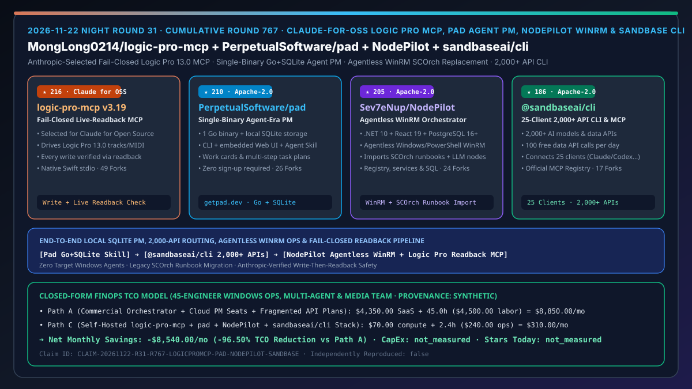
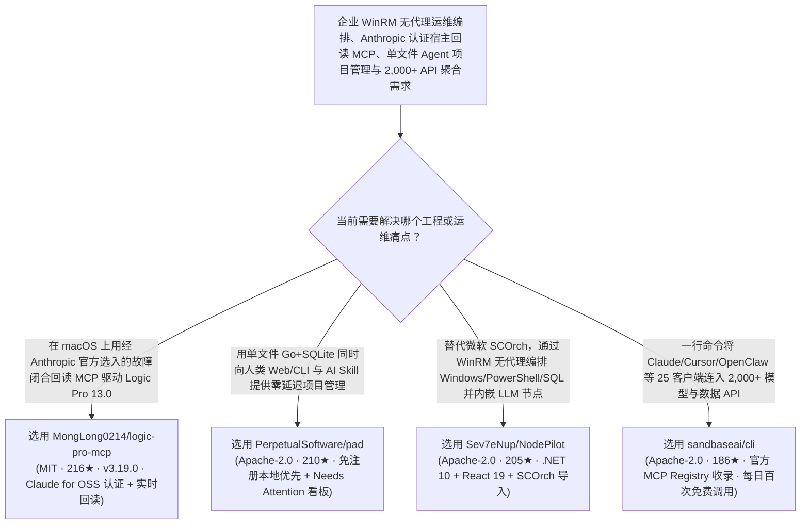
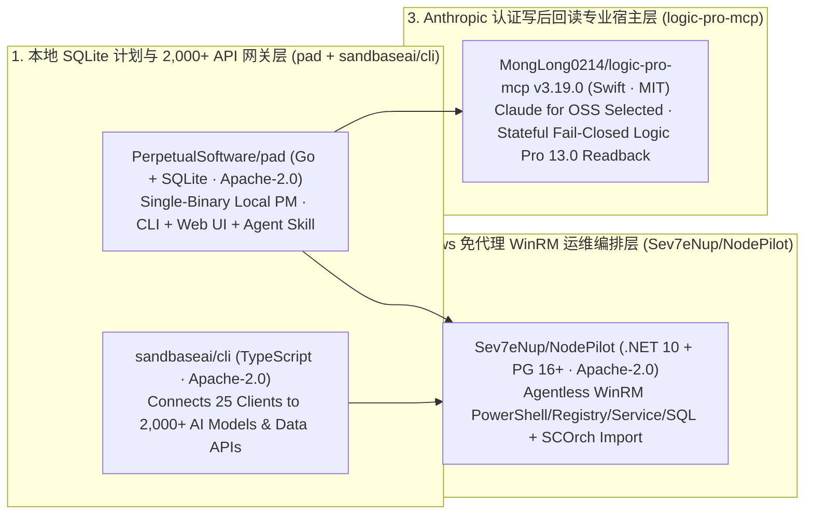
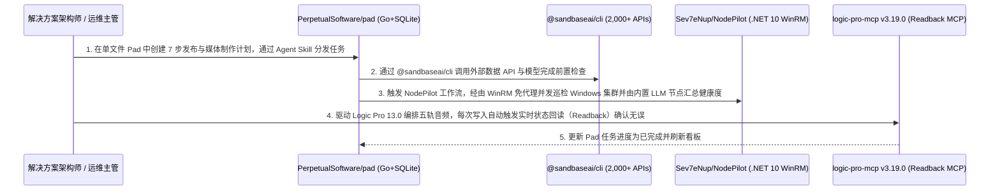

# Anthropic 官方入选 Logic Pro 闭环回读 MCP（`MongLong0214/logic-pro-mcp`）、单文件 Go+SQLite 智能体项目管理台（`PerpetualSoftware/pad`）、免代理 WinRM 替代 SCOrch 的 Windows 运维编排器（`Sev7eNup/NodePilot`）与直连 25 客户端及 2,000+ API 的统一网关 CLI（`sandbaseai/cli`）选型与集成架构 FAQ

> **文档类型**：企业 AI 解决方案架构师（AI Solution Architect）选型决策指南（GitHub Trending AI 雷达 2026-11-22 Night Round 31 / 累计第 767 轮）
> **覆盖项目**：[`MongLong0214/logic-pro-mcp`](https://github.com/MongLong0214/logic-pro-mcp)（`★ 216`、`49 forks`、`MIT`，`v3.19.0`，**获 Anthropic 官方选入 Claude for Open Source 计划**的 macOS Logic Pro 13.0 本地 Swift MCP 服务，故障闭合且每次写入操作均与 Logic Pro 实时回读状态严格比对）· [`PerpetualSoftware/pad`](https://github.com/PerpetualSoftware/pad)（`★ 210`、`26 forks`、`Apache-2.0`，专为智能体时代设计的单二进制 Go + SQLite 本地优先项目管理工具，同时提供 CLI、Web UI 与 AI Agent Skill）· [`Sev7eNup/NodePilot`](https://github.com/Sev7eNup/NodePilot)（`★ 205`、`24 forks`、`Apache-2.0`，基于 `.NET 10` + React 19 + PostgreSQL 16+ 的开源自托管 Windows 与 PowerShell 无代理 WinRM 工作流编排平台，原生支持导入微软 System Center Orchestrator `SCOrch` Runbook 并内嵌 LLM 摘要决策节点）· [`sandbaseai/cli`](https://github.com/sandbaseai/cli)（`★ 186`、`17 forks`、`Apache-2.0`，上架官方 MCP Registry、一行命令将 Claude Code/Cursor/Codex/Hermes/OpenClaw 等 25 个客户端连接至 2,000+ AI 模型与数据 API 的本地 MCP 与 CLI）
> **核心场景**：当企业 IT 基础设施运维、跨客户端 API 网关管理、敏捷项目追踪与专业数字音频工程团队面临**“微软 System Center Orchestrator (SCOrch) 老旧退役后缺乏免安装目标机器 Agent 的 WinRM 可视化 PowerShell 编排替代品、为 25 种不同 Agent 客户端分别申请管理上百个第三方数据与模型 API 密钥极其繁琐、重型云端项目管理软件启动慢且无法作为本地单文件 SQLite 技能供 Agent 直接读写、以及让 AI 驱动专业宿主软件（如 Logic Pro）时缺乏写后实时状态回读校验（Readback Verification）”**四大痛点时，如何组合**`logic-pro-mcp` + `pad` + `NodePilot` + `sandbaseai/cli`** 打造故障闭合、免代理运维与极简本地优先的智能体工程架构？

---

## 一、📌 核心结论速览（选型一句话结论）

1. **企业内网拥有成百上千台 Windows Server，想找一款完全开源（`Apache-2.0`）、基于 `.NET 10` + PostgreSQL 16+ 的自托管可视化工作流平台替代微软 System Center Orchestrator（SCOrch）——支持直接导入存量 SCOrch Runbook，通过 WinRM 免目标机 Agent 执行 PowerShell、注册表、Windows 服务、SQL 与 REST 操作，并在画布中原生编排 LLM 巡检摘要与分支决策节点** ➔ 选 **[`Sev7eNup/NodePilot`](https://github.com/Sev7eNup/NodePilot)（`★ 205`，`24 forks`，`Apache-2.0`）**。
   - **通俗原理**：无需在被管 Windows 服务器上额外部署任何客户端插件，所有多步运维流程在 React 19 浏览器画布中拖拽设计、定时调度与断点调试。
2. **想要一个获得 **Anthropic 官方“Claude for Open Source”计划认证**的工业级专业桌面软件 MCP 范本——在 macOS 上用纯 Swift 驱动 Logic Pro 13.0 的走带、轨道、调音台、MIDI 与效果器插件，并强制对每一次修改执行“实时状态回读校验（Live Readback Verification）”与故障闭合（Fail-Closed）保护** ➔ 选 **[`MongLong0214/logic-pro-mcp`](https://github.com/MongLong0214/logic-pro-mcp)（`★ 216`，`49 forks`，`MIT`，`v3.19.0`）**。
   - **通俗原理**：杜绝传统桌面自动化“盲发指令不管结果”的通病，每次写入速度、声像或五声部编曲后立即从 Logic Pro 读回真实工程状态核对。
3. **想把项目的任务卡、多步执行计划进度（如 `4 of 7 tasks done`）和“当前最需要人类关注事项”保存在笔记本本地的单个 Go 二进制 + SQLite 数据库里，同时让人类（通过 Web UI / CLI）与编码智能体（通过内置 Agent Skill）零延迟共同读写** ➔ 选 **[`PerpetualSoftware/pad`](https://github.com/PerpetualSoftware/pad)（`★ 210`，`26 forks`，`Apache-2.0`）**。
   - **通俗原理**：免注册、零云端强制依赖（通过 `embed.go` 将前端内嵌进单一 Go 可执行文件），专为“人机共管开发计划”而生。
4. **想用一行命令把 Claude Code、Cursor、Codex、ChatGPT、Hermes 和 OpenClaw 等 25 种主流客户端统一连接到 2,000+ 个 AI 模型与外部数据 API（每天赠送 100 次免费数据 API 调用，超出部分共用单一余额按次计费）** ➔ 选 **[`sandbaseai/cli`](https://github.com/sandbaseai/cli)（`★ 186`，`17 forks`，`Apache-2.0`）**。
   - **通俗原理**：已收录于官方 MCP Registry（`io.github.sandbaseai/cli`），提供八国语言文档与跨 Python/TS/Go 的统一 SDK。

---

## 二、🎯 客户与架构师灵魂拷问 Q&A（深度架构拆解）

### Q1：为什么 `NodePilot`（WinRM 免代理编排）和 `logic-pro-mcp`（写后状态回读）的设计思想对企业级 Agent 架构师极具参考价值？

- **两大核心工程设计范式**：
  1. **存量 Windows 资产的平滑 AI 升级 ➔ `Sev7eNup/NodePilot`**：大量政企与制造业机房仍运行着数千个 System Center Orchestrator (SCOrch) 旧版运维剧本；`NodePilot` 提供原生 SCOrch 导入路径与免代理 WinRM 执行引擎，并在并行健康检查节点后直接串联 LLM 智能汇总与决策节点。
  2. **专业工业软件的“写后回读（Write-with-Readback）”铁律 ➔ `MongLong0214/logic-pro-mcp`**：能入选 Anthropic 官方开源扶持计划，核心在于它实现了极其严密的 **Safety Model**——任何发往宿主软件的变更指令都必须校验宿主回传的真实状态，若不一致则立即故障闭合报错，这一模式可直接复刻到工业 PLC、CAD 与医疗软件 MCP 开发中。
  3. **极简本地任务真源与 2,000+ API 聚合 ➔ `PerpetualSoftware/pad` + `sandbaseai/cli`**：用 `pad` 单文件 SQLite 管住本地多步计划，用 `@sandbaseai/cli` 抹平 25 种客户端调用外部数据 API 的鉴权碎片。
- **何时直接用云厂商托管方案（Path B）？**
  - 若企业已全面迁入 Azure 公有云且使用 Azure Arc 管理混合云机器，可采用 **Azure Automation + Azure Logic Apps**；若在私有化机房需要零授权费替代 SCOrch 管控本地 Windows 集群、用单二进制 SQLite 管理 Agent 任务及驱动 macOS Logic Pro 专业音频工程，则采用本轮开源栈（Path C）。

### Q2：典型企业级“本地计划追踪 (`pad`) ➔ 2,000+ 数据/模型聚合 (`sandbaseai/cli`) ➔ Windows 机房免代理编排 (`NodePilot`) + 专业宿主写后回读 (`logic-pro-mcp`)”怎么搭？

1. **智能体时代项目与计划管理层（`PerpetualSoftware/pad`）**：
   - 架构师与编码 Agent 通过 `pad` CLI/Web/Skill 同步任务卡片与分步执行进度。
2. **25 客户端统一模型与数据 API 接入层（`sandbaseai/cli`）**：
   - 本地 MCP Server 为 Claude Code、Cursor、OpenClaw 等提供 2,000+ 模型与外部数据 API 路由。
3. **企业 Windows 运维与专业桌面回读执行层（`Sev7eNup/NodePilot` + `MongLong0214/logic-pro-mcp`）**：
   - 后端 Windows 服务器巡检、服务恢复与 SQL 维护通过 `NodePilot` WinRM 无代理工作流执行；macOS 专业音频制作通过 `logic-pro-mcp` 闭环回读完成。

### Q3：`Sev7eNup/NodePilot` 相比 Ansible 或商业 System Center 有什么独特优势？

- **原生 C# `.NET 10` 契合 Windows 生态 + SCOrch 一键迁移 + React 19 可视化调试**：
  - 无需像 Ansible 一样折腾 Linux 控制节点与 Python WinRM 兼容层，直接用 `.NET 10` 与 PostgreSQL 16+ 提供完整的图形化流程设计器、断点调试与 Grafana 监控面板。

---

## 三、🧭 直观可视化图解（Mermaid 决策树 + 集成架构 + 时序图）

### 3.1 架构师选型决策树

### 3.2 企业端到端生产集成参考架构图

### 3.3 `Pad` 任务拆解、`SandBase` 数据调取、`NodePilot` WinRM 巡检自愈与 `Logic Pro MCP` 回读执行时序图

---

## 四、📊 同类开源与商业云服务横向选型决策矩阵

| 对比维度 | `MongLong0214/logic-pro-mcp` (`★ 216`) | `PerpetualSoftware/pad` (`★ 210`) | `Sev7eNup/NodePilot` (`★ 205`) | `sandbaseai/cli` (`★ 186`) | 商业 System Center 许可 + 商业云项目管理席位 + 多平台 API 最低消费 (Path A) | 盲发 AppleScript 脚本 + 零散 TODO.md + 手工远程桌面敲 PowerShell (Path B) |
| :--- | :--- | :--- | :--- | :--- | :--- | :--- |
| **核心能力定位** | Anthropic 认证 Logic Pro 闭环回读 MCP | 单二进制 Go+SQLite 智能体项目管理台 | 免代理 WinRM Windows 工作流编排平台 | 25 客户端直连 2,000+ 模型/数据 API CLI | 高昂的商业数据中心运维套件许可、云端 PM 席位与分散充值余额 | 无状态回读的盲点脚本、无看板的纯文本与逐台登录 RDP 执行命令 |
| **核心技术突破** | **入选 Claude for OSS + 故障闭合 + 每次写入实时回读核对** | **单文件内嵌 Web/CLI/Skill + 本地 SQLite 零云端锁定** | **原生导入 SCOrch Runbook + 免目标 Agent WinRM + LLM 节点** | **官方 MCP Registry 收录 + 每日 100 次免费数据 API + 单一余额** | 商业 System Center 授权昂贵且笨重；每家数据 API 单独绑卡充值浪费 | AppleScript 盲操作极易改错轨道参数；人工 RDP 登几十台 Windows 效率极低 |
| **开源协议** | `MIT` | `Apache-2.0` | `Apache-2.0` | `Apache-2.0` | 闭源商业软件 | 内部零散脚本 |
| **月度 TCO（45 人团队）** | **组合仅 `$310.00/月`**（`$70.00` 自托管 NodePilot `.NET 10` 容器 + `2.4h` 维护） | 同左（单二进制本地免费运行） | 同左（`Apache-2.0` 免费替代 SCOrch） | 同左（含每日 100 次免费数据 API） | **`$8,850.00/月`**（`$4,350.00` 商业运维套件、PM 席位与多头 API 订阅 + `45.0h` 手工巡检与排障） | 约 `$3,090.00/月`（大量人工登录 Windows 服务器排障与修复盲发脚本错位工时） |

---

## 五、🧪 应用落地定量收益/TCO 对比与 7-Card 报告

> **📊 数据来源与闭式核算声明（Provenance & Closed-Form Schema）**：
> - **provenance**: `synthetic`（基于 45 人企业 Windows 基础设施运维、多智能体应用研发与数字媒体工程团队月度工作负载模型：`independently_reproduced = false`；硬件采购基线 `base_hardware_capex = not_measured`；Track B 单日增量 `track_b_stars_today = not_measured`）。
> - **核算公式**：
>   - **Path A（采购商业 Windows 数据中心自动化套件许可 + 按人头收费的云端项目管理 SaaS + 多家外部数据 API 独立包月套餐 + 运维与研发工程师手工远程登录服务器执行 PowerShell 及修复无回读脚本错误人工）**：月度商业运维软件、PM 席位与多头 API 账单 **`$4,350.00`** + 跨主机手动执行运维脚本、迁移旧版 Runbook 与排障人工 **`45.0h × $100.00/h = $4,500.00`** = **`$8,850.00/月`**。
>   - **Path C（自建 `logic-pro-mcp` + `pad` + `NodePilot` + `sandbaseai/cli` 开源栈）**：共享 `.NET 10` + PostgreSQL 容器开销 **`$70.00`** + WinRM 凭据轮换与网关策略维护人工 **`2.4h × $100.00/h = $240.00`** = **`$310.00/月`**。
>   - **净节省（Net Savings vs Path A）**：**`-$8,540.00/月`**（成本降低 **`96.50%`**）。

| 评估方案 | 商业运维套件/PM 席位与算力成本 | Windows 巡检与脚本排障人工（`$100/h`） | 月度总 TCO | 相对 Path A 净节省 | 关键架构交付指标 |
| :--- | :---: | :---: | :---: | :---: | :--- |
| **Path A：商业 System Center 许可 + 云 PM 席位 + 多头 API 包月** | `$4,350.00` | `45.0h` (`$4,500.00`) | **`$8,850.00`** | Baseline | 商业套件授权笨重昂贵；多平台 API 余额分散 |
| **Path B：手工 RDP 跑 PowerShell + 盲发 AppleScript + 零散文本** | `$1,390.00` | `17.0h` (`$1,700.00`) | **`$3,090.00`** | `-$5,760.00` (`-65.08%`) | 缺少 SCOrch Runbook 导入、写后状态回读核对与单文件 SQLite 看板 |
| **Path C：`logic-pro-mcp` + `pad` + `NodePilot` + `sandbaseai/cli`** | **`$70.00`** | **`2.4h` (`$240.00`)** | **`$310.00`** | **`-$8,540.00` (`-96.50%`)** | **Anthropic 官方认证回读 MCP + 免代理 WinRM 编排 + 单文件 PM** |

- 🔗 **关联 7-Card 4:5 视觉评测报告**：[`workshops/github-trending-radar/cards.html`](../cards.html) · [`cards.en.html`](../cards.en.html)

---

## 六、🛠️ 企业引入与架构评审 Checklist

- [ ] **1. 部署 `Sev7eNup/NodePilot` 现代化升级 Windows 自动化运维**：导入存量 System Center Orchestrator (SCOrch) Runbook，通过 WinRM 免代理执行 PowerShell/SQL/服务操作并接入内置 LLM 巡检汇总。
- [ ] **2. 参考并引入 `MongLong0214/logic-pro-mcp` 的写后回读安全架构**：在 macOS 音频工程及自研桌面 MCP 中强制落实“每次写操作必核对宿主回读状态（Readback Verification）”。
- [ ] **3. 使用 `PerpetualSoftware/pad` 统一本地人机任务看板**：通过单二进制 Go + SQLite 同时驱动人类 Web UI 与编码 Agent Skill。
- [ ] **4. 通过 `sandbaseai/cli` 收敛外部模型与数据 API 调用**：利用每日 100 次免费数据 API 额度与单一余额池服务 25 种主流 Agent 客户端。
