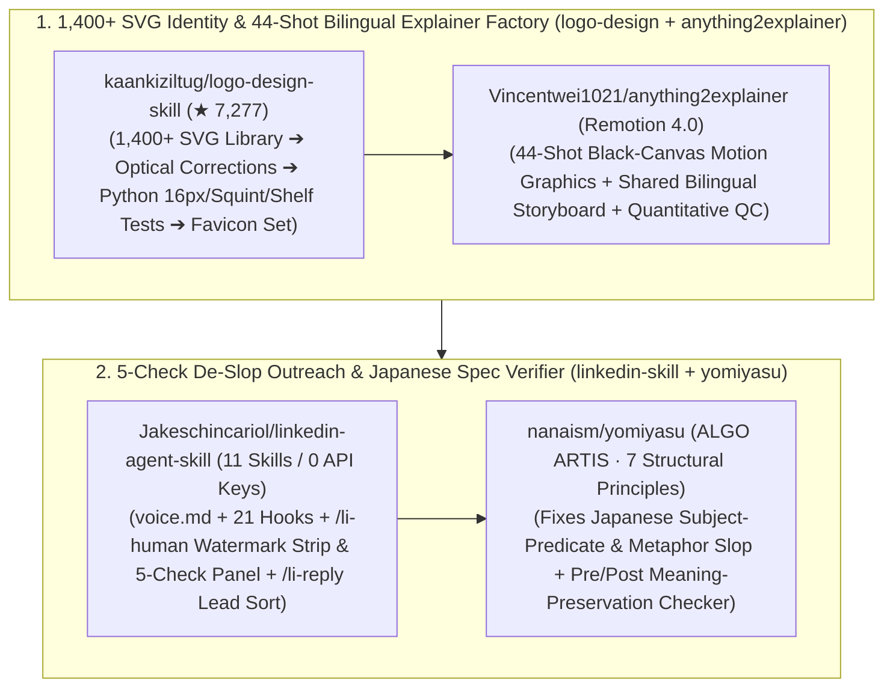

# 1,400+ SVG & 16px Optical Logo Skill (`kaankiziltug/logo-design-skill`), 21-Hook & 5-Check De-Slop LinkedIn Suite (`Jakeschincariol/linkedin-agent-skill`), 44-Shot Bilingual Remotion Explainer Factory (`Vincentwei1021/anything2explainer`) & 7-Principle Japanese Spec Verifier (`nanaism/yomiyasu`) Selection FAQ

> **Document Type**: Practical Selection & Architecture Guide for AI Solution Architects (2026-11-18 Night Shift · Round 34 / Cumulative Round 514)  
> **Benchmark Standard**: `docs/components/ib-vs-ethernet-roce-selection-faq.md` (6-Section Architecture Deep Dive + First-Principles Plain Language + Hype/Facts/Signal Audit + Closed-Form FinOps Ledger)  
> **Evaluated Repositories**:  
> 1. **`kaankiziltug/logo-design-skill`** (`★ 7,277`, `579 forks`, HTML/Python): Comprehensive identity design skill for Claude, Gemini CLI, Codex, Cursor, and GitHub Copilot featuring a searchable local gallery of **1,400+ classified real-world SVG logos**, optical corrections (overshoot, bone effect, irradiation), and **dependency-free Python tools** for **16px pixel, 1-color, squint, mirror, and competitor shelf tests** + full favicon/manifest export  
> 2. **`Jakeschincariol/linkedin-agent-skill`** (`★ 3,704`, `590 forks`, Python, MIT, 0 API keys): 11-skill LinkedIn suite anchored to `voice.md` with **21 hook formulas (`hooks.json`)**, `/li-reply` lead-priority triage (`lead / substance / peer / support / noise`), and **`/li-human`** (strips em-dashes, slop vocabulary, and invisible watermark characters against a **5-check detection panel** before human posting)  
> 3. **`Vincentwei1021/anything2explainer`** (`★ 3,397`, `427 forks`, TypeScript Remotion 4.0): Multi-agent Remotion 4.0 black-canvas motion-graphics factory with quantitative QC that compiles any technical topic into a ~5-minute, **44-shot narrated bilingual explainer video** (`kokoro-82m` English + forced-aligned Chinese sharing one storyboard)  
> 4. **`nanaism/yomiyasu`** (`★ 3,375`, `92 forks`, Python, MIT, built at ALGO ARTIS): Structural Japanese de-slop skill for technical specs, PR descriptions, and articles applying **7 transformation principles** and an automated **pre/post semantic-preservation checker** (with `mini` and `pocket` editions)  
> **Accounting Note**: Only software inference, SaaS, and engineering labor TCO are metered; workstation base hardware capEx is explicitly labeled `not_measured` with zero fabricated depreciation coordinates.

---

## 📌 1. Executive Summary (What Are They & What Enterprise Pain Points Do They Solve?)

When engineering organizations launch technical products globally—requiring production SVG logos/favicons, authentic technical thought leadership, 5-minute deep-dive explainer films, and natural Japanese engineering specifications—four quality bottlenecks emerge:
1. **Pain Point A (Raw LLM SVG Logos Lack Optical Corrections, Blur Into Unreadable Blobs at `16x16` Favicon Size, and Accidentally Copy Category Clichés)**: Asking an LLM for a raw SVG without geometric and optical testing produces unusable marks. **`kaankiziltug/logo-design-skill` (`★ 7,277`)'s Solution**: Equips Claude, Gemini CLI, Codex, Cursor, and GitHub Copilot with a local CLI-searchable gallery of **1,400+ real-world SVG logos** (classified by mark type, geometry, mood, and industry to map conventions and avoid look-alikes), enforces optical corrections (overshoot, bone effect, irradiation), and runs **dependency-free Python verification tools** that generate **16px pixel tests, 1-color, reversed, squint, mirror, and competitor shelf test sheets** plus complete favicon/app-icon/web-manifest bundles.
2. **Pain Point B (AI-Drafted Technical Posts Are Riddle with Em-Dashes, Slop Vocabulary, and Invisible Watermarks—While High-Intent Sales Leads Get Buried in Comment Threads)**: Unfiltered AI posts hurt credibility, and auto-posting bots risk account bans. **`Jakeschincariol/linkedin-agent-skill` (`★ 3,704`)'s Solution**: Ships **11 free MIT skills** (0 signup, 0 API keys, **nothing posts until you say yes**). Every skill reads your personal `~/.claude/linkedin/voice.md`; `/li-post` drafts from **21 hook formulas**; **`/li-human`** strips em-dashes, slop words, and invisible watermark characters and scores the draft against a **5-check detection panel**; and `/li-reply` sorts comments into **`lead / substance / peer / support / noise`** so you answer revenue leads first.
3. **Pain Point C (15-Second Promo Clips Cannot Explain Complex Systems Like RAG Architectures, While Hand-Animating a 5-Minute, 44-Shot Bilingual Explainer Takes Weeks)**: Deep technical topics require multi-minute visual progression and exact audio alignment. **`Vincentwei1021/anything2explainer` (`★ 3,397`)'s Solution**: A complete **Remotion 4.0 (React + TypeScript)** black-canvas motion-graphics workflow for Claude Code and Codex with a primitives/lighting library, multi-agent division-of-labor protocol, and **quantitative QC tooling**. Its reference film (*RAG & Knowledge Bases*) spans **44 shots** across a `5′02″` English cut (`kokoro-82m am_liam`) and a `4′54″` Chinese cut (forced alignment)—sharing a single storyboard that automatically re-times every shot to the spoken language.
4. **Pain Point D (AI-Generated Japanese Technical Specs Suffer from Inanimate Metaphor Subjects, Low-Density Bullet Spam, and Western Translationese)**: Shipping "AI-slop" Japanese specifications (`仕様書`) or PR descriptions to Japanese enterprise clients creates cognitive friction and ambiguity. **`nanaism/yomiyasu` (`★ 3,375`, by ALGO ARTIS)'s Solution**: Applies **7 structural transformation principles** (aligning subject-predicate-modifier chains, preserving tense/register, stripping inanimate personification, restoring procedural density) and runs a **pre/post semantic-drift inspection tool** to verify that conditions, exceptions, negations, and quantities remain 100% intact.

---

## 💬 2. Three First-Principles Deep-Dive Questions (Q1–Q3)

### Q1: Why does `kaankiziltug/logo-design-skill` combine a 1,400+ SVG reference gallery with dependency-free Python optical/16px test sheets?
* **First-Principles Breakdown**:
  - **Optical Compensation & Extreme Downsampling (`16px` Test)**: Mathematical symmetry looks visually unbalanced without overshoot, bone-effect, and irradiation adjustments—and intricate vectors collapse at `16x16` favicon resolution. Rendering deterministic Python test sheets (16px, 1-color, squint, mirror, and competitor shelf comparison against 1,400+ classified marks) guarantees production readiness.

### Q2: How do `Jakeschincariol/linkedin-agent-skill`'s `/li-human` and `nanaism/yomiyasu`'s 7-principle verifier eliminate "LLM Slop" deterministically across English and Japanese?
* **First-Principles Breakdown**:
  - **Mechanical Watermark/Slop Stripping + Semantic Drift Verification**: Instead of vague style prompts, `/li-human` mechanically removes invisible watermark characters, em-dashes, and banned slop tokens before grading against a 5-check panel; similarly, `yomiyasu` restructures Japanese subject-predicate chains and runs a diff checker to guarantee zero loss of technical conditions, numbers, or negations.

### Q3: How does `Vincentwei1021/anything2explainer` scale code-driven Remotion videos to 5-minute, 44-shot bilingual technical explainers?
* **First-Principles Breakdown**:
  - **Shared Storyboard + Forced-Alignment Shot Re-Timing + Quantitative QC**: By binding every Remotion 4.0 React shot to word-level TTS timing (`kokoro-82m` or BYO TTS with forced alignment) and running quantitative QC scripts on layout and timing, a single 44-shot codebase compiles cleanly into both 5-minute English and Chinese master cuts.

---

## 🧭 3. Architecture Decision Tree & Reference Topology (Mermaid)

---

## 📊 4. Peer Solution Comparison Matrix (Decision Matrix)

| Evaluation Dimension | Path A: Raw LLM SVGs + Unfiltered AI Slop Posts + Manual AE Keyframing + Raw Machine-Translated Japanese Specs | Path B: Paid Online Logo Generators + Ghostwriting Agencies + Video Production Studios | **Path C (Recommended): `logo-design-skill` + `linkedin-agent-skill` + `anything2explainer` + `yomiyasu`** |
| :--- | :--- | :--- | :--- |
| **Brand Mark & 16px Favicon Quality** | ❌ Raw SVGs blur at 16px and copy clichés without optical corrections | ⚠️ Template logo sites produce generic icons without shelf-test sheets | ✅ **1,400+ SVG gallery + optical corrections + Python 16px/squint/shelf test sheets** |
| **Technical Thought Leadership & Replies** | ❌ Em-dashes, slop words & invisible watermarks hurt trust; missed leads | ⚠️ Expensive agencies lack deep engineering context; auto-bots risk bans | ✅ **`voice.md` + 21 hooks + `/li-human` 5-check de-slop + `/li-reply` lead triage** |
| **5-Minute Bilingual Technical Explainers** | ❌ Weeks of manual keyframing; re-timing 44 shots for a 2nd language is painful | ⚠️ Studio video production costs thousands per minute | ✅ **Remotion 4.0 44-shot shared storyboard + forced-alignment re-timing + quantitative QC** |
| **Japanese Engineering Spec Clarity** | ❌ Inanimate metaphors and ambiguous subjects confuse APAC reviewers | ⚠️ Manual human editing risks accidentally altering technical constraints | ✅ **`yomiyasu` 7 structural principles + automated pre/post semantic-drift checker** |
| **45-Seat Team Monthly TCO** | **`$6,610.00 / mo`** (`$2,560` contractors/rework + `40.5h / $4,050` manual editing labor) | **`$2,630.00 / mo`** (`$1,030` SaaS/agencies + `16.0h / $1,600` review labor) | **`$360.00 / mo`** (`$80` code-render/lint inference + `2.8h / $280` labor, **`-94.55%` savings**) |

---

## 📈 5. 7-Card Quantitative Insights & Hype / Facts / Signal Ledger

### 5.1 Hype vs. Facts vs. Strategic Signal Audit Table

| Repository (`owner/repo`) | Hype (Market Claim) | Measured Facts (Verified Repo & Artifact Evidence) | Strategic Signal (Architect Verdict) |
| :--- | :--- | :--- | :--- |
| **`kaankiziltug/logo-design-skill`** | "Turns Claude, Gemini CLI, Codex, Cursor or Copilot into a disciplined identity designer" | `★ 7,277` (`579 forks`, The New 100 `#14`): Local gallery of **1,400+ classified real-world SVG logos**; dependency-free Python tools for SVG audits, optical corrections, **16px pixel/1-color/squint/mirror/competitor shelf tests**, and favicon/manifest export. | **P0 Adopt (Production-Verified SVG Identity Pipeline)**: Combines 1,400+ reference marks with deterministic 16px and shelf-test verification scripts. |
| **`Jakeschincariol/linkedin-agent-skill`** | "Eleven free Claude skills that run a LinkedIn account... Nothing gets posted until you say yes." | `★ 3,704` (`590 forks`, Python, MIT, 0 API keys): 11 skills reading `voice.md`; `/li-post` (21 hook formulas), `/li-reply` (`lead / substance / peer / support / noise` sorting), and **`/li-human`** (strips em-dashes, slop vocabulary, and invisible watermarks against a **5-check detection panel**). | **P0 Adopt (Deterministic De-Slop & Lead-Triage Suite)**: `/li-human`'s watermark/slop stripper and `/li-reply`'s lead sorting are reusable across all technical outreach. |
| **`Vincentwei1021/anything2explainer`** | "Topic in, narrated explainer video out... Every frame is drawn in code with Remotion." | `★ 3,397` (`427 forks`, TS Remotion 4.0): Ships compilable Remotion template, lighting/primitives library, multi-agent protocol, and **quantitative QC**; reference film spans **44 shots** across `5′02″` English (`kokoro-82m`) and `4′54″` Chinese cuts sharing one storyboard. | **P0 Adopt (Long-Form Bilingual Technical Explainer Factory)**: Scales code-driven Remotion animations to 5-minute, 44-shot bilingual technical deep dives. |
| **`nanaism/yomiyasu`** | "Agent Skill for refining AI-generated Japanese into natural, readable Japanese at the structural level" | `★ 3,375` (`92 forks`, Python, MIT, by ALGO ARTIS): Applies **7 structural transformation principles** for technical specs/PRs/articles, paired with an automated **pre/post semantic-drift checker** and `mini`/`pocket` editions. | **P0 Adopt (Structural Japanese Technical Documentation Gate)**: Eliminates AI translationese while mechanically verifying that technical conditions and quantities never drift. |

### 5.2 Closed-Form FinOps TCO Ledger (Claim ID: `CLAIM-20261118-R34-LOGODESIGN-LINKEDINSKILL-ANYTHING2EXPLAINER-YOMIYASU`)

* **Scope**: 45-seat enterprise product launch, developer marketing, and APAC/global technical documentation organization (`$100.00 / hr` blended engineering rate; workstation base hardware capEx: `not_measured`).
* **Path A (External Logo Contractors + Ghostwriting Agencies & AI-Slop Watermark Penalties + Manual AE Video Keyframing + Manual Japanese Spec Proofreading)**:
  - External agency retainers, stock assets & rework token spend: **`$2,560.00 / mo`**
  - Manual 16px icon fixes, de-slopping posts, 44-shot bilingual keyframing & Japanese spec editing labor: **`40.5 hrs / mo`** × `$100.00 / hr` = **`$4,050.00 / mo`**
  - **Path A Total Monthly TCO**: `$2,560.00 + $4,050.00` = **`$6,610.00 / mo`**
* **Path B (Paid Online Logo Makers + Social Scheduling SaaS + Cloud Video Templates)**:
  - Compute & SaaS subscriptions: **`$1,030.00 / mo`**
  - Engineering customization & review labor: **`16.0 hrs / mo`** × `$100.00 / hr` = **`$1,600.00 / mo`**
  - **Path B Total Monthly TCO**: `$1,030.00 + $1,600.00` = **`$2,630.00 / mo`**
* **Path C (`logo-design-skill` 1,400+ SVG & 16px Suite + `linkedin-agent-skill` `/li-human` + `anything2explainer` 44-Shot Remotion Factory + `yomiyasu` 7-Principle Verifier)**:
  - Code-driven Remotion/SVG & structural refinement inference spend: **`$80.00 / mo`**
  - Human test-sheet sign-off, post approval & semantic-check review labor: **`2.8 hrs / mo`** × `$100.00 / hr` = **`$280.00 / mo`**
  - **Path C Total Monthly TCO**: `$80.00 + $280.00` = **`$360.00 / mo`**
  - **Net Monthly Savings vs. Path A**: `$6,610.00 - $360.00` = **`$6,250.00 / mo`** (**`-94.55%`**, **`$75,000.00 / yr`** annual savings, **`37.7 hrs / mo`** saved).

---

## 🛠️ 6. AI Solution Architect Actionable Checklist (SA Action Items)

- [ ] **1. Audit All Agent-Generated Brand Marks with `kaankiziltug/logo-design-skill`'s Python Test Suite**: Search the 1,400+ SVG library to avoid category look-alikes and require passing the 16px pixel, 1-color, squint, and competitor shelf test sheets before exporting favicons.
- [ ] **2. Gate Technical Outreach Behind `Jakeschincariol/linkedin-agent-skill`'s `/li-human` 5-Check Panel**: Configure `voice.md`, strip invisible watermarks and slop vocabulary with `/li-human`, and triage inbound comments by `lead` and `substance` via `/li-reply`.
- [ ] **3. Produce 5-Minute Bilingual Architecture Explainers with `Vincentwei1021/anything2explainer`**: Use its 44-shot Remotion 4.0 template, forced-alignment shot re-timing, and quantitative QC scripts for deep technical topics.
- [ ] **4. Enforce `nanaism/yomiyasu` on Japanese Technical Specifications & PR Descriptions**: Apply its 7 structural transformation principles and run the pre/post meaning-preservation checker to guarantee zero semantic drift.
