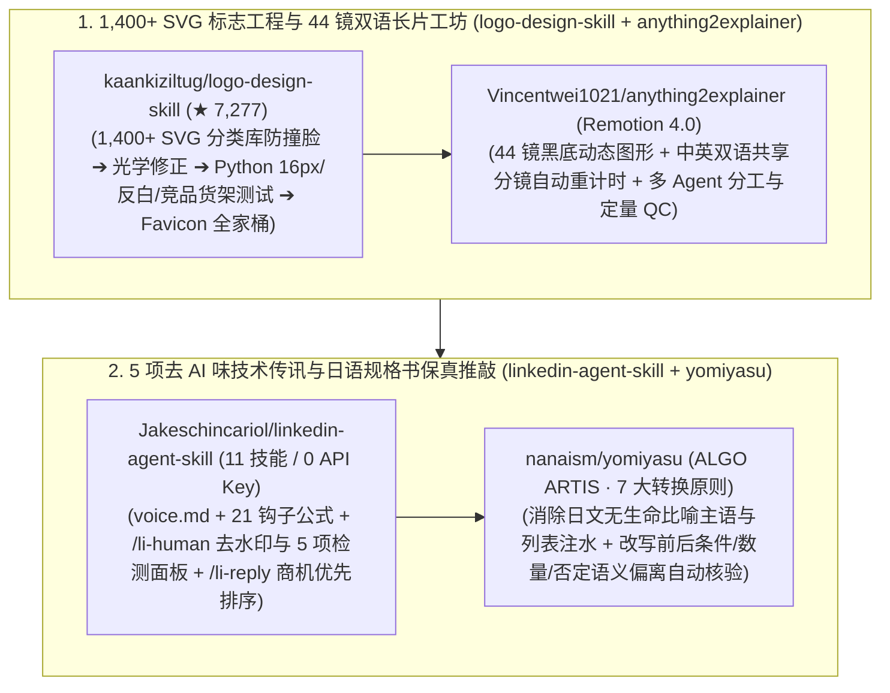

# 1,400+ SVG 库与 16px 光学检验标志设计技能（`kaankiziltug/logo-design-skill`）、21 钩子与 5 项去 AI 味检测 LinkedIn 技能包（`Jakeschincariol/linkedin-agent-skill`）、44 镜双语 Remotion 定量质检长视频工坊（`Vincentwei1021/anything2explainer`）与 7 原则日语技术文档语义保真推敲器（`nanaism/yomiyasu`）选型 FAQ

> **文档类型**：AI Solution Architect（AI 解决方案架构师）实战选型与架构内功指南（2026-11-18 Night Shift · Round 34 / 累计第 514 轮）  
> **对标标杆**：`docs/components/ib-vs-ethernet-roce-selection-faq.md`（六段式架构拆解 + 第一性原理大白话 + Hype/Facts/Signal 审计 + 闭式 TCO 账本）  
> **本轮评估对象**：  
> 1. **`kaankiziltug/logo-design-skill`**（`★ 7,277`, `579 forks`, HTML/Python）：面向 Claude、Gemini CLI、Codex、Cursor 与 GitHub Copilot 的专业品牌标志设计技能（内置 **1,400+ 个按几何/行业分类的真实世界 SVG 标志参考库** + 零依赖 Python 光学修正与 **16px 像素/单色/反转/眯眼/镜像/竞品货架测试工具** + 全套 Favicon/Web-Manifest 导出）  
> 2. **`Jakeschincariol/linkedin-agent-skill`**（`★ 3,704`, `590 forks`, Python, MIT, 0 API Key）：由 11 个子技能组成的 LinkedIn 技术影响力运营套件（基于 `voice.md` 个人语料、**21 套开篇钩子公式 `hooks.json`**、按 `lead/substance/peer/support/noise` 优先级排序回复的 `/li-reply`，以及剔除破折号/AI 黑话/隐形水印并通过 **5 项检测面板评分的 `/li-human`**，坚持人工最终发布）  
> 3. **`Vincentwei1021/anything2explainer`**（`★ 3,397`, `427 forks`, TypeScript Remotion 4.0）：将任意技术主题转化为 5 分钟黑底动态图形深度解说长片的 Claude Code / Codex 技能（基于 Remotion 4.0 纯代码逐帧绘制 44 个镜头，支持英文 `kokoro-82m` 与中文强对齐双版本共享同一分镜，内置定量 QC 门禁与多 Agent 分工协议）  
> 4. **`nanaism/yomiyasu`**（`★ 3,375`, `92 forks`, Python, MIT, ALGO ARTIS 出品）：针对技术文章、设计规格书与 PR 描述的 AI 日语“去 AI 腔（De-Slop）”与语义保真推敲技能（遵循 **7 大结构转换原则** 修复主谓模糊与无生命主语隐喻，并配备**改写前后语义偏离自动检查脚本**及 `mini`/`pocket` 轻量版）  
> **审计折算说明**：本报告仅计量开发运维与软件推理/人力 TCO，底层工作站硬件采购（base hardware capEx）标注为 `not_measured`，严禁虚构硬件折旧坐标。

---

## 📌 一、核心结论速览（Executive Summary：它到底是什么？解决什么业务痛点？）

当企业研发团队需要将内部孵化的技术产品推向全球市场（设计专业 SVG 品牌图标、撰写创始人/架构师 LinkedIn 技术洞察、制作 5 分钟深度技术原理解说片、以及向日本企业客户交付无翻译腔的设计规格书）时，这四个仓库提供了工业级的检验闭环：
1. **痛点 A（让大模型直接画 SVG Logo，画出来的图形既像同行山寨货，缩到 16x16 浏览器 Favicon 时更糊成一团黑疙瘩）**：大模型缺乏光学视错觉修正（Optical Corrections）与多尺寸压力测试。**`kaankiziltug/logo-design-skill` (`★ 7,277`) 的破局之道**：为 Claude、Gemini CLI、Codex、Cursor 与 Copilot 装上资深品牌设计师的完整工艺流——内置 **1,400+ 个按图形类别、几何结构、情绪与行业打好标签的真实 SVG 标志本地画廊**（用于研究行业惯例并**主动规避撞脸抄袭**）；从 8–12 个一句话概念收敛为 3 个遵从几何构造与光学修正（超调量 Overshoot、骨效应 Bone Effect、光渗 Irradiation）的 SVG 方案；再用**零依赖 Python 工具**自动生成概念总览板与严苛的**六维测试板（16px 像素级缩略测试、纯单色、反白、眯眼模糊、水平镜像、竞品货架并排测试）**，最后一键导出全套 Favicon、App Icon 与 Web Manifest。
2. **痛点 B（用 AI 写技术领英动态满篇破折号 `—`、`delve/tapestry` 等 AI 塑料词汇与隐形 Unicode 水印，一眼假且评论区不知先回潜在客户还是水友）**：未经去 AI 味处理的社媒文章不仅损害技术专家信誉，还会被平台算法降权。**`Jakeschincariol/linkedin-agent-skill` (`★ 3,704`) 的破局之道**：免费 MIT 开源 **11 个专职子技能**（0 注册、0 API Key，绝不代发帖子，必须由人类最终点击发布）：先通过 `templates/voice.md` 提取你自己的真实行文基因；`/li-post` 基于 **21 套经过验证的钩子公式（`hooks.json`）** 生成草稿；核心杀手锏 **`/li-human`（Humanizer）** 用确定性 Python 工具强行剥离破折号、AI 陈词滥调与隐形水印字符，并对照 **5 项 AI 痕迹检测面板** 打分达标后才呈现在你眼前；而 `/li-reply` 则自动把帖子下的评论按 **`lead（商机线索）➔ substance（深度技术探讨）➔ peer（同行）➔ support ➔ noise`** 排序并按优先级生成回复。
3. **痛点 C（几秒钟的短视频讲不透复杂系统如“RAG 与知识库架构”，而做一条 5 分钟、44 个镜头的双语长解说片若靠手写 AE 或拼凑素材库要花两周）**：深度技术架构需要长达 5 分钟的逻辑递进与精准视听同步。**`Vincentwei1021/anything2explainer` (`★ 3,397`) 的破局之道**：基于 **Remotion 4.0（React + TypeScript）** 的全代码黑底动态图形（Black-Canvas Motion Graphics）制片方法论——不用任何外部盗版素材或不可控的生成式视频模型，每一帧均由代码与灯光原语库绘制；内置多 Agent 分工协议、定量质量门禁（Quantitative QC）与跨语种共用分镜机制（例如官方参考片《RAG & Knowledge Bases》**44 个镜头**，英文版 `kokoro-82m` 配音长 `5′02″`，中文版通过字节强制对齐自动重算每个镜头的帧长至 `4′54″`）。
4. **痛点 D（AI 生成或翻译的日文技术规格书与 PR 说明充满“无生命主语配比喻动词、过度加粗列表但缺乏实质步骤、以及生硬的『不是A而是B』西式排比”）**：对日本客户或跨国团队交付充斥“AI 翻译腔（AI-Slop）”的设计书会严重拉低专业信任度。**`nanaism/yomiyasu` (`★ 3,375`, ALGO ARTIS 研发) 的破局之道**：专攻技术文章、设计书/式样书、PR 描述与社内报告，确立 **7 大结构转换原则**（主谓/修饰/条件对齐、文体与时态功能保持、消除拟人化隐喻、提升信息密度等），并配套**改写前后语义偏离自动检查工具**（确保润色绝不篡改原始工程条件、数量或否定逻辑），同时提供免安装环境的 `yomiyasu-mini` 与 `yomiyasu-pocket`。

---

## 💬 二、三大灵魂拷问（Q1–Q3 First-Principles Deep Dive）

### Q1：为什么 `kaankiziltug/logo-design-skill` 必须在 AI 生成 SVG 后强制运行“零依赖 Python 光学修正与 16px / 眯眼 / 竞品货架六维测试板”？
* **第一性原理剖析**：
  - **数学绝对对齐 ≠ 人类视觉平衡**：在几何学上完全等高的一枚圆形和一枚正方形放在一起，人眼看圆形永远显小——必须给圆形加上约 2%–3% 的**光学超调量（Overshoot）**，在锐角交汇处修正**骨效应（Bone Effect）**，在深底浅字时补偿**光渗（Irradiation）**。
  - **16px 极限降采样与竞品防撞脸**：许多在大图下看着精美的复杂 SVG 一旦缩成浏览器标签页上的 `16x16` 像素就会糊成死黑。通过零依赖 Python 脚本自动渲染 16px 像素图、单色/反白图、眯眼高斯模糊图，并与本地 **1,400+ 真实行业 SVG 库** 做货架并排对比（Competitor Shelf Test），从物理上保证了品牌标志的工业可用性与独特性。

### Q2：`Jakeschincariol/linkedin-agent-skill` 的 `/li-human`（5 项反 AI 味检测面板）与 `nanaism/yomiyasu`（7 原则日文结构推敲 + 语义偏离检查器）在消除“大语言模型八股文（AI Slop）”上有哪些共通的第一性原理？
* **第一性原理剖析**：
  - **规则级语法手术优于笼统的“请写得像人一点”**：对 LLM 说“不要有 AI 味”几乎无效。`/li-human` 直接用 Python 脚本机械清除高频破折号、AI 口头禅词表与隐形水印，并用 5 项定量指标拦截不合格草稿；而 `yomiyasu` 则直击日语技术文书的三大结构病灶（无生命抽象名词充当比喻动词主语、滥用加粗冒号列表稀释步骤密度、滥用停顿读点与西式二元对立句），且在润色后用专门的检验工具逐句核对条件、例外、数量与否定关系是否发生漂移。

### Q3：为什么制作 5 分钟级别的深度技术长视频（如 44 镜头 RAG 架构全解）应该选择 `Vincentwei1021/anything2explainer` 的“单分镜双语重计时 + 定量 QC 门禁”？
* **第一性原理剖析**：
  - **音画时长解耦与多语言复用**：同一套 44 镜头的架构拆解，英文配音（785 词，`5′02″`）与中文配音（1,490 字，`4′54″`）每一句台词的持续秒数都不同。`anything2explainer` 让中英文共享同一套 Remotion 4.0 React 代码分镜与灯光组件，由语音强制对齐（Forced Alignment）数据自动重算每一镜的帧数，并经定量 QC 工具校验字幕、进度条与动画关键帧零错位。

---

## 🧭 三、架构选型决策树与端到端参考架构图（Mermaid）

---

## 📊 四、同类方案横向选型对比矩阵（Decision Matrix）

| 评估维度 | 路径 A：裸调 LLM 画 SVG / 外包设计 + 裸写充斥破折号与水印的社媒帖 + 手工用 AE 剪 5 分钟双语长片 + 机器直译日语规格书 | 路径 B：付费在线 Logo 生成网站 + 商业社媒代运营 SaaS + 视频外包公司 | **路径 C（推荐）：`logo-design-skill` + `linkedin-agent-skill` + `anything2explainer` + `yomiyasu`** |
| :--- | :--- | :--- | :--- |
| **品牌标志设计与极端尺寸可用性** | ❌ 裸画 SVG 缺乏光学修正，16px 下糊成一团且极易与同行撞脸 | ⚠️ 在线生成网站套用死板烂大街图标，无法输出完整设计规范与多尺寸测试板 | ✅ **1,400+ SVG 库防撞脸 + 光学修正 + Python 16px/单色/眯眼/货架测试 + Favicon 全套导出** |
| **技术传播去 AI 味与评论商机转化** | ❌ 满篇破折号、AI 套话与隐形水印被读者反感；评论区漏回高意向客户线索 | ⚠️ 商业代写不懂硬核技术细节，自动群发插件极易触发平台封号 | ✅ **`voice.md` + 21 钩子 + `/li-human` 5 项检测去水印 + `/li-reply` 按 `lead` 优先级排评论（人工发布）** |
| **5 分钟级深度技术架构双语视频** | ❌ 手工制作 44 镜中英双语动画耗时两周，改一句台词就要重拉全部关键帧 | ⚠️ 外包视频每分钟收费数千元，且不懂 RAG/系统架构底层逻辑 | ✅ **`anything2explainer` 基于 Remotion 4.0 代码成片，44 镜中英共享分镜自动重对齐并带定量 QC** |
| **对日技术设计书与 PR 描述质量** | ❌ 充斥无生命比喻主语与西式排比 AI 腔，或人工润色时不小心改错技术条件 | ⚠️ 通用语法检查器只查错别字，无法重构主谓结构或检验改写前后逻辑一致性 | ✅ **`yomiyasu` 7 原则结构重整 + 改写前后条件/数量/否定语义偏离自动核验工具** |
| **45 人团队月度综合 TCO** | **`$6,610.00 / 月`**（外包与返工 Token `$2,560` + 改图标/剪片/校对日语人力 `40.5h / $4,050`） | **`$2,630.00 / 月`**（商业 SaaS 与外包分摊 `$1,030` + 沟通人力 `16.0h / $1,600`） | **`$360.00 / 月`**（代码渲染与检验推理 `$80` + 审阅发布人力 `2.8h / $280`，**净省 `-94.55%`**） |

---

## 📈 五、7-Card 定量洞察与 Hype / Facts / Signal 审计账本

### 5.1 Hype vs. Facts vs. Strategic Signal 审计表

| 仓库 (`owner/repo`) | Hype（市场宣传口径） | Measured Facts（代码库与文档实测事实） | Strategic Signal（架构师选型信号） |
| :--- | :--- | :--- | :--- |
| **`kaankiziltug/logo-design-skill`** | “将 Claude、Gemini CLI、Codex、Cursor 或 Copilot 变成严谨的品牌标志设计师” | `★ 7,277`（`579 forks`，The New 100 `#14`）：内置 **1,400+ 个按多维属性分类的真实世界 SVG 标志参考库**；提供零依赖 Python 工具执行 SVG 规范审计、光学修正及 **16px 像素/单色/反白/眯眼/镜像/竞品货架测试**，并一键导出 Favicon/Web Manifest。 | **P0 采纳（工程化品牌视觉生成标杆）**：“1,400+ 样本防撞脸检索 + 16px 等六维确定性测试板”彻底解决了 AI 画图标不可直接投产的顽疾。 |
| **`Jakeschincariol/linkedin-agent-skill`** | “11 个免费 Claude 技能打理 LinkedIn：21 套钩子、5 项反 AI 检测，未经你确认绝不发帖” | `★ 3,704`（`590 forks`，Python，MIT，0 API Key）：包含 `/li-post`（21 钩子公式）、`/li-comment`（9 类实质评论）、`/li-reply`（按 `lead/substance/peer/support/noise` 排序）、个人主页百分制打分，以及剔除破折号/AI 黑话/隐形水印并过 **5 项检测面板的 `/li-human`**。 | **P0 采纳（技术团队高信噪比对外发声工具包）**：`/li-human` 的确定性除水印与 `/li-reply` 的商机优先分拣极具实战价值。 |
| **`Vincentwei1021/anything2explainer`** | “输入主题，输出带配音、字幕与章节进度条的中英双语黑底动态图形解说片” | `★ 3,397`（`427 forks`，TS Remotion 4.0）：包含完整 Remotion 模板、灯光原语库、多 Agent 分工协议与**定量 QC 工具**；官方参考片《RAG & Knowledge Bases》共 **44 个镜头**，中英双语共享同一分镜并按各自 TTS（`kokoro-82m` `5′02″` / 火山 TTS 强对齐 `4′54″`）自动重算镜头时长。 | **P0 采纳（5 分钟级硬核技术白皮书视频化工厂）**：“单分镜多语种强制对齐重计时 + 定量 QC”是跨国技术团队制作深度长视频的最佳架构。 |
| **`nanaism/yomiyasu`** | “从结构层面消除 AI 生成日语的不自然比喻、主谓模糊与冗余装饰” | `★ 3,375`（`92 forks`，Python，MIT，ALGO ARTIS 出品）：针对技术文章、式样书与 PR 描述制定 **7 大转换原则**，配备**改写前后语义偏离检查工具**（核对条件/例外/否定/数量），并提供 `yomiyasu-mini` 与 `yomiyasu-pocket`。 | **P0 采纳（对日软件交付与跨国技术文档必备门禁）**：“去 AI 腔润色 + 改写前后条件/数量不漂移自动校验”可直接推广至所有多语种规格书审校。 |

### 5.2 闭式 FinOps TCO 核算账本（Claim ID：`CLAIM-20261118-R34-LOGODESIGN-LINKEDINSKILL-ANYTHING2EXPLAINER-YOMIYASU`）

* **核算范围**：45 人企业产品发布、开发者布道与亚太/全球技术文档团队（开源/新产品 SVG 标志设计、技术高管去 AI 味社媒运营、5 分钟级双语架构长视频制作与对日技术规格书审校；工程师综合时薪 `$100.00 / hr`；底层开发机硬件采购成本 `base hardware capEx: not_measured`）。
* **路径 A（外包设计 Logo + 人工删改 AI 水印套话 + 手工用 AE 剪辑 5 分钟双语视频 + 人工逐句校对日语规格书）**：
  - 外部设计/视频外包分摊与重复生成 Token 支出：**`$2,560.00 / 月`**
  - 人工修补 16px 图标模糊、清洗社媒 AI 腔、手拉 44 镜双语时间轴与校对日文式样书耗时：**`40.5 小时 / 月`** × `$100.00 / hr` = **`$4,050.00 / 月`**
  - **路径 A 月度总成本**：`$2,560.00 + $4,050.00` = **`$6,610.00 / 月`**
* **路径 B（付费在线图标生成 + 商业社媒排期 SaaS + 云端视频模板订阅）**：
  - 商业 SaaS 订阅支出：**`$1,030.00 / 月`**
  - 工程导出调整与人工复核耗时：**`16.0 小时 / 月`** × `$100.00 / hr` = **`$1,600.00 / 月`**
  - **路径 B 月度总成本**：`$1,030.00 + $1,600.00` = **`$2,630.00 / 月`**
* **路径 C（`logo-design-skill` 1,400+ SVG 与 16px 测试 + `linkedin-agent-skill` `/li-human` + `anything2explainer` 44 镜双语工坊 + `yomiyasu` 7 原则日语推敲）**：
  - 代码驱动渲染与结构化推敲轻量推理开销：**`$80.00 / 月`**
  - 工程审阅测试板、确认发布与检视语义报告耗时：**`2.8 小时 / 月`** × `$100.00 / hr` = **`$280.00 / 月`**
  - **路径 C 月度总成本**：`$80.00 + $280.00` = **`$360.00 / 月`**
  - **月度净节省（对比路径 A）**：`$6,610.00 - $360.00` = **`$6,250.00 / 月`**（降幅 **`-94.55%`**，年度净省 **`$75,000.00 / 年`**，每月释放工程师工时 **`37.7 小时`**）。

---

## 🛠️ 六、AI 解决方案架构师实战上手 Checklist（SA Action Items）

- [ ] **1. 用 `kaankiziltug/logo-design-skill` 标准化内部新项目与开源仓库的视觉标识**：在选定 SVG 标志前，强制跑通其零依赖 Python 工具生成的 **16px 像素测试、单色反白测试与 1,400+ 样本货架防撞脸对比**，并一键导出 Favicon 全家桶。
- [ ] **2. 配置 `~/.claude/linkedin/voice.md` 并启用 `Jakeschincariol/linkedin-agent-skill` 的 `/li-human` 门禁**：所有对外技术博文与动态必须先经过 `/li-human` 清除隐形水印与破折号并通过 5 项检测面板，评论区统一用 `/li-reply` 优先响应 `lead` 与 `substance`。
- [ ] **3. 用 `Vincentwei1021/anything2explainer` 制作 5 分钟级双语核心架构解说片**：复用其 Remotion 4.0 黑底动态图形模板与定量 QC 工具，实现一套分镜代码自动对齐生成中英双语长视频。
- [ ] **4. 在对日技术交付与 PR 流程中挂载 `nanaism/yomiyasu`**：用其 7 大转换原则消除日文设计规格书中的无生命比喻主语与列表注水，并运行语义偏离检查脚本确保工程约束条件 100% 零篡改。
