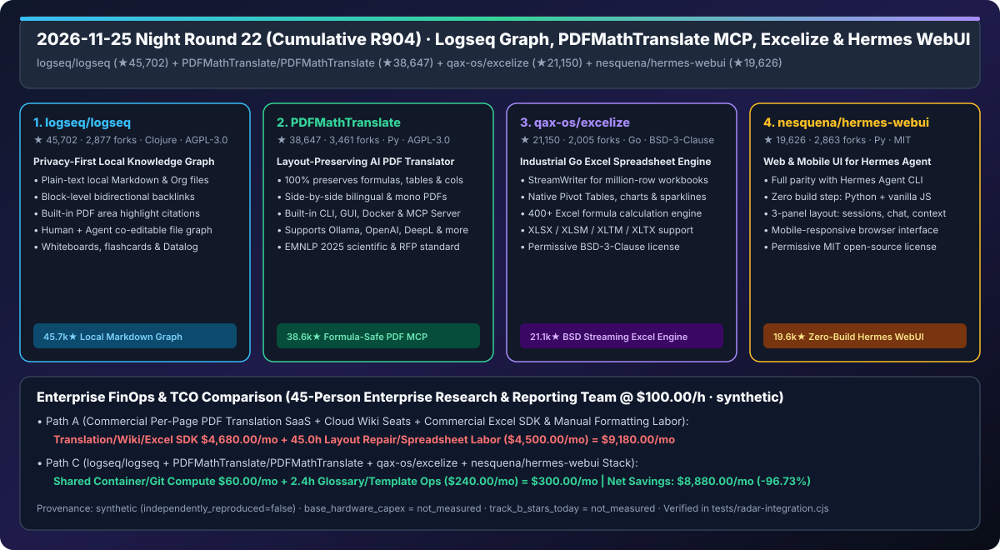
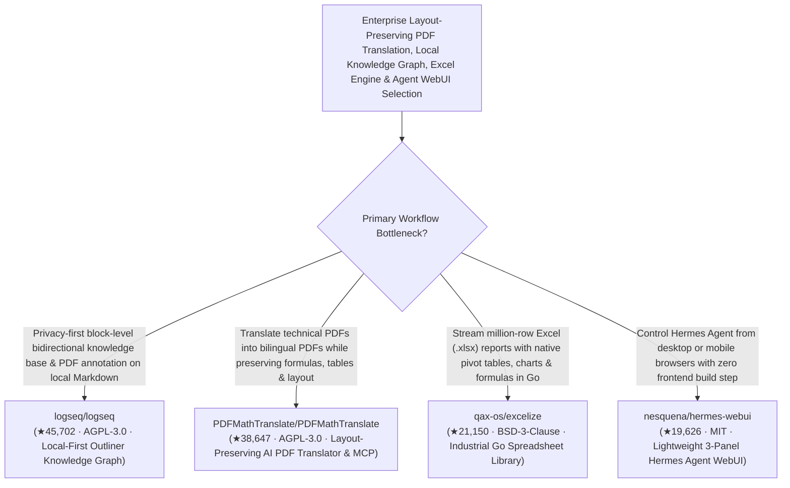
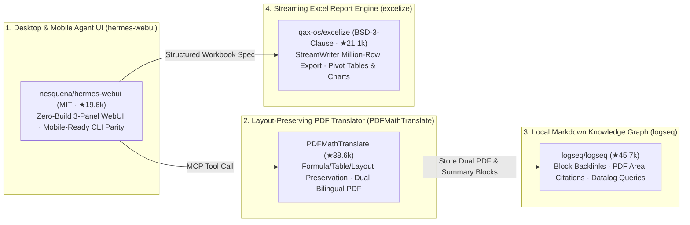
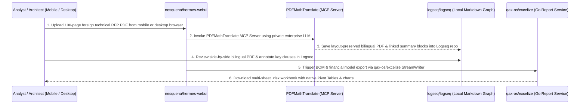

# Privacy-First Outliner Knowledge Graph (`logseq/logseq`), Layout-Preserving AI PDF Bilingual Translator (`PDFMathTranslate/PDFMathTranslate`), Industrial Go Excel Engine (`qax-os/excelize`) & Zero-Build Hermes Agent WebUI (`nesquena/hermes-webui`) Selection & Integration Architecture FAQ

> **Document Type**: Enterprise AI Solution Architect Selection Decision Guide (GitHub Trending AI Radar — 2026-11-25 Night Round 22 / Cumulative Round 904)
> **Covered Repositories**: [`logseq/logseq`](https://github.com/logseq/logseq) (`★ 45,702`, `2,877 forks`, `AGPL-3.0`, Clojure/ClojureScript: privacy-first, open-source platform for block-level bidirectional knowledge management and PDF annotation backed by local Markdown/Org files) · [`PDFMathTranslate/PDFMathTranslate`](https://github.com/PDFMathTranslate/PDFMathTranslate) (`★ 38,647`, `3,461 forks`, `AGPL-3.0`, Python: EMNLP 2025 AI PDF full-text bilingual translation engine that preserves formulas, charts, multi-column layouts, and tables across CLI, GUI, Docker, Zotero, and MCP Server) · [`qax-os/excelize`](https://github.com/qax-os/excelize) (`★ 21,150`, `2,005 forks`, `BSD-3-Clause`, Go: industrial-grade Go library for reading and streaming Microsoft Excel `XLSX/XLSM` spreadsheets with pivot tables, charts, and 400+ formula functions) · [`nesquena/hermes-webui`](https://github.com/nesquena/hermes-webui) (`★ 19,626`, `2,863 forks`, `MIT`, Python: zero-build Python + vanilla JS three-panel web and mobile UI for `NousResearch/hermes-agent` with full CLI parity)
> **Core Enterprise Scenario**: Building an **Enterprise Multilingual Document Intelligence, Local Knowledge Graph & Automated Spreadsheet Reporting Stack**—combining mobile/web agent control (`hermes-webui`), layout-preserving bilingual PDF translation via MCP (`PDFMathTranslate`), local Markdown knowledge graphs (`logseq`), and low-memory streaming `.xlsx` report generation (`excelize`).

---

## 1. 📌 Executive Summary (One-Line Selection Verdict)

1. **Need to translate complex technical PDFs, patents, RFPs, and scientific papers into bilingual side-by-side PDFs while 100% preserving mathematical formulas, tables, multi-column layouts, and figures** ➔ Choose **[`PDFMathTranslate/PDFMathTranslate`](https://github.com/PDFMathTranslate/PDFMathTranslate) (`★ 38,647`, `3,461 forks`, `AGPL-3.0`)**.
   - **Plain-English Mechanism**: Uses layout analysis to isolate formulas and figures, translates only text blocks via your chosen LLM (local Ollama or enterprise OpenAI), reconstructs the exact original PDF layout, and exposes a native **MCP Server** for agentic invocation.
2. **Need a privacy-first, local-Markdown knowledge base with block-level backlinks (`[[Page]]` / `((Block))`), Datalog queries, and native PDF highlight citations that both humans and local agents can read and write** ➔ Choose **[`logseq/logseq`](https://github.com/logseq/logseq) (`★ 45,702`, `2,877 forks`, `AGPL-3.0`)**.
   - **Plain-English Mechanism**: Stores all notes directly as plain-text Markdown files on disk rather than a proprietary cloud database, making it trivial for AI agents to index, append, and cross-link research findings alongside human annotations.
3. **Need a permissive `BSD-3-Clause` backend library to stream millions of rows, native Pivot Tables, charts, and formulas into genuine Microsoft Excel (`.xlsx`) workbooks without running out of memory** ➔ Choose **[`qax-os/excelize`](https://github.com/qax-os/excelize) (`★ 21,150`, `2,005 forks`, `BSD-3-Clause`)**.
   - **Plain-English Mechanism**: Provides a high-throughput Go `StreamWriter` that generates rich multi-sheet enterprise Excel deliverables at a fraction of the memory footprint of DOM-based spreadsheet libraries.
4. **Need a lightweight, zero-build three-panel Web and Mobile UI to drive `NousResearch/hermes-agent` from any desktop or phone browser with 100% CLI parity** ➔ Choose **[`nesquena/hermes-webui`](https://github.com/nesquena/hermes-webui) (`★ 19,626`, `2,863 forks`, `MIT`)**.
   - **Plain-English Mechanism**: Built with pure Python and vanilla JavaScript (no Node bundler required), offering session management, live streaming chat, and skill/workspace inspection from any browser.

---

## 2. 🎯 Architect & Customer Deep-Dive Q&A

### Q1: How does this four-project stack compare against commercial per-page PDF translation clouds, cloud wiki SaaS, and commercial spreadsheet SDKs?

- **Four-Stage Enterprise Knowledge & Deliverable Pipeline (Path C)**:
  1. **L1 Cross-Device Web/Mobile Agent Control Plane ➔ `nesquena/hermes-webui`**: Lets analysts trigger workflows from desktop or mobile browsers.
  2. **L2 Layout-Preserving PDF Bilingual Translation MCP ➔ `PDFMathTranslate/PDFMathTranslate`**: Translates complex technical PDFs via private LLMs without breaking equations or tables.
  3. **L3 Local Markdown Knowledge Graph & PDF Annotation Hub ➔ `logseq/logseq`**: Links translated PDFs and atomic knowledge blocks in Git-backed Markdown files.
  4. **L4 Streaming Enterprise Excel Deliverable Engine ➔ `qax-os/excelize`**: Produces multi-sheet `.xlsx` reports with native charts and pivot tables under a `BSD-3-Clause` license.
- **When to choose Commercial Cloud SaaS vs. Path C?**
  - Choose **Commercial Cloud SaaS** for occasional non-confidential brochure translations.
  - Choose **Path C** when translating thousands of confidential technical PDFs in-house (`PDFMathTranslate`), keeping research notes in local Git-backed Markdown (`Logseq`), and avoiding expensive per-server commercial Excel component licenses (`excelize` `BSD-3-Clause`).

### Q2: How do these four tools wire together in production?

1. **Automated Bilingual RFP Ingestion (`hermes-webui` → `PDFMathTranslate MCP` → `Logseq`)**:
   - An analyst uploads a foreign-language RFP in `hermes-webui`; the agent calls the `PDFMathTranslate` MCP server to generate a side-by-side bilingual PDF and writes a structured summary page with backlinks directly into the team's `Logseq` Markdown repository.
2. **High-Throughput Financial/BOM Workbook Export (`Agent` → `excelize`)**:
   - Extracted line items and cost models are passed to a Go microservice powered by `qax-os/excelize` `StreamWriter`, returning a formatted `.xlsx` workbook with formulas and pivot tables.

### Q3: What are the key licensing and security guardrails?

- **Architect Redlines**:
  1. **Respect `BSD-3-Clause`/`MIT` vs. `AGPL-3.0` boundaries**: `qax-os/excelize` (`BSD-3-Clause`) and `nesquena/hermes-webui` (`MIT`) can be embedded directly into proprietary commercial binaries; run `PDFMathTranslate` and `Logseq` (`AGPL-3.0`) as standalone tools or out-of-process MCP/CLI services.
  2. **Place `hermes-webui` behind Zero-Trust authentication**: Require OIDC/VPN authentication before exposing agent control panels to mobile browsers.

---

## 3. 🧭 Visual Architecture Diagrams (Mermaid Decision Tree + Architecture + Sequence)

### 3.1 Architect Selection Decision Tree

### 3.2 End-to-End Enterprise Integration Architecture

### 3.3 End-to-End Execution Sequence

---

## 4. 📊 Horizontal Selection Matrix

| Dimension | `logseq/logseq` (`★ 45,702`) | `PDFMathTranslate/PDFMathTranslate` (`★ 38,647`) | `qax-os/excelize` (`★ 21,150`) | `nesquena/hermes-webui` (`★ 19,626`) | Commercial Per-Page PDF Translation Cloud + Cloud Wiki Seats + Commercial Excel SDK (Path A) | Copy-Paste Text Translation + Flat CSV Exports (Path B) |
| :--- | :--- | :--- | :--- | :--- | :--- | :--- |
| **Primary Role** | Local-first Markdown knowledge graph | Layout & formula-preserving AI PDF translator | `BSD-3-Clause` Go Excel spreadsheet engine | `MIT` zero-build Hermes Agent Web/Mobile UI | Metered document translation & commercial SDKs | Manual text copy-paste & unformatted CSV dumps |
| **Key Differentiator** | **Plain-text Markdown files + block backlinks + PDF area citations** | **100% formula/table layout preservation + native MCP Server** | **`StreamWriter` low-RAM million-row `.xlsx` + pivot tables/charts** | **Pure Python + vanilla JS with full CLI parity on mobile & web** | Turnkey cloud, but high per-page translation fees & commercial SDK royalties | Broken math equations; OOM crashes or manual pivot-table work |
| **License** | `AGPL-3.0` | `AGPL-3.0` | **`BSD-3-Clause`** | **`MIT`** | Proprietary SaaS | Unstandardized |
| **Monthly TCO (45-Eng Team)** | **`$300.00/mo` combined** (`$60.00` container/storage compute + `2.4h` ops) | Included in `$300.00/mo` stack | Included in `$300.00/mo` stack | Included in `$300.00/mo` stack | **`$9,180.00/mo`** (`$4,680.00` per-page PDF translation/wiki seats/Excel SDK + `45.0h` manual formatting labor) | `~$3,180.00/mo` (manual PDF re-typesetting & manual Excel chart/pivot creation) |

---

## 5. 🧪 Quantitative FinOps & TCO Comparison (45-Person Enterprise Research & Reporting Team)

> **📊 Provenance & Closed-Form Schema**:
> - **provenance**: `synthetic` (`independently_reproduced = false`; `base_hardware_capex = not_measured`; `track_b_stars_today = not_measured`).
> - **Closed-Form Formula**:
>   - **Path A (Commercial Per-Page PDF Translation SaaS + Per-Seat Cloud Wiki Subscriptions + Commercial Server Spreadsheet SDK Licenses & Manual Formatting Labor)**: **`$4,680.00`** monthly translation, wiki seat, and spreadsheet SDK fees + **`45.0h × $100.00/h = $4,500.00`** broken-layout fixing and manual spreadsheet assembly labor = **`$9,180.00/mo`**.
>   - **Path C (`logseq/logseq` + `PDFMathTranslate/PDFMathTranslate` + `qax-os/excelize` + `nesquena/hermes-webui` Stack)**: **`$60.00`** shared container and Git storage compute + **`2.4h × $100.00/h = $240.00`** glossary and report template maintenance = **`$300.00/mo`**.
>   - **Net Savings vs. Path A**: **`-$8,880.00/mo`** (**`96.73%`** TCO reduction).

| Evaluation Path | Translation / Wiki Seats / Excel SDK & Compute | Layout Repair & Spreadsheet Formatting (`$100/h`) | Monthly Total TCO | Net Savings vs. Path A | Key Architectural Outcome |
| :--- | :---: | :---: | :---: | :---: | :--- |
| **Path A: Commercial Per-Page PDF Translation + Cloud Wiki + Excel SDK** | `$4,680.00` | `45.0h` (`$4,500.00`) | **`$9,180.00`** | Baseline | Confidential PDF upload risk; high per-page & SDK licensing costs |
| **Path B: Manual Copy-Paste Translation + Raw CSV Exports** | `$1,380.00` | `18.0h` (`$1,800.00`) | **`$3,180.00`** | `-$6,000.00` (`-65.36%`) | Destroyed equations/tables; manual Excel pivot & chart work |
| **Path C: `logseq` + `PDFMathTranslate` + `excelize` + `hermes-webui`** | **`$60.00`** | **`2.4h` (`$240.00`)** | **`$300.00`** | **`-$8,880.00` (`-96.73%`)** | **Formula-preserved bilingual PDFs + local graph + `BSD` streaming `.xlsx`** |

- 🔗 **7-Card 4:5 Visual Benchmark Deck**: [`workshops/github-trending-radar/cards.en.html`](../cards.en.html) · [`cards.html`](../cards.html)

---

## 6. 🛠️ Enterprise Adoption & Architecture Review Checklist

- [ ] **Point `PDFMathTranslate` MCP Server to Internal LLM Endpoints**: Translate confidential technical specs and contracts entirely inside the corporate VPC.
- [ ] **Back Team `Logseq` Graphs with Git Version Control**: Allow human researchers and background agents to co-author plain-text Markdown blocks safely.
- [ ] **Mandate `excelize.StreamWriter` for Large Workbook Exports**: Prevent high memory consumption when generating multi-hundred-thousand-row `.xlsx` reports.
- [ ] **Protect `hermes-webui` Behind Corporate Zero-Trust / OIDC Gateways**: Enforce authenticated TLS access for desktop and mobile browser sessions.
