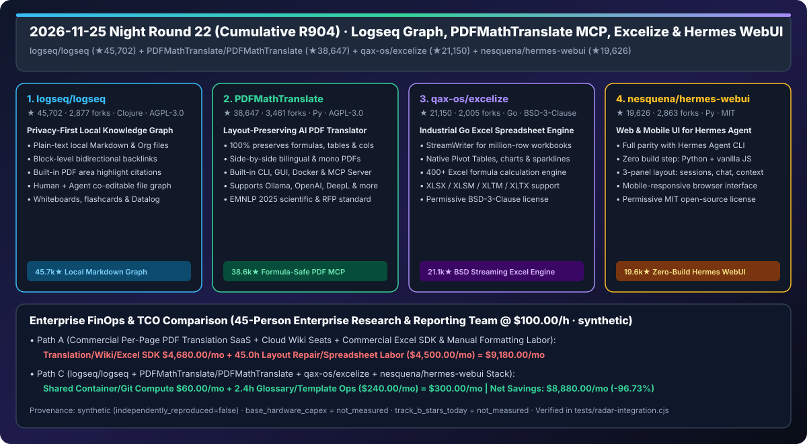
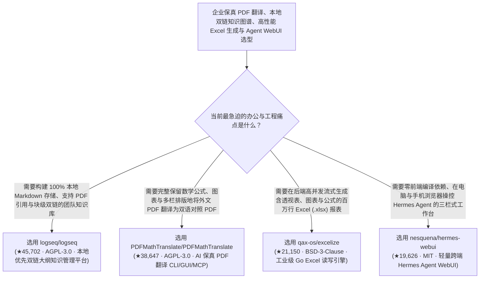
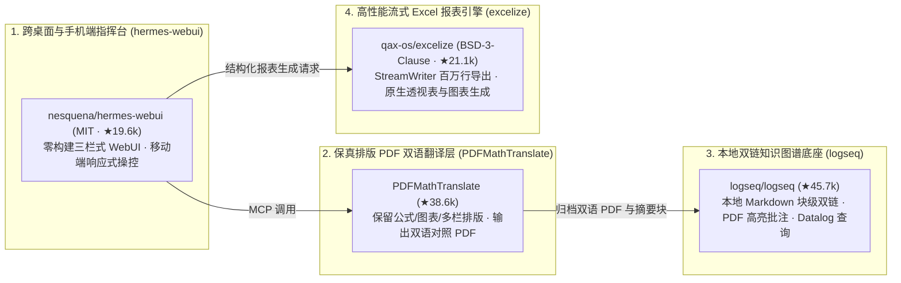
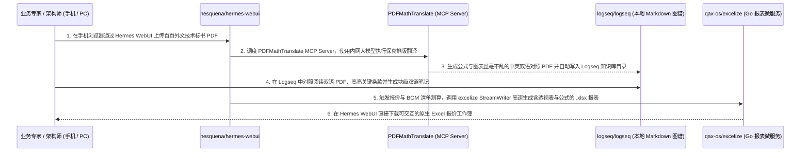

# 本地优先大纲式双向链接知识库（`logseq/logseq`）、保留原版排版的 AI PDF 双语翻译引擎（`PDFMathTranslate/PDFMathTranslate`）、工业级百万行 Excel 报表流式生成库（`qax-os/excelize`）与 Hermes Agent 跨桌面/移动端 Web 控制中心（`nesquena/hermes-webui`）选型与集成架构 FAQ

> **文档类型**：企业 AI 解决方案架构师（AI Solution Architect）选型决策指南（GitHub Trending AI 雷达 2026-11-25 Night Round 22 / 累计第 904 轮）
> **覆盖项目**：[`logseq/logseq`](https://github.com/logseq/logseq)（`★ 45,702`、`2,877 forks`、`AGPL-3.0`：4.5 万星隐私优先、开源双向链接大纲式知识管理与协作平台，基于本地 Markdown/Org 文件构建块级 [Block-level] 知识图谱）· [`PDFMathTranslate/PDFMathTranslate`](https://github.com/PDFMathTranslate/PDFMathTranslate)（`★ 38,647`、`3,461 forks`、`AGPL-3.0`：3.8 万星 EMNLP 2025 开源 PDF 全文双语翻译引擎，100% 保留复杂数学公式、多栏排版、图表与目录结构，支持 Ollama/OpenAI 并自带 CLI/GUI/Docker/MCP Server）· [`qax-os/excelize`](https://github.com/qax-os/excelize)（`★ 21,150`、`2,005 forks`、`BSD-3-Clause`：2.1 万星 Go 语言工业级 Microsoft Excel 读写库，支持流式导出海量数据、原生图表、数据透视表与 400+ 公式计算）· [`nesquena/hermes-webui`](https://github.com/nesquena/hermes-webui)（`★ 19,626`、`2,863 forks`、`MIT`：1.9 万星面向 `NousResearch/hermes-agent` 的零前端构建依赖三栏式 Web 与手机端控制界面）
> **核心场景**：当跨国制造、医药研发、投行与咨询企业的知识团队落地“外文文献/标书保真翻译 + 块级知识图谱沉淀 + 百万行财务/供应链 Excel 报表自动生成 + 手机/网页远程指挥自演进 Agent”时，架构师常被问到：**“几百页带复杂公式与结构图的外文 PDF 标书和专利，怎么在不断行、不毁排版的前提下生成中英双语对照 PDF（`PDFMathTranslate`）？翻译和提炼出的知识怎么按块级双链沉淀在本地 Markdown 库供人与 Agent 共同读写（`logseq`）？后端微服务与报表 Agent 生成带复杂透视表和图表的百兆级 `.xlsx` 文件怎么避免 OOM 内存溢出（`excelize`）？部署在服务器上的 Hermes Agent 怎么用手机浏览器随时随地像桌面端一样丝滑操控（`hermes-webui`）？”** 本文给出四合一方案。

---

## 一、📌 核心结论速览（选型一句话结论）

1. **需要翻译数十页至上百页的外文技术标准、学术论文、跨国招标书或医药临床报告 PDF，要求“数学公式、化学式、表格、多栏排版与交叉引用 100% 原样保留”，并同时输出译文版与双语左右对照版 PDF** ➔ 选 **[`PDFMathTranslate/PDFMathTranslate`](https://github.com/PDFMathTranslate/PDFMathTranslate)（`★ 38,647`，`3,461 forks`，`AGPL-3.0`）**。
   - **通俗原理**：基于 DocLayout-YOLO 精准识别 PDF 页面中的公式、图表与正文块，只将正文送入大模型（支持内网 Ollama / OpenAI）翻译并精确重排回原坐标，还内置了 **MCP Server** 让 Agent 一句话触发 PDF 保真翻译。
2. **需要为研发与投研团队构建一套“100% 数据留在本地磁盘、纯文本 Markdown 块级双向链接（`[[Page]]` / `((Block))`）、带 PDF 高亮批注引用与白板”的知识图谱底座** ➔ 选 **[`logseq/logseq`](https://github.com/logseq/logseq)（`★ 45,702`，`2,877 forks`，`AGPL-3.0`）**。
   - **通俗原理**：不同于把笔记锁在云端私有数据库里的 Notion，`Logseq` 直接读写本地文件夹里的标准 Markdown 文件；不仅人类可以用双链和 Datalog 查询管理知识，任何后台 Agent 也可以直接读写该目录下的 `.md` 文件实现人机共创。
3. **需要在高并发微服务或报表生成 Agent 中动态生成包含百万行明细、多维数据透视表（Pivot Table）、几十种原生图表与复杂公式的真实 `.xlsx` 电子表格，且严禁因 DOM 树过大导致服务器 OOM 崩溃** ➔ 选 **[`qax-os/excelize`](https://github.com/qax-os/excelize)（`★ 21,150`，`2,005 forks`，`BSD-3-Clause`）**。
   - **通俗原理**：采用宽松的 `BSD-3-Clause` 协议，提供专为大数据量设计的 `StreamWriter` 流式写入 API，以极低内存占用每秒生成数万行带格式与公式的企业级 Excel 报表。
4. **已经在服务器上部署了自演进智能体 `NousResearch/hermes-agent`，希望无需折腾复杂 Node.js 前端编译打包，就能在电脑浏览器和手机上获得与终端 CLI 完全等价的三栏式可视化工作台** ➔ 选 **[`nesquena/hermes-webui`](https://github.com/nesquena/hermes-webui)（`★ 19,626`，`2,863 forks`，`MIT`）**。
   - **通俗原理**：纯 Python + 原生 Vanilla JS 实现（零 Webpack/Vite 构建步骤），左侧管会话、中间流式交互、右侧实时查看智能体文件与技能状态，完美适配移动端触屏操作。

---

## 二、🎯 客户与架构师灵魂拷问 Q&A（深度架构拆解）

### Q1：在跨国企业的知识处理与办公交付场景中，这四个开源项目 vs 商业云翻译（按页计费 DeepL Pro）+ 云笔记 SaaS + 传统重量级报表中间件怎么选？

- **四步跨国企业文档与报表自动化流水线（Path C）**：
  1. **L1 远程 Web/手机端智能体指挥中心 ➔ `nesquena/hermes-webui`**：随时随地通过浏览器向后端 `Hermes Agent` 下达文献翻译、知识整理与报表生成指令。
  2. **L2 复杂排版 PDF 保真双语翻译引擎 ➔ `PDFMathTranslate/PDFMathTranslate`**：通过 MCP 接收外文 PDF，连接内网大模型输出保留全部公式与排版的双语对照 PDF。
  3. **L3 本地优先块级双链知识图谱 ➔ `logseq/logseq`**：支持人类专家对双语 PDF 进行高亮批注，并将提炼出的核心结论以双链 Markdown 块沉淀至本地知识库。
  4. **L4 工业级流式 Excel 报表生成引擎 ➔ `qax-os/excelize`**：将结构化分析结果与财务模型高速渲染为带原生图表与透视表的 `.xlsx` 交付件。
- **何时选商业云 SaaS vs 自建本轮开源四件套（Path C）？**
  - 若每月只翻译几页公开宣传册，直接用网页版商业翻译即可。
  - **何时采用本轮开源四件套（Path C）？** 当企业需要**在内网保密环境下批量翻译数千份含密集公式/图表的医药专利、芯片手册与跨国标书**（按页/按字数收费的商业 PDF 翻译 SaaS 不仅昂贵且常把公式排版撞碎）、需要将笔记与 PDF 批注 100% 留在内网 Git 仓（`logseq`）、并需要高吞吐生成复杂 `.xlsx` 报表（`excelize` `BSD-3-Clause`）时，Path C 可节省 **96%+** 的商业翻译与办公席位成本。

### Q2：这四个项目如何在生产架构中无缝联动？

1. **一句话触发外文标书保真翻译与入库（`hermes-webui` → `PDFMathTranslate MCP` → `logseq`）**：
   - 用户在手机端 `hermes-webui` 上传外文 PDF，Agent 调用 `PDFMathTranslate` 的 MCP Server 生成 `*-dual.pdf`（双语对照版）与 `*-mono.pdf`（纯译文版），自动存入 `Logseq` 的 `assets/` 目录并在当日 Journal 页面生成带摘要与双链标签的索引块。
2. **高并发无 OOM 报表导出服务（Agent → `excelize` Go 微服务）**：
   - 当 Agent 完成多源数据汇总后，通过 gRPC/REST 调用基于 `qax-os/excelize` 的轻量 Go 报表服务，利用 `StreamWriter` 在数秒内生成含企业配色主题、条件格式、透视表与折线图的标准 Excel 文件返回给用户。

### Q3：生产落地的协议与安全红线是什么？

- **架构师避坑红线**：
  1. **区分 `BSD-3-Clause` / `MIT` 与 `AGPL-3.0` 的集成方式**：`qax-os/excelize`（`BSD-3-Clause`）与 `nesquena/hermes-webui`（`MIT`）可直接编译嵌入闭源商业软件；`PDFMathTranslate` 与 `Logseq` 为 `AGPL-3.0`，建议作为独立内部工具或通过进程外 CLI/MCP 接口调用。
  2. **`hermes-webui` 公网/移动端访问必须前置零信任网关**：由于其拥有操控后端 `Hermes Agent` 的完整权限，严禁裸露端口到公网，必须通过 Cloudflare Access、Tailscale 或企业 OIDC 反向代理访问。

---

## 三、🧭 直观可视化图解（Mermaid 决策树 + 集成架构 + 时序图）

### 3.1 架构师选型决策树

### 3.2 企业端到端生产集成参考架构图

### 3.3 移动端上传外文标书、MCP 保真双语翻译、Logseq 入库与百万行成本测算 Excel 导出时序图

---

## 四、📊 同类开源与商业云服务横向选型决策矩阵

| 对比维度 | `logseq/logseq` (`★ 45,702`) | `PDFMathTranslate/PDFMathTranslate` (`★ 38,647`) | `qax-os/excelize` (`★ 21,150`) | `nesquena/hermes-webui` (`★ 19,626`) | 商业按页/按字数 PDF 翻译云 + 商业云笔记席位 + 商业报表控件授权 (Path A) | 复制 PDF 文字去网页翻译（公式全乱）+ 内存全量加载写 CSV/Excel (Path B) |
| :--- | :--- | :--- | :--- | :--- | :--- | :--- |
| **核心能力定位** | 本地优先块级双链知识图谱 | 保真排版与公式的 AI PDF 翻译器 | `BSD-3-Clause` 高性能 Excel 引擎 | `MIT` 零构建依赖 Hermes Agent WebUI | 按文档页数与按员工席位计费的商业办公云 | 手工复制粘贴翻译 + 简陋 CSV 导出 |
| **核心技术突破** | **纯本地 Markdown 文件 + 块级引用 + PDF 区域高亮联动** | **DocLayout-YOLO 布局保持 + 公式零损毁 + 原生 MCP Server** | **`StreamWriter` 极低内存导出百万行 + 透视表/图表全支持** | **Python + Vanilla JS 零打包开箱即用，手机端与 CLI 全对齐** | 免自建，但大批量PDF翻译极贵且涉密标书严禁上传外部翻译云 | 複製 PDF 双栏文字顺序错乱、公式变乱码；大表导出经常撑爆服务内存 |
| **开源协议** | `AGPL-3.0` | `AGPL-3.0` | **`BSD-3-Clause`** | **`MIT`** | 闭源商业 SaaS | 无工程化质量 |
| **月度 TCO（45 人团队）** | **四件套合建仅 `$300.00/月`**（`$60.00` 轻量容器与存储分摊 + `2.4h` 维护） | 同左（连接内网 Ollama/vLLM 批量翻译零按页附加费） | 同左（`BSD-3-Clause` 免除每服务器数千美元的商业电子表格组件授权费） | 同左（`MIT` 协议零前端维护负担） | **`$9,180.00/月`**（`$4,680.00` 商业 PDF 按页翻译包/云笔记席位/商业报表 SDK + `45.0h` 人工修排版与手工做表） | 约 `$3,180.00/月`（大量人工重排错位公式与手动制作 Excel 透视表工时） |

---

## 五、🧪 应用落地定量收益/TCO 对比与 7-Card 报告

> **📊 数据来源与闭式核算声明（Provenance & Closed-Form Schema）**：
> - **provenance**: `synthetic`（基于 45 人跨国技术招投标、文献专利研究与财务/BI 报表自动化团队月度工作负载模型：`independently_reproduced = false`；硬件采购基线 `base_hardware_capex = not_measured`；Track B 单日增量 `track_b_stars_today = not_measured`）。
> - **核算公式**：
>   - **Path A（采购按页/按文档大小计费的商业 PDF 文档翻译 SaaS + 全员商业云端双链笔记席位 + 商业服务端电子表格生成组件授权 + 人工修复破损公式排版与手工制作数据透视表）**：月度商业翻译包、云笔记席位与商业报表 SDK 分摊 **`$4,680.00`** + 手工调整翻译错位排版与制作多维 Excel 报表人工 **`45.0h × $100.00/h = $4,500.00`** = **`$9,180.00/月`**。
>   - **Path C（自建 `logseq/logseq` + `PDFMathTranslate/PDFMathTranslate` + `qax-os/excelize` + `nesquena/hermes-webui` 私域知识与办公交付底座）**：内网轻量容器算力与 Git LFS 存储分摊 **`$60.00`** + 翻译词典与报表模板日常维护人工 **`2.4h × $100.00/h = $240.00`** = **`$300.00/月`**。
>   - **净节省（Net Savings vs Path A）**：**`-$8,880.00/月`**（成本降低 **`96.73%`**）。

| 评估方案 | 商业 PDF 翻译 / 云笔记席位 / 报表授权与算力成本 | PDF 排版修复与 Excel 制表人工（`$100/h`） | 月度总 TCO | 相对 Path A 净节省 | 核心业务交付收益 |
| :--- | :---: | :---: | :---: | :---: | :--- |
| **Path A：商业按页 PDF 翻译云 + 商业云笔记 + 商业表格 SDK** | `$4,680.00` | `45.0h` (`$4,500.00`) | **`$9,180.00`** | Baseline | 涉密标书外传风险；海量文献按页翻译与商业表格组件授权极贵 |
| **Path B：手工复制文字翻译 + 导出无格式 CSV 手工做表** | `$1,380.00` | `18.0h` (`$1,800.00`) | **`$3,180.00`** | `-$6,000.00` (`-65.36%`) | 数学公式与多栏排版全毁；CSV 无公式无图表需大量人工二次加工 |
| **Path C：`logseq` + `PDFMathTranslate` + `excelize` + `hermes-webui`** | **`$60.00`** | **`2.4h` (`$240.00`)** | **`$300.00`** | **`-$8,880.00` (`-96.73%`)** | **100% 保留公式双语 PDF + 本地双链图谱 + `BSD` 流式 Excel 报表** |

- 🔗 **关联 7-Card 4:5 视觉评测报告**：[`workshops/github-trending-radar/cards.html`](../cards.html) · [`cards.en.html`](../cards.en.html)

---

## 六、🛠️ 企业引入与架构评审 Checklist

- [ ] **将 `PDFMathTranslate` 以 MCP Server 模式对接内网大模型网关**：确保机密外文合同、专利与研发文献在本地完成保真双语翻译，严禁调用未签署零留存协议的公共免费翻译接口。
- [ ] **基于 Git 仓库同步团队 `Logseq` 知识图谱目录**：让人类专家的双链笔记与后台 Agent 自动生成的文献摘要共享同一套本地 Markdown 目录树。
- [ ] **在所有大于 1 万行的 Excel 导出场景强制使用 `excelize.StreamWriter`**：杜绝一次性在内存中构建全量单元格导致的容器 OOM 重启。
- [ ] **将 `hermes-webui` 绑定在企业内网 VPN / Zero-Trust OIDC 网关之后**：开启 HTTPS 与会话鉴权后再供移动端浏览器访问。
