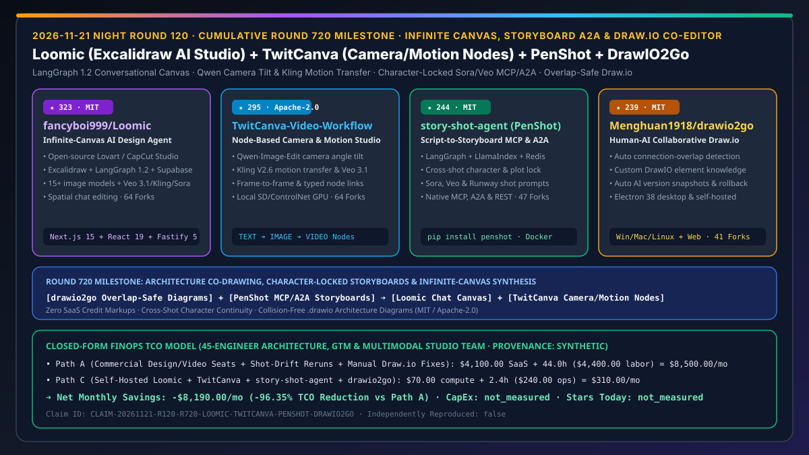
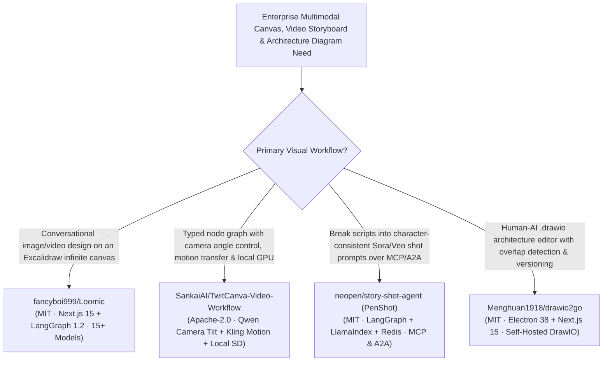
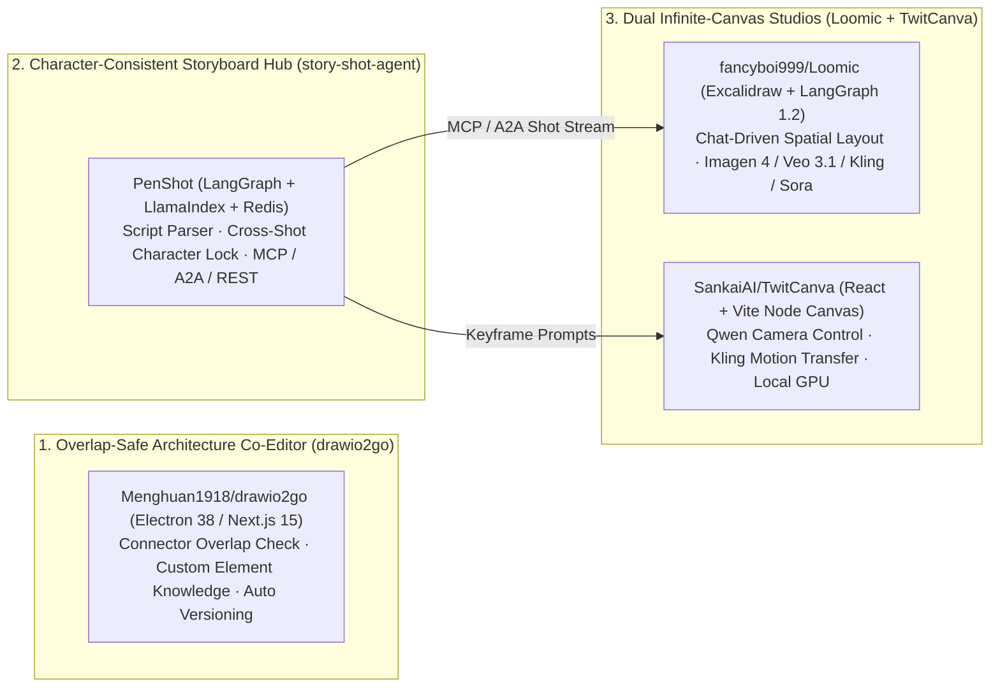
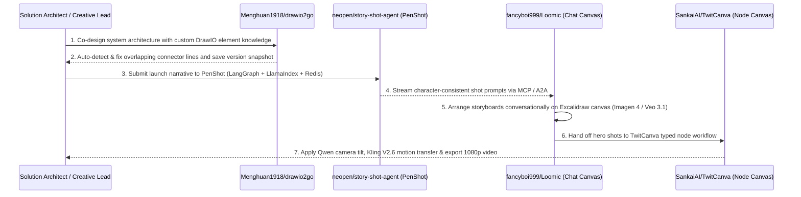

# [Round 720 Milestone] Infinite-Canvas AI Design Agent (`fancyboi999/Loomic`), Node-Based Camera/Motion Video Studio (`SankaiAI/TwitCanva-Video-Workflow`), Character-Consistent Script-to-Storyboard A2A/MCP Engine (`neopen/story-shot-agent`) & Overlap-Safe Human-AI Draw.io Editor (`Menghuan1918/drawio2go`) Selection & Architecture FAQ

> **Document Type**: Enterprise AI Solution Architect Selection & Integration Guide (GitHub Trending AI Radar — 2026-11-21 Night Round 120 / Cumulative Round 720 Milestone)
> **Covered Repositories**: [`fancyboi999/Loomic`](https://github.com/fancyboi999/Loomic) (`★ 323`, `64 forks`, `MIT` — open-source alternative to Lovart, CapCut Video Studio & Canva AI built on Next.js 15, React 19, Fastify 5, LangGraph 1.2, Supabase & Excalidraw across 15+ image/video models) · [`SankaiAI/TwitCanva-Video-Workflow`](https://github.com/SankaiAI/TwitCanva-Video-Workflow) (`★ 295`, `64 forks`, `Apache-2.0` — drag-and-drop node canvas with `Qwen-Image-Edit` camera angle control, `Kling V2.6` motion transfer, frame-to-frame interpolation & local SD/ControlNet GPU support) · [`neopen/story-shot-agent`](https://github.com/neopen/story-shot-agent) (`★ 244`, `47 forks`, `MIT` — PenShot multi-agent script-to-storyboard engine on LangGraph + LlamaIndex + Redis ensuring cross-shot character consistency with MCP, A2A, REST & Function Call APIs) · [`Menghuan1918/drawio2go`](https://github.com/Menghuan1918/drawio2go) (`★ 239`, `41 forks`, `MIT` — Electron 38 & Next.js 15 human-AI collaborative Draw.io editor with automatic connection-overlap detection, custom element knowledge injection & AI version snapshots)
> **Core Scenario**: At our **Cumulative Round 720 Milestone**, we address four critical workflows for Solution Architects and enterprise creative engineering teams: **self-hosting an infinite-canvas conversational design and video studio (`Loomic`)**, **controlling camera tilt/rotation, motion transfer, and local GPU previews in a typed node graph (`TwitCanva-Video-Workflow`)**, **maintaining strict character and narrative consistency across multi-shot Sora/Veo video prompts via MCP/A2A (`story-shot-agent`)**, and **eliminating overlapping arrows and destructive edits in AI-generated `.drawio` architecture diagrams (`drawio2go`)**.

---

## 1. 📌 Executive Summary (One-Line Selection Verdict)

1. **Need a self-hosted, open-source alternative to Lovart, CapCut Video Studio, and Canva AI where users chat with a `LangGraph 1.2` agent on an Excalidraw infinite canvas to generate and arrange images and videos across 15+ models** ➔ Choose **[`fancyboi999/Loomic`](https://github.com/fancyboi999/Loomic) (`★ 323`, `64 forks`, `MIT`)**.
   - **Plain-English Mechanism**: Built on `Next.js 15 + React 19 + Fastify 5 + LangGraph 1.2 + Supabase PostgreSQL + Excalidraw`. The agent understands spatial canvas context (e.g., *"change the image on the left to warm tones"*) and orchestrates **15+ image models** (`Imagen 4`, `Gemini Image`, `DALL-E 3`, `GPT Image`, `Flux Kontext`, `Recraft`, `Seedream`) and **video + native audio models** (`Veo 3.1/3.0/2.0`, `Kling`, `Seedance`, `Wan`, `Sora`, `Hailuo`) using your own API keys.
2. **Need a drag-and-drop node-based canvas (`TEXT ➔ IMAGE ➔ VIDEO`) with `Qwen-Image-Edit` camera angle rotation/tilt, `Kling V2.6` motion transfer, frame-to-frame video interpolation, and local GPU (`Stable Diffusion`, `ControlNet`, `Qwen`) execution** ➔ Choose **[`SankaiAI/TwitCanva-Video-Workflow`](https://github.com/SankaiAI/TwitCanva-Video-Workflow) (`★ 295`, `64 forks`, `Apache-2.0`)**.
   - **Plain-English Mechanism**: Combines type-validated visual node connections (`IMAGE ➔ VIDEO`, `TEXT ➔ IMAGE`) with an embedded LangGraph chat assistant, camera rotation/tilt controls, reference-video motion transfer, 720p/1080p aspect-ratio presets, and hybrid local GPU + cloud API execution.
3. **Need a multi-agent script-to-storyboard engine (`LangGraph + LlamaIndex + Redis`) that parses scripts or documents into Sora/Veo/Runway shot prompts with strict cross-shot character consistency over MCP, A2A, and REST** ➔ Choose **[`neopen/story-shot-agent`](https://github.com/neopen/story-shot-agent) (`★ 244`, `47 forks`, `MIT`)**.
   - **Plain-English Mechanism**: Published on PyPI as `penshot` (and Docker Hub `neotems/penshot`), **PenShot** uses LlamaIndex and Redis to persist character appearance and scene anchors across shots while LangGraph agents decompose scripts into coherent shot-by-shot prompts exposed via **MCP, REST API, Function Calls, and A2A**.
4. **Need a human-AI collaborative Draw.io architecture editor (`Electron 38` desktop + `Next.js 15` web) that automatically detects overlapping connection lines, injects custom Draw.io element knowledge, and versions every AI edit** ➔ Choose **[`Menghuan1918/drawio2go`](https://github.com/Menghuan1918/drawio2go) (`★ 239`, `41 forks`, `MIT`)**.
   - **Plain-English Mechanism**: Solves the biggest headache of AI-generated `.drawio` diagrams—arrows colliding with or passing through boxes. **Canvas Enhancement** automatically checks whether connection lines overlap with elements after insertion, **LLM Enhancement** injects custom Draw.io element schemas and color palettes, and **Version Management** snapshots every human or AI edit with support for self-hosted Draw.io rendering servers.

---

## 2. 🎯 Architect & Customer Deep-Dive Q&A

### Q1: How do `Loomic`, `TwitCanva-Video-Workflow`, `story-shot-agent`, and `drawio2go` solve the reliability and cost bottlenecks of enterprise visual & architectural generation?

- **Four Complementary Visual Engineering Capabilities**:
  1. **Overlap-Free Human-AI Architecture Diagramming (`Menghuan1918/drawio2go`)**: Raw LLM XML generation produces messy `.drawio` diagrams where connector lines cross over icons. `drawio2go` validates connector overlaps automatically, injects domain icon knowledge, and creates per-edit version snapshots.
  2. **Cross-Shot Character & Narrative Continuity (`neopen/story-shot-agent`)**: Generating 20 video clips one prompt at a time produces 20 different-looking protagonists. `PenShot` locks character and plot state in Redis + LlamaIndex across a LangGraph multi-agent pipeline and serves downstream studios via MCP and A2A.
  3. **Conversational Infinite Canvas vs Deterministic Node Graph (`Loomic` + `TwitCanva`)**: `Loomic` gives product and marketing teams a zero-learning-curve conversational Excalidraw studio, while `TwitCanva` gives technical creators deterministic node graphs with `Qwen-Image-Edit` camera rotation, `Kling V2.6` motion transfer, frame-to-frame interpolation, and local GPU previewing.
- **When to Choose Commercial Cloud Suites (Path B)**:
  - Small non-technical teams that do not mind per-seat credit markups or cloud data hosting can subscribe directly to **Canva Enterprise / CapCut Pro**.

### Q2: How do we wire an end-to-end visual architecture & multimodal production studio combining all four projects?

1. **Technical Architecture Co-Drawing Plane (`Menghuan1918/drawio2go`)**:
   - Solution Architects run `drawio2go` (Electron desktop or internal Next.js web pointed at a self-hosted Draw.io URL) with enterprise cloud icon knowledge, automatic connector-overlap checking, and version snapshots.
2. **Script Decomposition & Character Consistency Plane (`neopen/story-shot-agent`)**:
   - Feed product launch scripts, training narratives, or case studies into `PenShot` (`LangGraph + LlamaIndex + Redis`) and expose the resulting character-consistent shot prompts via **MCP and A2A**.
3. **Dual-Mode Infinite Canvas Production Plane (`Loomic` + `TwitCanva-Video-Workflow`)**:
   - Use `Loomic` (`Excalidraw + LangGraph 1.2 + Supabase`) for conversational spatial layout across 15+ image and video models;
   - Use `TwitCanva` for fine-grained camera angle adjustments (`Qwen-Image-Edit`), motion transfer (`Kling V2.6`), frame-to-frame transitions, and zero-marginal-cost local GPU (`Stable Diffusion / ControlNet`) drafts.

### Q3: What are the boundaries and trade-offs of this stack?

- **Key Strengths**:
  - **100% Permissive Open Source (`MIT` & `Apache-2.0`)**: Eliminates 3x–5x SaaS credit markups by letting teams bring their own provider keys and local GPUs.
  - **Native MCP & A2A Interoperability**: `PenShot` connects directly to agentic ecosystems via MCP and A2A.
- **Operational Scope**:
  - Cloud video APIs (`Veo 3.1`, `Sora`, `Kling`) still bill per second of generated video at provider rates; use `TwitCanva`'s local Stable Diffusion / Qwen integration for rapid storyboard iterations before rendering final 1080p clips.

---

## 3. 🧭 Visual Architecture & Decision Diagrams

### 3.1 Solution Architect Selection Decision Tree

### 3.2 End-to-End Enterprise Reference Architecture

### 3.3 Overlap-Checked Architecture Drawing, PenShot Storyboard Locking & Dual-Canvas Video Synthesis Sequence

---

## 4. 📊 Peer Open-Source vs Commercial Cloud Selection Matrix

| Dimension | `fancyboi999/Loomic` (`★ 323`) | `TwitCanva-Video-Workflow` (`★ 295`) | `neopen/story-shot-agent` (`★ 244`) | `Menghuan1918/drawio2go` (`★ 239`) | Commercial Lovart/CapCut/Canva Enterprise (Path A) | Raw Cloud Video API Calls (Path B) |
| :--- | :--- | :--- | :--- | :--- | :--- | :--- |
| **Core Role** | Conversational Excalidraw AI design & video canvas | Typed node canvas with camera/motion control & local GPU | LangGraph + LlamaIndex script-to-shot MCP/A2A engine | Overlap-safe human-AI Draw.io architecture editor | Closed-source AI design/video SaaS + manual `.drawio` fixes | Direct Vertex AI Veo / OpenAI Sora API scripts |
| **Architectural Edge** | **Spatial chat agent + 15+ models + Supabase self-hosting** | **`Qwen-Image-Edit` camera angles + `Kling` motion + local SD** | **Cross-shot character consistency + native MCP/A2A** | **Auto connector-overlap detection + AI version history** | 3x–5x credit markups; proprietary cloud data lock-in | Lacks infinite canvas, character continuity & `.drawio` checks |
| **License** | `MIT` | `Apache-2.0` | `MIT` | `MIT` | Proprietary SaaS | Proprietary Cloud API |
| **Monthly TCO (45-Eng Team)** | **`$310.00/mo` combined** (`$70.00` compute + `2.4h` ops) | Included in `$310.00/mo` stack | Included in `$310.00/mo` stack | Included in `$310.00/mo` stack | **`$8,500.00/mo`** (`$4,100.00` seats/credits + `44.0h` rework) | `~$2,720.00/mo` (high retry waste from inconsistent shots) |

---

## 5. 🧪 Quantitative ROI / FinOps TCO Model & 7-Card Report

> **📊 Provenance & Closed-Form Audit Declaration**:
> - **Provenance**: `synthetic` (45-engineer enterprise solution architecture, technical marketing & multimodal production workload model; `independently_reproduced = false`; `base_hardware_capex = not_measured`; `track_b_stars_today = not_measured`).
> - **Closed-Form Equations**:
>   - **Path A (Commercial Lovart / CapCut / Canva Enterprise Seats & Credit Markups + Wasted Video Generations from Character Drift + Manual `.drawio` Connector-Overlap Fixing)**: Monthly SaaS & wasted credit spend **`$4,100.00`** + manual diagram fixing & storyboard rework labor **`44.0h × $100.00/h = $4,400.00`** = **`$8,500.00/mo`**.
>   - **Path C (Self-Hosted `fancyboi999/Loomic` + `SankaiAI/TwitCanva-Video-Workflow` + `neopen/story-shot-agent` + `Menghuan1918/drawio2go`)**: Shared Supabase/Redis container compute **`$70.00`** + provider config & template maintenance **`2.4h × $100.00/h = $240.00`** = **`$310.00/mo`**.
>   - **Net Savings vs Path A**: **`-$8,190.00/mo`** (**`96.35%`** cost reduction).

| Architecture Option | API / SaaS / Compute | Architecture & Creative Ops Labor (`$100/h`) | Total Monthly TCO | Net Savings vs Path A | Key Architectural Outcome |
| :--- | :---: | :---: | :---: | :---: | :--- |
| **Path A: Commercial Design Cloud + Video Drift + Manual Draw.io** | `$4,100.00` | `44.0h` (`$4,400.00`) | **`$8,500.00`** | Baseline | Heavy credit markups; overlapping AI arrows in `.drawio` |
| **Path B: Raw Cloud Video APIs + Manual Diagramming** | `$1,520.00` | `12.0h` (`$1,200.00`) | **`$2,720.00`** | `-$5,780.00` (`-68.00%`) | High shot-retry waste; no spatial canvas or overlap detection |
| **Path C: `Loomic` + `TwitCanva` + `PenShot` + `drawio2go`** | **`$70.00`** | **`2.4h` (`$240.00`)** | **`$310.00`** | **`-$8,190.00` (`-96.35%`)** | **Spatial chat canvas + camera/motion nodes + shot lock + Draw.io guard** |

- 🔗 **7-Card 4:5 Visual Report**: [`workshops/github-trending-radar/cards.en.html`](../cards.en.html) · [`cards.html`](../cards.html)

---

## 6. 🛠️ Enterprise Adoption & Architecture Review Checklist

- [ ] **1. Standardize Architecture Diagramming on `Menghuan1918/drawio2go`**: Point `drawio2go` at a self-hosted Draw.io instance, load enterprise icon/style knowledge, and enable automatic connector-overlap detection plus per-edit version snapshots.
- [ ] **2. Lock Multi-Shot Character Consistency with `neopen/story-shot-agent` (`PenShot`)**: Deploy `penshot` with Redis + LlamaIndex to parse scripts into character-consistent Sora/Veo prompts exposed over MCP and A2A.
- [ ] **3. Self-Host `fancyboi999/Loomic` for Conversational Infinite-Canvas Design**: Deploy the Next.js 15 + Fastify 5 + LangGraph 1.2 + Supabase stack with BYOK keys for Imagen 4, Veo 3.1, Kling, and Sora.
- [ ] **4. Use `SankaiAI/TwitCanva-Video-Workflow` for Node-Level Camera & Motion Control**: Leverage typed node graphs, local GPU previews (`Stable Diffusion`, `ControlNet`), `Qwen-Image-Edit` camera angles, and `Kling V2.6` motion transfer.
