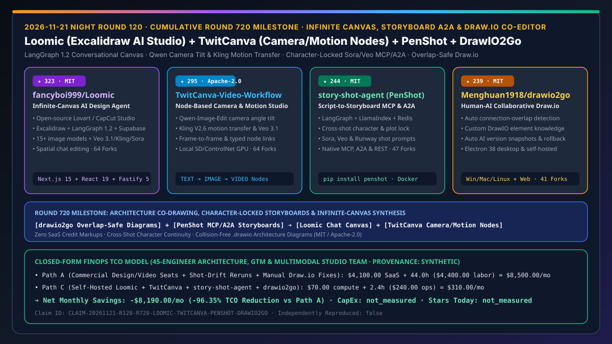
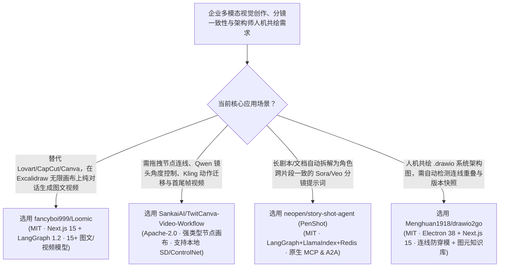
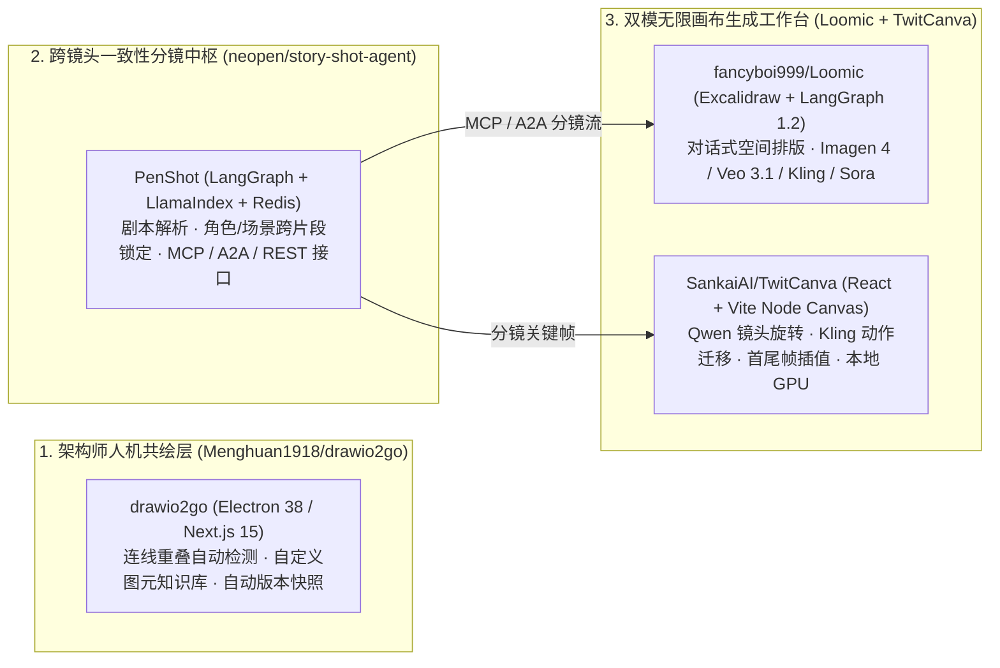
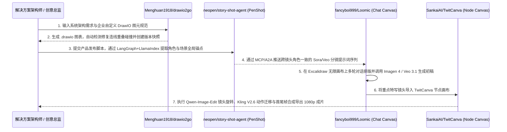

# 【第 720 轮里程碑】开源 Lovart/CapCut 无限画布设计 Agent（`fancyboi999/Loomic`）、带视角与动作迁移的节点式视频画布（`SankaiAI/TwitCanva-Video-Workflow`）、跨镜头角色一致的剧本分镜 A2A/MCP 引擎（`neopen/story-shot-agent`）与防连线重叠人机共绘架构图工具（`Menghuan1918/drawio2go`）选型与集成架构 FAQ

> **文档类型**：企业 AI 解决方案架构师（AI Solution Architect）选型决策指南（GitHub Trending AI 雷达 2026-11-21 Night Round 120 / 累计第 720 轮里程碑）
> **覆盖项目**：[`fancyboi999/Loomic`](https://github.com/fancyboi999/Loomic)（`★ 323`、`64 forks`、`MIT`，基于 Excalidraw + LangGraph 1.2 + Next.js 15 构建、集成 Veo 3.1/Kling/Sora/Imagen 4 等 15+ 模型的开源 Lovart / CapCut Video Studio 替代方案）· [`SankaiAI/TwitCanva-Video-Workflow`](https://github.com/SankaiAI/TwitCanva-Video-Workflow)（`★ 295`、`64 forks`、`Apache-2.0`，支持 `Qwen-Image-Edit` 镜头视角控制、`Kling V2.6` 动作迁移、首尾帧插值与本地 SD/ControlNet 的拖拽节点式视频工作台）· [`neopen/story-shot-agent`](https://github.com/neopen/story-shot-agent)（`★ 244`、`47 forks`、`MIT`，基于 LangGraph + LlamaIndex + Redis 确保跨片段角色/剧情一致并原生支持 MCP/A2A/REST 的剧本转分镜智能体 `PenShot`）· [`Menghuan1918/drawio2go`](https://github.com/Menghuan1918/drawio2go)（`★ 239`、`41 forks`、`MIT`，内置连线碰撞自动检测、自定义图元知识注入、自建 DrawIO 切换与自动版本快照的 Electron/Web 人机共绘架构图工具）
> **核心场景**：在第 **720 轮（R720）**里程碑中，我们聚焦企业多模态内容生产与架构师日常制图的四大高频刚需——**如何用对话驱动无限画布替代昂贵闭源的 Lovart / Canva AI / CapCut Video Studio（`Loomic`）**、**如何在生成多镜头企业宣传片或短剧时保证角色长相与剧情跨镜头不崩坏（`story-shot-agent`）**、**如何精准控制 AI 生成画面的摄像机俯仰旋转角度与人物动作迁移（`TwitCanva-Video-Workflow`）**，以及**解决方案架构师在用 AI 画 `.drawio` 系统架构图时如何彻底消灭“箭头穿过图标、连线重叠、改坏上一版无法回退”（`drawio2go`）**？

---

## 一、📌 核心结论速览（选型一句话结论）

1. **想要 Lovart / CapCut Video Studio / Canva AI 的“无限画布对话式图文视频创作体验”，但要求 100% 开源自托管、自带 API Key 按量付费且数据不出企业内网** ➔ 选 **[`fancyboi999/Loomic`](https://github.com/fancyboi999/Loomic)（`★ 323`，`64 forks`，`MIT`）**。
   - **通俗原理**：基于 `Next.js 15 + React 19 + Fastify 5 + LangGraph 1.2 + Supabase PostgreSQL + Excalidraw` 构建的无限画布设计 Agent。无需时间轴和死板模板，直接在 Excalidraw 画布上对 AI 说“把左边那张图换成暖色调并生成 5 秒动态镜头”，底层 LangGraph Agent 自动理解画布空间位置关系，按需调用 **15+ 图片模型**（Imagen 4、Gemini Image、DALL-E 3、Flux Kontext、Recraft、Seedream）与**主流视频+原生音频模型**（Veo 3.1/3.0、Kling、Seedance、Wan、Sora、Hailuo）。
2. **需要像搭积木一样通过强类型节点连线（`TEXT ➔ IMAGE ➔ VIDEO`）精确控制摄像机旋转/俯仰角度（`Qwen-Image-Edit`）、迁移参考视频动作（`Kling V2.6`）、生成首尾帧过渡动画，或挂载本地 GPU 的 Stable Diffusion / ControlNet** ➔ 选 **[`SankaiAI/TwitCanva-Video-Workflow`](https://github.com/SankaiAI/TwitCanva-Video-Workflow)（`★ 295`，`64 forks`，`Apache-2.0`）**。
   - **通俗原理**：如果说 `Loomic` 是“纯对话无感编排”，`TwitCanva` 就是“面向专业创作者与开发者的拖拽式节点画布（Node-based Canvas）”。它内置 **Camera Angle Control（调整任意图片的镜头旋转与俯仰角）**、**Motion Control（将参考视频动作精准迁移至角色立绘）**、**Frame-to-Frame 首尾帧视频生成**、智能类型校验连线以及内置 LangGraph 助手，并支持本地开源模型与云端 API 混合运行。
3. **想把长篇产品脚本、小说或培训讲义自动拆解为数十个连贯的分镜片段，且强制保持角色外貌、服装与场景跨镜头高度一致，并通过 MCP / A2A / REST API 嵌入自动化视频流水线** ➔ 选 **[`neopen/story-shot-agent`](https://github.com/neopen/story-shot-agent)（`★ 244`，`47 forks`，`MIT`）**。
   - **通俗原理**：**PenShot（`pip install penshot` / Docker `neotems/penshot`）** 基于 `LangGraph + LlamaIndex + Redis` 构建多智能体剧本拆解管线。直接让单次大模型写视频 Prompt 会导致第 1 镜和第 5 镜的主角完全变样；PenShot 先用 LlamaIndex 提取并锁定全局角色设定卡与场景锚点存入 Redis，再由 LangGraph 多智能体逐镜生成适配 **Sora、Veo、Runway** 的连贯分镜提示词，原生暴露 **MCP、A2A、Function Calls 与 REST API** 四大标准接口。
4. **作为 AI Solution Architect，每天都要画 `.drawio` 技术架构图，苦于通用大模型生成的 XML 经常出现“连线穿过组件框、箭头重叠、改一处毁全图且没有历史版本对比”** ➔ 选 **[`Menghuan1918/drawio2go`](https://github.com/Menghuan1918/drawio2go)（`★ 239`，`41 forks`，`MIT`）**。
   - **通俗原理**：基于 `Electron 38 + Next.js 15 + React 19` 的跨平台（Windows/macOS/Linux 桌面端与 Web 端）人机共绘 Draw.io 编辑器。它针对 AI 画架构图的三大痛点做了工程级增强：① **Canvas Enhancement（连线重叠自动检测）**：插入图标或组件后自动检查连接线是否与图元重叠，避免 AI 连线穿模；② **LLM Enhancement（图元知识库与配色风格注入）**：支持注入自定义云厂商图标知识与企业配色规范；③ **Version Management & Self-Hosted URL**：每次 AI 修改自动打版本快照（随时一键回退），并支持切换至企业内网自托管 Draw.io 服务。

---

## 二、🎯 客户与架构师灵魂拷问 Q&A（深度架构拆解）

### Q1：`fancyboi999/Loomic`（对话式 Excalidraw 画布）和 `SankaiAI/TwitCanva-Video-Workflow`（拖拽式节点画布）有什么核心区别？企业该如何组合选型？

- **两种互补的多模态生产范式**：
  1. **面向产品/营销人员与快速头脑风暴 ➔ `Loomic`（Chat-Driven Spatial Canvas）**：使用者不需要懂“什么是首尾帧插值节点、什么是 ControlNet 权重”，只需在 Excalidraw 画布上框选元素用自然语言对话，由后台 `LangGraph 1.2` Agent 自动选择 Imagen 4 或 Veo 3.1/Kling 完成排版与生成。
  2. **面向视觉设计师与可控视频工程流 ➔ `TwitCanva`（Node-Driven Pipeline Canvas）**：当需要精确控制 `Qwen-Image-Edit` 摄像机 45 度俯拍旋转、提取参考视频骨骼动作迁移至指定 IP 形象（`Kling V2.6`）、或强制限定 `TEXT ➔ IMAGE ➔ VIDEO` 节点复现链路时，使用 `TwitCanva` 的强类型节点连线。
  3. **上游叙事一致性引擎 ➔ `neopen/story-shot-agent` (PenShot)**：无论是 `Loomic` 还是 `TwitCanva`，在制作超过 30 秒的多镜头成片前，先调用 `PenShot` 的 MCP / A2A 接口将原始文案转化为角色锚定、跨镜头一致的分镜脚本。
- **何时直接用商业云 SaaS（Path B）？**
  - 若团队仅有 1–2 名兼职运营偶尔制作简单海报且无数据私有化要求，直接订阅 **Canva Pro / CapCut 商业版** 即可。

### Q2：典型企业级“架构师人机共绘 (`drawio2go`) + 剧本分镜一致性引擎 (`PenShot`) + 双模无限画布生成 (`Loomic` + `TwitCanva`)”生产架构怎么搭？

1. **解决方案架构师技术蓝图共绘层（`Menghuan1918/drawio2go`）**：
   - 架构师在桌面端或内网 Web 部署 `drawio2go`（指向企业私有 Draw.io 渲染端），注入 Azure/AWS/私有云自定义图元知识库；AI 生成初版架构图后，系统自动执行**连线与组件重叠碰撞检测**并保存版本快照，架构师在画布上微调定稿。
2. **剧本解析与跨镜头角色一致性编排层（`neopen/story-shot-agent`）**：
   - 将产品发布会脚本、客户案例故事或培训讲义输入 `PenShot`（`LangGraph + LlamaIndex + Redis`），通过其 MCP 或 A2A 接口输出带角色特征锁定的连续分镜 Prompt 序列。
3. **对话式与节点式双擎多模态生成层（`fancyboi999/Loomic` + `SankaiAI/TwitCanva-Video-Workflow`）**：
   - 快速创意与多轮对话排版走 `Loomic`（Excalidraw + Supabase + 15+ 模型）；
   - 精细镜头角度调整（`Qwen-Image-Edit`）、动作捕捉迁移（`Kling V2.6`）、首尾帧插值与本地 GPU 模型（`Stable Diffusion / ControlNet`）渲染走 `TwitCanva`。

### Q3：这套架构的适用边界是什么？

- **核心优势**：
  - **100% 宽松开源协议（`MIT` 与 `Apache-2.0`）**，所有设计稿、架构图源文件（`.drawio`）与分镜资产完全保存在企业自有 PostgreSQL / Redis / 本地磁盘中，且直接使用企业自有模型 API Key（零中间商抽成）。
- **适用边界**：
  - 视频生成模型（如 Veo 3.1、Sora、Kling）本身的云端 API 调用仍按上游厂商计费；若需降低视频渲染成本，可在 `TwitCanva` 中优先使用本地 GPU 跑开源权重完成草稿分镜预览，定稿后再调旗舰视频 API。

---

## 三、🧭 直观可视化图解（Mermaid 决策树 + 集成架构 + 时序图）

### 3.1 架构师选型决策树

### 3.2 企业端到端生产集成参考架构图

### 3.3 架构图防重叠共绘、PenShot 分镜锁定、Loomic 对话排版与 TwitCanva 镜头/动作精控时序图

---

## 四、📊 同类开源与商业云服务横向选型决策矩阵

| 对比维度 | `fancyboi999/Loomic` (`★ 323`) | `TwitCanva-Video-Workflow` (`★ 295`) | `neopen/story-shot-agent` (`★ 244`) | `Menghuan1918/drawio2go` (`★ 239`) | 商业 Lovart/CapCut/Canva 企业版 + 手工改图 (Path A) | 单一云文生视频 API 直调 (Path B) |
| :--- | :--- | :--- | :--- | :--- | :--- | :--- |
| **核心能力定位** | 对话驱动 Excalidraw 无限画布图文视频 Agent | 拖拽节点式镜头旋转、动作迁移与首尾帧画布 | LangGraph+LlamaIndex 跨镜头角色一致分镜引擎 | 防连线重叠与自动版本管理的 AI Draw.io 编辑器 | 闭源商业 AI 画布 SaaS + 商业分镜软件 + 手工调架构图 | 裸调 Vertex AI Veo / OpenAI Sora API |
| **核心工程优势** | **空间上下文感知对话 + 15+ 模型自托管（Supabase）** | **`Qwen-Image-Edit` 视角控制 + `Kling` 动作迁移 + 本地 GPU** | **Redis 全局锚点确保多镜头角色不崩 + 原生 MCP/A2A** | **自动检测连接线与图元重叠穿模 + AI 自动打版本快照** | 按席位与生成积分高额溢价；设计原稿锁死在闭源云端 | 无无限画布交互、无跨镜头角色锁定、无 `.drawio` 防重叠 |
| **开源协议** | `MIT` | `Apache-2.0` | `MIT` | `MIT` | 闭源商业 SaaS | 闭源云 API |
| **月度 TCO（45 人团队）** | **组合仅 `$310.00/月`**（含共享容器/Redis 算力与 2.4h 运维） | 同左（`$70.00` 算力 + `$240.00` 人工） | 同左（`pip install penshot` / Docker） | 同左（桌面 Electron 或 Vercel/内网部署） | **`$8,500.00/月`**（`$4,100.00` 席位/积分溢价 + `44.0h` 人工） | 约 `$2,720.00/月`（缺乏分镜一致性导致大量废片重试） |

---

## 五、🧪 应用落地定量收益/TCO 对比与 7-Card 报告

> **📊 数据来源与闭式核算声明（Provenance & Closed-Form Schema）**：
> - **provenance**: `synthetic`（基于 45 人企业解决方案架构、技术营销与多模态内容工程团队工作负载模型：`independently_reproduced = false`；硬件采购基线 `base_hardware_capex = not_measured`；Track B 单日增量 `track_b_stars_today = not_measured`）。
> - **核算公式**：
>   - **Path A（商业 Lovart / CapCut Video Studio / Canva 企业席位与积分溢价 + 因角色跨镜头不一致导致的视频废片重抽浪费 + 架构师手工修复 AI 生成的 `.drawio` 重叠连线人工）**：月度商业 SaaS 与废片积分浪费 **`$4,100.00`** + 手工修图、改分镜与调连线人工 **`44.0h × $100.00/h = $4,400.00`** = **`$8,500.00/月`**。
>   - **Path C（自建 `fancyboi999/Loomic` + `SankaiAI/TwitCanva-Video-Workflow` + `neopen/story-shot-agent` + `Menghuan1918/drawio2go` 开源组合）**：共享 Supabase/Redis 容器算力 **`$70.00`** + 模型通道与图元库维护 **`2.4h × $100.00/h = $240.00`** = **`$310.00/月`**。
>   - **净节省（Net Savings vs Path A）**：**`-$8,190.00/月`**（成本降低 **`96.35%`**）。

| 评估方案 | API / SaaS / 算力成本 | 架构制图与多模态生产人工（`$100/h`） | 月度总 TCO | 相对 Path A 净节省 | 关键架构交付指标 |
| :--- | :---: | :---: | :---: | :---: | :--- |
| **Path A：商业设计画布席位 + 视频废片重抽 + 手工修架构图** | `$4,100.00` | `44.0h` (`$4,400.00`) | **`$8,500.00`** | Baseline | 积分加价高达 3–5 倍；AI 画 `.drawio` 连线频繁穿模 |
| **Path B：裸调云端视频 API + 传统手动 Draw.io** | `$1,520.00` | `12.0h` (`$1,200.00`) | **`$2,720.00`** | `-$5,780.00` (`-68.00%`) | 缺乏跨镜头角色一致性锚定与无限画布空间编排 |
| **Path C：`Loomic` + `TwitCanva` + `PenShot` + `drawio2go`** | **`$70.00`** | **`2.4h` (`$240.00`)** | **`$310.00`** | **`-$8,190.00` (`-96.35%`)** | **无限画布对话 + 镜头/动作精控 + 分镜角色锁定 + 连线防重叠** |

- 🔗 **关联 7-Card 4:5 视觉评测报告**：[`workshops/github-trending-radar/cards.html`](../cards.html) · [`cards.en.html`](../cards.en.html)

---

## 六、🛠️ 企业引入与架构评审 Checklist

- [ ] **1. 为架构师团队部署 `Menghuan1918/drawio2go`**：切换至企业内网自托管 Draw.io 渲染地址，导入企业标准架构配色与自定义云图元知识库，开启插入图元后的**连线重叠自动检测**与每次 AI 编辑前的自动版本快照。
- [ ] **2. 将 `neopen/story-shot-agent` (PenShot) 设为多镜头视频前置引擎**：使用 Docker（`neotems/penshot`）或 `pip install penshot` 启动服务，利用 LlamaIndex + Redis 锁定全局角色与场景特征，并通过 MCP 或 A2A 接口向下游画布输出分镜 Prompt。
- [ ] **3. 部署 `fancyboi999/Loomic` 替代闭源商业 AI 画布**：基于 Turborepo + Supabase + Fastify 私有化部署 `Loomic`，填入企业自有 Vertex AI / OpenAI / Replicate API Key，赋能市场与产品团队在 Excalidraw 无限画布上对话式创作。
- [ ] **4. 使用 `SankaiAI/TwitCanva-Video-Workflow` 处理高精度镜头与本地 GPU 预览**：利用强类型节点连线执行本地 SD/ControlNet 低成本分镜预演，并通过 `Qwen-Image-Edit` 视角控制与 `Kling V2.6` 动作迁移完成定稿精修。
