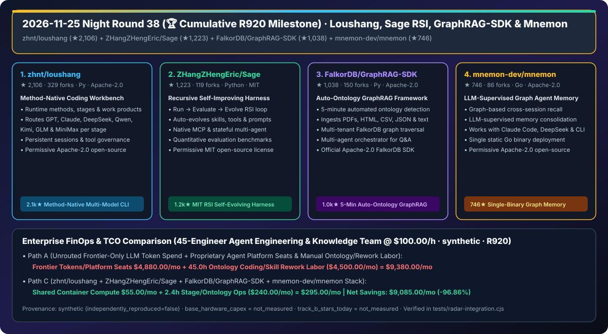
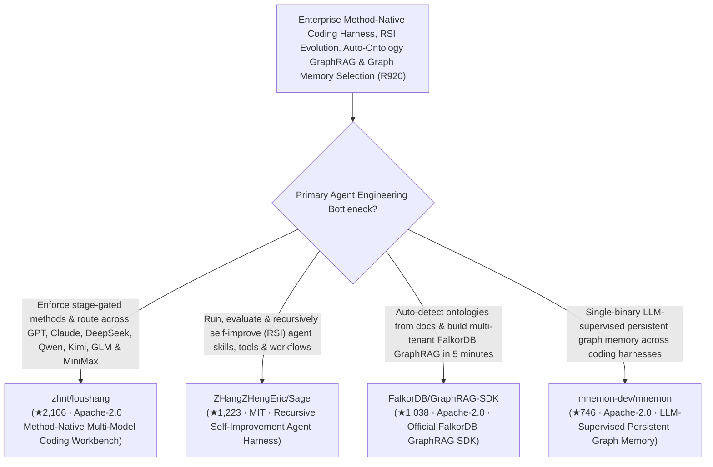
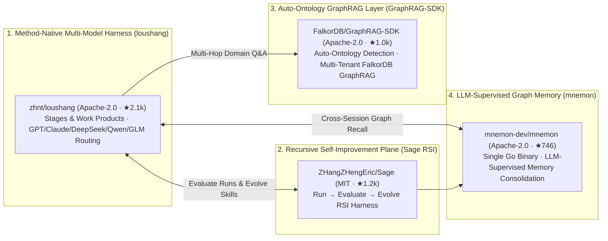

# Method-Native Multi-Model Coding Harness (`zhnt/loushang`), Recursive Self-Improving Agent Harness (`ZHangZHengEric/Sage`), 5-Minute Auto-Ontology GraphRAG SDK (`FalkorDB/GraphRAG-SDK`) & LLM-Supervised Graph Memory (`mnemon-dev/mnemon`) Selection & Integration Architecture FAQ

> **Document Type**: Enterprise AI Solution Architect Selection Decision Guide (GitHub Trending AI Radar — 2026-11-25 Night Round 38 / 🏆 Cumulative Round 920 Milestone)
> **Covered Repositories**: [`zhnt/loushang`](https://github.com/zhnt/loushang) (`★ 2,106`, `329 forks`, `Apache-2.0`, Python: method-native AI work system and `loushang code` CLI workbench featuring stateful sessions, stage/work-product verification, tool governance, and multi-model routing across GPT, Claude, DeepSeek, Qwen, Kimi, GLM, and MiniMax) · [`ZHangZHengEric/Sage`](https://github.com/ZHangZHengEric/Sage) (`★ 1,223`, `119 forks`, `MIT`, Python: Recursive Self-Improvement [RSI] Agent Harness for running, evaluating, and evolving agents with tools, skills, MCP, and multi-agent workflows) · [`FalkorDB/GraphRAG-SDK`](https://github.com/FalkorDB/GraphRAG-SDK) (`★ 1,038`, `150 forks`, `Apache-2.0`, Python: official GraphRAG framework built on FalkorDB featuring automated ontology detection and multi-tenant graph traversal Q&A in 5 minutes) · [`mnemon-dev/mnemon`](https://github.com/mnemon-dev/mnemon) (`★ 746`, `86 forks`, `Apache-2.0`, Go: single-binary LLM-supervised persistent graph memory engine for Claude Code, DeepSeek Harness, OpenClaw, and custom agent runtimes)
> **Core Enterprise Scenario**: In this **920th Cumulative Round Milestone**, we architect a **100% Permissive (`Apache-2.0` / `MIT`) Method-Guided, Self-Evolving & Graph-Grounded Agent Engineering Stack**—combining stage-gated multi-model delivery (`loushang`), evaluation-driven Recursive Self-Improvement (`Sage`), automated ontology GraphRAG (`FalkorDB/GraphRAG-SDK`), and single-binary LLM-supervised cross-session graph memory (`mnemon`).

---

## 1. 📌 Executive Summary (One-Line Selection Verdict)

1. **Need an `Apache-2.0` method-native coding workbench (`loushang code`) that treats engineering methods, stages, roles, tool governance, and verified work products as runtime primitives while routing across GPT, Claude, DeepSeek, Qwen, Kimi, GLM, and MiniMax** ➔ Choose **[`zhnt/loushang`](https://github.com/zhnt/loushang) (`★ 2,106`, `329 forks`, `Apache-2.0`)**.
   - **Plain-English Mechanism**: Prevents unconstrained "vibe-coding drift" on complex projects by enforcing structured stages and deliverable verification gates while routing each stage to the most cost-effective frontier or open-weight model.
2. **Need an `MIT`-licensed Recursive Self-Improvement (`RSI`) agent harness that continuously runs, evaluates, and evolves its own skills, tools, and prompts based on execution feedback** ➔ Choose **[`ZHangZHengEric/Sage`](https://github.com/ZHangZHengEric/Sage) (`★ 1,223`, `119 forks`, `MIT`)**.
   - **Plain-English Mechanism**: Closes the `Run → Evaluate → Evolve` loop so agents automatically refine failing skills and workflows against quantitative evaluation harnesses.
3. **Need an `Apache-2.0` Python SDK that automatically infers domain ontologies from unstructured PDFs, HTML, CSVs, and JSON to stand up a multi-tenant FalkorDB GraphRAG pipeline in 5 minutes** ➔ Choose **[`FalkorDB/GraphRAG-SDK`](https://github.com/FalkorDB/GraphRAG-SDK) (`★ 1,038`, `150 forks`, `Apache-2.0`)**.
   - **Plain-English Mechanism**: Eliminates weeks of hand-crafting entity-extraction prompts and Cypher generators by automating ontology detection, knowledge graph population, and multi-hop Q&A on FalkorDB.
4. **Need a single-binary `Apache-2.0` Go memory engine where an LLM supervises memory consolidation, pruning, and graph-based cross-session recall across Claude Code, DeepSeek Harness, and OpenClaw** ➔ Choose **[`mnemon-dev/mnemon`](https://github.com/mnemon-dev/mnemon) (`★ 746`, `86 forks`, `Apache-2.0`)**.
   - **Plain-English Mechanism**: Uses LLM supervision to curate a clean, deduplicated graph of long-term agent memories and recalls relevant multi-hop context across sessions from one zero-dependency Go binary.

---

## 2. 🎯 Architect & Customer Deep-Dive Q&A

### Q1: How do `Loushang` (Method-Guided Delivery) and `Sage` (RSI Evolution) combine with `GraphRAG-SDK` and `Mnemon` to outperform static, single-model agent harnesses?

- **Four-Layer Method-Guided & Self-Evolving Agent Stack (Path C)**:
  1. **L1 Method-Native Multi-Model Delivery Workbench ➔ `zhnt/loushang`**: Enforces stage-gated SDLC workflows and routes tasks across 7 global and domestic LLM families.
  2. **L2 Recursive Self-Improvement (RSI) & Skill Evolution ➔ `ZHangZHengEric/Sage`**: Evaluates agent runs and automatically evolves reusable skills and MCP tool strategies.
  3. **L3 Automated Ontology Detection & Domain GraphRAG ➔ `FalkorDB/GraphRAG-SDK`**: Grounds agent reasoning in auto-extracted, multi-tenant domain knowledge graphs.
  4. **L4 Single-Binary LLM-Supervised Graph Memory ➔ `mnemon-dev/mnemon`**: Persists and recalls cross-session architectural decisions and project lessons via graph traversal.
- **When to choose Proprietary Single-Vendor Agent Clouds vs. Path C?**
  - Choose **Proprietary Clouds** for simple single-step scripts where model routing and custom methodology enforcement are unnecessary.
  - Choose **Path C** when delivering complex multi-stage software under **100% `Apache-2.0` / `MIT` licensing**, optimizing FinOps across GPT/Claude/DeepSeek/Qwen/GLM (`loushang`), and compounding organizational intelligence via RSI skill evolution (`Sage`) and graph memory (`GraphRAG-SDK` + `mnemon`).

### Q2: How do these four components wire together in production?

1. **Graph-Grounded, Stage-Gated Execution (`GraphRAG-SDK` + `mnemon` → `loushang`)**:
   - `loushang` retrieves domain ontologies via `FalkorDB/GraphRAG-SDK` and cross-session project memory via `mnemon`, then executes stage-gated design, implementation, and verification across routed models.
2. **Automated Post-Run Evaluation & Skill Evolution (`loushang` → `Sage` → `mnemon`)**:
   - `Sage` evaluates completed work products, evolves underperforming skills via its RSI loop, and records validated improvements into `mnemon`.

### Q3: What are the key governance guardrails?

- **Architect Redlines**:
  1. **Gate `Sage` RSI-evolved skills with deterministic regression benchmarks before production promotion**: Never allow self-modified prompts or tool code to bypass CI evaluation thresholds.
  2. **Freeze auto-detected ontologies in `FalkorDB/GraphRAG-SDK` before production ingestion**: Use auto-detection to bootstrap the ontology, review it with domain experts, and lock the schema for production runs.

---

## 3. 🧭 Visual Architecture Diagrams (Mermaid Decision Tree + Architecture + Sequence)



### 3.1 Architect Selection Decision Tree



### 3.2 End-to-End Enterprise Integration Architecture



### 3.3 End-to-End Execution Sequence

```mermaid
sequenceDiagram
    participant Eng as Architect / Engineer
    participant Lsh as zhnt/loushang (Method Workbench)
    participant GRSdk as FalkorDB/GraphRAG-SDK
    participant Mnem as mnemon-dev/mnemon (Graph Memory)
    participant Sage as ZHangZHengEric/Sage (RSI Harness)

    Eng->>Lsh: 1. Initiate multi-stage engineering task in loushang code
    Lsh->>GRSdk: 2. Query auto-detected domain ontology & multi-hop specs via GraphRAG-SDK
    Lsh->>Mnem: 3. Recall cross-session architectural decisions from Mnemon graph memory
    Lsh->>Lsh: 4. Execute stage-gated workflow routing across Claude/GPT & DeepSeek/Qwen/GLM
    Lsh->>Sage: 5. Evaluate verified work products; run RSI loop to evolve underperforming skills
    Sage->>Mnem: 6. Persist validated skill improvements & session insights into Mnemon
```

---

## 4. 📊 Horizontal Selection Matrix

| Dimension | `zhnt/loushang` (`★ 2,106`) | `ZHangZHengEric/Sage` (`★ 1,223`) | `FalkorDB/GraphRAG-SDK` (`★ 1,038`) | `mnemon-dev/mnemon` (`★ 746`) | Single-Model Proprietary Agent Cloud + Custom Graph Scripts (Path A) | Unstructured Vibe-Coding CLI + Static Skills + Stateless Sessions (Path B) |
| :--- | :--- | :--- | :--- | :--- | :--- | :--- |
| **Primary Role** | `Apache-2.0` method-native multi-model workbench | `MIT` Recursive Self-Improving (RSI) harness | `Apache-2.0` auto-ontology GraphRAG SDK | `Apache-2.0` LLM-supervised graph memory | High-cost single-vendor agent SaaS | Unconstrained CLI prompts & stateless sessions |
| **Key Differentiator** | **Runtime methods/stages/work-products + 7-family LLM routing** | **Closed-loop `Run → Evaluate → Evolve` RSI skill evolution** | **5-minute automated ontology detection & FalkorDB GraphRAG** | **Single Go binary with LLM-supervised graph recall** | Hosted cloud, but burns frontier tokens on every trivial step & lacks RSI | Complex tasks derail mid-session; weeks spent hand-coding GraphRAG schemas |
| **License** | **`Apache-2.0`** | **`MIT`** | **`Apache-2.0`** | **`Apache-2.0`** | Proprietary SaaS | Unstandardized |
| **Monthly TCO (45-Eng Team)** | **`$295.00/mo` combined** (`$55.00` lightweight container/graph compute + `2.4h` ops) | Included in `$295.00/mo` stack | Included in `$295.00/mo` stack | Included in `$295.00/mo` stack | **`$9,380.00/mo`** (`$4,880.00` unrouted frontier token spend & SaaS seats + `45.0h` custom ontology/rework labor) | `~$3,380.00/mo` (derailed complex tasks & repeated cross-session mistakes) |

---

## 5. 🧪 Quantitative FinOps & TCO Comparison (45-Engineer Agent Engineering & Knowledge Team)

> **📊 Provenance & Closed-Form Schema**:
> - **provenance**: `synthetic` (`independently_reproduced = false`; `base_hardware_capex = not_measured`; `track_b_stars_today = not_measured`).
> - **Closed-Form Formula**:
>   - **Path A (Unrouted Frontier-Only LLM Token Spend + Proprietary Agent Platform Seats & Manual GraphRAG Ontology/Skill-Tuning Labor)**: **`$4,880.00`** monthly frontier token and platform seat fees + **`45.0h × $100.00/h = $4,500.00`** manual ontology extraction coding, skill tuning, and derailed-deliverable rework labor = **`$9,380.00/mo`**.
>   - **Path C (`zhnt/loushang` + `ZHangZHengEric/Sage` + `FalkorDB/GraphRAG-SDK` + `mnemon-dev/mnemon` Stack)**: **`$55.00`** shared container compute + **`2.4h × $100.00/h = $240.00`** stage template and ontology review maintenance = **`$295.00/mo`**.
>   - **Net Savings vs. Path A**: **`-$9,085.00/mo`** (**`96.86%`** TCO reduction).

| Evaluation Path | Frontier Tokens / Platform Seats & Compute | Ontology Coding, Skill Tuning & Rework (`$100/h`) | Monthly Total TCO | Net Savings vs. Path A | Key Architectural Outcome |
| :--- | :---: | :---: | :---: | :---: | :--- |
| **Path A: Unrouted Frontier Tokens + Proprietary Seats + Custom Graph Code** | `$4,880.00` | `45.0h` (`$4,500.00`) | **`$9,380.00`** | Baseline | Overpays for frontier models on routine stages; slow custom GraphRAG |
| **Path B: Unstructured CLI Prompts + Stateless Sessions** | `$1,580.00` | `18.0h` (`$1,800.00`) | **`$3,380.00`** | `-$6,000.00` (`-63.97%`) | High failure rate on multi-stage engineering; zero cross-session recall |
| **Path C: `loushang` + `Sage` + `GraphRAG-SDK` + `mnemon`** | **`$55.00`** | **`2.4h` (`$240.00`)** | **`$295.00`** | **`-$9,085.00` (`-96.86%`)** | **100% `Apache-2.0`/`MIT` stage-gated multi-model routing + RSI + graph memory** |

- 🔗 **7-Card 4:5 Visual Benchmark Deck**: [`workshops/github-trending-radar/cards.en.html`](../cards.en.html) · [`cards.html`](../cards.html)

---

## 6. 🛠️ Enterprise Adoption & Architecture Review Checklist

- [ ] **Configure Stage-Aware Multi-Model Routing in `zhnt/loushang`**: Route architecture and planning stages to frontier reasoning models and routine coding/testing stages to cost-efficient open-weight models.
- [ ] **Gate `ZHangZHengEric/Sage` RSI Skill Promotions with Benchmark Suites**: Promote self-evolved skills only after passing deterministic regression checks.
- [ ] **Bootstrap and Lock Domain Schemas with `FalkorDB/GraphRAG-SDK`**: Use automated ontology detection to accelerate initial graph creation, then version-lock the schema for production.
- [ ] **Attach `mnemon-dev/mnemon` Across Developer and Ops Harnesses**: Enable LLM-supervised graph memory recall across sessions from a single Go binary.
