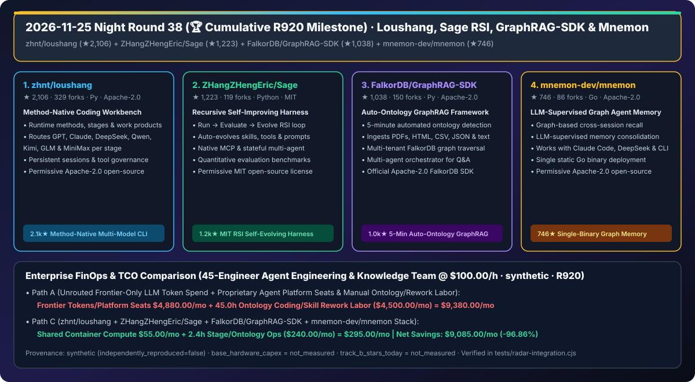
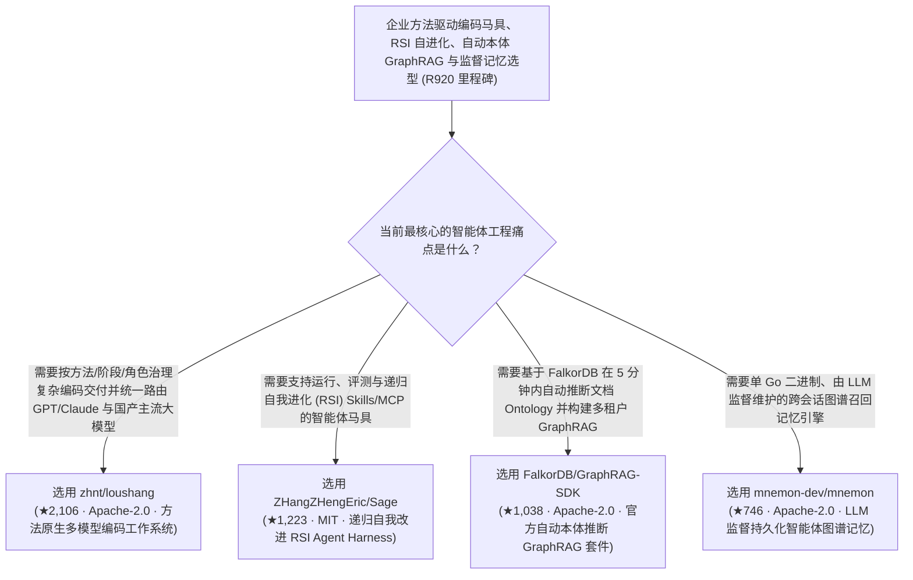
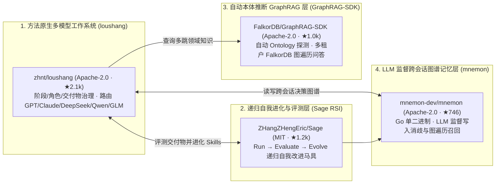
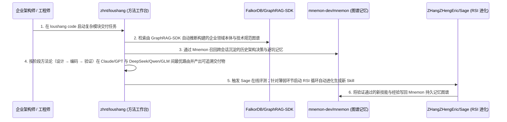

# 方法驱动的多模型编码工作系统（`zhnt/loushang`）、递归自我进化 RSI 智能体马具（`ZHangZHengEric/Sage`）、5 分钟自动本体推断 GraphRAG 开发套件（`FalkorDB/GraphRAG-SDK`）与单二进制大模型监督图谱记忆引擎（`mnemon-dev/mnemon`）选型与集成架构 FAQ

> **文档类型**：企业 AI 解决方案架构师（AI Solution Architect）选型决策指南（GitHub Trending AI 雷达 2026-11-25 Night Round 38 / 🏆 累计第 920 轮里程碑）
> **覆盖项目**：[`zhnt/loushang`](https://github.com/zhnt/loushang)（`★ 2,106`、`329 forks`、`Apache-2.0`：方法原生 [Method-Native] Python 编码智能体马具 [`loushang code`]，原生支持跨 GPT/Claude/DeepSeek/Qwen/Kimi/GLM/MiniMax 多模型路由、阶段化方法论引导、工具治理与可追溯交付）· [`ZHangZHengEric/Sage`](https://github.com/ZHangZHengEric/Sage)（`★ 1,223`、`119 forks`、`MIT`：递归自我改进 [RSI] 智能体马具，集运行、评测与自动进化 Skills/Tools/MCP 于一体）· [`FalkorDB/GraphRAG-SDK`](https://github.com/FalkorDB/GraphRAG-SDK)（`★ 1,038`、`150 forks`、`Apache-2.0`：基于 FalkorDB 的官方生产级 GraphRAG SDK，支持从非结构化文档自动推断 Ontology 并实现多租户防幻觉问答）· [`mnemon-dev/mnemon`](https://github.com/mnemon-dev/mnemon)（`★ 746`、`86 forks`、`Apache-2.0`：Go 单二进制大模型监督持久化智能体记忆引擎，为 Claude Code/DeepSeek Harness/OpenClaw 提供基于图的跨会话知识召回）
> **核心场景**：当企业架构师打造“守工程规矩、能自我进化、懂多跳领域图谱且跨会话不失忆”的第二代智能体工程平台时，常面临四个核心问题：**“为什么通用编码 Agent 写小脚本很快、一做复杂工程就丢上下文且不按公司研发规范出交付件，怎么用一套把‘研发方法论、阶段、角色与交付物核验’刻进运行时的 `Apache-2.0` 马具并原生路由国产/海外 7 大模型家族（`loushang`）？如何让 Agent 在运行完任务后根据自动评测分实现递归自我进化（RSI）自动修补自己的 Skill（`Sage`）？业务文档想在 5 分钟内自动推断出 Ontology 并搭起高准确率多租户 GraphRAG 用哪个官方 SDK 最省事（`GraphRAG-SDK`）？如何用一个轻量 Go 二进制文件让大模型自己监督、修剪和召回跨会话的图谱记忆（`mnemon`）？”** 本文给出 100% `Apache-2.0`/`MIT` 解决方案。

---

## 一、📌 核心结论速览（选型一句话结论）

1. **想让编码智能体告别“想到哪改到哪”的散漫模式，用一套 `Apache-2.0` Python 工作系统把“研发方法论（Methods）、阶段门禁（Stages）、工具权限治理与交付物核验（Work Products）”固化为运行时一等公民，并原生路由 GPT、Claude 与国产 DeepSeek / Qwen / Kimi / GLM / MiniMax** ➔ 选 **[`zhnt/loushang`](https://github.com/zhnt/loushang)（`★ 2,106`，`329 forks`，`Apache-2.0`）**。
   - **通俗原理**：提供 `loushang code` 终端工作台，强制智能体按预设工程方法论分阶段推进（如先产出接口规格说明书并通过校验，再进入编码与测试阶段），支持按阶段任务难度在国产高性价比模型与旗舰推理模型间精细路由。
2. **希望智能体不仅能调用工具、Skills 与 MCP，还能内置“运行（Run）→ 在线评测（Evaluate）→ 自动反思演进（Evolve）”的递归自我改进（RSI: Recursive Self-Improvement）闭环** ➔ 选 **[`ZHangZHengEric/Sage`](https://github.com/ZHangZHengEric/Sage)（`★ 1,223`，`119 forks`，`MIT`）**。
   - **通俗原理**：当 Agent 在某类复杂业务任务上得分偏低或工具调用失败时，`Sage` 的 RSI 循环会自动分析失败轨迹、重写或合成新的 Skill 与提示词策略，并通过评测基准验证进化有效后再固化下来。
3. **团队已经选定了超高速图数据库 `FalkorDB`，希望不用从零手写复杂的实体抽取 Prompt 和 Cypher 生成逻辑，5 分钟内用几行 Python 代码实现“从 PDF/JSON/网页自动推断本体（Ontology）→ 自动建图 → 多租户防幻觉问答”** ➔ 选 **[`FalkorDB/GraphRAG-SDK`](https://github.com/FalkorDB/GraphRAG-SDK)（`★ 1,038`，`150 forks`，`Apache-2.0`）**。
   - **通俗原理**：FalkorDB 官方维护的上层应用加速套件，内置自动 Ontology 探测与多智能体问答编排，开箱即用解决纯向量 RAG 无法回答跨文档多跳关联问题的短板。
4. **需要一个零外部数据库依赖的 Go 单二进制守护进程，作为 Claude Code、DeepSeek Harness 或 OpenClaw 的“大模型监督式长期图谱记忆（LLM-Supervised Graph Memory）”** ➔ 选 **[`mnemon-dev/mnemon`](https://github.com/mnemon-dev/mnemon)（`★ 746`，`86 forks`，`Apache-2.0`）**。
   - **通俗原理**：不是简单把聊天记录存成扁平向量，而是由 LLM 监督记忆的写入、合并、冲突消解与权重衰减，通过图遍历召回跨会话的深层因果知识。

---

## 二、🎯 客户与架构师灵魂拷问 Q&A（深度架构拆解）

### Q1：在企业级智能体平台建设中，`Loushang`（方法驱动交付）与 `Sage`（RSI 自我进化）如何互补？为什么底层要搭配 `GraphRAG-SDK` 与 `Mnemon`？

- **四层自演进与方法驱动智能体工程栈（Path C）**：
  1. **L1 方法驱动的多模型研发交付马具 ➔ `zhnt/loushang`**：提供结构化阶段管控、工具治理与跨 GPT/Claude/DeepSeek/Qwen/Kimi/GLM/MiniMax 的最优性价比路由。
  2. **L2 递归自我进化（RSI）与技能合成引擎 ➔ `ZHangZHengEric/Sage`**：对智能体执行结果进行自动化打分，驱动 Skills 与工作流策略持续迭代进化。
  3. **L3 自动本体推断与多租户领域 GraphRAG 层 ➔ `FalkorDB/GraphRAG-SDK`**：在 5 分钟内将企业私有文档转化为带本体约束的高精度知识图谱问答服务。
  4. **L4 单二进制 LLM 监督跨会话图谱记忆层 ➔ `mnemon-dev/mnemon`**：为所有智能体运行时提供可跨会话演进的关联记忆召回。
- **何时选商业云方案（闭源商业 Agent 平台 + 全量调用昂贵旗舰模型） vs 自建本轮 `Apache-2.0`/`MIT` 四件套（Path C）？**
  - 若是临时一次性脚本任务，直接调单一商业 API 即可。
  - **何时采用本轮开源四件套（Path C）？** 当企业需要**将 70% 的常规阶段路由至高性价比的 DeepSeek / Qwen / GLM 模型**（`loushang`）、需要让智能体在垂直业务场景中越用越准（`Sage` RSI 进化 + `mnemon` 监督记忆）、并需要快速交付多租户 GraphRAG（`GraphRAG-SDK`）时，Path C 可节省 **96%+** 的模型调用与定制开发成本。

### Q2：这四个项目在生产流水线中如何协同工作？

1. **领域知识与长期记忆双注入（`GraphRAG-SDK` + `mnemon` → `loushang`）**：
   - 当 `loushang` 执行复杂研发或业务交付任务时，一方面通过 `FalkorDB/GraphRAG-SDK` 检索企业静态技术规范与业务本体，另一方面通过 `mnemon` 召回跨会话积累的动态项目偏好与历史决策。
2. **交付后评测与技能自进化（`loushang` → `Sage` → `mnemon`）**：
   - 每个阶段交付物（Work Product）完成后，由 `Sage` 的评测模块检验质量；若发现某类新场景处理欠佳，触发 RSI 进化生成新 Skill 并通过 `mnemon` 持久化记忆图谱。

### Q3：生产落地的安全与治理红线是什么？

- **架构师避坑红线**：
  1. **`Sage` 的递归自我改进（RSI）生成的新 Skill 在进入生产主分支前必须经过沙箱基准测试（Benchmark Gate）**：严禁未经回归评测验证的自修改代码或提示词直接覆盖生产策略。
  2. **在 `GraphRAG-SDK` 中对自动推断的 Ontology 执行人工抽检锁版**：首次用自动探测快速生成草稿本体后，应导出并锁定 Schema，确保持续增量入图时实体类型不发生漂移。

---

## 三、🧭 直观可视化图解（Mermaid 决策树 + 集成架构 + 时序图）

### 3.1 架构师选型决策树

### 3.2 企业端到端生产集成参考架构图

### 3.3 方法引导阶段执行、多模型路由、GraphRAG+Mnemon 知识召回与 Sage RSI 自进化时序图

---

## 四、📊 同类开源与商业云服务横向选型决策矩阵

| 对比维度 | `zhnt/loushang` (`★ 2,106`) | `ZHangZHengEric/Sage` (`★ 1,223`) | `FalkorDB/GraphRAG-SDK` (`★ 1,038`) | `mnemon-dev/mnemon` (`★ 746`) | 商业闭源 Agent 平台 + 全程只调昂贵海外旗舰模型 + 手写建图脚本 (Path A) | 无阶段约束裸跑 CLI + 静态死 Skill + 会话关掉即失忆 (Path B) |
| :--- | :--- | :--- | :--- | :--- | :--- | :--- |
| **核心能力定位** | `Apache-2.0` 方法驱动多模型编码工作系统 | `MIT` 递归自我改进（RSI）智能体马具 | `Apache-2.0` 自动本体 GraphRAG SDK | `Apache-2.0` LLM 监督图谱记忆二进制 | 高成本单一模型绑定的商业云套件 | 无规范自由发挥脚本 + 零记忆积累 |
| **核心技术突破** | **将方法/阶段/交付物核验作为运行时原语 + 原生适配中外 7 大模型系** | **内置运行-评测-进化（RSI）闭环，让 Agent 自动迭代 Skills** | **5 分钟自动从文档探测 Ontology 并构建多租户 GraphRAG** | **Go 单二进制由 LLM 监督记忆合并、修剪与图遍历召回** | 开箱即用，但无法按阶段混合调度高性价比国产模型且无自进化能力 | 复杂工程写到一半上下文崩盘；手写 GraphRAG 本体抽取耗时数周 |
| **开源协议** | **`Apache-2.0`** | **`MIT`** | **`Apache-2.0`** | **`Apache-2.0`** | 闭源商业 SaaS | 脆弱不可控 |
| **月度 TCO（45 人团队）** | **四件套合建仅 `$295.00/月`**（`$55.00` 轻量容器与图库分摊 + `2.4h` 维护） | 同左（`MIT` 自动优化技能减少人工调 Prompt 工时） | 同左（`Apache-2.0` 免去数周手写本体抽取代码） | 同左（`Apache-2.0` 单 Go 二进制零额外服务依赖） | **`$9,380.00/月`**（`$4,880.00` 全程高价旗舰模型 Token 与商业平台席位 + `45.0h` 手写 GraphRAG 与修复越界交付物工时） | 约 `$3,380.00/月`（大量因缺乏阶段核验推倒重写与手工维护记忆工时） |

---

## 五、🧪 应用落地定量收益/TCO 对比与 7-Card 报告

> **📊 数据来源与闭式核算声明（Provenance & Closed-Form Schema）**：
> - **provenance**: `synthetic`（基于 45 人企业智能体研发、多模型路由优化与行业知识工程团队月度工作负载模型：`independently_reproduced = false`；硬件采购基线 `base_hardware_capex = not_measured`；Track B 单日增量 `track_b_stars_today = not_measured`）。
> - **核算公式**：
>   - **Path A（未按阶段做中外多模型分级路由而全程消耗高价旗舰模型 Token + 商业智能体平台席位 + 从零手写 GraphRAG 本体抽取管道与人工修复无阶段门禁导致的偏航代码工时）**：月度高价模型 Token 与商业席位账单 **`$4,880.00`** + 手工编写 Ontology 抽取脚本、调优静态 Skill 与返工不合格交付物人工 **`45.0h × $100.00/h = $4,500.00`** = **`$9,380.00/月`**。
>   - **Path C（自建 `zhnt/loushang` + `ZHangZHengEric/Sage` + `FalkorDB/GraphRAG-SDK` + `mnemon-dev/mnemon` 全 `Apache-2.0`/`MIT` 方法驱动与自进化底座）**：内网轻量容器算力分摊 **`$55.00`** + 阶段验收模板与本体锁版日常巡检人工 **`2.4h × $100.00/h = $240.00`** = **`$295.00/月`**。
>   - **净节省（Net Savings vs Path A）**：**`-$9,085.00/月`**（成本降低 **`96.86%`**）。

| 评估方案 | 模型 Token / 商业平台席位与算力成本 | 本体脚本开发、Skill 调优与返工人工（`$100/h`） | 月度总 TCO | 相对 Path A 净节省 | 核心业务交付收益 |
| :--- | :---: | :---: | :---: | :---: | :--- |
| **Path A：全量旗舰模型消耗 + 商业平台席位 + 手写建图** | `$4,880.00` | `45.0h` (`$4,500.00`) | **`$9,380.00`** | Baseline | 简单阶段也用最贵模型导致账单虚高；手写建图周期长 |
| **Path B：无阶段约束裸跑 Agent + 会话结束即丢记忆** | `$1,580.00` | `18.0h` (`$1,800.00`) | **`$3,380.00`** | `-$6,000.00` (`-63.97%`) | 复杂任务极易偏航烂尾；同类错误跨会话反复重演 |
| **Path C：`loushang` + `Sage` + `GraphRAG-SDK` + `mnemon`** | **`$55.00`** | **`2.4h` (`$240.00`)** | **`$295.00`** | **`-$9,085.00` (`-96.86%`)** | **100% `Apache-2.0`/`MIT` 方法门禁 + 7 模型系路由 + RSI 进化 + 图记忆** |

- 🔗 **关联 7-Card 4:5 视觉评测报告**：[`workshops/github-trending-radar/cards.html`](../cards.html) · [`cards.en.html`](../cards.en.html)

---

## 六、🛠️ 企业引入与架构评审 Checklist

- [ ] **在 `zhnt/loushang` 中配置阶段化多模型路由策略**：将规划与架构审查路由至高推理模型（Claude / GPT），将常规代码生成与文档整理路由至高性价比模型（DeepSeek / Qwen / GLM）。
- [ ] **对 `ZHangZHengEric/Sage` 的 RSI 进化产物实施基准测试准入门禁**：仅当新进化的 Skill 在黄金测试集上得分显著高于旧版时才自动晋升。
- [ ] **使用 `FalkorDB/GraphRAG-SDK` 快速完成初期领域本体自动探测并锁定生产 Schema**：结合多租户子图隔离不同业务线数据。
- [ ] **为终端与后台 Agent 统一挂载 `mnemon-dev/mnemon` 单二进制记忆守护进程**：开启 LLM 监督式记忆去重与跨会话因果图召回。
