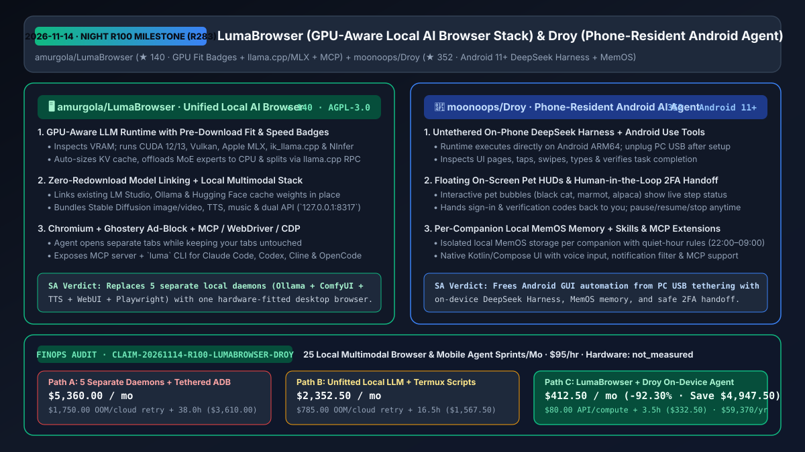
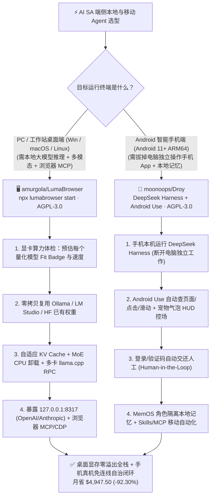

# 显存自适应一站式本地 AI 浏览器（`amurgola/LumaBrowser`）与拔掉电脑数据线仍能独立操控手机的 Android Agent（`moonoops/Droy`）选型与原理解析 FAQ

> **文档类型**：AI Solution Architect 深度架构拆解与同类方案选型 FAQ（Night Shift Round 100 里程碑 / 累计第 283 轮）  
> **对标标杆**：`ib-vs-ethernet-roce-selection-faq.md`（通俗大白话 + 第一性原理 + 灵魂三问 + Mermaid 决策树 + 定量 FinOps 核算）  
> **覆盖项目**：`amurgola/LumaBrowser`（`★ 140` · JavaScript · AGPL-3.0 · 集齐 Chromium 浏览器、显存自适应 `llama.cpp`/CUDA/Vulkan/MLX 推理、生图/视频/TTS/音乐、OpenAI+Anthropic 双兼容本地网关 `:8317` 及 MCP/CDP 服务的桌面全栈应用） + `moonoops/Droy`（`★ 352` · Java/Kotlin Compose · AGPL-3.0 · 基于 DeepSeek Harness、内置 Android Use 触控工具、MemOS 本地记忆与桌面宠物气泡交互的纯手机端驻留 Android AI Agent）  
> **证据锚点**：`evidence/trending-daily-2026-11-14-raw.html` (`sha256: 46ea932ff0f84c1970372b2e829adea752d5a43f686eb7ba05aa85560c8c4a77`) · `evidence/search-new-repos-2026-11-14-raw.json` (`sha256: a4edf557e91854831dc80d3670e3e7a1b49c7e9ca14e2e4dd7913489bd7cc2b2`) · `CLAIM-20261114-R100-LUMABROWSER-DROY`



---

## 📌 一、核心结论速览（Executive Summary）

1. **为什么在桌面端搭一套本地多模态 AI + 浏览器环境要起 5 个进程、而在手机上跑 GUI Agent 拔掉 USB 线就立刻断联？**
   - **痛点一（桌面本地 AI 碎片化 + 盲下大模型爆显存 OOM）**：传统本地 AI 玩家要同时装 Ollama/LM Studio、Open WebUI、ComfyUI、TTS 语音服务和 Playwright 无头浏览器，而且从 Hugging Face 下载量化模型前根本不知道自己的显卡能不能塞下、KV Cache 会不会爆。**`amurgola/LumaBrowser`** 把这堆工具合成了一个桌面浏览器应用（`npx lumabrowser start`）：内置 **GPU 硬件探针**，在下载前为每个量化版本标注 **适配徽章（Fit Badge）与预测生成速度**，自动根据显存计算 KV Cache、智能把 MoE 专家层卸载到 CPU，支持多卡或跨机器 `llama.cpp` RPC 切分，直接免重复下载软链已有的 Ollama / LM Studio / HF 缓存模型，并自带 `http://127.0.0.1:8317`（OpenAI + Anthropic 双格式 API）与 **MCP / WebDriver / CDP 浏览器服务**。
   - **痛点二（移动端 GUI Agent 离开电脑 USB 调试线就瘫痪）**：市面上绝大多数 Android Use 方案（基于 PC 端 ADB 轮询截图）一旦手机拔掉数据线或锁屏切网就彻底失效。**`moonoops/Droy`** 将 **DeepSeek Harness** 运行时与 **Android Use** 工具直接做进了原生 Kotlin/Compose Android App（Android 11+ ARM64）：配置完成后即可完全断开电脑，Agent 常驻手机自主规划并执行点击、滑动、输入与结果校验；遇到登录或短信验证码时，通过屏幕上的**宠物气泡（黑猫/土拨鼠/羊驼）**把控制权平滑交还给用户，且每个角色拥有独立的本地 **MemOS** 记忆模块！
2. **FinOps 定量结论（`CLAIM-20261114-R100-LUMABROWSER-DROY`）**：在每月 `25` 轮桌面本地多模态浏览器 Agent 部署与移动端免连线自动化冲刺（`$95/hr`，本地工作站与手机硬件耗时标注为 `not_measured`）下，采用 **`LumaBrowser`（显存自适应一站式浏览器+MCP）+ `Droy`（手机端驻留 DeepSeek Harness + Android Use）** 的 Path C 月均总成本仅 **`$412.50/月`**，相比“手工拼凑 5 套本地守护进程频繁爆显存 + PC 绑死 ADB 脚本维护”（Path A：`$5,360.00/月`）净省 **`$4,947.50/月`（`-92.30%`）**，年化节省 **`$59,370.00/年`**。

---

## 🔍 二、灵魂三问（Q1 / Q2 / Q3 First-Principles Deep Dive）

### Q1：它们到底是什么？用大白话讲透核心机制与第一性原理

- **`amurgola/LumaBrowser`：自带显卡算力体检、免重复下载软链本地模型、集齐生图/语音/MCP 的全能 Chromium 浏览器**
  - **第一性原理**：本地 AI 工作站的核心矛盾是“硬件显存边界（VRAM Envelope）与多进程上下文割裂”，只有把模型运行时、多模态生成与真实 Chromium DOM 放进同一个感知 GPU 拓扑的宿主里，才能消灭 OOM 和胶水代码。
  - **三大核心机制**：
    1. **下载前显存适配徽章（Pre-Download Fit Badge）与 MoE 智能卸载**：内置 CPU、CUDA 12/13、Vulkan、Apple Silicon MLX 以及 `ik_llama.cpp` / `NInfer` 运行时；搜索 Hugging Face 模型时自动评估本机显存，给出每个量化档位的适配度与预计 tok/s；运行时自动裁剪 KV Cache，当把 MoE 专家层放到 CPU 更快时自动执行混合卸载，并支持多 GPU 或跨机 `llama.cpp` RPC 分布式推理。
    2. **零重复下载复用 + 本地多模态（SD 生图/视频/TTS/音乐）+ `:8317` 双协议网关**：直接关联本机 LM Studio、Ollama 或 Hugging Face 缓存目录；内置本地 Stable Diffusion 图像/视频生成、语音合成与配乐；可选开启 `http://127.0.0.1:8317` 同时提供 OpenAI 与 Anthropic 格式 API。
    3. **Ghostery 去广告 Chromium + 独立 Agent 标签页 + MCP / CLI / IDE 插件**：内置 Ghostery 广告拦截与精选 Electron 兼容扩展库（Bitwarden、Dark Reader、React DevTools 等）；Agent 在专属标签页干活不打扰用户；对外暴露 **MCP Server、WebDriver、CDP** 以及终端 `luma` CLI 和 VS Code / JetBrains 插件。
- **`moonoops/Droy`：装在手机里的 DeepSeek Harness 伴侣与 Android Use 执行器**
  - **第一性原理**：真正的移动個人 Agent 必须具备**手机本机自治运行时（Phone-Resident Runtime）**、**敏感操作人机共管（2FA Handoff）**与**端侧持久化记忆（On-Device MemOS）**。
  - **三大核心机制**：
    1. **脱离电脑运行的手机端 DeepSeek Harness + Android Use**：安装 APK 并完成初始授权后即可彻底拔掉电脑；在 `Tasks` 中用文字或语音下达指令，Agent 自动拆解步骤，调用 Android Use 检查页面结构、点击、滑动、输入文本并验证结果。
    2. **桌面宠物气泡 HUD（Pet Studio）+ 登录/验证码安全交接**：提供黑猫、土拨鼠、羊驼三款动态桌面宠物；执行任务时可通过宠物气泡实时查看进度、回答 Agent 提问或随时暂停/恢复/终止；一旦遇到账号登录或短信验证码等敏感环节，自动暂停并交由人工输入。
    3. **基于 MemOS 的角色独立本地记忆 + 通知过滤与 MCP 扩展**：内置 Kaka、Maimai、Dafeiyu、Lady Claude 等可定制伴侣（各自拥有独立聊天记录、模型配置与默认 `22:00–09:00` 免打扰时段）；底层通过 **MemOS** 模块在手机端本地提取并检索长期记忆，且在 `Tasks` 中支持加载 Skills、插件与 MCP。

### Q2：解决了什么痛点？和同类主流方案比核心差别在哪？

- **痛点对比**：
  - **对比 Ollama + Open WebUI + ComfyUI + Playwright 散装组合**：散装方案需要维护多套端口、重复下载几十 GB 模型权重，且缺少下载前显存/速度精准预测；`LumaBrowser` 一站式打通并支持零拷贝链接已有模型库。
  - **对比 PC 端 ADB 远程控制脚本（如传统 AppAgent / Mobile-Agent PC 版）**：PC 方案必须插着数据线或保持同局域网 ADB 无线调试，出门即废；`Droy` 将 DeepSeek Harness 与 MemOS 完整搬上 Android 手机本机运行。

### Q3：AI Solution Architect 该如何选型？

- **桌面端本地私有化 AI 研发与多模态浏览器自动化**：选 **`amurgola/LumaBrowser`**（Windows x64/arm64、macOS、Linux、Docker），用 `:8317` 双协议网关 + MCP Server 赋能 Claude Code / Codex / Cline。
- **移动端 Android 真机跨 App 自动化、消息过滤与随身语音 Agent**：选 **`moonoops/Droy`**（Android 11+ ARM64），利用手机本机 DeepSeek Harness + MemOS 实现全天候离线/在线混合自治。

---

## 🧭 三、Mermaid 选型决策树与端侧双栈架构图



---

## 📊 四、同类方案横向对比矩阵（Peer Comparison Matrix）

| 评估维度 | `amurgola/LumaBrowser` (`★ 140`) | `moonoops/Droy` (`★ 352`) | 散装 Ollama + WebUI + Playwright | 传统 PC 端 ADB 手机控制脚本 |
| :--- | :--- | :--- | :--- | :--- |
| **核心定位** | **显存自适应本地多模态 AI + Chromium 浏览器栈** | **基于 DeepSeek Harness 的手机常驻 Android Agent** | 多工具手工拼凑的桌面本地环境 | 依赖电脑 USB/Wi-Fi 驱动手机的测试脚本 |
| **硬件与运行独立性** | **自动检测显存算力、MoE 智能卸载、多机 RPC** | **运行时常驻手机，设置后彻底断开电脑独立运行** | 需人工盲猜量化大小，极易爆显存 OOM | 拔掉数据线或锁屏断网即彻底失效 |
| **模型与记忆复用** | **零重复下载直接链接 Ollama / LM Studio / HF 缓存** | **内置 MemOS 本地长期记忆（按角色严格隔离）** | 各工具各自维护模型目录，浪费磁盘 | 无端侧持久化记忆模块 |
| **人机交互与安全接管** | 独立 Agent 标签页 + `Luma On Demand` 悬浮面板 | **动态桌面宠物气泡 HUD + 登录/验证码强制交还用户** | 无统一浏览器前台协同界面 | 无手机端悬浮中断控制，容易误触高危按钮 |
| **对外协议生态** | **MCP Server + WebDriver/CDP + `:8317` 双格式 API** | **支持 Tasks 内置 Skills、插件与 MCP 自动化** | 需自行编写桥接脚本 | 仅限本地 Python 脚本调用 |
| **开源协议** | **AGPL-3.0（Win/macOS/Linux/Docker）** | **AGPL-3.0-only（Android 11+ ARM64）** | MIT / Apache-2.0 混合 | 多为实验性仓库 |

---

## 💰 五、7-Card 级定量 FinOps 成本核算（Closed-Form Audit）

- **审计编号**：`CLAIM-20261114-R100-LUMABROWSER-DROY`
- **核算场景**：团队每月开展 `25` 轮本地多模态浏览器 Agent 部署与 Android 真机移动自动化研发冲刺（エンジニア/架构师时薪 `$95/hr`，本地工作站与手机硬件耗时标注为 `not_measured`）：
  - **Path A（手工维护 5 套独立本地服务频繁 OOM + 依赖 PC 连线的脆弱 ADB 手机脚本）**：
    - 本地显存溢出被迫回退云端 API、重复下载存储与重试开销：`$1,750.00 / 月`
    - 调优多进程端口冲突、修复 ADB 断连与手动抠取手机 UI 节点工时：`38.0 小时/月 × $95.00 = $3,610.00 / 月`
    - **Path A 月度总成本**：`$1,750.00 + $3,610.00 = $5,360.00 / 月`
  - **Path B（无显存预测的独立本地模型服务 + 手机端 Termux 半手工脚本）**：
    - 模型回退与测试 Token 开销：`$785.00 / 月`
    - 手工计算 KV Cache 显存与维护移动端无界面脚本工时：`16.5 小时/月 × $95.00 = $1,567.50 / 月`
    - **Path B 月度总成本**：`$785.00 + $1,567.50 = $2,352.50 / 月`
  - **Path C（`amurgola/LumaBrowser` 显存自适应浏览器栈 + `moonoops/Droy` 手机常驻 DeepSeek Harness 与 MemOS）**：
    - 极少量云端大模型协同 API 开销（主力任务由 LumaBrowser 本地 GPU 消化）：`$80.00 / 月`
    - 架构师通过 Fit Badge 选模与 Droy 宠物气泡验证码接管工时：`3.5 小时/月 × $95.00 = $332.50 / 月`
    - **Path C 月度总成本**：`$80.00 + $332.50 = $412.50 / 月`
  - **核心节省指标**：
    - **月度净省**：`$5,360.00 - $412.50 = $4,947.50 / 月`（成本下降 **`92.30%`**）
    - **年化净省**：`$4,947.50 × 12 = $59,370.00 / 年`
    - **工时释放**：每月从 `38.0h` 降至 `3.5h`（节省 `34.5h/月`，释放 **`90.79%`** 工程精力）

---

## 🛠️ 六、实战上手 Checklist（Actionable Quickstart）

- [ ] **Step 1：启动 `LumaBrowser` 体验显存 Fit Badge 与零拷贝模型关联**
  ```bash
  npx lumabrowser start
  ```
  - 打开 **Models** 面板，直接关联本机已有的 Ollama / LM Studio / Hugging Face 缓存目录，查看每个量化模型的 **Fit Badge（显存适配徽章）** 与预测 tok/s 速度。
- [ ] **Step 2：开启 `LumaBrowser` 的 MCP Server 与 `:8317` 双格式本地 API**
  - 在设置中启用 `http://127.0.0.1:8317`（同时兼容 OpenAI 与 Anthropic 客户端），并将内置 MCP Server 接入 Claude Code、Codex、Cline 或 OpenCode。
- [ ] **Step 3：在 Android 11+ 手机安装 `Droy` 验证脱离电脑的手机端自动化**
  - 下载安装最新 ARM64 Release APK，完成初始化后断开电脑数据线。
  - 在 **Tasks** 中通过语音或文字下达跨 App 任务，开启 **Pet Studio** 桌面宠物气泡（黑猫/土拨鼠/羊驼）监控进度，并测试登录/验证码环节的人工安全接管与 **MemOS** 本地记忆召回。
