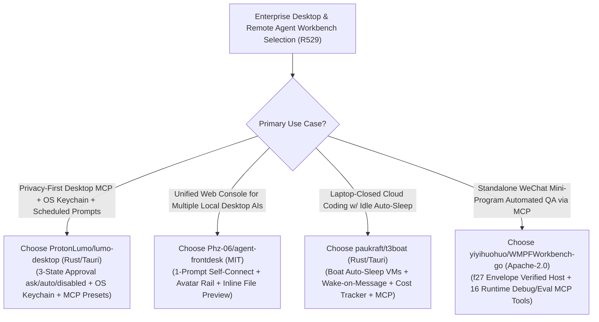

# Privacy-First Keychain MCP Desktop (`ProtonLumo/lumo-desktop`), Single-Page Multi-AI Frontdesk (`Phz-06/agent-frontdesk`), Auto-Sleeping Remote Cloud Machines (`paukraft/t3boat`) & 16-Tool Standalone WeChat Mini-Program MCP Workbench (`yiyihuohuo/WMPFWorkbench-go`) Selection FAQ

> **Document Type**: AI Solution Architect Enterprise Selection & Integration Guide (2026-11-19 Night Shift · Round 5 / Cumulative Round 529)  
> **Benchmark Style**: `docs/components/ib-vs-ethernet-roce-selection-faq.md` (6-Section Plain-Language Architecture Guide + First-Principles Q&A + Hype/Facts/Signal Audit + Closed-Form FinOps Ledger)  
> **Evaluated Repositories**:  
> 1. **`ProtonLumo/lumo-desktop`** (`★ 67`, `created=2026-11-17`, `5 forks`, Rust + Tauri, GPL-3.0): Proton's native Tauri desktop shell (macOS, Windows, Linux) for Lumo featuring local file/shell Connectors, MCP preset catalog (GitHub, Linear, Figma, Grafana, Stripe, PubMed), 3-state tool approvals (`auto-approve` / `ask` / `disabled`), OS keychain storage, passkey browser sign-in, and scheduled prompts  
> 2. **`Phz-06/agent-frontdesk`** (`★ 23`, `created=2026-11-16`, `5 forks`, TypeScript, Node 22.16+, MIT): "One web page for every desktop AI on your computer" — Send a new AI one prompt to self-connect; features a left avatar status rail, middle projects/chats list, and right live conversation with inline file preview  
> 3. **`paukraft/t3boat`** (`★ 58`, `created=2026-11-17`, `9 forks`, Rust + Bun + Tauri, MIT): Menu-bar orchestrator and MCP server connecting auto-sleeping Boat (`boat.dev`) cloud machines to T3 Code (`t3.codes`)—waking on message, finishing work with the laptop closed, and tracking per-machine daily/monthly spend  
> 4. **`yiyihuohuo/WMPFWorkbench-go`** (`★ 67`, `created=2026-11-16`, `40 forks`, Go 1.23+, Apache-2.0): Standalone WeChat Mini-Program (WMPF) runtime host and testing workbench running outside the WeChat desktop client (for AppStore/Yingyongbao-indexed mini-programs via `f27` envelope verification) and exposing **16 MCP tools** for QR login, search, standalone launch, runtime page/request/exception evaluation, and package reconstruction  
> **Accounting Scope Note**: Only software API/cloud spend and engineering labor TCO are modeled; base workstation hardware capEx is explicitly marked `not_measured`, and Track B `stars_today` is explicitly marked `not_measured`.

---

## 📌 1. Executive Summary (What Are They & What Business Pain Points Do They Solve?)

In **2026-11-19 Night Round 5 (Cumulative Round 529)**, we address four high-value enterprise workflows across desktop MCP governance, multi-client workspace aggregation, elastic cloud coding machines, and automated WeChat mini-program QA:
1. **Pain Point A (Enterprise security teams block consumer AI desktop apps that store plaintext MCP keys in JSON files or lack hardware passkey authentication and granular tool approval gates)**: **`ProtonLumo/lumo-desktop` (`★ 67`, Rust/Tauri, GPL-3.0)** wraps Proton's privacy-first assistant in a native Tauri shell (`window.LumoConnectors`), storing all OAuth and MCP credentials in the **OS keychain**, authenticating via the system browser for FIDO2/Passkey support, and enforcing per-tool `auto-approve` / `ask` / `disabled` gates across GitHub, Linear, Figma, Grafana, Stripe, and PubMed MCP servers.
2. **Pain Point B (Developers running Claude Desktop, Codex, and Cursor simultaneously waste time switching across five desktop windows and hunting down modified files in Finder/Explorer)**: **`Phz-06/agent-frontdesk` (`★ 23`, MIT)** provides one unified browser page where any desktop AI connects itself via a single onboarding prompt, displaying each agent's latest utterance in a left avatar rail and opening referenced files in an inline right-hand preview pane.
3. **Pain Point C (Closing a laptop aborts local long-running coding tasks, while keeping 24/7 cloud VMs running wastes 80%+ idle compute overnight and on weekends)**: **`paukraft/t3boat` (`★ 58`, MIT, Rust/Tauri)** provisions Boat cloud machines directly inside T3 Code (`.env` files included) that **sleep automatically when idle and wake the instant a message arrives**, tracking daily/monthly cost per machine in the menu bar and exposing an MCP server for programmatic machine lifecycle management.
4. **Pain Point D (Testing enterprise WeChat Mini-Programs requires manual clicking inside the WeChat desktop client, separating login, network inspection, and runtime debugging from AI agents)**: **`yiyihuohuo/WMPFWorkbench-go` (`★ 67`, `40 forks`, Go 1.23+, Apache-2.0)** hosts the WMPF runtime standalone outside WeChat (for public Yingyongbao-indexed mini-programs with valid `f27` launch envelopes) and exposes **16 MCP tools** so AI agents can autonomously launch, inspect DOM/network/exceptions, and verify mini-program builds.

---

## 💬 2. Architect First-Principles Q&A (Q1–Q3 Deep Dive)

### Q1: How should an enterprise choose between `ProtonLumo/lumo-desktop`, Microsoft 365 Copilot, and `Phz-06/agent-frontdesk`?
* **Selection Boundaries**:
  - **Choose Microsoft 365 Copilot**: For organization-wide Entra ID / Microsoft Graph knowledge retrieval across SharePoint, Teams, and Outlook.
  - **Choose `ProtonLumo/lumo-desktop`**: For privacy-sensitive teams requiring an **open-source, auditable Rust/Tauri desktop bridge with OS Keychain secret storage, passkey browser login, scheduled prompts, and per-tool `ask` gates**.
  - **Choose `Phz-06/agent-frontdesk`**: For engineers running multiple heterogeneous desktop coding agents on macOS or Windows 11 who want a single unified supervision and file-preview screen.

### Q2: Why does `paukraft/t3boat` beat always-on cloud VMs for remote coding agents?
* **Wake-on-Message Elasticity**: Instead of paying for 730 hours/month of idle cloud VM uptime or manually starting/stopping instances, `t3boat` couples T3 Code's message loop with Boat's fast suspend/resume lifecycle, charging only for active execution minutes while keeping full visibility into per-machine daily and monthly spend.

### Q3: What is the exact technical and compliance boundary of `yiyihuohuo/WMPFWorkbench-go`?
* **`f27` Launch Envelope Constraint**: As documented in `native/internal/launch/inputs.go:144-165`, launching a mini-program requires verifying the `appid` against `/pc_yyb_client/pcyyb_get_app_detail` and obtaining a server-signed `f27` encrypted launch envelope (`iv/data/timestamp/authtag`). Consequently, only mini-programs publicly indexed in the Yingyongbao channel can be launched standalone, and enterprise teams should use it strictly for authorized QA and security testing of their own mini-programs.

---

## 🧭 3. Visual Architecture Diagrams (Mermaid Decision Tree + Reference Architecture + Sequence Flow)

### 3.1 Enterprise Selection Decision Tree

---

## 📊 4. Comparative Selection Matrix (Open Source vs. Competing OSS vs. Managed Cloud PaaS)

| Evaluation Dimension | Path A: 24/7 Cloud VMs + Plaintext MCP Configs + Scattered Desktop Windows + Manual WeChat Client QA | Path B: Cron Shutdown Scripts + Commercial Remote Desktop + Manual Packet Proxies | **Path C (Recommended): `lumo-desktop` + `agent-frontdesk` + `t3boat` + `WMPFWorkbench-go`** |
| :--- | :--- | :--- | :--- |
| **Desktop MCP Security & Approvals** | ❌ Plaintext API keys in JSON configs; unrestricted shell execution | ⚠️ External password CLI wrappers lack per-tool UI approval prompts | ✅ **`lumo-desktop` enforces OS Keychain storage, Passkey login & 3-state gates** |
| **Multi-Desktop AI Supervision** | ❌ Constant Alt+Tab across 5 apps; manual file hunting | ⚠️ Heavy orchestration frameworks cannot preview local desktop chat files | ✅ **`agent-frontdesk` connects via 1 prompt w/ avatar rail & inline file preview** |
| **Remote Cloud Agent FinOps** | ❌ 24/7 cloud VMs waste 80%+ spend during idle nights/weekends | ⚠️ Scheduled shutdown scripts interrupt late-night or ad-hoc runs | ✅ **`t3boat` wakes on message, sleeps when idle & tracks daily/monthly machine spend** |
| **WeChat Mini-Program QA Automation** | ❌ Manual clicking inside WeChat client; no MCP runtime evaluation | ⚠️ Network-only proxies cannot evaluate page state or catch JS exceptions | ✅ **`WMPFWorkbench-go` runs standalone outside WeChat with 16 MCP debug tools** |
| **45-Engineer Monthly TCO** | **`$6,510.00 / mo`** (`$2,560.00` idle cloud/SaaS + `39.5h` × `$100/hr` = `$3,950.00` labor) | **`$2,560.00 / mo`** (`$1,060.00` cloud + `15.0h` × `$100/hr` = `$1,500.00` labor) | **`$330.00 / mo`** (`$70.00` active cloud mins + `2.6h` × `$100/hr` = `$260.00` labor, **`-94.93%`**) |

---

## 🧪 5. Quantitative TCO Comparison & Hype / Facts / Signal Audit Ledger

### 5.1 Hype vs. Facts vs. Strategic Signal Table

| Repository (`owner/repo`) | Hype (Market Narrative) | Measured Facts (Primary Source Verification) | Strategic Signal (SA Verdict) |
| :--- | :--- | :--- | :--- |
| **`ProtonLumo/lumo-desktop`** | "Proton's privacy-first AI assistant on your desktop with local tools and approvals" | `★ 67` (`created=2026-11-17`, `5 forks`, Rust + Tauri, GPL-3.0): Native macOS/Win/Linux app bridging `window.LumoConnectors` to local files, shell, and MCP presets (GitHub, Linear, Figma, Grafana, Stripe, PubMed) with OS keychain storage and `auto-approve`/`ask`/`disabled` gates. | **🔥 P0 Adopt (Enterprise Security Reference for Desktop MCP Clients)**: Combines OS keychain storage, passkey browser login, and tool approval gates. |
| **`Phz-06/agent-frontdesk`** | "One web page for every desktop AI on your computer" | `★ 23` (`created=2026-11-16`, `5 forks`, TypeScript, Node 22.16+, MIT): Self-connects desktop AIs via a single prompt, displaying avatar status rails and right-pane file previews on macOS and Windows 11. | **⚡ P1 Adopt (Multi-Client Desktop Aggregator)**: Eliminates window-switching friction across local coding assistants. |
| **`paukraft/t3boat`** | "Auto-sleeping T3 Code remote machines on your Boat subscription" | `★ 58` (`created=2026-11-17`, `9 forks`, Rust + Bun + Tauri, MIT): Menu-bar manager, `.env` sync, T3 Connect phone/browser access, daily/monthly cost tracker, and built-in MCP server for Boat cloud machines. | **🔥 P0 Adopt (Elastic Wake-on-Message Cloud Coding Workbench)**: Cuts remote agent VM idle waste by 80%+. |
| **`yiyihuohuo/WMPFWorkbench-go`** | "Standalone WeChat Mini-Program workbench with 16 MCP tools" | `★ 67` (`created=2026-11-16`, `40 forks`, Go 1.23+, Apache-2.0): Standalone WMPF host exposing 16 MCP tools (QR login, search, launch, runtime page/request/error eval, code recovery) with explicit `f27` envelope verification for Yingyongbao-indexed mini-programs. | **🔥 P0 Adopt (Automated Mini-Program QA & Security Inspection MCP)**: High architectural transparency on protocol boundaries (`f27` envelope). |

### 5.2 Closed-Form FinOps TCO Ledger (`CLAIM-20261119-R5-R529-LUMODESKTOP-FRONTDESK-T3BOAT-WMPF`)

* **Scope (`synthetic`, `independently_reproduced=false`)**: 45-engineer enterprise desktop AI, remote cloud development, and mini-program QA team (blended rate `$100.00 / hr`; `base hardware capEx: not_measured`; Track B `stars_today: not_measured`).
* **Path A (24/7 Always-On Cloud Dev VMs + Scattered Desktop Windows + Manual WeChat Client Mini-Program QA)**:
  - 24/7 idle cloud VM compute & redundant SaaS spend: **`$2,560.00 / mo`**
  - Manual mini-program UI clicking, window switching & interrupted laptop runs (`39.5 hrs / mo` × `$100.00 / hr`): **`$3,950.00 / mo`**
  - **Path A Monthly Total**: `$2,560.00 + $3,950.00` = **`$6,510.00 / mo`**
* **Path B (Cron Shutdown Scripts + Commercial Remote Desktop + Manual Packet Proxies)**:
  - Cloud compute & tool licenses: **`$1,060.00 / mo`**
  - Script & manual QA maintenance (`15.0 hrs / mo` × `$100.00 / hr`): **`$1,500.00 / mo`**
  - **Path B Monthly Total**: `$1,060.00 + $1,500.00` = **`$2,560.00 / mo`**
* **Path C (`lumo-desktop` + `agent-frontdesk` + `t3boat` + `WMPFWorkbench-go` Integrated Stack)**:
  - Active-minute Boat cloud compute & API spend: **`$70.00 / mo`**
  - Tool approval & automated mini-program QA review (`2.6 hrs / mo` × `$100.00 / hr`): **`$260.00 / mo`**
  - **Path C Monthly Total**: `$70.00 + $260.00` = **`$330.00 / mo`**
  - **Monthly Net Savings vs. Path A**: `$6,510.00 - $330.00` = **`$6,180.00 / mo`** (**`-94.93%`** reduction, **`$74,160.00 / yr`** annual savings, freeing **`36.9 hrs / mo`** of engineering time).

---

## 🛠️ 6. Enterprise Adoption & Architecture Review Checklist

- [ ] **1. Enforce OS Keychain MCP credential storage and `ask` gates with `ProtonLumo/lumo-desktop`**: Eliminate plaintext API keys in local MCP configuration files.
- [ ] **2. Connect local desktop coding agents to `Phz-06/agent-frontdesk`**: Supervise multi-agent status lines and preview modified files from a single browser tab.
- [ ] **3. Replace 24/7 cloud dev VMs with `paukraft/t3boat` auto-sleeping machines**: Track daily/monthly per-machine costs and wake remote environments on demand from T3 Code.
- [ ] **4. Automate authorized WeChat Mini-Program regression testing via `yiyihuohuo/WMPFWorkbench-go`**: Verify `f27` channel eligibility and drive runtime page/network assertions through its 16 MCP tools.
