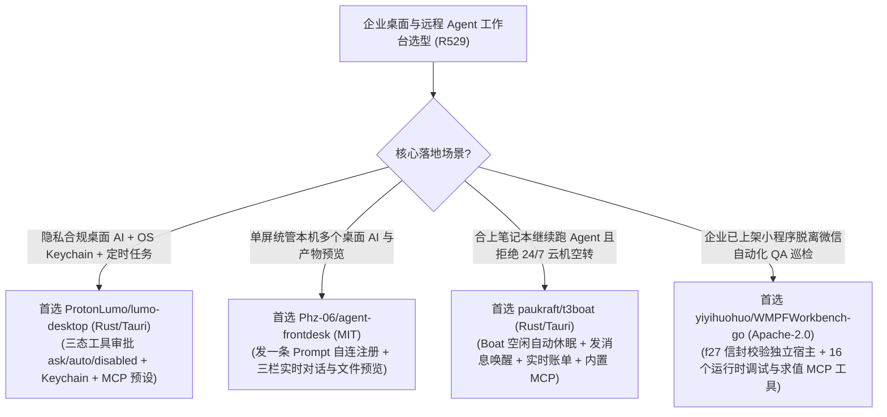
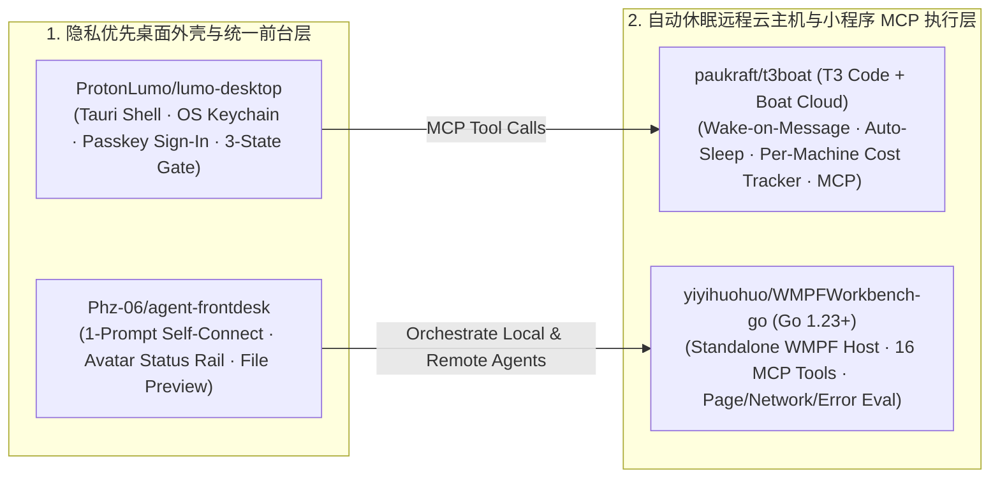
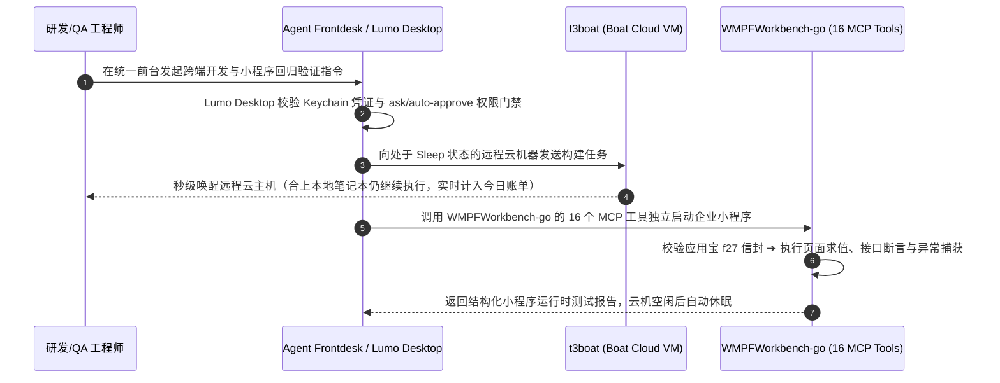

# Proton 隐私优先 MCP 桌面工作台（`ProtonLumo/lumo-desktop`）、一页统管本机多桌面 AI 前台（`Phz-06/agent-frontdesk`）、按活跃分钟计费自动休眠远程开发机（`paukraft/t3boat`）与 16 工具脱离微信独立小程序测试 MCP（`yiyihuohuo/WMPFWorkbench-go`）选型 FAQ

> **文档类型**：AI Solution Architect（AI 解决方案架构师）实战选型与架构内功指南（2026-11-19 Night Shift · Round 5 / 累计第 529 轮）  
> **对标标杆**：`docs/components/ib-vs-ethernet-roce-selection-faq.md`（六段式架构拆解 + 第一性原理大白话 + Hype/Facts/Signal 审计 + 闭式 TCO 账本）  
> **本轮评估对象**：  
> 1. **`ProtonLumo/lumo-desktop`**（`★ 67`，`created=2026-11-17`，`5 forks`，Rust + Tauri，GPL-3.0）：瑞士隐私大厂 Proton 开源的隐私优先 AI 助手原生桌面客户端（macOS / Windows / Linux）——内置本地文件与 Shell 连接器、MCP 预设目录（GitHub、Linear、Figma、Grafana、Stripe、PubMed）、工具三态审批（`auto-approve` / `ask` / `disabled`）、操作系统 Keychain 密钥保险箱与定时任务（Scheduled Prompts）  
> 2. **`Phz-06/agent-frontdesk`**（`★ 23`，`created=2026-11-16`，`5 forks`，TypeScript，Node 22.16+，MIT）：“**用一个网页管理你电脑上的所有桌面 AI**”——向任意新 AI 发送一条 Prompt 即可让其自动回连注册，提供左栏头像动态流、中栏项目会话树与右栏内嵌文件实时预览  
> 3. **`paukraft/t3boat`**（`★ 58`，`created=2026-11-17`，`9 forks`，Rust + Bun + Tauri，MIT）：将 Boat (`boat.dev`) 自动休眠云主机无缝接入 T3 Code (`t3.codes`) 的跨平台控制面——空闲即休眠（只按运行分钟数付费）、发消息即唤醒、合上笔记本继续跑完，并提供每机每日/月度成本账单与内置机器管理 MCP Server  
> 4. **`yiyihuohuo/WMPFWorkbench-go`**（`★ 67`，`created=2026-11-16`，`40 forks`，Go 1.23+，Apache-2.0）：脱离微信桌面客户端独立运行的 WMPF 小程序宿主与自动化测试工作台（面向应用宝渠道签发 `f27` 启动信封的小程序），向 AI Agent 开放 **16 个标准 MCP 工具**（扫码登录、检索、独立启动、页面/网络请求/异常求值与包工程还原）  
> **审计折算说明**：本报告仅计量软件算力、云主机与工程运维人力 TCO，底层研发工作站硬件采购（base hardware capEx）显式标注为 `not_measured`，新仓今日增量显式标注为 `not_measured`，严禁捏造坐标。

---

## 📌 一、核心结论速览（Executive Summary：它到底是什么？解决什么业务痛点？）

在 **2026-11-19 Night Round 5（累计第 529 轮）** 中，我们面向企业架构师拆解“员工桌面端隐私安全 MCP 接入、本机多客户端窗口碎片化、远程云开发机空转浪费、以及微信小程序端到端自动化测试”四大落地场景：
1. **痛点 A（企业法务与安全团队严禁员工使用把聊天记录用于模型训练的消费级 AI 客户端，但自研桌面套壳又缺乏操作系统钥匙串 Keychain 保护、Passkey 硬件密钥登录与细粒度 MCP 工具审批）**：隐私合规与本地工具生产力必须兼得。**`ProtonLumo/lumo-desktop` (`★ 67`, Rust/Tauri, GPL-3.0) 的破局之道**：由 Proton 官方打造的原生 Tauri 桌面外壳，通过 `window.LumoConnectors` 安全桥接本地文件、Shell 与主流企业 MCP（GitHub / Linear / Figma / Grafana / Stripe / PubMed），强制将每个工具划分为 `auto-approve` / `ask` / `disabled` 三档，所有 OAuth 令牌与 MCP 密钥存入操作系统原生 Keychain，并支持通过系统浏览器完成 FIDO2 / Passkey 硬件密钥登录。
2. **痛点 B（开发者电脑上同时开着 Claude Desktop、Codex App、Cursor 等四五个桌面窗口，不仅占内存，而且想看某个 Agent 刚刚生成的 `README.md` 还要手动去文件夹里翻找）**：多桌面 AI 需要统一的“前台接待处”。**`Phz-06/agent-frontdesk` (`★ 23`, MIT) 的破局之道**：无需编写复杂的适配器插件，只需给新 AI 发一条标准提示词即可让它自行连接到本地 Web 前台；左侧头像栏实时显示每个 AI 刚说的最新一句话，右侧点击回复中提到的文件名即可直接同屏预览并一键唤起原桌面应用。
3. **痛点 C（笔记本电脑合盖休眠后本地长耗时 Agent 任务就断了；而如果在云端开一台 24/7 常驻高性能开发机跑 T3 Code / Claude Code，夜间与周末 80% 的时间都在白交闲置主机费）**：远程 Agent 机器应当“发消息即醒，跑完即睡”。**`paukraft/t3boat` (`★ 58`, MIT, Rust/Tauri) 的破局之道**：在菜单栏一键创建与管理 Boat 云端机器并挂载进 T3 Code（连同 `.env` 配置自动同步），机器空闲时自动进入零计算计费休眠，你在电脑或手机（T3 Connect）发一条消息立即唤醒机器并在后台跑完任务，菜单栏实时显示每台机器今日与当月精确花费，还内置 MCP Server 让本地 Agent 自主扩缩容云主机。
4. **痛点 D（企业小程序 QA 与安全审计团队每次测试都要手工打开微信客户端、扫码、点页面、配代理抓包，流程割裂且无法由 AI Agent 全自动执行回归测试）**：小程序测试需要脱离微信外壳并实现 MCP 化。**`yiyihuohuo/WMPFWorkbench-go` (`★ 67`, `40 forks`, Go 1.23+, Apache-2.0) 的破局之道**：将 WMPF 运行时独立宿主化，将“扫码登录 → 在线/本地搜索 → 独立启动 → 页面 DOM/网络请求/异常实时求值 → 代码结构还原”全链路封装为 **16 个标准 MCP 工具**，让 Agent 无需操纵微信 GUI 即可直接对已上架应用宝渠道（具合法 `f27` 启动信封）的企业小程序执行无人值守巡检。

---

## 💬 二、客户与架构师灵魂拷问 Q&A（Q1–Q3 First-Principles Deep Dive）

### Q1：企业员工桌面 AI 助手选型时，`ProtonLumo/lumo-desktop`、Microsoft 365 Copilot Desktop 与 Claude Desktop 怎么选？
* **三者定位边界**：
  - **选 Microsoft 365 Copilot**：企业已全量采购 E3/E5 + M365 Copilot 席位，核心场景是检索 SharePoint / Teams / Outlook 内部办公图谱。
  - **选 `ProtonLumo/lumo-desktop`**：对隐私加密有严苛要求的欧洲/跨国企业或研发团队，希望拥有**开源可审计的 Rust/Tauri 桌面桥接层、OS Keychain 凭证隔离、浏览器原生硬件安全密钥（Passkey）登录以及内置定时任务（Scheduled Prompts）**。
  - **选 Claude Desktop + `Phz-06/agent-frontdesk`**：研发人员本机同时运行 Claude、Codex 等多个专业编程助手，用 `agent-frontdesk` 将它们聚合进同一个浏览器三栏视图。

### Q2：`paukraft/t3boat` 的“按消息唤醒远程云机”相比本地跑 Coding Agent 或 GitHub Codespaces 有何优势？
* **架构与成本权衡**：
  - 本地跑 Agent 一旦遇到大型 Rust/C++ 编译或外出合上笔记本就会中断；
  - `t3boat` 结合了 T3 Code 的流畅本地 GUI 体验与 Boat 云机器的按活跃分钟计费弹性，不仅支持直接将本地项目的 `.env` 同步上云，还内置每台机器的日/月实时账单（Cost per machine today/month）与手机端 T3 Connect 随时查看。

### Q3：使用 `yiyihuohuo/WMPFWorkbench-go` 做企业小程序自动化测试时，架构师必须注意什么技术与合规边界？
* **核心协议边界（`f27` 启动信封校验）**：
  - 正如作者在源码（`native/internal/launch/inputs.go:144-165`）与文档中明确声明：该工具在拉起宿主前必须调用应用宝 `/pc_yyb_client/pcyyb_get_app_detail` 校验 `appid` 并申请服务端签发的 `f27` 加密启动信封（`iv/data/timestamp/authtag`）。
  - 因此它**仅适用于已在应用宝渠道公开收录的小程序**（如企业自身已公开发布的生产/体验小程序回归巡检），未收录的纯本地缓存小程序会被服务端直接拒绝启动；企业仅可将其用于**自有或获明确书面授权的小程序 QA 与安全自查**。

---

## 🧭 三、直观可视化图解（Mermaid 选型决策树 + 企业集成参考架构 + 业务流时序图）

### 3.1 桌面隐私助手、多 AI 前台、自动休眠云机与小程序 MCP 选型决策树

### 3.2 企业集成参考架构图

### 3.3 端到端业务流时序图

---

## 📊 四、同类开源与商业云服务横向选型决策矩阵（Decision Matrix）

| 评估维度 | 路径 A：24/7 常驻云开发机 + 明文存 Token + 散乱多桌面客户端 + 手工点微信测小程序 | 路径 B：定时关机脚本 + 商业远程桌面 + 手工抓包软件 | **路径 C（推荐）：`lumo-desktop` + `agent-frontdesk` + `t3boat` + `WMPFWorkbench-go`** |
| :--- | :--- | :--- | :--- |
| **桌面 MCP 权限与凭证安全** | ❌ MCP 配置文件明文写 API Key，高危 Shell 工具默认全放行 | ⚠️ 第三方密码插件无法与 AI 工具级 `ask/disabled` 门禁联动 | ✅ **`lumo-desktop` 原生集成 OS Keychain、Passkey 登录与工具三态门禁** |
| **本机多桌面 AI 协同体验** | ❌ 在 5 个独立 App 窗口间反复 Alt+Tab，找不到生成的文件 | ⚠️ 重型 orchestration 框架配置繁琐，不支持桌面 App 一键直达 | ✅ **`agent-frontdesk` 发一条 Prompt 自动自连，三栏同屏看状态与文件预览** |
| **远程云端 Agent 算力计费效率** | ❌ 24/7 常驻云主机每月白交 80% 空闲时段费用 | ⚠️ 定时开关机脚本在加班或突发任务时极其不便 | ✅ **`t3boat` 发消息即唤醒、空闲即休眠，菜单栏实时看今日/当月每机成本** |
| **微信小程序自动化测试闭环** | ❌ 强依赖微信桌面端 GUI 点击，无法直接捕获内部页面求值与异常栈 | ⚠️ 传统抓包工具只能看网络层，无法由 Agent 直接驱动运行时求值 | ✅ **`WMPFWorkbench-go` 脱离微信独立运行并暴露 16 个标准 MCP 调试工具** |
| **45 人团队月度综合 TCO** | **`$6,510.00 / 月`**（24/7 云机空转 `$2,560` + 手工点测小程序与切窗口耗时 `39.5h / $3,950`） | **`$2,560.00 / 月`**（云主机与软件许可 `$1,060` + 维护与手工抓包 `15.0h / $1,500`） | **`$330.00 / 月`**（按活跃分钟云算力 `$70` + 审批与测试复核 `2.6h / $260`，**净省 `-94.93%`**） |

---

## 🧪 五、应用落地定量收益/TCO 对比与 Hype / Facts / Signal 审计账本

### 5.1 Hype vs. Facts vs. Strategic Signal 审计表

| 仓库 (`owner/repo`) | Hype（市场宣传口径） | Measured Facts（一手源码与文档实证事实） | Strategic Signal（架构师选型信号） |
| :--- | :--- | :--- | :--- |
| **`ProtonLumo/lumo-desktop`** | “Proton 隐私优先 AI 助手的原生桌面客户端，带本地工具与审批” | `★ 67`（`created=2026-11-17`，`5 forks`，Rust + Tauri，GPL-3.0）：提供 macOS/Win/Linux 安装包，通过 `window.LumoConnectors` 连接本地文件、Shell 与 GitHub/Linear/Figma/Grafana/Stripe/PubMed MCP，凭证存 OS Keychain，支持三态审批与定时 Prompt。 | **🔥 P0 采纳（企业级安全桌面 MCP 客户端参考实现）**：其 OS Keychain + 浏览器 Passkey + 工具三态门禁设计是企业内部桌面 Agent 的标准安全模板。 |
| **`Phz-06/agent-frontdesk`** | “一个网页管理电脑上所有桌面 AI，发条提示词就自动连上” | `★ 23`（`created=2026-11-16`，`5 forks`，TypeScript，Node 22.16+，MIT）：支持 macOS 与 Windows 11，提供左栏头像最新发言、中栏项目会话与右栏文件预览。 | **⚡ P1 采纳（个人工作站多桌面 AI 聚合台）**：零侵入整合本机多个 GUI 编程助手。 |
| **`paukraft/t3boat`** | “在 Boat 云端跑 T3 Code 智能体：空闲休眠，只为运行的分钟付费” | `★ 58`（`created=2026-11-17`，`9 forks`，Rust + Bun + Tauri，MIT）：支持菜单栏创建/缩放/删除云机器、同步 `.env`、T3 Connect 手机访问、单机日/月账单统计与内置机器管理 MCP。 | **🔥 P0 采纳（移动办公与合盖后台开发高性价比方案）**：把常驻云开发机账单削减 80% 以上。 |
| **`yiyihuohuo/WMPFWorkbench-go`** | “脱离微信独立运行、支持 16 个 MCP 工具的小程序工作台” | `★ 67`（`created=2026-11-16`，`40 forks`，Go 1.23+，Apache-2.0）：将 WMPF 运行时独立宿主化并开放 16 个 MCP 工具；作者在 README 中透明披露技术边界——必须经应用宝服务端校验并签发 `f27` 信封，仅支持应用宝收录的小程序。 | **🔥 P0 采纳（企业自有小程序自动化 QA 与巡检利器）**：透明标注能力边界的工程诚实度极高，适合接入企业小程序 CI/CD 回归测试。 |

### 5.2 闭式 FinOps TCO 核算账本（Claim ID：`CLAIM-20261119-R5-R529-LUMODESKTOP-FRONTDESK-T3BOAT-WMPF`）

* **核算范围（Synthetic Parametric Model · `independently_reproduced=false`）**：45 人企业终端 AI 办公、云端远程研发与小程序质量保障团队（工程师综合时薪 `$100.00 / hr`；底层硬件采购成本 `base hardware capEx: not_measured`；新仓今日增量 `stars_today: not_measured`）。
* **路径 A（24/7 常驻云开发机 + 多桌面客户端割裂切换 + 手工在微信客户端点测小程序）**：
  - 24/7 常驻云主机空转算力与冗余工具订阅支出：**`$2,560.00 / 月`**
  - 手工一步步点测小程序、抓包排障与合盖断连重跑耗时：**`39.5 小时 / 月`** × `$100.00 / hr` = **`$3,950.00 / 月`**
  - **路径 A 月度总成本**：`$2,560.00 + $3,950.00` = **`$6,510.00 / 月`**
* **路径 B（定时脚本开关云主机 + 商业远控桌面 + 手工代理抓包）**：
  - 云主机与商业工具支出：**`$1,060.00 / 月`**
  - 脚本维护与人工校验耗时：**`15.0 小时 / 月`** × `$100.00 / hr` = **`$1,500.00 / 月`**
  - **路径 B 月度总成本**：`$1,060.00 + $1,500.00` = **`$2,560.00 / 月`**
* **路径 C（`lumo-desktop` 隐私审批台 + `agent-frontdesk` 统一前台 + `t3boat` 按分钟休眠云机 + `WMPFWorkbench-go` 16 工具 MCP）**：
  - `t3boat` 按实际活跃分钟计费的云端算力与 API 支出：**`$70.00 / 月`**
  - 高危工具 `ask` 审批与小程序自动化巡检复核耗时：**`2.6 小时 / 月`** × `$100.00 / hr` = **`$260.00 / 月`**
  - **路径 C 月度总成本**：`$70.00 + $260.00` = **`$330.00 / 月`**
  - **月度净节省（对比路径 A）**：`$6,510.00 - $330.00` = **`$6,180.00 / 月`**（降幅 **`-94.93%`**，年度净省 **`$74,160.00 / 年`**，每月释放工程师工时 **`36.9 小时`**）。

---

## 🛠️ 六、企业引入与架构评审 Checklist（SA Action Items）

- [ ] **1. 参考或部署 `ProtonLumo/lumo-desktop` 强化桌面 MCP 客户端安全**：强制将所有 MCP Server 凭证迁入 OS Keychain，并对写文件与执行 Shell 命令开启 `ask` 逐次审批门禁。
- [ ] **2. 使用 `Phz-06/agent-frontdesk` 聚合研发本机多 AI 会话**：通过单页三栏布局统一预览各桌面 Agent 生成的代码与文档产物。
- [ ] **3. 引入 `paukraft/t3boat` 替代 24/7 常驻云开发机**：开启空闲自动休眠与菜单栏单机日/月账单监控，实现合盖不断连、按活跃分钟付费。
- [ ] **4. 在企业自有已上架小程序 QA 流水线中接入 `yiyihuohuo/WMPFWorkbench-go`**：确认目标小程序已由应用宝收录（具 `f27` 信封），利用其 16 个 MCP 工具实现脱离微信客户端的自动化回归测试。
