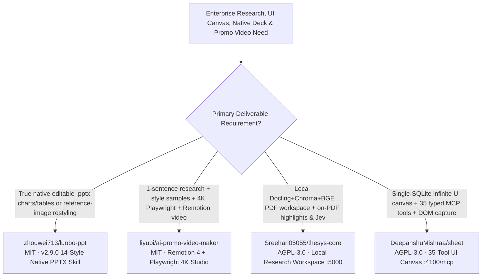
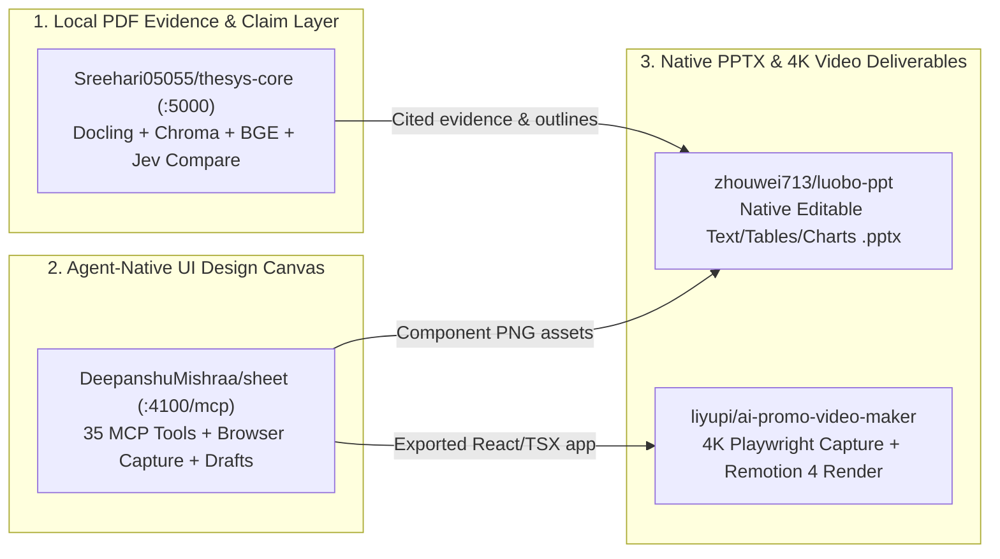
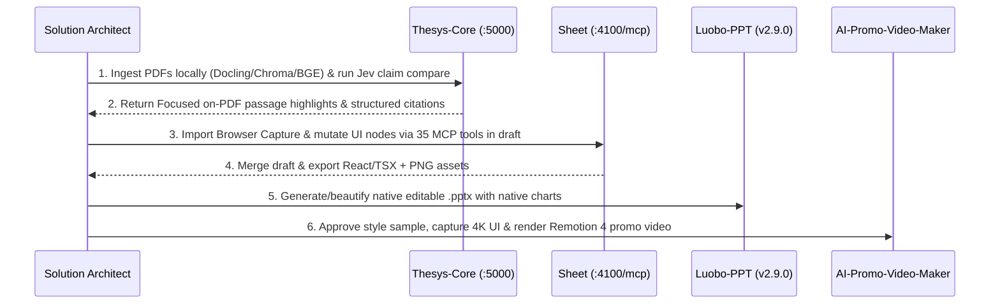

# Native Editable PPTX Skill, 4K Product Promo Video Maker, Local On-PDF Research Workspace & 35-Tool UI Design Canvas MCP Selection Guide: Luobo-PPT vs AI-Promo-Video-Maker vs Thesys-Core vs Sheet

> **2026-11-23 Night Round 35 (Cumulative Round 822)** · Enterprise AI Solution Architect Practical Selection, End-to-End Integration Architecture & FinOps TCO Guide
> **Companion Architecture Diagram**: [`assets/github-ai-radar-2026-11-23-r35-r822-luoboppt-promovideo-thesyscore-sheet.svg`](../../../assets/github-ai-radar-2026-11-23-r35-r822-luoboppt-promovideo-thesyscore-sheet.svg)

---

## 1. 📌 Executive Summary

Across enterprise customer presentation authoring, 4K product launch video production, local-first literature synthesis with on-PDF citation highlights, and agent-editable infinite UI design canvases, **`zhouwei713/luobo-ppt`**, **`liyupi/ai-promo-video-maker`**, **`Sreehari05055/thesys-core`**, and **`DeepanshuMishraa/sheet`** form a high-leverage open-source productivity stack:

1. **Native Editable `.pptx` Generation & Reference-Image Beautification (`zhouwei713/luobo-ppt`)**: (`★ 504`, `94 forks`, Python, `MIT`, `v2.9.0`). An `agentskills.io`-compliant `SKILL.md` for Claude, Codex, Gemini CLI, Cursor, and GitHub Copilot that outputs true native PowerPoint textboxes, tables, and double-click editable charts across 14 visual styles—or restyles an existing `.pptx` to match a reference image without dropping a single word of source text.
2. **1-Sentence 4K Commercial Product Promo Video Maker (`liyupi/ai-promo-video-maker`)**: (`★ 497`, `76 forks`, Python, `MIT`). Combines `AGENTS.md` workflow specs, a Remotion 4 video template, Playwright Chromium 4K screen capture, and ffmpeg audio mixing so coding agents research a product, render bespoke style sample frames for human selection, and produce a beat-synced 4K promo video.
3. **Local-First Research Workspace with On-PDF Highlights & Jev Comparison (`Sreehari05055/thesys-core`)**: (`★ 186`, `21 forks`, TypeScript/Python, `AGPL-3.0`). Runs `Docling`, `Chroma`, and `BGE` locally in Docker (`127.0.0.1:5000`), searches OpenAlex and arXiv, jumps from inline citations directly to `Full` or `Focused` on-PDF passage highlights, and compares two papers on any claim using TypeSafe `Jev`.
4. **Local-First Infinite UI Design Canvas with 35 MCP Tools (`DeepanshuMishraa/sheet`)**: (`★ 150`, `12 forks`, TypeScript, `AGPL-3.0`). Backed by a single SQLite file and loopback MCP server (`http://127.0.0.1:4100/mcp` + Rust/Tauri desktop app), it exposes 35 typed-transaction MCP tools, versioned history with isolated mergeable drafts, a Browser Capture extension that imports live DOM sections as editable layers, and one-way export to HTML, React/TSX, JSON, and PNG.
5. **FinOps Quantitative Takeaway**: Replacing commercial slide SaaS, outsourced promo video production, cloud literature tools, and multi-seat UI design subscriptions (Path A: `$9,550.00/mo`) with this self-hosted stack (Path C: `$305.00/mo`) saves **`$9,245.00/mo`** (**`-96.81%`**).

---

## 2. 🎯 Architect & Customer Key Q&A

### Q1: When should teams use commercial cloud SaaS vs. this 4-project open-source stack?
- **Use commercial cloud SaaS when**:
  - Teams only need web-based slide links without delivering native editable PowerPoint charts (**Gamma**);
  - Large distributed design orgs require real-time cloud multiplayer cursors (**Figma Enterprise**).
- **Deploy this 4-project open-source stack when**:
  - **Delivering True Native Editable `.pptx` Decks**: Use **`luobo-ppt`** when enterprise clients require real PowerPoint textboxes, native tables, and editable data charts (or zero-text-loss restyling from a reference slide image);
  - **In-House 4K Product Launch Videos**: Use **`ai-promo-video-maker`** so your coding agent proposes multiple visual directions, captures 4K real UI screens via Playwright, and renders beat-synced Remotion 4 videos;
  - **Confidential Technical Literature Review**: Use **`thesys-core`** to keep PDFs, BGE embeddings, and chat history on local disk (`thesys-data` volume) with exact on-PDF passage highlighting;
  - **Transactional Agent-Co-Edited UI Canvases**: Use **`sheet`** (`:4100/mcp`) so Claude/Codex/Cursor mutate UI layouts in isolated drafts via 35 MCP tools and export clean React/TSX.

### Q2: How do these four tools chain into an end-to-end product & GTM engineering pipeline?
1. **Evidence & Literature Grounding (`thesys-core`)**: Ingest domain papers and technical PDFs locally with `Docling + Chroma + BGE`, verifying competing claims via `Jev` pairwise comparison;
2. **UI Canvas Co-Design (`sheet`)**: Capture reference web sections via the Browser Capture extension, let coding agents iterate on UI nodes through 35 MCP tools in an isolated draft, and export React/TSX;
3. **Executive Deck Generation (`luobo-ppt`)**: Turn technical findings and architecture outlines into native editable `.pptx` slides with conclusion-first titles and speaker notes;
4. **4K Promo Video Rendering (`ai-promo-video-maker`)**: Capture 4K live product views with Playwright and compile a beat-synced 4K Remotion 4 launch video.

### Q3: What are the licensing and operational boundaries?
- **`luobo-ppt`** & **`ai-promo-video-maker`**: Permissive **`MIT`** license—safe for internal and commercial client deliverables.
- **`thesys-core`** & **`sheet`**: **`AGPL-3.0`** license—ideal for local/internal workbench use; network-exposed modified SaaS deployments trigger AGPL source-disclosure obligations.

---

## 3. 🧭 Visual Architecture & Decision Diagrams (Mermaid)

### 3.1 Selection Decision Tree

### 3.2 End-to-End Enterprise Reference Architecture

### 3.3 Runtime Execution Sequence

---

## 4. 📊 Comparative Selection Matrix

| Dimension | `zhouwei713/luobo-ppt` | `liyupi/ai-promo-video-maker` | `Sreehari05055/thesys-core` | `DeepanshuMishraa/sheet` | Commercial SaaS & Agency Stack (Path A) |
| :--- | :--- | :--- | :--- | :--- | :--- |
| **Primary Role** | Native editable `.pptx` generator & reference-image beautifier | 1-sentence 4K Remotion 4 product promo video maker | Local PDF research workspace with on-PDF highlights | 35-MCP-tool local infinite UI canvas & DOM importer | Slide SaaS + video agency + cloud PDF SaaS + UI seats |
| **Key Differentiator** | Native PowerPoint textboxes, tables & editable charts (`v2.9.0`) | Bespoke style samples + 4K real Playwright capture + beat sync | Local `Docling + Chroma + BGE` + `Focused` PDF highlights + `Jev` | Single SQLite file, 35 typed MCP tools, isolated mergeable drafts | Flattened non-editable slide images & multi-week video agency lead times |
| **Data Residency** | 100% local `.pptx` build | Local Playwright + Remotion + ffmpeg render | PDFs, vectors & chat stay on local `thesys-data` volume | Local `:4100` loopback server & SQLite file | Unreleased product UIs and PDFs uploaded to external clouds |
| **License** | `MIT` | `MIT` | `AGPL-3.0` | `AGPL-3.0` | Proprietary SaaS / Agency Retainer |
| **Monthly TCO (45-Eng Team)** | **Combined `$305.00/mo`** (`$65.00` local/container compute + `$240.00` ops labor) | Included in combined stack | Included in combined stack | Included in combined stack | **`$9,550.00/mo`** (`$5,050.00` SaaS/agency + `$4,500.00` labor) |

---

## 5. 🧪 Quantitative FinOps TCO Comparison (Closed-Form Audit)

> **Audit Note**: Modeled for a 45-person architecture and product organization producing 80 native client `.pptx` decks, 6 4K product promo videos, 400 deep-dive PDF paper comparisons, and 50 UI canvas prototypes per month. Repository metadata is verified via the GitHub REST API; live runtime p99 latency is marked `not_measured`.

| Cost Component | Path A: Commercial Slide/PDF/UI SaaS + Outsourced Promo Video Production | Path C: Self-Hosted `luobo-ppt` + `ai-promo-video-maker` + `thesys-core` + `sheet` | Net Savings / Delta |
| :--- | :--- | :--- | :--- |
| **API / SaaS Subscriptions, Agency & Compute** | `$5,050.00 / mo` | `$65.00 / mo` | `-$4,985.00 / mo` |
| **Manual Slide Chart Redraw, Video Editing & PDF QA Labor** | `$4,500.00 / mo` (`45.0 hrs × $100/hr`) | `$240.00 / mo` (`2.4 hrs × $100/hr`) | `-$4,260.00 / mo` |
| **Total Monthly TCO** | **`$9,550.00 / mo`** | **`$305.00 / mo`** | **`$9,245.00 / mo` (`-96.81%`)** |

---

## 6. 🛠️ Enterprise Architecture Review Checklist

- [ ] **Native OOXML Editability Verification (`luobo-ppt`)**: Open generated `.pptx` decks in PowerPoint, WPS, and Keynote to verify that all textboxes, tables, and native charts are double-click editable and zero source words were dropped during beautification.
- [ ] **Environment Preflight & Style Gate (`ai-promo-video-maker`)**: Run the read-only environment check for Node.js 18+, Python 3.9+, Playwright Chromium, and ffmpeg, and require human sign-off on style sample frames before full 4K Remotion rendering.
- [ ] **Persistent Volume Protection (`thesys-core`)**: Stop containers with `docker compose down` (without `-v`) so the `thesys-data` volume preserves ingested PDFs, BGE embeddings, and citation chat history.
- [ ] **Isolated Draft Merging (`sheet`)**: Connect coding agents to `http://127.0.0.1:4100/mcp` using isolated drafts before merging UI node transactions into the main SQLite document.
