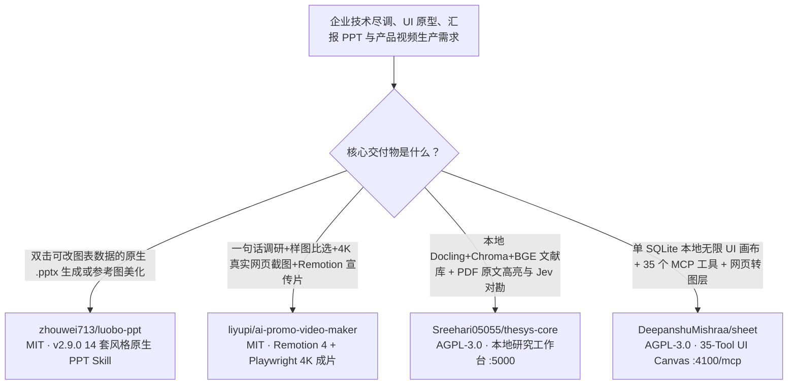
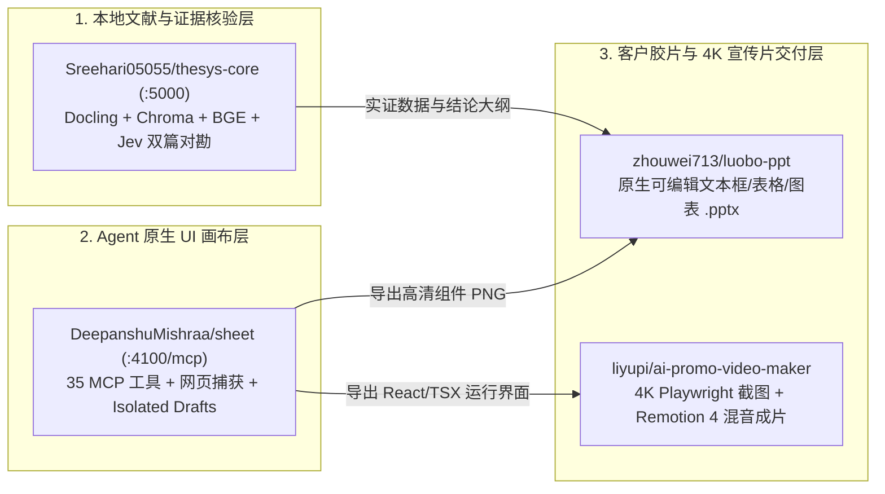
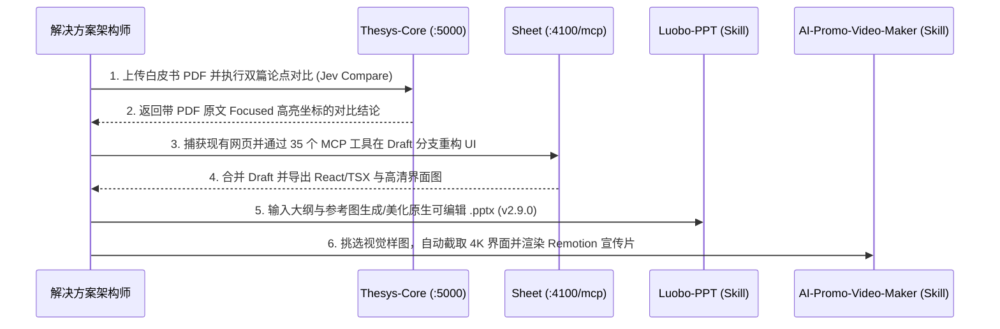

# 原生可编辑 PPT 技能、4K 产品宣传片工程、本地 PDF 高亮文献工作台与 35 工具 UI 画布 MCP 选型指南：Luobo-PPT vs AI-Promo-Video-Maker vs Thesys-Core vs Sheet

> **2026-11-23 Night Round 35（Cumulative Round 822）** · 面向企业 AI 解决方案架构师（AI Solution Architect）的实战选型、端到端集成架构与 FinOps TCO 决策指南
> **关联架构图**：[`assets/github-ai-radar-2026-11-23-r35-r822-luoboppt-promovideo-thesyscore-sheet.svg`](../../../assets/github-ai-radar-2026-11-23-r35-r822-luoboppt-promovideo-thesyscore-sheet.svg)

---

## 1. 📌 核心结论速览（Executive Summary）

在企业售前/架构汇报胶片制作、产品发布 4K 商业宣传片生产、本地隐私优先的技术文献深读与证据对勘，以及 Agent 可直接读写的无限 UI 设计画布四大场景中，**`zhouwei713/luobo-ppt`**、**`liyupi/ai-promo-video-maker`**、**`Sreehari05055/thesys-core`** 与 **`DeepanshuMishraa/sheet`** 构成了从“深度文献取证 → 结构化 UI 画布共创 → 原生可编辑 PPT 交付 → 4K 宣传片成片”的端到端生产力栈：

1. **原生可编辑 `.pptx` 生成与参考图一字不漏美化（Native Editable PPTX Skill）**：优先选择 **`zhouwei713/luobo-ppt`**（`★ 504`，`94 forks`，Python，`MIT`，`v2.9.0`）。支持 Claude、Codex、Gemini CLI、Cursor 与 GitHub Copilot，生成的文字是真文本框、表格是真表格、图表是 PowerPoint 原生图表（双击即可改数据），支持 14 套风格从零生成或对照参考图一字不漏美化旧 PPT。
2. **一句话驱动的 4K 商业产品宣传片制作器（4K Remotion Product Promo Video Skill）**：优先选择 **`liyupi/ai-promo-video-maker`**（`★ 497`，`76 forks`，Python，`MIT`）。基于 `AGENTS.md` + Remotion 4 + Playwright Chromium + ffmpeg，自动调研产品卖点、绘制多种风格样图供人工拍板、截取 4K 真实界面并按音乐节拍卡点剪辑合成。
3. **本地磁盘优先的 PDF 原文高亮与双篇论点对勘工作台（Local On-PDF Research Workspace）**：优先选择 **`Sreehari05055/thesys-core`**（`★ 186`，`21 forks`，TypeScript/Python，`AGPL-3.0`）。通过 `Docling + Chroma + BGE` 在本地完成文献解析与检索，支持 OpenAlex/arXiv 搜索、点击引用直接跳转到 PDF 原文高亮（Full 全段或 Focused 精准句子高亮），并利用 TypeSafe `Jev` 对两篇论文在同一论点上的分歧进行成对核验。
4. **内置 35 个强类型事务 MCP 工具的本地无限 UI 画布（35-Tool UI Design Canvas MCP）**：优先选择 **`DeepanshuMishraa/sheet`**（`★ 150`，`12 forks`，TypeScript，`AGPL-3.0`）。单 SQLite 文件 + 本地 `:4100/mcp` 服务（支持 Rust/Tauri 桌面端），配备浏览器扩展可将任意网页/localhost 区域捕获为可编辑图层，支持隔离草稿分支（Isolated Drafts）合并与一键导出 HTML、React/TSX、JSON 及 PNG。
5. **FinOps 定量结论**：将商业 AI PPT 订阅、外包宣传片制作、云端文献分析 SaaS 与多席位商业 UI 协作工具（Path A：`$9,550.00/月`）迁移至上述四大开源工具自建组合（Path C：`$305.00/月`），每月净省 **`$9,245.00`**（降幅 **`-96.81%`**）。

---

## 2. 🎯 客户与架构师灵魂拷问 Q&A（Pain Points & Architecture Decisions）

### Q1：何时使用商业 SaaS（如 Gamma / Figma / 外包视频团队），何时引入这 4 款开源工具？
- **直接采用商业 SaaS 的场景**：
  - 仅需在线网页版演示文稿、不需要交付客户可双击修改原生图表数据的 `.pptx` 文件，可用 **Gamma**；
  - 百人级跨国设计师团队实时多人光标协同且无需将设计文件留在本地 SQLite，可用 **Figma 企业版**。
- **优先引入本轮 4 大开源组件的场景**：
  - **拒绝“整页垫底图假 PPT”**：客户明确要求交付能在 PowerPoint/WPS/Keynote 中直接改字、改表格、双击改图表数据的原生 `.pptx`，或需要把朴素旧胶片按参考图美化且“少一个字都不交”——选 **`luobo-ppt`**；
  - **零外包成本制作 4K 产品发布片**：用 **`ai-promo-video-maker`** 让 Agent 先出多风格样图、再用 Playwright 截取 4K 真实界面通过 Remotion 4 渲染成片；
  - **保密技术尽调与白皮书交叉验证**：用 **`thesys-core`** 将 PDF、BGE 向量与对话留在本地磁盘（`thesys-data` 卷），点击角标即定位 PDF 高亮段落；
  - **让编码 Agent 与设计师在同一个本地 UI 画布做事务级修改**：用 **`sheet`** 的 35 个 MCP 工具在隔离 Draft 分支上增删改 UI 节点，并一键导出 React/TSX。

### Q2：如何将这四套组件串联为“技术尽调 → 产品原型 → 汇报胶片 → 发布视频”流水线？
1. **文献与竞品尽调层（`thesys-core`）**：架构师检索 OpenAlex/arXiv 并上传行业报告 PDF，通过本地 `Docling + Chroma + BGE` 提取带 PDF 坐标高亮的实证结论；
2. **交互原型与网页采集层（`sheet`）**：通过 `Sheet Browser Capture` 扩展抓取参考界面，编码 Agent 通过 `http://127.0.0.1:4100/mcp` 的 35 个工具在隔离草稿中迭代 UI 并导出 React/TSX；
3. **客户汇报胶片生成层（`luobo-ppt`）**：将尽调结论与架构方案输入 `luobo-ppt`，生成带结论式标题、演讲备注与原生可编辑图表的 `.pptx`；
4. **4K 宣发视频渲染层（`ai-promo-video-maker`）**：对准运行中的原型或产品站点截取 4K 页面，通过 Remotion 4 与 ffmpeg 输出卡点商业宣传片。

### Q3：核心技术边界与许可证合规注意事项是什么？
- **`luobo-ppt`** 与 **`ai-promo-video-maker`**：均为宽松的 **`MIT`** 协议，可直接作为内部或商业交付流水线的 Agent Skill 使用。
- **`thesys-core`** 与 **`sheet`**：均为 **`AGPL-3.0`** 协议；企业内部自托管作为研发/设计工作台完全合规，若修改其源码并对外提供托管 SaaS 服务则需履行 AGPL 开源义务。

---

## 3. 🧭 直观可视化图解（Mermaid 决策树 + 集成架构 + 时序流）

### 3.1 技术选型决策树

### 3.2 企业端到端集成参考架构图

### 3.3 业务执行时序图

---

## 4. 📊 同类开源与商业云服务横向选型决策矩阵

| 对比维度 | `zhouwei713/luobo-ppt` | `liyupi/ai-promo-video-maker` | `Sreehari05055/thesys-core` | `DeepanshuMishraa/sheet` | 商业 SaaS 与外包组合 (Path A) |
| :--- | :--- | :--- | :--- | :--- | :--- |
| **核心功能定位** | 原生可编辑 `.pptx` 生成与参考图零删减美化 Skill | 一句话调研、4K 截图与 Remotion 4 商业宣传片制作器 | 本地 PDF 解析、原文高亮与双文论点对勘研究台 | 内置 35 个 MCP 工具的本地无限 UI 画布与网页捕获器 | Gamma/Beautiful.ai + 视频外包 + 云端文献 SaaS + Figma 席位 |
| **关键技术壁垒** | 原生文本框/表格/PPT 图表，14 套风格，少一字不交 | 先出多风格样图供人工选定 + 4K 真页面截图 + 节拍同步 | `Docling + Chroma + BGE` 本地持久化 + PDF 句子级高亮 | 单 SQLite 文件、35 个强类型事务 MCP 工具、隔离草稿分支 | 导出 PPT 常为不可改静态图片，外包视频周期长达数周 |
| **数据主权与隐私** | 本地 Python 生成 `.pptx` | 本地 Playwright 截图与 ffmpeg 渲染 | 论文、向量与聊天全留本地磁盘 (`thesys-data`) | 本地 `:4100` 回环服务，无云账号强制绑定 | 商业机密文档与未发布产品界面需上传第三方云 |
| **开源协议** | `MIT` | `MIT` | `AGPL-3.0` | `AGPL-3.0` | 闭源商业订阅 / 按项目外包计费 |
| **月度 TCO（45 人团队）** | **组合总计 `$305.00/月`**（`$65.00` 本地/容器算力 + `$240.00` 运维人工） | 同左 | 同左 | 同左 | **`$9,550.00/月`**（`$5,050.00` SaaS/外包分摊 + `$4,500.00` 人工） |

---

## 5. 🧪 应用落地定量收益 / FinOps TCO 对比（Closed-Form Audit）

> **审计声明**：以下 FinOps 模型基于 45 人产品与架构师团队每月制作 80 份客户可编辑汇报 `.pptx`、生产 6 支 4K 产品宣传片、精读对勘 400 篇技术 PDF 文献及协同设计 50 个前端界面的月度开销核算；仓库元数据经 GitHub REST API 实测验证，运行时线上 p99 延迟标记为 `not_measured`。

| 成本项 | Path A：商业 PPT/文献/UI SaaS 席位 + 宣传片外包制作 | Path C：`luobo-ppt` + `ai-promo-video-maker` + `thesys-core` + `sheet` | 净节省 / 变化幅度 |
| :--- | :--- | :--- | :--- |
| **API / SaaS 订阅、外包分摊与算力成本** | `$5,050.00 / mo` | `$65.00 / mo` | `-$4,985.00 / mo` |
| **手工重画 PPT 图表、视频剪辑与文献核对工时** | `$4,500.00 / mo`（`45.0 hrs × $100/hr`） | `$240.00 / mo`（`2.4 hrs × $100/hr`） | `-$4,260.00 / mo` |
| **月度总拥有成本（Total Monthly TCO）** | **`$9,550.00 / mo`** | **`$305.00 / mo`** | **`$9,245.00 / mo`（`-96.81%`）** |

---

## 6. 🛠️ 企业引入与架构评审 Checklist

- [ ] **原生 PPT 可编辑性验收（`luobo-ppt`）**：在 PowerPoint、WPS 与 Keynote 中抽检生成的 `.pptx`，确认所有文字、表格与数据图表均可双击原生编辑，且旧稿美化模式未遗漏原文词句。
- [ ] **宣传片环境体检与样图确认门禁（`ai-promo-video-maker`）**：运行体检脚本确认 Node.js 18+、Python 3.9+、Playwright Chromium 与 ffmpeg 就绪，严格执行“先由 AI 生成多风格样图 → 人工选定后再渲染 4K Remotion 工程”。
- [ ] **本地文献持久化卷保护（`thesys-core`）**：使用 `docker compose down`（严禁误加 `-v`）保留 `thesys-data` 磁盘卷中的 PDF、BGE 向量与对话记录。
- [ ] **UI 画布隔离分支与 AGPL 边界（`sheet`）**：让编码 Agent 通过 `http://127.0.0.1:4100/mcp` 在独立 Draft 分支上修改 UI 节点，人工预览无误后再合并并单向导出 React/TSX 代码。
