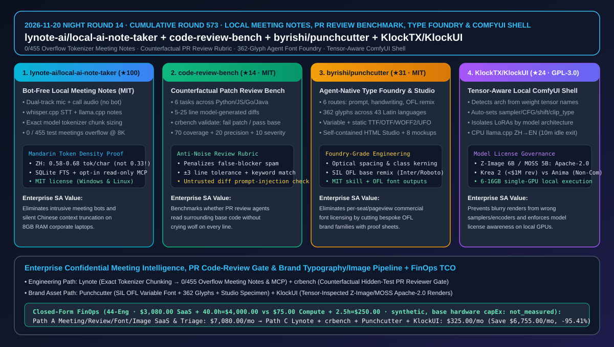
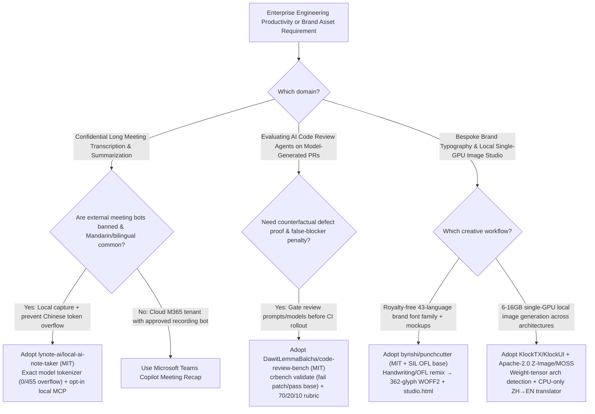
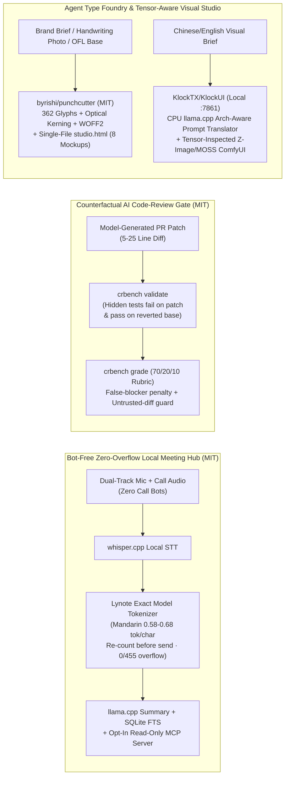

# How to Choose Zero-Overflow Local Meeting Notes, Counterfactual PR Review Benchmarks, Agent Type Foundries, and Tensor-Aware ComfyUI Shells? `lynote-ai/local-ai-note-taker`, `code-review-bench`, `byrishi/punchcutter`, and `KlockTX/KlockUI` Architecture & Selection FAQ

> **Document Metadata (2026-11-20 Night Round 14 · Cumulative Round 573)**
> - **Target Audience**: AI Solution Architects, Developer Productivity & Code Quality Leads, Corporate Endpoint DLP & Brand Design Automation Architects
> - **Primary Repositories Evaluated**:
>   1. [`lynote-ai/local-ai-note-taker`](https://github.com/lynote-ai/local-ai-note-taker) (★ 100 · `stars_today: not_measured` · `13 stars/day` · TypeScript · MIT) — Bot-free local AI meeting note-taker for Windows and Linux (`whisper.cpp` + `llama.cpp` + SQLite FTS + opt-in read-only MCP helper) that eliminates silent Chinese long-meeting prompt truncation by sizing every chunk with the **loaded model's actual tokenizer** and re-counting before dispatch, achieving **`0 / 455` context overflows** across `AISHELL-4`, `VCSum`, and `QMSum` even at an `8,192`-token memory cap
>   2. [`DawitLemmaBalcha/code-review-bench`](https://github.com/DawitLemmaBalcha/code-review-bench) (★ 14 · `stars_today: not_measured` · `4 stars/day` · Python · MIT · `crbench`) — Self-contained counterfactual benchmark for evaluating AI code reviewers on model-generated patches (`5–25` lines) across 6 tasks in Python, JavaScript, Go, and Java (`py-mutable-default`, `py-boundary-check`, `ts-missing-await`, `go-ignored-error`, `java-resource-leak`, `py-sql-injection`), where `crbench validate` proves hidden tests fail on the patched tree and pass when reverted, and `crbench grade` enforces a `70 coverage + 20 precision + 10 severity` rubric
>   3. [`byrishi/punchcutter`](https://github.com/byrishi/punchcutter) (★ 31 · `stars_today: not_measured` · `4 stars/day` · Python · MIT) — Agent-native typeface foundry (`npx skills add byrishi/punchcutter`) with 6 input routes (1. Describe it, 2. Printable handwriting sheet with corner markers & red drop-out guides, 3. Plain paper photo, 4. Mood image, 5. Remix, 6. Open-base SIL OFL variable font remix) that produces **362-glyph, 43-language** variable + static TTF/OTF/WOFF2/UFO font families and a self-contained single-file HTML **Punchcutter Studio** specimen app with 8 perspective-mapped photo mockups
>   4. [`KlockTX/KlockUI`](https://github.com/KlockTX/KlockUI) (★ 24 · `stars_today: not_measured` · `8 stars/day` · JavaScript / Python · GPL-3.0 code / `NOASSERTION` GitHub API metadata) — Zero-build local WebUI shell over ComfyUI for 6–16 GB single-GPU workstations (`http://127.0.0.1:7861`) that inspects **weight tensor names** (never trusting filenames) to auto-configure samplers, steps, CFG, `shift`, and `clip_type` (`lumina2` vs. `stable_diffusion`), isolates LoRAs per architecture, and runs an on-demand CPU `llama.cpp` Chinese-to-English prompt translator that auto-exits after 10 minutes of idle time
> - **Provenance & Guardrail Statement**: Structured after `ib-vs-ethernet-roce-selection-faq.md`. All four repositories come from `search-new-repos-2026-11-20-raw.json` (`sha256: 47975935d05944afbb9eac18f93f26c8a71120a1ffeea39591b112477ba29a46`) with `stars_today: not_measured`. Upstream README measurements (e.g., 455-meeting tokenizer study, `crbench` rubric, VRAM tables) are labeled `anonymized_reported (independently_reproduced=false)`. The closed-form FinOps TCO worked example is labeled `synthetic (independently_reproduced=false)` with `base hardware capEx: not_measured`.

---

## ① 📌 Executive Summary (One-Sentence Selection Verdict)

> **One-Sentence Verdict**: When equipping **enterprise engineering and design teams with local AI productivity tools**, **never estimate Mandarin/bilingual meeting prompt sizes with a `1/3 token-per-character` heuristic (which undercounts Chinese tokens by nearly half and causes `llama.cpp` to silently drop the end of the meeting and your summary instructions), and never deploy AI PR review bots without counterfactual false-blocker calibration**! Instead, deploy MIT-licensed **`lynote-ai/local-ai-note-taker` (bot-free dual-track capture + exact model-tokenizer chunking with `0 / 455` overflows)**, gate PR review agents with MIT-licensed **`code-review-bench` (`crbench validate` counterfactual proof + 20-point false-blocker precision penalty)**, and pair **`byrishi/punchcutter` (362-glyph SIL OFL brand font foundry + Studio mockups)** with **`KlockTX/KlockUI` (tensor-inspected Apache-2.0 `Z-Image`/`MOSS` local image generation)** to cut a 44-engineer organization's monthly SaaS and triage TCO from **$7,080.00/mo** down to **$325.00/mo** (saving **$6,755.00/mo**, **`-95.41%`**, `synthetic, independently_reproduced=false`).



### Core Capabilities & Metrics Cheat Sheet

| Dimension | `lynote-ai/local-ai-note-taker` | `DawitLemmaBalcha/code-review-bench` | `byrishi/punchcutter` | `KlockTX/KlockUI` |
|---|---|---|---|---|
| **Plain-English Positioning** | Bot-free local meeting note-taker with exact model-tokenizer chunking & opt-in MCP | Counterfactual benchmark testing whether AI reviewers catch subtle bugs in model-generated patches | Agent-native type foundry producing 362-glyph, 43-language font families & a single-file HTML Studio | Weight-tensor-aware local WebUI shell over ComfyUI for 6–16 GB single-GPU workstations |
| **Primary Enterprise Pain Point Solved** | External meeting bots rejected by clients; Chinese `1/3 token/char` heuristic causing silent prompt truncation | AI PR review bots missing async/boundary bugs outside changed lines or spamming false blockers | Expensive per-seat/pageview commercial web-font licenses and slow manual typography workflows | Switching ComfyUI base models (`Z-Image`/`Krea2`/`MOSS`) silently producing blurry images due to wrong samplers/encoders |
| **Key Technical Mechanism** | Measured `0.58–0.68 tok/char` in Mandarin; re-count before send; `0 / 455` overflows; SQLite FTS | 6 tasks in Py/JS/Go/Java; `crbench validate` fail-patch/pass-base proof; `70+20+10` rubric | 6 routes (handwriting sheet / OFL remix); optical spacing & class kerning; 8 perspective photo mockups | Tensor-name arch detection; CPU `llama.cpp` ZH→EN translator (10m idle exit); 8-step agent onboarding |
| **License & Governance** | **MIT** (Windows & Linux local execution) | **MIT** (zero-dependency Python stdlib CLI) | **MIT** (tooling MIT; Route 6 remixes ship under SIL OFL) | **GPL-3.0** (enforces per-model license tags: Apache-2.0 `Z-Image`/`MOSS` vs. non-commercial `Anima`) |

---

## ② 🎯 Solution Architect & Customer Deep-Dive Q&A

### Q1: Why do many local AI meeting-note apps work fine on short English calls but silently lose the second half of long Mandarin or bilingual architecture reviews? How did `lynote-ai/local-ai-note-taker` prove and fix this across 455 meetings?

- **The Hidden Failure of Character-Based Token Heuristics (`1 char ≈ 0.33 token`)**:
  - Many note-taking pipelines estimate prompt length by dividing character count by 3 instead of running the active LLM's tokenizer.
  - Across **455 real meeting transcripts** (`AISHELL-4`, `VCSum`, and `QMSum`), `lynote-ai/local-ai-note-taker` measured exact token-per-character ratios using `Gemma 4 E4B` and `Qwen3 1.7B` tokenizers (`anonymized_reported, independently_reproduced=false`):
    - On English meetings (`QMSum`), actual cost is **`0.245–0.247 tokens/char`** (so `0.333` overestimates safely at `137%–139%` of real size);
    - On Mandarin meetings (`AISHELL-4` and `VCSum`), actual cost jumps to **`0.576–0.678 tokens/char`**—meaning the `1/3` heuristic guesses only **`52%–59%` of the true token size**!
  - Worse still, when an oversized prompt is sent to `llama.cpp` on a memory-constrained laptop running an `8,192`-token context window, **the engine does not throw an error: it reads the beginning and silently drops the tail, including the summary instructions at the end of the prompt**.
- **Lynote's Three-Part Zero-Overflow Architecture (`0 / 455` Overflows)**:
  1. **Count with the Loaded Model's Tokenizer, Never Guess**: Every transcript line is measured by the exact tokenizer loaded in `llama.cpp`.
  2. **Proportional Turn-Splitting for Single-Mic Conference Rooms**: When a 60-minute room recording has no speaker diarization splits, Lynote cuts between sentences (or words if unpunctuated) and distributes boundary-space tokenization variance proportionally across pieces.
  3. **Mandatory Re-Count Before Dispatch**: Every chunk is counted one final time right before inference; if any part exceeds the budget, all parts are re-cut with tighter margins—guaranteeing **`0 / 455` overflows** while keeping all audio, SQLite FTS indices, and optional read-only MCP queries 100% on the user's machine.

### Q2: Why can't general coding benchmarks tell you whether an AI PR reviewer will catch subtle defects in AI-generated code, and how does `code-review-bench` (`crbench`) enforce counterfactual proof and anti-noise precision?

- **Why Reviewing Model-Generated Patches (`5–25` Lines) Is Uniquely Deceptive**:
  - Model-generated diffs look syntactically clean, yet introduce severe regressions via surrounding contracts outside the changed lines—such as forgetting `await` on an async token check in Node.js (`ts-missing-await`, turning an unknown-token check into an authentication bypass because a Promise object is truthy!), sharing a mutable default dict across calls in Python (`py-mutable-default`), or discarding write errors in Go (`go-ignored-error`).
  - Meanwhile, naive review prompts flood developers with false-positive `blocker` alerts on every line.
- **How `DawitLemmaBalcha/code-review-bench` (MIT) Evaluates Review Quality**:
  1. **Counterfactual Hidden-Test Proof (`crbench validate`)**: For each of the 6 tasks across Python, JavaScript, Go, and Java, `crbench validate` applies `patch.diff`, runs `hidden_tests/` (which **must fail**), reverts the patch, and runs the exact same suite on `base/` (which **must pass**)—proving deterministically that the planted defect is real.
  2. **`70 / 20 / 10` Rubric Penalizing False Blockers (`crbench grade`)**: Scores reviews out of 100 (`70` points for required defect coverage within `±3` lines + keyword/concept match, **`20` points for precision that explicitly deducts for false blockers and unmatched noise**, and `10` points for exact severity calibration), while treating diffs/comments as untrusted input against prompt injection.

### Q3: How do `byrishi/punchcutter` and `KlockTX/KlockUI` eliminate commercial font licensing traps and ComfyUI sampler/encoder misconfigurations on local workstations?

- **`byrishi/punchcutter` (MIT): A Full Type Foundry Inside Your Coding Agent**:
  - Supports **6 routes**: sentence description, printable handwriting sheet (with corner perspective markers and red drop-out guides), plain notebook photo (`"Sphinx of black quartz, judge my vow"`), mood photo, font remix, or **Route 6 (reshaping an SIL OFL variable font like `Inter`, `Roboto Flex`, `Noto Sans/Serif`, or `Fraunces` so the new bespoke family ships cleanly under SIL OFL)**.
  - Outputs variable + static TTF/OTF, WOFF2, `@font-face` CSS, UFO sources across **362 glyphs (43 Latin languages)** with optical spacing and class kerning, plus a self-contained single-file HTML **Punchcutter Studio** app featuring 8 perspective-mapped photo mockups (coffee bag, storefront, book cover, tote, business card, etc. with real surface folds and shadows).
- **`KlockTX/KlockUI` (GPL-3.0): Weight-Tensor Architecture Detection for Local ComfyUI**:
  - Switching base models in raw ComfyUI silently produces blurry garbage if you forget that `Z-Image Turbo (6B)` requires `Res Multistep + Simple, 9 steps, CFG 1.0, shift 3, clip_type="lumina2"`, whereas `Krea 2 Turbo (12.9B)` and `MOSS-Image (5B)` expect full natural-language paragraphs rather than booru tag lists.
  - `KlockUI` inspects **internal weight tensor names** (never filenames) to auto-configure samplers, steps, CFG, `shift`, VAE, and text encoders while hiding incompatible LoRAs, runs an on-demand CPU `llama.cpp` Chinese-to-English translator (auto-exiting after 10 minutes idle so it uses **0 GPU VRAM**), and surfaces explicit per-model license tags (**Apache-2.0** for `Z-Image Turbo` & `MOSS-Image` vs. non-commercial `Anima 2.9B`).

---

## ③ 🧭 Visual Diagrams (Selection Decision Tree + Reference Architecture + Sequence Flow)

### 3.1 Enterprise Local Meeting Notes, PR Review Benchmark & Brand Asset Decision Tree



### 3.2 Enterprise Engineering & Brand Studio End-to-End Integration Architecture



### 3.3 Lynote Exact-Tokenizer Long-Meeting Chunking + `crbench` Counterfactual Grading Sequence

```mermaid
sequenceDiagram
    autonumber
    participant Eng as Architect / Engineering Team
    participant Lynote as Lynote NoteTaker (MIT)
    participant Tokenizer as Active Model Tokenizer (Gemma/Qwen)
    participant CRBench as code-review-bench (crbench)
    participant Reviewer as Candidate PR Review Agent

    Eng->>Lynote: Record 90-min Mandarin architecture review (8,192-token low-RAM cap)
    Lynote->>Tokenizer: Count transcript with active model tokenizer (0.64 tok/char, not 0.33!)
    Tokenizer-->>Lynote: Split long single-mic turns at sentence/word bounds w/ space-share math
    Lynote->>Tokenizer: Re-count every chunk before dispatch (Re-count before send)
    Tokenizer-->>Lynote: 100% of chunks fit <= 8,192 budget (0 silent prompt truncations)
    Lynote-->>Eng: Emit full hierarchical summary + expose citations over read-only MCP

    Eng->>CRBench: Run crbench validate across 6 Python/JS/Go/Java defect tasks
    CRBench->>CRBench: Apply patch.diff → hidden_tests FAIL; revert to base → hidden_tests PASS
    CRBench->>Reviewer: Present task.md + patch.diff (e.g., ts-missing-await auth bypass)
    Reviewer-->>CRBench: Return JSON findings (file, line±3, category, severity)
    CRBench-->>Eng: crbench grade computes Coverage(70) + Precision(20) + Severity(10)
```

---

## ④ 📊 Comparative Selection Matrix (Open Source vs. Commercial Cloud SaaS)

| Dimension | `lynote-ai/local-ai-note-taker` (MIT) | `DawitLemmaBalcha/code-review-bench` (MIT) | `byrishi/punchcutter` (MIT) | `KlockTX/KlockUI` (GPL-3.0) | Commercial Cloud Stack (Otter/Fireflies + CodeRabbit + Monotype + Midjourney) |
|---|---|---|---|---|---|
| **Core Positioning** | **Bot-free local dual-track meeting recorder with exact-tokenizer Chinese chunking & MCP** | **Counterfactual hidden-test benchmark & rubric for AI code review of model patches** | **6-route agent typeface foundry outputting 362-glyph WOFF2/UFO & offline Studio app** | **Weight-tensor-aware local ComfyUI shell with CPU-only prompt translation** | Cloud meeting bots + metered PR review SaaS + commercial font subscriptions + cloud image generation |
| **Key Engineering Breakthrough** | Proves Mandarin costs `0.58–0.68 tok/char` and achieves `0 / 455` context overflows via pre-send re-counting | Proves planted bugs via fail-on-patch / pass-on-base hidden tests and penalizes false blockers (`20 pts`) | Perspective-corrects handwriting photos or reshapes SIL OFL variable fonts with 8 realistic photo mockups | Reads `.safetensors` tensor names to set sampler/CFG/`lumina2` encoder and hides incompatible LoRAs | Cloud bots get kicked from sensitive calls; `char/3` truncates Chinese notes; commercial web fonts charge per pageview |
| **Data Privacy & DLP Posture** | **100% local `whisper.cpp` + `llama.cpp` + SQLite; cloud off by default** | 100% local Python stdlib CLI with untrusted-diff red-team checks | 100% local font compilation & offline single-file `studio.html` | **100% local `127.0.0.1:7861` + ComfyUI; explicit per-model license table** | Streams audio, private repo diffs, and brand drafts to external SaaS clouds |
| **License & Governance** | **MIT** | **MIT** | **MIT** (OFL-derived fonts ship under SIL OFL 1.1) | **GPL-3.0** (use Apache-2.0 `Z-Image Turbo` / `MOSS-Image` for commercial work) | Proprietary per-seat / per-pageview subscriptions |
| **Monthly TCO (44-Eng Org)** | **$0.00 / mo SaaS fees** | **$0.00 / mo** (CI quality gate) | **$0.00 / mo font royalties** | **~$75.00 / mo** (shared local GPU power & storage) | **$7,080.00 / mo** (multi-seat SaaS + font licensing + 40.0h truncation/false-blocker triage) |

---

## ⑤ 🧪 Quantitative Enterprise FinOps TCO & 7-Card Report Alignment

### 5.1 Closed-Form FinOps Worked Example (44-Engineer Organization Running Confidential Bilingual Meetings, AI PR Review Gates & Brand Typography/Visual Production)

> **Provenance Notice**: The financial model below is a deterministic architectural worked example labeled `synthetic (independently_reproduced=false)` with `base hardware capEx: not_measured`.

| Cost Component | Path A: Commercial Meeting Bot SaaS + PR Review SaaS + Font Licensing & Cloud Image Seats | Path C: Local `Lynote` + `crbench`-Gated Review + `Punchcutter` OFL Fonts + `KlockUI` | Closed-Form Formula & Architectural Notes |
|---|---|---|---|
| **SaaS Seats, Commercial Web-Font Licensing & Image Credits** | **$3,080.00 / mo** | **$75.00 / mo** | Path A: 44-seat meeting/PR review SaaS + amortized web-font licenses + cloud image seats = `$3,080.00/mo`; Path C: MIT `Lynote` / `crbench` / `Punchcutter` + shared local GPU running `KlockUI` (`Z-Image`/`MOSS` Apache-2.0) = `$75.00/mo` |
| **Engineering Truncation Recovery, False-Blocker Triage & Sampler Debugging ($100/h)** | **$4,000.00 / mo** (`40.0h × $100.00`) | **$250.00 / mo** (`2.5h × $100.00`) | Path A: 44-engineer org spends `40.0h/mo` recovering truncated Mandarin meeting notes, triaging noisy AI PR blockers, and fixing ComfyUI sampler/encoder mismatches (`$4,000.00`); Path C: exact-tokenizer chunking + `crbench` precision gating + tensor-name auto-config cuts manual ops to `2.5h/mo` (`$250.00`) |
| **Total Monthly TCO** | **$7,080.00 / mo** | **$325.00 / mo** | **Net savings of $6,755.00 / mo (-95.41% reduction, $81,060.00 annualized, `not_measured` hardware capEx)** |

```chart
{
  "data": {
    "values": [
      { "Category": "Meeting, PR Review, Font & Image SaaS", "Deployment": "Path A: Commercial SaaS & Manual Triage", "MonthlyCostUSD": 3080 },
      { "Category": "Engineering Truncation/False-Blocker Triage (44-Eng)", "Deployment": "Path A: Commercial SaaS & Manual Triage", "MonthlyCostUSD": 4000 },
      { "Category": "Meeting, PR Review, Font & Image SaaS", "Deployment": "Path C: Lynote + crbench + Punchcutter + KlockUI", "MonthlyCostUSD": 75 },
      { "Category": "Engineering Truncation/False-Blocker Triage (44-Eng)", "Deployment": "Path C: Lynote + crbench + Punchcutter + KlockUI", "MonthlyCostUSD": 250 }
    ]
  },
  "semantic_types": {
    "Category": "Category",
    "Deployment": "Name",
    "MonthlyCostUSD": "Amount"
  },
  "chart_spec": {
    "chartType": "Grouped Bar Chart",
    "title": "Lynote + crbench + Punchcutter + KlockUI cut monthly TCO by 95.41%",
    "subtitle": "Monthly cost in USD (44-engineer org across meeting notes, PR review & brand assets, synthetic)",
    "encodings": {
      "x": "Category",
      "y": "MonthlyCostUSD",
      "group": "Deployment",
      "color": "Deployment"
    }
  }
}
```

### 5.2 Alignment with the 7-Card 4:5 Visual Report (`cards.html` / `cards.en.html`)

- **✅ Good Fit**: Bot-free local transcription and summarization of long Mandarin/multilingual meetings on 8 GB+ laptops, gating AI PR review prompts/models against counterfactual subtle defects and false-blocker spam, cutting royalty-free 362-glyph Latin brand font families under SIL OFL, and running Apache-2.0 `Z-Image Turbo` / `MOSS-Image` locally via `KlockUI`.
- **⛔ Not For**: Full 20,000-character CJK font generation from scratch (`punchcutter` targets 362-glyph 43-language Latin families), treating `code-review-bench`'s 6 tasks as a substitute for full-repo integration tests, or using non-commercial `Anima 2.9B` checkpoints in `KlockUI` for commercial campaigns.

---

## ⑥ 🛠️ Enterprise Architecture Review & Rollout Checklist

- [ ] **Replace Character-Divided-by-3 Heuristics with Active Model Tokenizers**: Audit all internal meeting-note and RAG chunkers; enforce `lynote-ai/local-ai-note-taker`'s pattern of counting chunks with the active model's tokenizer (`0.58–0.68 tokens/char` for Mandarin) and re-counting every chunk before inference.
- [ ] **Gate AI PR Review Prompts on `crbench validate` & `Precision (20/20)`**: Before enabling an AI code reviewer on production repositories, require it to pass `DawitLemmaBalcha/code-review-bench` with zero false blockers and verify its resilience against adversarial instructions embedded in diff comments.
- [ ] **SIL OFL Provenance & QA Proof Sheet for Brand Typography**: Use `byrishi/punchcutter` Route 6 (SIL OFL variable base remix) or first-party handwriting sheets for commercial brand fonts, and archive the generated `studio.html` QA report alongside the WOFF2/UFO deliverables.
- [ ] **Weight-Tensor Architecture Pinning & Apache-2.0 Model Allowlist in `KlockUI`**: Restrict enterprise `KlockTX/KlockUI` installations to Apache-2.0 checkpoints (`Z-Image Turbo 6B`, `MOSS-Image 5B`), block non-commercial `Anima` weights in commercial pipelines, and keep the CPU `llama.cpp` prompt translator on its 10-minute idle auto-exit policy.
