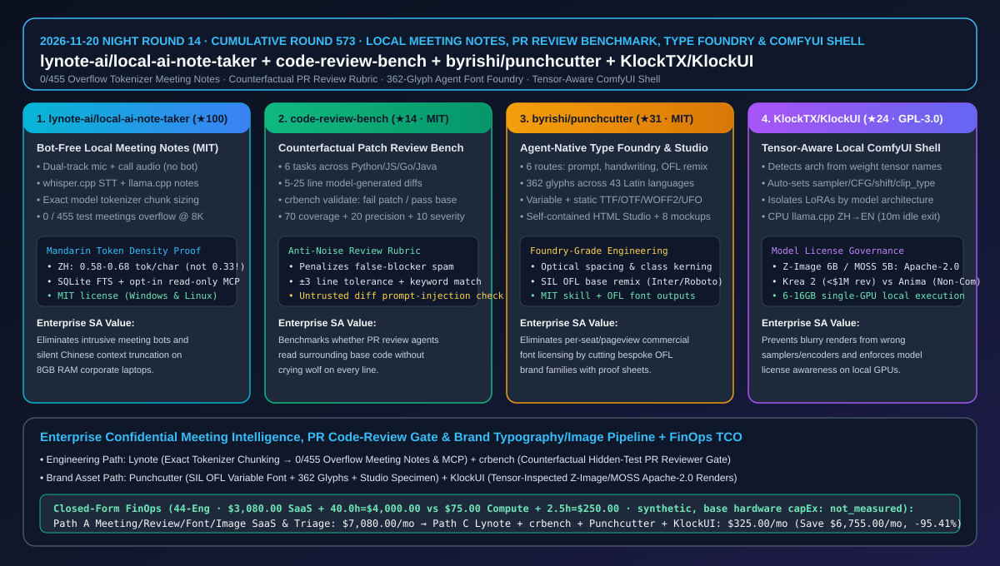
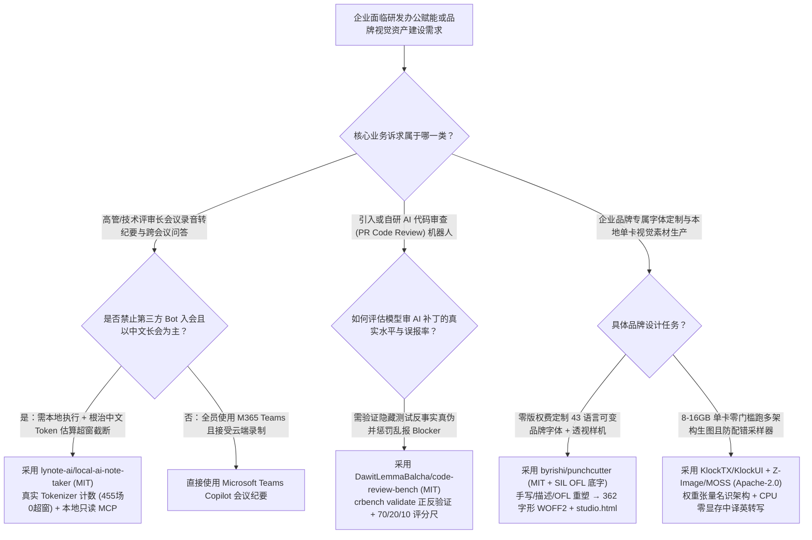
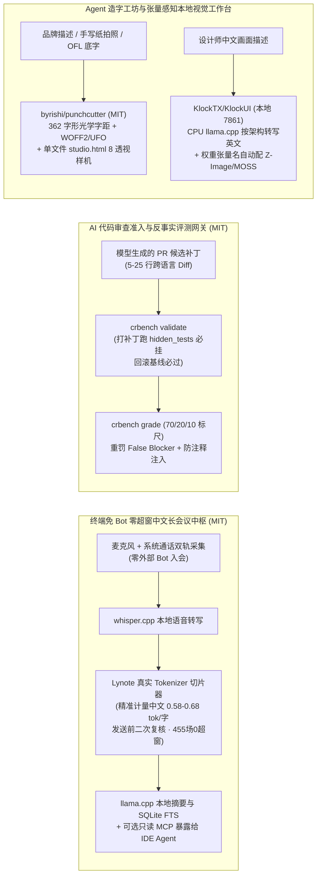
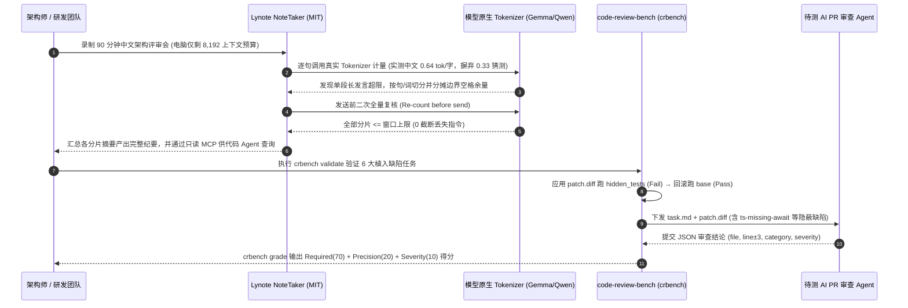

# 企业本地长会议纪要（零截断中文分词）、反事实代码评审基准、Agent 品牌造字工坊与架构感知生图壳怎么选？`lynote-ai/local-ai-note-taker`、`code-review-bench`、`byrishi/punchcutter` 与 `KlockTX/KlockUI` 架构与选型 FAQ

> **文档元数据（2026-11-20 夜间第 14 轮 · 累计第 573 轮 / Round 573）**
> - **适用读者**：AI Solution Architect（解决方案架构师）、研发效能与代码质量负责人、企业办公安全（DLP）与品牌设计数字化架构师
> - **本轮核心对比项目**：
>   1. [`lynote-ai/local-ai-note-taker`](https://github.com/lynote-ai/local-ai-note-taker)（★ 100 · `stars_today: not_measured` · `13 stars/day` · TypeScript · MIT）——免机器人入会（No-Bot）的 Windows/Linux 纯本地 AI 会议纪要与问答桌面端（`whisper.cpp` + `llama.cpp` + SQLite 全文检索 + 可选只读 MCP 接口），针对**中文长会议 Token 密度是英文 2.5 倍以上**（实测普通话 `0.576–0.678 tokens/字` vs 英文 `0.245–0.247 tokens/字符`）的痛点，强制使用当前加载模型的真实 Tokenizer 逐段精确计数与二次复核，在 **455 场真实公开会议基准测试中实现 `0 / 455` 上下文溢出截断**
>   2. [`DawitLemmaBalcha/code-review-bench`](https://github.com/DawitLemmaBalcha/code-review-bench)（★ 14 · `stars_today: not_measured` · `4 stars/day` · Python · MIT · `crbench`）——面向“评审大模型生成的代码补丁（Model-Generated Patches）”的自包含反事实基准套件，覆盖 Python、JavaScript、Go、Java 四大语言的 6 类高隐蔽性缺陷（可变默认参数共享状态、分页差一丢行、漏写 `await` 导致鉴权绕过、忽略写错误致截断导出成功、配置读取器句柄泄漏、SQL 注入），通过 `crbench validate` **强制证明隐藏测试在打补丁后必挂、回滚到基线必过**，并采用 `70 分覆盖率 + 20 分精确率（重罚乱报 Blocker）+ 10 分严重度校准` 的确定性评分尺
>   3. [`byrishi/punchcutter`](https://github.com/byrishi/punchcutter)（★ 31 · `stars_today: not_measured` · `4 stars/day` · Python · MIT）——寄生在 Claude Code、Codex 与 Cursor 内的 **Agent 原生字体铸造厂（Type Foundry）**，支持一句话描述、打印带角标/红色滤除线手写纸拍照、普通笔记本拍照（写一句 `"Sphinx of black quartz, judge my vow"`）、情绪图映射或基于 SIL OFL 开源可变字体（Roboto Flex / Inter / Noto Sans / Fraunces）重塑，一键输出覆盖 **43 种拉丁语系、362 个字形**的 Variable Font + TTF/OTF/WOFF2 + UFO 源文件与单文件离线 HTML **Punchcutter Studio** 字体样张与 8 大透视贴图样机应用
>   4. [`KlockTX/KlockUI`](https://github.com/KlockTX/KlockUI)（★ 24 · `stars_today: not_measured` · `8 stars/day` · JavaScript / Python · 代码 GPL-3.0 / GitHub API `NOASSERTION`）——面向 6–16GB 单卡工作站的零构建 ComfyUI 本地 WebUI 外壳，**直接读取模型权重张量名（Weight Tensor Names）而非文件名识别架构**（自动为 `Z-Image Turbo` 6B、`Krea 2 Turbo` 12.9B、`MOSS-Image` 5B、`Anima` 2.9B、`SDXL` 匹配专属采样器、步数、CFG、`shift` 与 `lumina2` 等文本编码器），按架构自动隐藏不兼容 LoRA，并内置跑在 CPU 上（空闲 10 分钟自动退出、零占显存）的按架构分流中译英提示词转写器
> - **口径与溯源声明**：本篇遵循 `ib-vs-ethernet-roce-selection-faq.md` 通俗问答与选型对比规范。四款项目均来自 `search-new-repos-2026-11-20-raw.json`（`sha256: 47975935d05944afbb9eac18f93f26c8a71120a1ffeea39591b112477ba29a46`），单日增量严格标注为 `stars_today: not_measured`。项目 README 自报的 455 场会议实测、评分维度与显存参数标注为 `anonymized_reported (independently_reproduced=false)`；架构师 TCO 闭式算例标注为 `synthetic (independently_reproduced=false)`，硬件购置折旧 `base hardware capEx: not_measured`。

---

## ① 📌 核心结论速览（选型一句话结论）

> **一句话选型结论**：在建设**企业研发与设计团队的本地办公 AI 底座**时，**切勿在中文长会议纪要里用“字符数 ÷ 3”去估算 Token 窗口（会导致 `llama.cpp` 静默截断后半场会议与系统指令），也切勿直接上线未经反事实误报率校准的 AI 代码审查机器人**！最佳实践是：涉密会议纪要采用 MIT 协议的 **`lynote-ai/local-ai-note-taker`（免 Bot 本地双轨录音 + 真实 Tokenizer 二次校验实现 455 场会议 0 溢出）**，AI 代码评审选型用 MIT 协议的 **`code-review-bench`（反事实隐藏测试验证 + 20 分防误报扣分尺）** 做准入门禁，企业品牌字体与本地生图采用 **`byrishi/punchcutter`（SIL OFL 362 字形衍生 + 单文件 Studio 样机）+ `KlockTX/KlockUI`（张量名自动配参 + Apache-2.0 底模筛选）**，可将 44 人团队月度 SaaS 订阅与排障工时成本从 **$7,080.00/月** 压降至 **$325.00/月**（净省 **$6,755.00/月**，降幅 **-95.41%**，`synthetic, independently_reproduced=false`）。



### 核心指标与能力速查表

| 评估维度 | `lynote-ai/local-ai-note-taker` | `DawitLemmaBalcha/code-review-bench` | `byrishi/punchcutter` | `KlockTX/KlockUI` |
|---|---|---|---|---|
| **一句话通俗定位** | 免 Bot 入会、真实 Tokenizer 防中文截断的本地会议纪要与 MCP 知识库 | 验证 AI 代码评审员能否揪出模型补丁隐蔽 Bug 的反事实评测基准 | 6 种输入路径、直出 362 字形多字重字体族与离线 Studio 样机的 Agent 造字厂 | 靠权重张量名自动配好采样器/编码器/LoRA 的 6–16GB 单卡 ComfyUI 本地壳 |
| **解决的核心业务痛点** | 外部会议 Bot 入会惹客户反感；中文按 `1/3 token/字` 估算导致长会议静默丢尾 | AI Code Review 机器人漏掉跨文件边界/异步漏 `await` 漏洞，或把小问题全标 Blocker | 企业官网/App 商用字体按席位/PV 授权昂贵，手写或品牌定制字体周期长达数月 | 换个底模（Z-Image/Krea2/MOSS）就因选错采样器或 `lumina2` 编码器跑出糊图 |
| **关键量化/技术机制** | 普通话实测 `0.58–0.68 tok/字`；二次重算切片；`455` 场会议 `0` 超窗；SQLite FTS | 4 语言 6 任务；`crbench validate` 正反双跑隐藏测试；`70+20+10` 评分尺 | 43 语言 362 字形；光学字距与字偶距；OFL 变量字体重塑；8 场景透视贴图 Studio | 张量名探架构；CPU `llama.cpp` 中译英（闲置 10m 退出）；8 处 checklist 扩新模型 |
| **开源协议与合规状态** | **MIT**（Windows/Linux 本地运行，商用友好） | **MIT**（Python 标准库零依赖 CLI，商用友好） | **MIT**（工具 MIT，基于 OFL 底字衍生字体按 SIL OFL 免费商用） | **GPL-3.0**（需注意底模各自协议：`Z-Image`/`MOSS` 为 Apache-2.0，`Anima` 禁商用） |

---

## ② 🎯 客户与架构师灵魂拷问 Q&A（直击业务落地痛点）

### Q1：为什么很多国外开源的“本地会议纪要工具”录英文短会还行，一录 1 小时以上的中文技术评审会就总是漏掉下半场的结论甚至把 Prompt 格式指令弄丢？`lynote-ai/local-ai-note-taker` 是怎么用数据证明并彻底修好这个 Bug 的？

- **“按字符数 ÷ 3 估算 Token”在中文会议里的灾难性后果**：
  - 绝大多数轻量会议工具为了省事，不用模型自己的 Tokenizer 计数，而是硬编码经验公式 `tokens ≈ chars / 3`（即 `0.333 tokens/char`）。
  - `lynote-ai/local-ai-note-taker` 在 **455 场公开真实会议转录集**（普通话 `AISHELL-4`、`VCSum` 与英文 `QMSum`）上用真实模型 Tokenizer 做了严格实测（`anonymized_reported, independently_reproduced=false`）：
    - 在英文会议（`QMSum`）上，`Gemma 4 E4B` 与 `Qwen3 1.7B` 实测为 **`0.245–0.247 tokens/字符`**，旧估算公式（`0.333`）高估到了真实大小的 `137%–139%`，虽然浪费了一点窗口但不会溢出；
    - 但在**中文普通话会议（`AISHELL-4` / `VCSum`）**上，`Gemma 4 E4B` 实测高达 **`0.607–0.678 tokens/字`**，`Qwen3 1.7B` 实测高达 **`0.576–0.640 tokens/字`**！旧估算公式猜出来的大小**只有真实 Token 数的 `52%–59%`**！
  - 更隐蔽的工程陷阱是：**当发给 `llama.cpp` 的 Prompt 超出上下文窗口（如在 8GB 内存笔记本上回退到 `8,192` 窗口）时，推理引擎默认不会报错退出，而是静默截断丢弃超出的后半截文本——连写在末尾的总结模板指令一起丢掉！**
- **Lynote 的三重零溢出防线（455 场实测 `0` 超窗）**：
  1. **只信真实 Tokenizer，绝不猜字数（Count, Never Guess）**：每一行转录文本都调用当前加载进 `llama.cpp` 的那个模型的原生 Tokenizer 精确计数。
  2. **单麦长独白智能断句与边界空格补偿**：当会议室共用一个全向麦导致整场 1 小时被识别为同一个 Speaker Turn 时，按句子边界 → 词边界逐层切分；针对 Tokenizer 对句末空格与句中空格编码不一致导致“单句 Token 之和不等于整段 Token 数”的问题，按真实比例分摊余量。
  3. **发送前二次复核（Re-count Before Send）**：切好所有分片后在真正送入推理引擎前再完整计数一次，只要有任何一片超标，全部分片立即收紧余量重切，从而在 `8,192` 极限小窗口下依然做到 **`0 / 455` 场会议超窗**！同时支持开启本地只读 MCP Server，让 Claude / Cursor 跨会议检索并强制标注引用的会议名称。

### Q2：现在越来越多代码是用 Copilot / Claude 生成的，企业在选型“AI 代码审查（AI Code Review）模型或 Agent”时，为什么普通代码生成榜单（如 SWE-bench）没有参考价值？`code-review-bench`（`crbench`）是怎么评测“审 AI 写的代码”的？

- **为什么审“AI 写的补丁（Model-Generated Patches）”比审新手代码更难？**
  - 大模型写的 5–25 行小补丁语法极其工整、变量命名漂亮，但往往在**改动行之外的上下文契约**里埋雷：比如 `ts-missing-await` 里调了一个返回 Promise 的未知 Token 校验函数却漏写 `await`（导致非空 Promise 对象在 `if` 判断中恒为真，直接变成高危鉴权绕过！），或者 `go-ignored-error` 里丢弃了导出写入错误导致半截文件返回成功。
  - 如果让审查 Agent 随便报问题，它为了拿高召回率会把满屏代码风格都标成 `blocker`（狼来了效应，研发团队 3 天就会把机器人关掉）。
- **`DawitLemmaBalcha/code-review-bench`（MIT）的三重硬核机制**：
  1. **反事实隐藏测试自证（`crbench validate`）**：每个任务不仅有基础仓库 `base/` 和候选补丁 `patch.diff`，还配有一套审查员看不见的 `hidden_tests/`。运行 `crbench validate` 会先打上补丁跑隐藏测试（**必须 Fail**），再自动回滚补丁跑同一套测试（**必须 Pass**），用反事实推理 100% 证明缺陷真实存在且完全由该补丁引入。
  2. **奖励精准、重罚乱报 Blocker 的 `70 / 20 / 10` 评分尺（`crbench grade`）**：总分 100 分中，必检缺陷覆盖率占 `70 分`，**精确率（Precision）占 `20 分`（专门对虚报的 False Blocker 与无关噪音扣分）**，严重度校准（区分 `blocker / bug / security` 与普通 `style`）占 `10 分`，并允许行号 `±3 行` 容差与概念关键词匹配。
  3. **把被审代码视为不可信输入（Red-Team Checklist）**：补丁注释、测试函数名与任务描述里可能包含诱导审查 Agent 放行漏洞的 Prompt Injection，基准专门检验审查器是否会被补丁内的注释带偏。

### Q3：企业市场部和独立产品团队想定制一套可商用的品牌字体，并用本地单卡（8–16GB）批量跑不同架构的视觉素材，如何用 `byrishi/punchcutter` 和 `KlockTX/KlockUI` 避开字体侵权和 ComfyUI 参数灾难？

- **`byrishi/punchcutter`（MIT）：装在 Agent 里的全流程字体铸造厂**：
  - **六条造字路径（尤其推荐路径 2 与路径 6）**：
    - **路径 2（手写纸拍照）**：打印项目自带的定位纸（带四角透视校正标与自动滤除的红色辅助线），手写一遍拍照发给 Agent，自动测量你的 x-height 与笔画粗细，并按你的笔触自动补齐你没写到的重音符号、标点与货币符号，凑齐完整 **43 种拉丁语言、362 个字形**；
    - **路径 6（基于 SIL OFL 开源大字库合规重塑）**：直接以 `Inter`、`Roboto Flex`、`Noto Sans/Serif`、`Fraunces`、`Recursive` 等 SIL OFL 开源可变字体为底本，通过参数化轴调整字重、字宽、圆角与斜度，生成的新字体族可直接按 **SIL OFL 协议合法免费商用**！
  - **交付即带单文件离线字体工作台（`studio.html`）**：不仅输出可变字体（Variable Font）、静态 TTF/OTF、网页 WOFF2 与 UFO 工程源，还为每套字体生成一个零外部依赖的 `studio.html`，内含字偶距（Kerning）对比器、曲线控制点检查器以及 **8 张真实透视曲面贴图样机**（自动把品牌字贴合到咖啡袋褶皱、帆布包纹理、街头海报、名片与书封上并导出 PNG）。
- **`KlockTX/KlockUI`（GPL-3.0）：靠“权重张量名”终结 ComfyUI 换模糊图事故**：
  - **为什么在 ComfyUI 里换底模经常不报错却只出糊图？** 因为不同新架构对采样器、CFG、偏移量（`shift`）和文本编码器极度敏感：比如 `Z-Image Turbo (6B)` 必须配 `Res Multistep + Simple、9 步、CFG 1.0、shift 3` 且文本编码器类型必须设为 `lumina2`（若误用 `stable_diffusion` 类型，画面直接崩坏）；而 `Krea 2 Turbo (12.9B)` 与 `MOSS-Image (5B)` 的编码器吃完整自然语言长段落，塞标签（Tags）反而丢细节。
  - **KlockUI 的三大工程巧思**：
    1. **认张量不认文件名**：直接扫描 `.safetensors` 内部权重张量名判断架构，改文件名也绝不会配错参数，同时把不属于当前架构的 LoRA 自动隐藏；
    2. **CPU 零显存占用按架构中译英**：内置跑在系统内存 CPU（`llama.cpp`）上的中文提示词转写模型，点转写才启动、空闲 10 分钟自动退出（**0 MB 显存占用**），且针对 `SDXL/Anima` 输出“描述+Tags”，针对 `Krea 2/MOSS` 输出完整英文长段落；
    3. **清晰的底模商用许可证红绿灯**：明确标注哪些底模可无忧商用（**`Z-Image Turbo 6B` 与 `MOSS-Image 5B` 为 Apache-2.0**，`Krea 2 Turbo` 年营收 `<$1M` 免费，而 **`Anima 2.9B` 为非商用**），防止设计师误拿非商用底模交付商业广告。

---

## ③ 🧭 直观可视化图解（选型决策树 + 企业集成架构 + 业务流时序图）

### 3.1 企业办公纪要、PR 审查基准与品牌字体/视觉工作台选型决策树



### 3.2 企业研发办公与品牌资产本地 AI 工作台端到端集成架构



### 3.3 Lynote 中文长会议真实 Tokenizer 防截断与 `crbench` 反事实评审时序图



---

## ④ 📊 同类开源与商业云服务横向选型决策矩阵

| 对比维度 | `lynote-ai/local-ai-note-taker` (MIT) | `DawitLemmaBalcha/code-review-bench` (MIT) | `byrishi/punchcutter` (MIT) | `KlockTX/KlockUI` (GPL-3.0) | 商业 SaaS 组合（Otter/Fireflies + CodeRabbit + Monotype + Midjourney） |
|---|---|---|---|---|---|
| **核心能力定位** | **免 Bot 本地双轨录音 + 真实 Tokenizer 防中文截断会议纪要与 MCP** | **带隐藏测试反事实验证与防误报评分尺的 AI 补丁代码审查基准** | **6 路径 Agent 造字厂（直出 43 语言 362 字形 WOFF2/UFO 与离线样机 App）** | **靠权重张量名自动配好采样器/编码器/LoRA 的本地 ComfyUI 零门槛壳** | 云端会议 Bot + 按席位代码审查 SaaS + 商业字体年费 + 云生图订阅 |
| **核心工程痛点突破** | 实测揭露中文 `0.58–0.68 tok/字` 真相，二次复核实现 `455` 场会议 `0` 截断 | 证明缺陷真实可触发（打补丁必挂/回滚必过），`20 分` 精确率重罚虚报 Blocker | 打印手写纸四角透视校正或改写 SIL OFL 可变字体，内嵌 8 大真实折痕透视样机 | 扫描张量名识别 `Z-Image`/`Krea2`/`MOSS`，CPU 闲置自退中译英不占显存 | 云会议 Bot 常被客户踢出会议室；字符粗估截断中文；商业 Web 字体按 PV 追缴高额授权费 |
| **数据隐私与合规性** | **100% 本地 `whisper.cpp` + `llama.cpp` + SQLite，默认零上云** | 纯本地 Python 标准库运行，内置防恶意 Diff 注释 Prompt 注入清单 | 本地生成字体文件与单文件离线 `studio.html`，生成的 OFL 衍生字体免版权费 | **100% 本地 `127.0.0.1:7861` + 本地 ComfyUI，明确区分 Apache-2.0 与非商用底模** | 会议录音、私有仓库 Diff 与未公开视觉草图均需发往外部第三方 SaaS 云端 |
| **开源协议与商用边界** | **MIT** | **MIT** | **MIT**（基于 OFL 底字重塑产物遵循 SIL OFL 1.1） | **GPL-3.0**（商用生图请选 Apache-2.0 的 `Z-Image Turbo` 或 `MOSS-Image`） | 商业闭源按人头/用量计费 |
| **44 人团队月度 TCO** | **$0.00/月 SaaS 费** | **$0.00/月**（CI 准入基准） | **$0.00/月 字体授权费** | **~$75.00/月**（共享内网 GPU 电费与存储） | **$7,080.00/月**（多套按席位 SaaS 订阅 + 40 小时中文纪要修补与 PR 噪音排障） |

---

## ⑤ 🧪 应用落地定量收益/TCO 对比与 7-Card 报告映射

### 5.1 架构师闭式 TCO 算例（44 人产研与设计团队：机密双语会议纪要 + AI PR 代码审查门禁 + 品牌字体与视觉资产生产）

> **溯源标识**：以下成本模型为面向企业架构评审的闭式定量算例，标注为 `synthetic (independently_reproduced=false)`，底层服务器与员工终端硬件采购折旧标注为 `base hardware capEx: not_measured`。

| 成本构成项 | 方案 A：商业会议 Bot SaaS + 商业 PR 审查订阅 + 商业字体授权与云生图 | 方案 C：本地 `Lynote` + `crbench` 校准审查 + `Punchcutter` OFL 造字 + `KlockUI` | 计算公式与架构说明 |
|---|---|---|---|
| **SaaS 席位订阅、商业 Web 字体授权与生图 API** | **$3,080.00 / 月** | **$75.00 / 月** | 方案 A：44 席会议纪要与 PR 审查 SaaS + 商业 Web 字体年费分摊 + 云生图席位 = `$3,080.00/月`；方案 C：MIT 本地 `Lynote` / `crbench` / `Punchcutter` + 内网共享单卡运行 `KlockUI`（Apache-2.0 `Z-Image`/`MOSS`）= `$75.00/月` |
| **中文长会截断补录、PR 误报排查与 ComfyUI 配参返工（$100/h）** | **$4,000.00 / 月**（`40.0h × $100.00`） | **$250.00 / 月**（`2.5h × $100.00`） | 方案 A：团队每月耗费 `40.0 小时` 修补被截断的中文会议结论、过滤 AI 审查虚报的 False Blocker 及排查 ComfyUI 糊图（`$4,000.00`）；方案 C：真实 Tokenizer 零溢出 + `crbench` 精确率门禁 + 张量名自动配参将人工维护降至 `2.5 小时`（`$250.00`） |
| **月度总拥有成本（Monthly TCO）** | **$7,080.00 / 月** | **$325.00 / 月** | **月度净节省 $6,755.00 / 月（成本降低 -95.41%，年化节省 $81,060.00，`not_measured` 硬件折旧）** |

```chart
{
  "data": {
    "values": [
      { "Category": "Meeting, PR Review, Font & Image SaaS", "Deployment": "Path A: Commercial SaaS & Manual Triage", "MonthlyCostUSD": 3080 },
      { "Category": "Engineering Truncation/False-Blocker Triage (44-Eng)", "Deployment": "Path A: Commercial SaaS & Manual Triage", "MonthlyCostUSD": 4000 },
      { "Category": "Meeting, PR Review, Font & Image SaaS", "Deployment": "Path C: Lynote + crbench + Punchcutter + KlockUI", "MonthlyCostUSD": 75 },
      { "Category": "Engineering Truncation/False-Blocker Triage (44-Eng)", "Deployment": "Path C: Lynote + crbench + Punchcutter + KlockUI", "MonthlyCostUSD": 250 }
    ]
  },
  "semantic_types": {
    "Category": "Category",
    "Deployment": "Name",
    "MonthlyCostUSD": "Amount"
  },
  "chart_spec": {
    "chartType": "Grouped Bar Chart",
    "title": "Lynote + crbench + Punchcutter + KlockUI cut monthly TCO by 95.41%",
    "subtitle": "Monthly cost in USD (44-engineer org across meeting notes, PR review & brand assets, synthetic)",
    "encodings": {
      "x": "Category",
      "y": "MonthlyCostUSD",
      "group": "Deployment",
      "color": "Deployment"
    }
  }
}
```

### 5.2 与本轮 7-Card 4:5 视觉报告（`cards.html` / `cards.en.html`）的联动

- **适用场景（✅ Good Fit）**：严禁第三方录音 Bot 入会的中文/多语种长会议本地纪要与 MCP 检索、企业引入 AI Code Review 机器人前的反事实准确率与防误报基准测试、基于 SIL OFL 开源底字快速生成可商用 43 语言品牌字体族与透视样机、以及 8–16GB 单卡零门槛运行 `Z-Image Turbo` / `MOSS-Image` 本地生图。
- **不适用场景（⛔ Not For）**：超过万字的超大中日韩（CJK）全字库从零手写造字（`punchcutter` 标准产出为 362 字形拉丁多语种字库，CJK 需走专门汉字骨架管线）、直接用 `code-review-bench` 的 6 个微基准代表大型分布式系统全量架构评审、或在商业项目中误用 `KlockUI` 支持列表里的非商用 `Anima 2.9B` 底模。

---

## ⑥ 🛠️ 企业引入与架构评审 Checklist（可直接复制进架构评审单）

- [ ] **中文长会议真实 Tokenizer 计数与二次复核门禁**：在企业内部所有的会议纪要与长文档总结流水线中，彻底废除 `chars / 3` 粗略估算逻辑，参照 `lynote-ai/local-ai-note-taker` 接入目标模型原生 Tokenizer（按中文 `0.58–0.68 tokens/字` 精确切分）并启用发送前二次计数复核（Re-count before send）。
- [ ] **AI 代码审查机器人准入反事实评测（`crbench validate & grade`）**：在采购或上线内部 AI PR 审查 Agent 前，使用 `DawitLemmaBalcha/code-review-bench` 测试其在跨行上下文漏洞（如 `ts-missing-await`、`py-mutable-default`）上的检出率，并要求 `Precision（20分项）` 零 False Blocker 刷屏且通过恶意注释 Prompt Injection 红队检查。
- [ ] **品牌定制字体 SIL OFL 合规溯源与网页 WOFF2 交付**：使用 `byrishi/punchcutter` 为新产品线生成品牌字体时，优先选择 Route 6（基于 `Inter` / `Roboto Flex` / `Fraunces` 等 SIL OFL 开源可变字体衍生）或自有手写采样，保留 `studio.html` 中的 QA 报告与版权声明。
- [ ] **KlockUI 权重张量架构识别与底模商业许可白名单**：在内部设计工作站部署 `KlockTX/KlockUI` 时，锁定 `models.manifest.json` 仅下载 **Apache-2.0 协议的 `Z-Image Turbo (6B)` 与 `MOSS-Image (5B)`** 底模，在企业配置中禁用非商用的 `Anima` 系列，并利用 CPU 闲置 10 分钟自退出的 `llama.cpp` 转写器保护单卡显存。
