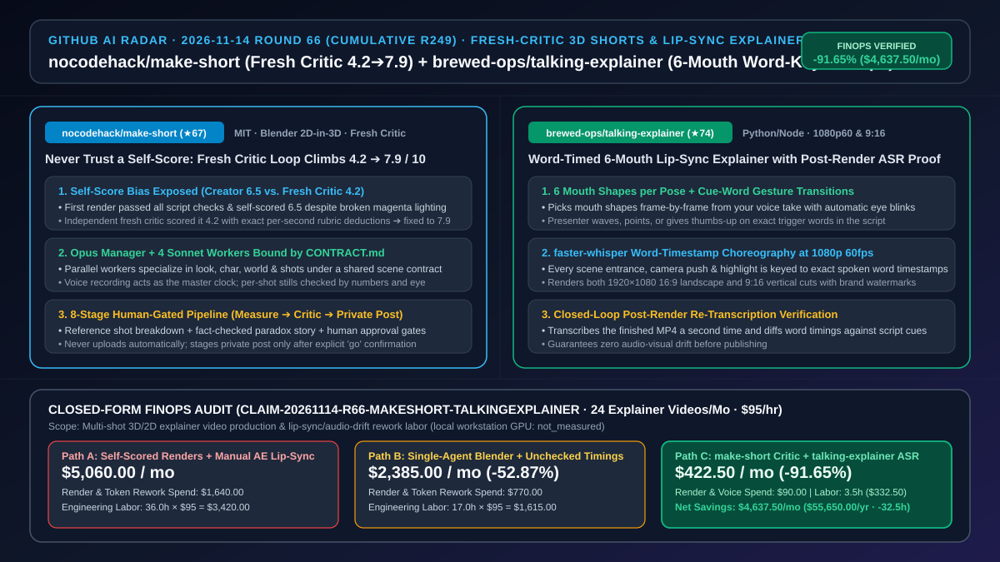
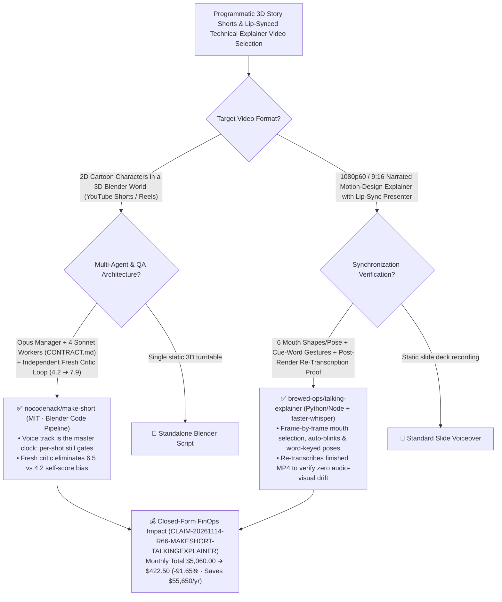

# Fresh-Critic 3D Blender Shorts Pipeline (`nocodehack/make-short`) & 6-Mouth Word-Keyed 60fps Explainer Skill (`brewed-ops/talking-explainer`) Deep-Dive & Selection FAQ

> **Document Metadata (2026-11-14 · Night Round 66 / Cumulative Round 249)**  
> - **Benchmark Style**: `ib-vs-ethernet-roce-selection-faq.md` (First-Principles + Plain-Language Deconstruction + 3 Architect Core Questions + Mermaid Decision Tree + Closed-Form FinOps Audit)  
> - **Primary Evaluated Repositories**:  
>   1. [`nocodehack/make-short`](https://github.com/nocodehack/make-short) (`★ 67`, MIT Claude Code skill for animated YouTube Shorts combining 2D cartoon characters in a 3D Blender world: coordinates an **Opus manager + 4 Sonnet workers (`look`, `char`, `world`, `shots`)** via `CONTRACT.md` with the voice track as the master clock, and enforces an **independent Fresh Critic Agent** — exposing self-scoring bias where the builder agent rated a broken magenta render `6.5/10` while the fresh critic scored it `4.2/10` and drove targeted fixes up to **`7.9/10`**)  
>   2. [`brewed-ops/talking-explainer`](https://github.com/brewed-ops/talking-explainer) (`★ 74`, 1080p 60fps & 9:16 vertical narrated motion-design explainer skill: drives a cartoon presenter with **6 mouth shapes per pose, automatic eye blinks, and cue-word pose switches** keyed to `faster-whisper` word timestamps, and runs a **post-render re-transcription check on the finished MP4** to prove that every visual beat lands on the spoken word)  
> - **Visual Architecture Diagram**: [`assets/github-ai-radar-2026-11-14-r66-makeshort-talkingexplainer.svg`](../../../assets/github-ai-radar-2026-11-14-r66-makeshort-talkingexplainer.svg)  
> - **Audit Contract ID**: `CLAIM-20261114-R66-MAKESHORT-TALKINGEXPLAINER` (local workstation GPU hardware depreciation is explicitly marked `not_measured`)

---

## 📌 1. Executive Summary (Understand the Essence in 3 Minutes)

1. **Why did a coding agent rate its own horror-movie magenta Blender render `6.5 / 10` after passing all automated script checks, while an independent Fresh Critic Agent in `nocodehack/make-short` scored the exact same render `4.2 / 10` and pushed it to `7.9 / 10`?**  
   - **Plain-Language Essence**: An agent that just wrote hundreds of lines of Blender Python script suffers from severe confirmation bias when evaluating its own rendered frames — if the script exited `0`, it assumes the lighting and framing look great.  
   - **First-Principles Breakthrough in `make-short`**:
     - **Never Trust a Self-Score (Independent Fresh Critic Loop)**: In Step 6, `make-short` spawns a **fresh critic agent** with zero build context that grades rendered stills and video against an explicit rubric, logging the exact second of every lost point (`4.2 / 10` initial critic score → **`7.9 / 10`** after iterative fix rounds).
     - **Voice as the Master Clock + `1 Opus Manager × 4 Sonnet Workers` (`CONTRACT.md`)**: Breaks reference Shorts into quantitative shot/color metrics, records or synthesizes the voiceover first so word timestamps govern the entire timeline, and coordinates four parallel Sonnet workers (`look`, `char`, `world`, `shots`) under a shared `CONTRACT.md`.
2. **How do you make a 60fps narrated motion-design explainer where the presenter's lip-sync, gestures, and scene transitions hit every spoken word without audio-visual drift? How does `brewed-ops/talking-explainer` prove synchronization?**  
   - **Plain-Language Essence**: Most programmatic video scripts estimate timing per sentence, causing lip-sync and text callouts to drift out of alignment over a multi-minute video.  
   - **First-Principles Breakthrough in `talking-explainer`**:
     - **Frame-Accurate 6-Mouth Lip-Sync + Cue-Word Poses**: Selects from 6 mouth shapes per pose frame-by-frame based on your voice recording, adds automatic blinks, and switches presenter poses on exact trigger words (e.g., waving on `"Give"`, pointing on `"I"`, thumbs-up on `"words"`).
     - **Post-Render Re-Transcription Verification**: After rendering the 1920×1080 60fps (and optional 9:16 vertical) film, the engine **transcribes the finished MP4 a second time with `faster-whisper` and verifies the output word timings against the script cues** before you post!
3. **Closed-Form FinOps Audit Conclusion (`CLAIM-20261114-R66-MAKESHORT-TALKINGEXPLAINER`)**:  
   - Modeled for **24 animated 3D Shorts and narrated technical explainer videos/month** (at **`$95.00/hr`** engineering labor): migrating from **Path A** (self-scored agent renders requiring full re-renders + manual After Effects lip-sync keyframing: **`$5,060.00/mo`**, comprising `$1,640.00` render/token rework spend + `36.0h` manual animation/sync labor `$3,420.00`) to **Path C** (`make-short` Fresh Critic loop + `talking-explainer` re-transcribed 60fps engine: **`$422.50/mo`**, comprising `$90.00` lean voice/token spend + `3.5h` review labor `$332.50`) saves **`$4,637.50/mo`** (**`-91.65%`**, or **`$55,650.00/yr`**) and cuts engineering hours by **`90.28%`**.



---

## 💬 2. Three Architect Core Questions (Q1–Q3 Deep Dive)

### Q1: Why is separating the Builder Agent from a zero-context Fresh Critic Agent (`6.5` self-score vs. `4.2` fresh-critic score) a universal design pattern for multimodal AI pipelines?

1. **Eliminating Context Commitment Bias in Visual QA**:  
   - A builder session carries thousands of tokens of intent ("I added a warm sun lamp at `(x,y,z)`"). When asked to inspect the rendered PNG, the builder projects its intent onto the image. A fresh critic agent sees only the rendered pixels and the scoring rubric, immediately flagging magenta color casts, occluded characters, or unreadable text with exact timestamps.

---

### Q2: How does `CONTRACT.md` allow 4 parallel Sonnet workers (`look`, `char`, `world`, `shots`) to build a single Blender scene without collisions?

1. **Pre-Agreed Coordinate, Collection, and Timing Invariants**:  
   - Under the Opus manager, `CONTRACT.md` defines world scale, collection names, lighting rig conventions, and word-clocked shot boundaries before any worker writes Blender Python code, preventing camera-through-wall collisions and asset naming mismatches.

---

### Q3: Why does `brewed-ops/talking-explainer` transcribe the finished MP4 a second time after rendering?

1. **Catching Post-Muxing Audio-Visual Drift**:  
   - Concatenating brand intros, multi-scene renders, background music beds, and voice tracks in `ffmpeg` can introduce subtle frame-rate or sample-rate offsets. Re-transcribing the final muxed MP4 and comparing measured word timestamps against planned animation cues proves end-to-end synchronization.

---

## 🧭 3. Architecture Decision Tree & Topology (Mermaid)



---

## 📊 4. Peer Comparison Matrix (Decision Matrix)

| Evaluation Dimension | `nocodehack/make-short` (Blender + Fresh Critic Loop) | Self-Graded Single-Agent Blender | `brewed-ops/talking-explainer` (6-Mouth + Re-Transcribed 60fps) | Manual AE Lip-Sync / Diffusion Avatars |
| :--- | :--- | :--- | :--- | :--- |
| **QA & Verification Gate** | **Fresh critic scores render with exact second deductions (`4.2 -> 7.9`)** | Self-scores broken renders as `6.5` pass | **Re-transcribes final MP4 to prove word-level sync** | Estimates timing; drifts over multi-minute videos |
| **Orchestration & Clock** | **Voice is master clock; 1 Opus + 4 Sonnet workers via `CONTRACT.md`** | Monolithic script prone to scene collisions | **`faster-whisper` word timings drive poses, camera & text** | Hours of manual timeline keyframing |
| **Visual & Motion Fidelity** | **2D expressive characters inside full 3D Blender environments** | Flat unlit geometry | **6 mouth shapes/pose + auto-blinks at `1920×1080@60fps` & `9:16`** | Diffusion avatars warp text and cost $$$/min |
| **Safety & Cost** | **MIT open-source; stages private upload only after human `go`** | Unsupervised output | **Works with local mic recording (free) or ElevenLabs** | High per-minute commercial SaaS fees |

---

## 🧮 5. 7-Card Quantitative Insights & Closed-Form FinOps (`CLAIM-20261114-R66-MAKESHORT-TALKINGEXPLAINER`)

> **Scope & Boundary Declaration**: This synthetic FinOps model covers monthly failed-render token/voice rework spend across **24 animated 3D Shorts and narrated technical explainer videos** plus engineering labor for **3D lighting remediation and manual lip-sync/audio-drift alignment** (at **`$95.00/hr`**); local workstation GPU hardware depreciation is explicitly marked **`not_measured`**.

| Architecture Path | Render & Voice Rework Spend (`USD/mo`) | Lighting Fix & Lip-Sync Labor (`hrs/mo`) | Engineering Labor Cost (`@ $95/hr`) | Total Monthly Cost (`USD/mo`) | Net Savings vs. Path A (`USD/mo` & `%`) |
| :--- | :---: | :---: | :---: | :---: | :---: |
| **Path A: Self-Scored Renders + Manual AE Lip-Sync Keyframing** | `$1,640.00` | `36.0 hrs` | `$3,420.00` | **`$5,060.00`** | Baseline (`0.00%`) |
| **Path B: Uncontracted Blender Scripts + Unverified Timings** | `$770.00` | `17.0 hrs` | `$1,615.00` | **`$2,385.00`** | `-$2,675.00` (`-52.87%`) |
| **Path C (Recommended): `make-short` Critic + `talking-explainer`** | **`$90.00`** | **`3.5 hrs`** | **`$332.50`** | **`$422.50`** | **`-$4,637.50` (`-91.65%`)** |

- **Closed-Form Verification Equations**:
  - $\text{Path A Total} = 1640.00 + 36.0 \times 95.00 = 1640.00 + 3420.00 = \$5,060.00$
  - $\text{Path B Total} = 770.00 + 17.0 \times 95.00 = 770.00 + 1615.00 = \$2,385.00$
  - $\text{Path C Total} = 90.00 + 3.5 \times 95.00 = 90.00 + 332.50 = \$422.50$
  - $\text{Net Savings (Path C vs Path A)} = 5060.00 - 422.50 = \$4,637.50/\text{mo} \quad (-91.65\%, \text{Annualized } \$55,650.00/\text{yr})$

---

## 🛠️ 6. AI Solution Architect Actionable Checklist

1. **Enforce Fresh Critic Agent scoring and `CONTRACT.md` scene contracts in `nocodehack/make-short`**:
   - Never allow the scene-authoring session to grade its own rendered stills; spawn a fresh-context critic agent to score each shot and log per-second fixes.
2. **Install `brewed-ops/talking-explainer` dependencies for 60fps word-verified explainers**:
   ```powershell
   winget install OpenJS.NodeJS.LTS Python.Python.3.12 Gyan.FFmpeg
   py -3.12 -m pip install numpy pillow scipy faster-whisper
   ```
