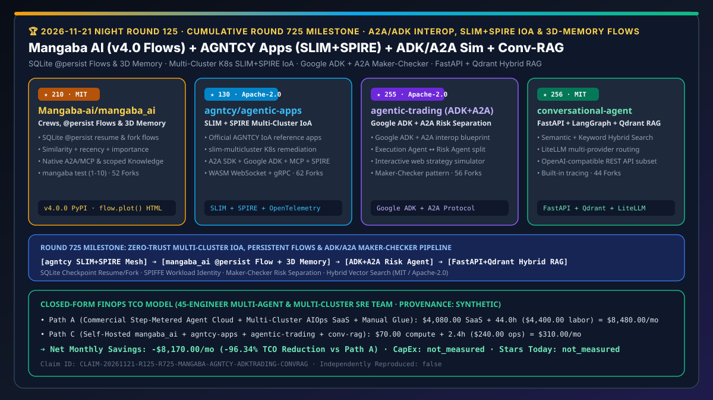
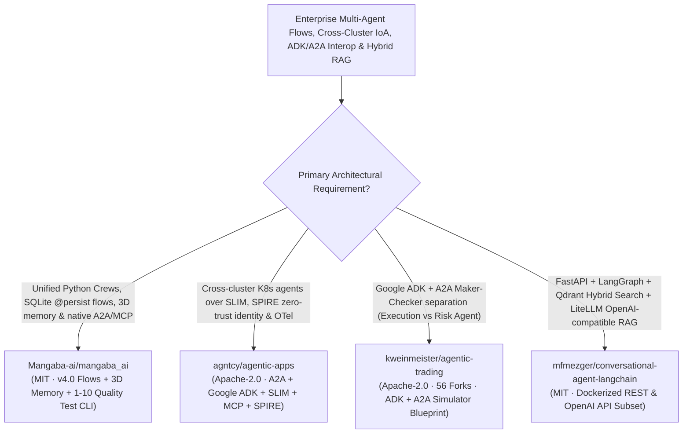
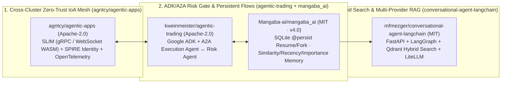
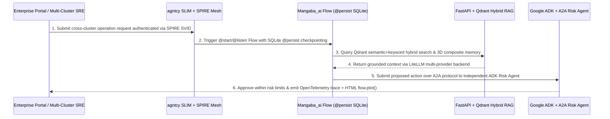

# [Round 725 Milestone] Persistent-Flow & 3D-Memory A2A/MCP Framework (`Mangaba-ai/mangaba_ai`), AGNTCY SLIM+SPIRE Multi-Cluster IoA Apps (`agntcy/agentic-apps`), Google ADK+A2A Maker-Checker Reference (`kweinmeister/agentic-trading`) & FastAPI+LangGraph+Qdrant Hybrid RAG (`mfmezger/conversational-agent-langchain`) Selection & Architecture FAQ

> **Document Type**: Enterprise AI Solution Architect Selection & Integration Guide (GitHub Trending AI Radar — 2026-11-21 Night Round 125 / **Cumulative Round 725 Milestone**)
> **Covered Repositories**: [`Mangaba-ai/mangaba_ai`](https://github.com/Mangaba-ai/mangaba_ai) (`★ 210`, `52 forks`, `MIT` — v4.0.0 Python multi-agent framework unifying Crews, `@persist` SQLite resumable/forkable event Flows, 3D composite Memory, scoped Knowledge & native A2A/MCP protocols) · [`agntcy/agentic-apps`](https://github.com/agntcy/agentic-apps) (`★ 130`, `62 forks`, `Apache-2.0` — AGNTCY Internet-of-Agents reference monorepo combining **A2A SDK, Google ADK, SLIM messaging, MCP, SPIRE zero-trust identity & OpenTelemetry** across Kubernetes clusters) · [`kweinmeister/agentic-trading`](https://github.com/kweinmeister/agentic-trading) (`★ 255`, `56 forks`, `Apache-2.0` — Google ADK + A2A interoperability simulator separating strategy execution and risk management agents) · [`mfmezger/conversational-agent-langchain`](https://github.com/mfmezger/conversational-agent-langchain) (`★ 256`, `44 forks`, `MIT` — FastAPI + LangGraph + LiteLLM + Qdrant hybrid-search RAG backend with an OpenAI-compatible API subset)
> **Core Scenario**: Celebrating our **725th Cumulative Deep-Dive FAQ Milestone**, how enterprise architects build a standards-based multi-agent production stack: **unifying resumable `@persist` SQLite flows and 3D semantic memory (`mangaba_ai`)**, **enforcing Maker-Checker risk separation via Google ADK and A2A (`agentic-trading`)**, **securing cross-cluster Kubernetes agent communication with SLIM, SPIRE, and OpenTelemetry (`agntcy/agentic-apps`)**, and **serving hybrid Qdrant + LiteLLM RAG over an OpenAI-compatible FastAPI backend (`conversational-agent-langchain`)**.

---

## 1. 📌 Executive Summary (One-Line Selection Verdict)

1. **Need a single cohesive Python framework (`pip install mangaba`) that replaces fragmented CrewAI + LangChain glue with SQLite-persisted event Flows (resume/fork), 3D composite memory (`similarity + recency + importance`), scoped document Knowledge, and native A2A/MCP interoperability** ➔ Choose **[`Mangaba-ai/mangaba_ai`](https://github.com/Mangaba-ai/mangaba_ai) (`★ 210`, `52 forks`, `MIT`)**.
   - **Plain-English Mechanism**: In v4.0.0, `mangaba_ai` delivers event-driven **Flows** (`@start`, `@listen`, `@router`, `and_`/`or_` combinators, typed Pydantic state, SQLite `@persist` with resume/fork, and `flow.plot()` HTML graphs), separate **Knowledge** (PDF, DOCX, Excel, JSON, CSV, URLs scoped per agent or crew), **Unified Memory** (composite recall weighting similarity + recency + importance with automatic fact extraction and deduplication), and a full CLI (`mangaba test` 1–10 quality grading and `mangaba train` human feedback loops).
2. **Need production reference architectures from the AGNTCY (Internet of Agents) consortium demonstrating cross-cluster Kubernetes remediation and root-cause analysis over `A2A SDK + Google ADK + SLIM + MCP + SPIRE + OpenTelemetry`** ➔ Choose **[`agntcy/agentic-apps`](https://github.com/agntcy/agentic-apps) (`★ 130`, `62 forks`, `Apache-2.0`)**.
   - **Plain-English Mechanism**: Provides 5 complete multi-agent reference systems—including **`slim-multicluster`** (cloud-hosted troubleshooting agent diagnosing Kubernetes issues across cluster boundaries using **SLIM, A2A SDK, Google ADK, MCP, and SPIRE zero-trust identity**), **`observability_app`** (SLIM telemetry distribution + OpenTelemetry RCA), and **`slim-cross-transport`** (bridging browser WebSocket WASM bindings and native gRPC participants on one SLIM node).
3. **Need a clean architectural reference showing how Google ADK (Agent Development Kit) agents interoperate over the Agent2Agent (A2A) protocol to decouple execution agents from independent risk-management agents** ➔ Choose **[`kweinmeister/agentic-trading`](https://github.com/kweinmeister/agentic-trading) (`★ 255`, `56 forks`, `Apache-2.0`)**.
   - **Plain-English Mechanism**: Created by Karl Weinmeister (`56 forks`), this simulator pairs a strategy agent with a separate risk-governance agent communicating strictly via **A2A** alongside a web simulator UI—serving as a blueprint for enterprise Maker-Checker governance patterns.
4. **Need a Dockerized FastAPI conversational RAG backend combining LangGraph, Qdrant semantic + keyword hybrid search, LiteLLM multi-provider routing, and an OpenAI-compatible REST API subset** ➔ Choose **[`mfmezger/conversational-agent-langchain`](https://github.com/mfmezger/conversational-agent-langchain) (`★ 256`, `44 forks`, `MIT`)**.
   - **Plain-English Mechanism**: Eliminates provider lock-in by routing across Azure OpenAI, Cohere, Ollama, and Google AI Studio via **LiteLLM**, indexing documents into **Qdrant** with hybrid search, and exposing an OpenAI-compatible API surface with built-in tracing.

---

## 2. 🎯 Architect & Customer Deep-Dive Q&A

### Q1: Why do enterprise multi-agent systems fail when scaling across teams and Kubernetes clusters—and how do `@persist` Flows, A2A Maker-Checker separation, and SLIM + SPIRE solve it?

- **Three Enterprise Scaling Bottlenecks Solved**:
  1. **Stateless Workflows & Flat Memory Decay (`Mangaba-ai/mangaba_ai`)**: Long-running agent flows crash without checkpointing, and naive vector memory treats stale trivia the same as critical facts. `mangaba_ai` adds `@persist` SQLite checkpointing (with `resume` and `fork`) and composite 3D memory (`similarity + recency + importance`).
  2. **Unchecked Execution Agents (`kweinmeister/agentic-trading`)**: Putting action logic and risk checks inside the same prompt invites self-approval bias. Separating the execution agent and risk-management agent across process boundaries via **Google ADK + A2A** enforces independent risk gating.
  3. **Insecure Cross-Cluster Agent Transport (`agntcy/agentic-apps`)**: When a central SRE agent diagnoses workloads across multiple Kubernetes clusters, `agntcy/agentic-apps` secures transport with **SLIM** and authenticates every agent and MCP tool call via **SPIRE (SPIFFE)** zero-trust identities and **OpenTelemetry** traces.
- **When to Choose Managed Cloud Services (Path B)**:
  - If all agents operate inside a single cloud boundary, use **Google Cloud Vertex AI Agent Engine** or **Azure AI Foundry Agent Service**.

### Q2: How do we wire an end-to-end Multi-Cluster IoA, ADK/A2A Risk-Gated & Hybrid RAG architecture?

1. **Cross-Cluster Zero-Trust Transport & Telemetry Layer (`agntcy/agentic-apps`)**:
   - Connect distributed agent nodes across Kubernetes clusters and browsers (WASM/WebSocket + gRPC) using **SLIM**, **SPIRE** workload identities, and **OpenTelemetry**.
2. **ADK + A2A Maker-Checker Governance Layer (`kweinmeister/agentic-trading` Pattern)**:
   - Require every high-impact action proposed by an execution agent to pass an independent **Google ADK + A2A** risk-governance agent check.
3. **Resumable Event-Flow & 3D Memory Orchestration Layer (`Mangaba-ai/mangaba_ai`)**:
   - Orchestrate multi-agent crews with `@start / @listen / @router`, SQLite `@persist` resume/fork, 3D composite memory, and `mangaba test` quality gates.
4. **Hybrid Vector Search & Multi-Provider RAG Layer (`mfmezger/conversational-agent-langchain`)**:
   - Serve document embeddings, Qdrant hybrid search, and LiteLLM routing via an OpenAI-compatible FastAPI service.

### Q3: What are the boundaries and disclaimers of this stack?

- **Key Strengths**:
  - **100% Permissive Open Source (`MIT` and `Apache-2.0`)** uniting **A2A, MCP, Google ADK, SLIM, SPIRE, LangGraph, LiteLLM, and Qdrant**.
- **Usage Boundaries**:
  - `kweinmeister/agentic-trading` is an educational simulator for demonstrating Google ADK + A2A interoperability and must never be used for live financial trading with real capital.

---

## 3. 🧭 Visual Architecture & Decision Diagrams

### 3.1 Solution Architect Selection Decision Tree

### 3.2 End-to-End Enterprise Reference Architecture

### 3.3 SPIRE Auth, `mangaba_ai` Persistent Flow, Qdrant Hybrid Retrieval & ADK/A2A Risk Verification Sequence

---

## 4. 📊 Peer Open-Source vs Commercial Cloud Selection Matrix

| Dimension | `Mangaba-ai/mangaba_ai` (`★ 210`) | `agntcy/agentic-apps` (`★ 130`) | `agentic-trading` (`★ 255`) | `conversational-agent-langchain` (`★ 256`) | Commercial Multi-Agent Cloud + AIOps SaaS (Path A) | Single-Cloud Managed Agent PaaS (Path B) |
| :--- | :--- | :--- | :--- | :--- | :--- | :--- |
| **Core Role** | Python Crew/Flow/3D-Memory/A2A/MCP framework | SLIM+SPIRE+A2A+ADK multi-cluster reference apps | Google ADK + A2A Maker-Checker reference | FastAPI + LangGraph + Qdrant + LiteLLM RAG backend | Step-metered multi-agent cloud + K8s AIOps SaaS | Vertex AI Agent Engine / Azure Foundry |
| **Architectural Edge** | **SQLite `@persist` resume/fork + 3D memory + `mangaba test`** | **Cross-cluster K8s remediation via SLIM, SPIRE & OTel** | **Clean Google ADK + A2A execution vs risk decoupling** | **Qdrant hybrid search + LiteLLM + OpenAI-compatible REST** | High per-step fees; proprietary cross-cluster connectors | Locked to single cloud IAM; lacks SLIM/SPIRE cross-cluster mesh |
| **License** | `MIT` | `Apache-2.0` | `Apache-2.0` | `MIT` | Proprietary SaaS | Proprietary Cloud PaaS |
| **Monthly TCO (45-Eng Team)** | **`$310.00/mo` combined** (`$70.00` compute + `2.4h` ops) | Included in `$310.00/mo` stack | Included in `$310.00/mo` stack | Included in `$310.00/mo` stack | **`$8,480.00/mo`** (`$4,080.00` SaaS + `44.0h` custom glue labor) | `~$2,750.00/mo` (managed agent + vector instances) |

---

## 5. 🧪 Quantitative ROI / FinOps TCO Model & 7-Card Report

> **📊 Provenance & Closed-Form Audit Declaration**:
> - **Provenance**: `synthetic` (45-engineer enterprise multi-agent orchestration, multi-cluster SRE & RAG platform workload model; `independently_reproduced = false`; `base_hardware_capex = not_measured`; `track_b_stars_today = not_measured`).
> - **Closed-Form Equations**:
>   - **Path A (Commercial Step-Metered Multi-Agent Cloud + Commercial Multi-Cluster K8s AIOps SaaS + Managed Vector DB + Manual State-Recovery & Cross-Cluster Identity Engineering)**: Monthly SaaS subscriptions **`$4,080.00`** + custom checkpointing, A2A & identity glue labor **`44.0h × $100.00/h = $4,400.00`** = **`$8,480.00/mo`**.
>   - **Path C (Self-Hosted `Mangaba-ai/mangaba_ai` + `agntcy/agentic-apps` + `kweinmeister/agentic-trading` + `mfmezger/conversational-agent-langchain`)**: Shared container & Qdrant compute **`$70.00`** + flow & SLIM/SPIRE policy maintenance **`2.4h × $100.00/h = $240.00`** = **`$310.00/mo`**.
>   - **Net Savings vs Path A**: **`-$8,170.00/mo`** (**`96.34%`** cost reduction).

| Architecture Option | API / SaaS / Compute | Multi-Agent Platform Labor (`$100/h`) | Total Monthly TCO | Net Savings vs Path A | Key Architectural Outcome |
| :--- | :---: | :---: | :---: | :---: | :--- |
| **Path A: Commercial Multi-Agent Cloud + Multi-Cluster AIOps** | `$4,080.00` | `44.0h` (`$4,400.00`) | **`$8,480.00`** | Baseline | Expensive step billing; manual cross-cluster auth glue |
| **Path B: Single-Cloud Managed Agent PaaS + Managed Vector DB** | `$1,550.00` | `12.0h` (`$1,200.00`) | **`$2,750.00`** | `-$5,730.00` (`-67.57%`) | No local SQLite `@persist` fork, 3D memory, or SLIM/SPIRE mesh |
| **Path C: `mangaba_ai` + `agntcy` + `adk-a2a` + `conv-rag`** | **`$70.00`** | **`2.4h` (`$240.00`)** | **`$310.00`** | **`-$8,170.00` (`-96.34%`)** | **`@persist` flows + SLIM/SPIRE zero-trust + ADK/A2A risk gate** |

- 🔗 **7-Card 4:5 Visual Report**: [`workshops/github-trending-radar/cards.en.html`](../cards.en.html) · [`cards.html`](../cards.html)

---

## 6. 🛠️ Enterprise Adoption & Architecture Review Checklist

- [ ] **1. Standardize Resumable Flows & 3D Memory on `Mangaba-ai/mangaba_ai`**: Enable `@persist` SQLite checkpointing for flow resume/fork and run `mangaba test` (1–10 quality grading) in CI.
- [ ] **2. Enforce Maker-Checker Governance via `kweinmeister/agentic-trading` Patterns**: Decouple execution agents from risk-validation agents using Google ADK and the A2A protocol.
- [ ] **3. Secure Multi-Cluster Agent Topologies with `agntcy/agentic-apps`**: Adopt SLIM transport, SPIRE workload identities, and OpenTelemetry tracing across Kubernetes boundaries.
- [ ] **4. Deploy `mfmezger/conversational-agent-langchain` for Hybrid RAG**: Run the Dockerized FastAPI + LangGraph + Qdrant hybrid-search backend with LiteLLM multi-provider routing.
